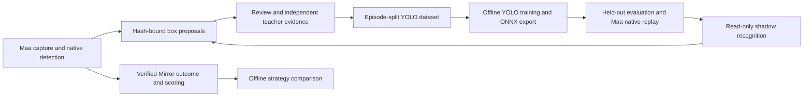

# Maa-native sinner detection and Mirror learning implementation

## Contract and architecture

October11 clarification: **box means the account's owned identities**, opened
by clicking each sinner. Detector bounding boxes are supporting vision only.
The finishing priorities are a revisioned full identity index / owned-inventory
reconciliation, and evidence-backed Mirror self-label / learning. A public index
never marks an identity owned; an incomplete account scan never marks it absent.

Identity records use game personality ID as key, with independent EN/JP/ZH titles,
source revision/hash, and nullable missing keyword/skill facts. The retained
localization currently yields184 playable IDs; the old statics yield128 facts.
Both are partial until reconciled against a current complete catalogue. HuiJi
Personalities and Personalitypassives are intended sources; current raw access
returns403, so search snippets are not imported as a complete JSON database.

MuMu ownership collection uses native Maa OCR and native TemplateMatch for the
Owned checked / ALL unchecked controls, a unique sinner header and hash-bound
navigation intent. Sidebar filters only change the viewed sinner. Ordinary click
opens the gallery; holding a library card opens its details. Known guide/detail
return arrows are native-matched and closed once. Every observed card retains
its OCR tokens and source image; exact normalized title matching only, unknown
or low-confidence rows remain unresolved. Level/uptie stay null if unproven.
End-of-list coverage and all12 sinners are required before full inventory claims.

Implementation order:
1. Refresh and version the whole ID catalogue, fill missing aliases/facts and
   compare with current Wiki inventory. Reject NPCs/duplicate IDs.
2. Scan twelve owned galleries, support bounded scrolling and independent end
   detection, reconcile exact aliases, retain unresolved rows and account hashes.
3. Feed independently verified page/card outcomes to the correction queue;
   train/export/evaluate ONNX offline, then replay via Maa native recognizers.
4. Learn Mirror rankings from complete verified outcome episodes, measure HP,
   time and expenses, and compare held-out policies before any promotion.
Completion requires a real full inventory round trip and a trained/evaluated
native model; current protocol tests or progression90 alone do not satisfy it.

Pinned runtime: MaaFramework5.12.2, ProjectInterfaceV2, Python Agent and MXU.
Maa provides inference; it does not itself automatically train or approve labels.
Use its YOLOv8/YOLO11 ONNX protocol, `model/detect`, zero-based `expected`
indices and native `run_recognition_direct`. Training dependencies are offline
tools only, never a second gameplay controller or a Python inference replacement.

References:
- [Pinned protocol](https://github.com/MaaXYZ/MaaFramework/blob/f625a60edeccd4549f9a71c0f74628d827ade8fb/docs/en_us/3.1-PipelineProtocol.md)
- [Official detection recipe](https://github.com/MaaXYZ/MaaNeuralNetworkCookbook/tree/main/NeuralNetworkDetect)
- [Wiki sinners](https://limbuscompany.huijiwiki.com/wiki/罪人)
- [Wiki current-season reference](https://limbuscompany.huijiwiki.com/wiki/名与蛛之镜)

## Stages and acceptance

| Stage | Implementation | Acceptance / real-device boundary |
|---|---|---|
|1 offline foundation|12 stable sinner classes, box validation, proposal queue, episode deduplication, YOLO export, explicit run progression score, Wiki provenance|Tests/retained-frame audit; no trained-model claim|
|2 data collection|Maa native template/OCR teachers or reviewed card boxes; uncertain NN boxes remain proposals; correction creates a new review|**MuMu required**: English/Japanese card selection, party details and battle HUD; identities/skins/scales/occlusion and negatives|
|3 train/export|Official YOLO11n workflow, fixed seed, opset17 ONNX, raw pre-NMS output, hashes and split manifest|Every class represented in train/validation/test by independent episodes; no adjacent-frame leakage|
|4 evaluate/shadow|Native Maa replay of held-out images, per-class precision/recall/IoU, unknown/background tests, speed, drift queue|**MuMu required**: read-only shadow, same single controller; no model-generated click|
|5 controlled integration|Replace fixed deployment boxes only after model/native replay and fresh identity agreement; retain count/order/intent/successor gates|**MuMu required**: bounded deployment with selected ordinal proof; budget and pending transactions unchanged|
|6 strategy learning|Gift/theme/trial candidate rankings plus outcome, team/system/HP/time/resource coverage; offline comparison with current heuristics|Multiple independent runs; distinguish prediction from causal gift benefit, real payout from victory|

## Labels and self-label policy

The box target is the **visible sinner card/unit**, not a fixed grid cell or OCR
text box. Class order is storage.SINNERS; Sinclair class9 is game sinner11,
Outis class10/game12, Gregor class11/game13. Dante is not a detector class.
Missing/occluded objects are not filled in from slot coordinates. Keep duplicates
and conflicting class predictions in the correction queue, not the training set.

Automatic labels are proposals. Promotion requires a hash-bound review of the
actual visible card boundary and identity, or separately audited native teachers.
A model cannot certify its own prediction. Validation/test reviews are independent
of that model. Duplicate images across episodes/splits refuse. Complete negative
frames need explicit review; partial labels cannot be silently treated as negatives.
Readiness is a coverage gate, not proof of good accuracy. Model promotion is separate
and remains disabled until native replay and real-device shadow are verified.

## Wiki data and scoring

Wiki names/effects/recipes are revisioned background facts, never screen truth,
owned inventory, current resource cost or reward proof. Keep URL, retrieval method,
revision if available and content hash. On October11 the public raw JSON request
returned403; search-index metadata is explicitly distinguished from API data.
Do not bypass access restrictions or infer current costs from the old 湖之镜 page.
Raw exports stay in build; normalized facts require review before policy use.

Run progression score v1 is70*verified floors/5 +20*verified victory +10*verified
reward. It measures completion only. Efficiency/survival/gift utility scores stay
unknown without measured HP/time/cost; missing data is not zero loss. Incomplete
or unpaid runs are censored outcomes and cannot become positive strategy targets.
Score calculation is read-only and does not update the run ledger or rotation.

## Immediate MuMu request when stage1 passes

Ask the user to open **Limbus**, identify EN/JP, and leave the party/card page
visible. First collect read-only screenshots. Ask before game navigation if the
current unpaid run would be disturbed; never touch FGO or replay old claims.
Need at least three independent sessions per split and20 reviewed instances per
class/split as the initial collection target, plus reviewed negatives. Final model
quality is decided by held-out metrics, not that count alone.
