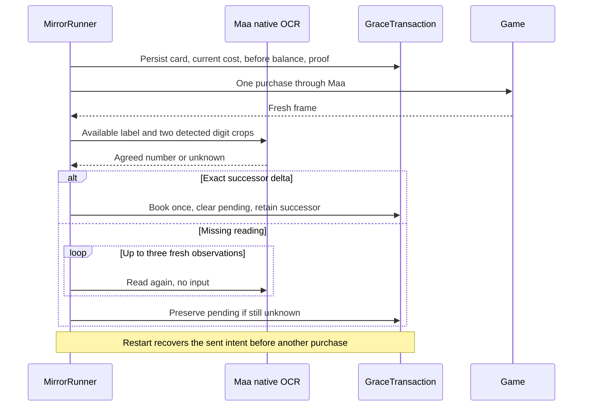
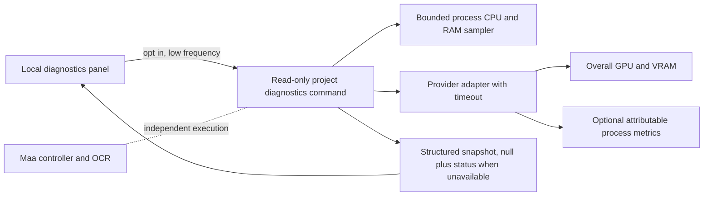

# Recovery, settings and local diagnostics plan

Status: star balance recovery and decision traces implemented; current-page product
test evidence is tracked in acceptance. Local diagnostics now has a backend sampler
and read-only CLI; GUI integration and process-GPU attribution remain unverified.
The current staged plan and six engineering views live in
[wiki chapter9](wiki/en_us/9-execution-plan.md). This document retains the original
diagnostic interface contract; it is not a replacement for current acceptance.

1. Reproduce the actual `Grace purchase successor balance not proven` frame with
   native Maa OCR. Preserve the existing card4 intent. Two anchored detected-digit
   crops must agree; missing/contrary evidence does not become a guessed balance.
2. Reconcile a sent purchase from retained before-frame hash, visible card cost,
   same scope/configuration and fresh exact balance. Retry observations up to3,
   not the purchase. Continue remaining selections through the original pipeline.
3. Restore pinned custom MXU GitHub settings, portrait order and base star cards.
   Save actual PI options, retain other profile/queue settings and enforce idle
   editing. No simulated enhancement controls. Reopen/read back before acceptance.
4. Show real decision components and final rule/priority scores in console and
   run.log, separating manually assigned priority from neural shadow predictions.
5. Add optional local resource diagnostics, with the contract below. Verify the
   wiki first, update the feature-local views, implement, then compare code and
   actual GUI readings to the plan. DSH must not run a concurrent controller.

Diagnostics interface: `version`, `sampled_at`, `interval_ms`, process samples
`role/pid/cpu_percent/rss_bytes/status`, system GPU samples
`provider/device_name/util_percent/vram_used_bytes/vram_total_bytes/status`, and
separate optional process GPU samples with explicit metric provenance. Unknown
values are null plus a reason, never zero. CPU percent semantics must state how
cores are normalized. Do not report whole-GPU load as MaaLimbus load. No UUID,
username, raw command output, machine identifier or external upload. A bounded
asynchronous collector independent of the controller, opt-in low-frequency panel,
no elevation; stopped/missing/unsupported providers are normal states.

The diagnostics collector must not own or request a game controller. This planned
view is not proof that GPU attribution or the panel has been implemented. Star
recovery and telemetry do not establish five-floor completion, receipt or rotation.
