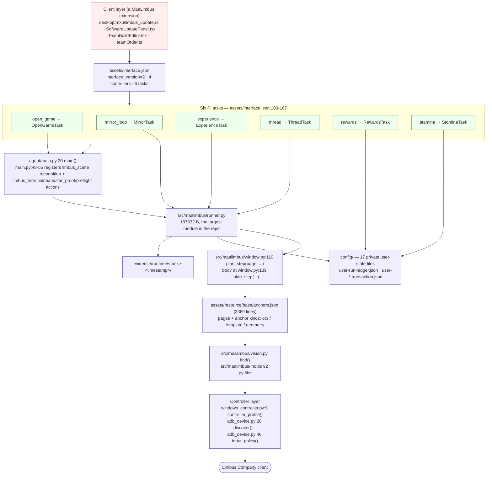
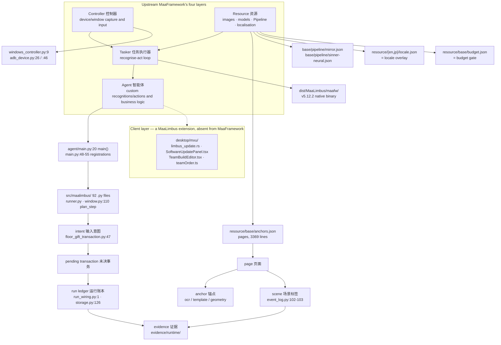

# 1 Overview and Glossary

[中文](../zh_cn/1-overview.md) · [← Index](index.md)

This chapter answers four questions: what MaaLimbus is, what each of the six main tasks does, how far completion actually goes, and how to read the terms and the dependency/license boundaries. Every technical claim is bound to a verifiable anchor (`relative/path:line`, a test name, or an `evidence/runtime/...` path); anything unverifiable is explicitly marked "not accepted".

## 1.1 What this is & how complete it is

### The goal chain

- In one sentence: **five Hard Mirror Dungeon floors → verified rewards → saved-team rotation → repeat**; after that, budgeted Enkephalin conversion/refill, mail and daily missions (`PROJECT.md:9-10`, `README.md:25`).
- Technical positioning: MaaFramework Win32 controller + ProjectInterface V2 + MXU + Python Agent (`AGENTS.md:3`), targeting the Limbus Company native Windows client, shipping English and Japanese resource packs (`README.md:8`, `README.md:23`).
- The upstream version is pinned: `pyproject.toml:10` → `dependencies = ["maafw==5.12.2", "numpy>=2", "opencv-python>=4.10"]`; the runtime package on this machine bundles the same release, v5.12.2 (`docs/maaframework-conformance.md:24-27`).
- There are only two Pipeline files: `assets/resource/base/pipeline/mirror.json` and `assets/resource/base/pipeline/sinner-neural.json`.

### The six main tasks

The tasks are declared in `assets/interface.json:103-167`; labels and descriptions come from the shipped i18n (`assets/i18n/zh_cn.json:75-86`, `assets/i18n/en_us.json:75-86`, `assets/i18n/ja_jp.json`).

| task name | entry | English label | What the repository says it does |
| --- | --- | --- | --- |
| `open_game` | `OpenGameTask` (`assets/interface.json:105-107`) | Open game (`assets/i18n/en_us.json:75`) | Launch Android through Maa and verify the foreground; leave an already-open game running. On Windows, connect the game window first (`assets/i18n/en_us.json:76`) |
| `mirror_loop` | `MirrorTask` (`assets/interface.json:112-114`) | Mirror Dungeon (`assets/i18n/en_us.json:77`) | Use the global saved builds and deployment order; choose one team or a rotation here. Hard by default; spending requires a configured budget (`assets/i18n/en_us.json:78`) |
| `experience` | `ExperienceTask` (`assets/interface.json:131-133`) | Experience Luxcavation (`assets/i18n/en_us.json:79`) | Uses a saved team and navigates through Drive to Luxcavation; an unfinished Mirror run blocks navigation (`assets/i18n/en_us.json:80`) |
| `thread` | `ThreadTask` (`assets/interface.json:141-143`) | Thread Luxcavation (`assets/i18n/en_us.json:81`) | Uses a saved team and navigates through Drive to Luxcavation; an unfinished Mirror run blocks navigation (`assets/i18n/en_us.json:82`) |
| `rewards` | `RewardsTask` (`assets/interface.json:151-153`) | Collect rewards (`assets/i18n/en_us.json:83`) | Claim rewards for the current cleared Mirror run with its module budget (`assets/i18n/en_us.json:84`) |
| `stamina` | `StaminaTask` (`assets/interface.json:161-163`) | Convert Enkephalin (`assets/i18n/en_us.json:85`) | Budgeted conversion recognition is under development; currently captures evidence and stops without spending (`assets/i18n/en_us.json:86`) |

The four controllers are declared in the same file: `windows-window`, `windows-background`, `windows`, `mumu-adb` (`assets/interface.json:14-68`); resources are declared as `en`/`jp` (`:69-86`).

### Completion, stated honestly

The table at `README.md:45-54` is the most concentrated statement of the current standard:

| Feature | Verified range | Not finished |
| --- | --- | --- |
| Windows / ADB control | MuMu-native Maa input, randomised in-box landing, process and single-controller gates | Windows game input and Japanese live operation |
| Global settings and tasks | Six MXU main task entries, global team, Mirror single/rotation selection | Full global-settings edit-and-restart, and GUI Start dispatch acceptance |
| Hard Mirror Dungeon | Actual English five floors (the CLI / `window_step` path, see below), complete collectible receipts, real paid reward claim, Team2→Team7 reentry | Arbitrary layouts, shop/fusion, long unattended farming |
| Battle and gift picking | Native touch WinRate/START, independent Hard/title gates, bounded drags | Smart card assignment, full strategy, Japanese |
| Experience / Thread Luxcavation | Independent task entries referencing saved teams | Actual stages, cost and battle flow; currently stops on the captured page |
| Enkephalin conversion / daily rewards | Independent entries and budget foundation | Actual pages and credit; currently stops on the captured page |
| GitHub updates | Desktop launcher wired to cache, persistent rate limiting, verification, config-preserving install / failure rollback | Public new-version download and a visibly restarted version |
| Black-box learning | Reviewed image hashes, training data split by real run | Two samples today, model not trained or enabled |

**A qualifier on the "Hard Mirror Dungeon — actual English five floors" row**: that five-floor evidence comes from the CLI / `tools/window_step.py` path over retained frames, **not** from a packaged MXU end-to-end run. Section 7.3 of chapter 7 records the fact pointing the other way: `dist/MaaLimbus` can currently only run the entry chain, and clicking `mirror_loop` in MXU does not finish (`docs/handover-2026-10-08.md:130-132`, `dist/MaaLimbus/build-info.json:11-15`; see [chapter 7](7-quality.md)). The two statements coexist without contradiction: the capability is proven on the source/CLI path and not yet proven in the packaged distribution form — so do not read "verified range" in this table as "usable as a package".

Three further standards you must know:

- **There is no accepted release package**, and "the process started, the task returned success, the offline tests passed" does not mean a Mirror Dungeon clear (`README.md:31-32`). One English Hard five-floor chain (including reward claim and saved-team rotation reentry) has real MuMu evidence (`README.md:23`, `README.md:25`), but arbitrary layouts, versions and long unattended farming are not promised.
- **Three proofs are still missing**: a live run whose journal carries `pre_battle_identity_report`, a GET-overlay acknowledgement bound to a real purchase, and a full floor 2→5 run (`PROJECT.md:75-77`).
- **The shop GET overlay** has been read offline and `ShopTransaction.reserve_overlay_acknowledgement` is implemented (`docs/acceptance.md:19-24`), but the runner does not call it yet (`docs/acceptance.md:26-28`, `wired_in_runner=false`), so a real purchase still stops safely with `shop_receipt_successor_not_proven`. **Black-box learning** has only 2 samples / 2 episodes of data preparation, with `training_ready=False`, `model_trained=False`, `production=False` (`docs/acceptance.md:160`).

**Where the evidence lives**: run evidence under `evidence/runtime/<task>-<yyyymmdd-hhmmss>/`, launch records in `build/native-launch*.json`, logs in `build/native-live.*.log` (`README.md:64`). This repository currently holds 918 run directories of that shape (local directory count, 2026-10-12; the number grows with every run).

### Figure 1: the project at a glance

## 1.2 Glossary

### MaaFramework's four layers, plus one MaaLimbus extension

Upstream splits the system into Controller / Resource / Tasker / Agent. MaaLimbus keeps that vocabulary and gives each layer its own landing points. **Note that the last layer, Client, is a MaaLimbus extension — MaaFramework has no such layer** — and this wiki always marks it as such.

| Layer | English | 中文 | Responsibility | Landing point in MaaLimbus |
| --- | --- | --- | --- | --- |
| 1 | Controller | 控制器 | Device/window capture and input | `src/maalimbus/windows_controller.py:9 def controller_profile(interface_path: Path, name: str)`; `src/maalimbus/adb_device.py:26 def discover(serial, adb_path=None)`, `adb_device.py:46 def input_policy(record, allow_fallback=True)` |
| 2 | Resource | 资源 | Images/models/Pipeline/localisation | Declared in `assets/interface.json:69-86` (en/jp); `assets/resource/base/anchors.json:6`; `assets/resource/base/pipeline/mirror.json`, `assets/resource/base/pipeline/sinner-neural.json`; `assets/i18n/{zh_cn,en_us,ja_jp}.json` |
| 3 | Tasker | 任务执行器 | Runs the Pipeline's recognise-act loop | The upstream MaaFramework binary (in the runtime package, `dist/MaaLimbus/maafw/`); version and provenance verified in `docs/maaframework-conformance.md:8-27` |
| 4 | Agent | 智能体 | Custom recognitions/actions and business logic | `agent/main.py:20 def main()`; `agent/main.py:48-55` registers the custom recognition and actions (`limbus_scene`, `limbus_terminal`, `limbus_team`, `limbus_star_proof`, `limbus_initial_gift_proof`, `limbus_initial_receipt_proof`, `limbus_difficulty_proof`, `limbus_preflight`); the implementations live in `src/maalimbus/` |
| 5 | **Client (a MaaLimbus extension, absent from MaaFramework)** | 客户端 GUI | The ProjectInterface V2 client UI | `desktop/mxu/limbus_update.rs`, `desktop/mxu/SoftwareUpdatePanel.tsx`, `desktop/mxu/TeamBuildEditor.tsx`, `desktop/mxu/teamOrder.ts` |

### MaaLimbus-specific terms

| English | 中文 | One-line definition | Landing point |
| --- | --- | --- | --- |
| page | 页面 | An interface state derived from one frame and registered in the anchor file (which screen a screenshot shows) | `assets/resource/base/anchors.json:6` (the `pages` list), `assets/resource/base/anchors.json:5` (registry plus offline re-check note); `src/maalimbus/anchors.py:1-9`; `src/maalimbus/window.py:110 def plan_step(page, ...)` |
| anchor | 锚点 | One machine-recheckable recognition assertion; only three kinds: `ocr` regex, `template` template, `geometry` single-frame geometry | `src/maalimbus/anchors.py:1-9` (the three kinds and the "never guesses" rule); `assets/resource/base/anchors.json:5` points at the offline re-check tool `tools/verify_anchors.py` |
| scene | 场景标签 | The page name recorded inside observation/frame evidence, binding evidence back to a concrete screen | `src/maalimbus/event_log.py:102-103` (accepts `scene_before`), `src/maalimbus/event_log.py:143-144` (prints `page: {scene}`); consumer `src/maalimbus/floor_gift_transaction.py:77` |
| intent | 输入意图 | A durable record of an input that has already been sent: written before the input so a crash/restart can refuse to repeat it | `src/maalimbus/floor_gift_transaction.py:47 def intent(self, title, count, proof, *, owned=False)`; `src/maalimbus/game_launch.py:1` (durable intent) |
| pending transaction | 未决事务 | Input sent but its postcondition not yet proven; while unproven no further input is allowed | `src/maalimbus/floor_gift_transaction.py:1` ("an unknown postcondition never allows another input"); `src/maalimbus/theme_transaction.py:4`; `src/maalimbus/shop_transaction.py:295 def _pending(...)` |
| run ledger | 运行账本 | The event ledger of one Mirror run; `RunStore` refuses out-of-order or unevidenced events | `src/maalimbus/run_wiring.py:1-18` (which page proves which completion event), `run_wiring.py:156 def reconcile(...)`; `src/maalimbus/storage.py:126 class RunStore`; on disk `config/user-run-ledger.json` |
| locale overlay | 本地化覆盖层 | A per-language overlay of recognition text/resources, one for en and one for jp, layered over base | `assets/resource/en/locale.json`, `assets/resource/jp/locale.json`, `assets/resource/{en,jp}/pipeline/locale.json`; consumer `src/maalimbus/battle_vision.py:14 def planning_anchors(image, catalog, locale='en')` |
| budget | 预算闸门 | The offline gate before spending any Enkephalin/Module; at zero budget every request is refused instead of clicked | `src/maalimbus/budget.py:1-6` ("never talks to the game; a caller asks it first"); `assets/resource/base/budget.json:3-7` (`status: "pending"`, `module_budget: 0`) |
| evidence | 证据 | The frames/observations/logs retained for one run; the only proof that something happened | `README.md:64`; `evidence/runtime/<task>-<yyyymmdd-hhmmss>/`; the ledger is evidence too (`config/user-run-ledger.json`) |

### Figure 2: how the terms relate

## 1.3 Dependency and license boundaries

### The vendored upstream relationship

- `sources/upstream/MaaFramework/` is an in-repo source checkout of MaaFramework; its current HEAD is `cc5fef675f42ca899e12bc4932ff37ac1278853c` (local `git rev-parse HEAD`, 2026-10-12). The provenance manifest records exactly that commit as the documentation/API reading anchor (`THIRD_PARTY_NOTICES/README.md:9-16`). `git describe --tags` yields no tag in that checkout, so **cite the commit, not a tag**.
- The runtime package bundles the same release, v5.12.2: `docs/maaframework-conformance.md:24-27` records that this machine's `build/portable check .../build-info.json` has `inputs.maa = MAA-win-x86_64-v5.12.2.zip`, matching `maafw==5.12.2` in `pyproject.toml:10`.
- This machine also has `build/maafw-v5.12.2/` (the local copy used when reading the spec) and `build/maafw-src/` (the reading list in `docs/maaframework-conformance.md:17-22`).

### MXU

- MXU 2.7.1, commit `9fa8cc51e8ff8cd89d99f3ea55fe3a7a82e6ede3`, is the base for the project-modified Windows desktop executable; the original AGPL notice is `THIRD_PARTY_NOTICES/MXU-AGPL-3.0.txt` (`THIRD_PARTY_NOTICES/README.md:19-20`), with packaged sources in `sources/MXU-v2.7.1-source.zip` (`THIRD_PARTY_NOTICES/README.md:22`). Modified candidates additionally carry `MXU-MaaLimbus-source.zip` (`THIRD_PARTY_NOTICES/README.md:23`).
- **Boundary**: MXU carries its AGPL-3.0 notice (`THIRD_PARTY_NOTICES/README.md:26`); the root license does not relicense third-party material (`README.md:70-74`).

### License texts and boundaries

- MaaLimbus's own code: AGPL-3.0-or-later, in the root `LICENSE` (`THIRD_PARTY_NOTICES/README.md:3`, `README.md:70`). That was this project's own choice — **MaaFramework does not require an application to be AGPL** (`README.md:70`).
- The MaaFramework native runtime 5.12.2 is **LGPL-3.0** (not AGPL): text at `THIRD_PARTY_NOTICES/MaaFramework-LGPL-3.0.md` and the referenced `THIRD_PARTY_NOTICES/GPL-3.0.txt` (`THIRD_PARTY_NOTICES/README.md:9-10`, `README.md:72`); the actual release commit and source archive for v5.12.2 are at `THIRD_PARTY_NOTICES/README.md:14-16`.
- LALC-derived assets are AGPL-3.0 (`THIRD_PARTY_NOTICES/README.md:26`); MaaCommonAssets (`dabcd4681ac990dc4361de26416d986abd80e4aa`) is MIT (`THIRD_PARTY_NOTICES/README.md:39-40`); PaddleOCR is Apache-2.0 (`THIRD_PARTY_NOTICES/README.md:41-42`).
- Frozen Python/MaaDeps runtime notices: new Windows builds require the retained MaaDeps v2.12.2 Windows runtime (`THIRD_PARTY_NOTICES/README.md:49-57`).
- Distribution boundary: a new Windows package must ship the license texts, source versions, build instructions and any applicable corresponding source, and **that package has not been published yet** (`README.md:76-78`); Lix-derived assets cannot be turned into LGPL by swapping the root license (`README.md:74`).

## Not covered by this chapter

- Module responsibilities and design trade-offs → chapter 2.
- The control flow and timing inside one run → chapter 3.
- A step-by-step account of the end-to-end business chain → chapter 4 (reserved, not delivered this round).
- The field meanings of the 17 `config/` user-state files and the full run-ledger data model → chapter 5.
