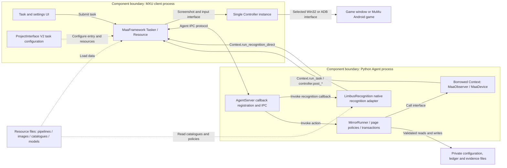
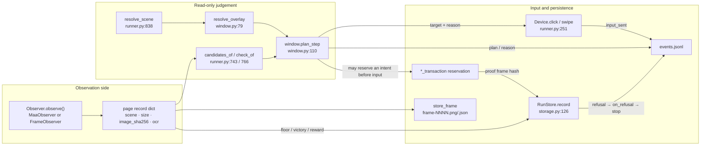

# 2 Architecture

[中文](../zh_cn/2-architecture.md) · [← Index](index.md)

This chapter answers one question: **who loads what, when** — and why the tree is shaped the way it is as a result.

The entry point above is `index.md`. This chapter states only what can be read out of the repository; it does not repeat `PROJECT.md`'s running log. Every technical claim is bound to a `path:line` anchor, a test name, or an `evidence/` path.

Sub-pages of this chapter (linked only from the sections below — the index never links them):

- [2.2 Module Map](2.2-modules.md) — the 93 Python modules, clustered, each with its responsibility
- [2.3 Design Decisions](2.3-decisions.md) — the full rationale and code for the 12 key decisions

---

## 2.1 Layered overview

### Figure 2-1 Layered architecture

### Table 2-1 Layer responsibilities and landing points

| Layer | Owner | Responsibility | Landing point | Boundary |
| --- | --- | --- | --- | --- |
| Client | this project's own extension (upstream MaaFramework has no such layer) | task selection, task-setting editors, update panel | `desktop/mxu/TeamBuildEditor.tsx`, `desktop/mxu/teamOrder.ts`, `desktop/mxu/SoftwareUpdatePanel.tsx`, `desktop/mxu/limbus_update.rs` | writes PI configuration and lock-protected private rotation commands; no direct game input |
| Resource | this project | controller/task/option declarations, anchors, pipeline nodes, localization | `assets/interface.json:2` (`interface_version: 2`), `assets/resource/base/anchors.json`, `assets/resource/base/pipeline/mirror.json`, `assets/i18n/` | declarations only, no decision logic |
| Tasker | upstream MaaFramework `v5.12.2` | screenshots, recognition, graph scheduling, input conversion, timeouts | `maafw/` (`pyproject.toml` pins `maafw==5.12.2`, see `docs/maaframework-conformance.md:11`) | no business judgement; the coordinate conversion lives in `ControllerAgent::preproc_touch_point` (`docs/maaframework-conformance.md:37-48`) |
| Agent | this project | custom recognition and custom actions; turns a page into structured evidence | `agent/main.py:48-69`, `agent/recognition.py:103`, `agent/recognition.py:1478` | never builds a second controller |
| Business (`src/maalimbus/`) | this project | page→action planning, ledger, transactions, offline learning | `src/maalimbus/runner.py:1` (95 modules) | planners/transactions are pure; runner adapters and neural_shadow still call Maa, so this directory is not entirely pure business |
| Controller | MaaFramework + this project's choice | the single real device ownership | `src/maalimbus/windows_controller.py:9`, `src/maalimbus/adb_device.py:1` | only one controller at a time (`src/maalimbus/controller_lease.py:1`) |

### The end-to-end chain

1. MXU turns the user's ticks into one task through the `task` table at `assets/interface.json:103`; `task.entry` names a pipeline entry node (e.g. `mirror_loop` → `MirrorTask`).
2. The MaaFramework Tasker loads `assets/resource/base/pipeline/mirror.json` and calls back into the Agent process when it hits a node that needs a custom recognition or action.
3. The 1 custom recognition + 15 custom actions registered at `agent/main.py:48-69` are invoked by name (`limbus_scene`, `limbus_mirror_loop`, `limbus_map_observe`, …).
4. The action calls into business logic and Maa adapters under `src/maalimbus/`. `MirrorLoopAction` (`agent/recognition.py:1478`) *is* the whole loop: it wraps the PI's controller as `runner.MaaDevice`, wraps `AgentTasker` as `runner.MaaObserver`, and hands both to `runner.MirrorRunner` (`agent/recognition.py:1509-1522`).
5. Every input the business layer sends goes back through `MaaDevice`'s `post_click` / `post_swipe` onto the PI's own controller. No second device channel is created (`docs/agent-loop.md:105-107`).

> The load-bearing constraint: **there is exactly one input exit**. The `Device` Protocol at `src/maalimbus/runner.py:251` and the `Observer` Protocol at `:550` are the only two seams between the business layer and a device. That is also why the loop is offline-testable — `FrameObserver` (`:566`) replays archived frames and `FakeDevice` (`:386`) records what was sent, so `tests/test_runner.py` drives the real loop over real archived evidence with no device attached.

### Three external dependencies and their licences

| Dependency | Pinned version / commit | Licence | Role in this chapter |
| --- | --- | --- | --- |
| MaaFramework | `maafw==5.12.2` (`docs/maaframework-conformance.md:11`); the spec was read at the matching tag `v5.12.2` | LGPL-3.0 (`docs/design.md:346`) | Tasker + Controller layers |
| MaaFramework source reference | `cc5fef675f42ca899e12bc4932ff37ac1278853c` (`docs/design.md:346`) | LGPL-3.0 | the factual source for the protocols and the coordinate space |
| LixAssistantLimbusCompany | `431b432e22f0b0da08b95d7c478fa213be20b3e8` (`docs/design.md:350`) | AGPL-3.0 | static preferences and geometry constants only; its controller/runtime is **never** imported (`PROJECT.md:1339`) |

---

## 2.2 Module map

`src/maalimbus/` holds **93 `.py` files** (including `__init__.py`). Each module's responsibility is declared by that module's own docstring on line 1 — the full listing, module by module, is in [2.2 Module Map](2.2-modules.md).

### Figure 2-2 Module dependency graph (from measured imports)

```mermaid
flowchart TD
    subgraph ORCH["Orchestration"]
        RUNNER["runner.py<br/>MirrorRunner.step / run"]
        WIRING["run_wiring.py<br/>ledger_event / settle / expire / reconcile"]
        FLOWS["session_flow.py<br/>named live-session flows"]
        JOBS["jobs.py<br/>finite Maa job polling"]
        ELOG["event_log.py<br/>human-readable run log"]
    end

    subgraph DECIDE["Decision layer (pure)"]
        WINDOW["window.py<br/>plan_step"]
        POLICIES["policies.py<br/>rank_gifts / ResourceBudget / RunLedger"]
        ROUTE["route_plan.py<br/>plan_route"]
        MLP["mirror_learning_policy.py<br/>static heuristics + a bounded learned term"]
        BUDGET["budget.py<br/>spend gate"]
    end

    subgraph SEE["Vision / page reading"]
        VISION["vision.py<br/>Text + normalized position"]
        MAPV["map_vision.py<br/>map identity and bounded route reading"]
        BATTLEV["battle_vision.py"]
        SHOPV["shop_vision.py"]
    SHOPREV["shop_revive.py<br/>service / options / slot box / state button"]
        GCAT["gift_vision.py<br/>GiftCatalog"]
        TEAMV["team_vision.py<br/>team_row / card_states"]
        THEMEV["theme_vision.py<br/>ThemeCatalog"]
        EVENTV["event_vision.py"]
        REWARDV["reward_vision.py"]
    end

    subgraph DURABLE["Durability"]
        STORAGE["storage.py<br/>write_json / ProfileStore / RunStore"]
        TXN["*_transaction.py<br/>reserve-before-input"]
        PS["runtime_paths.py<br/>ROOT / data_directory / ledger_path"]
    end

    subgraph EXEC["Task execution"]
        REWTASK["reward_task.py / lux_task.py"]
        SHOPTXN["shop_transaction.py"]
    end

    RUNNER --> WINDOW
    RUNNER --> WIRING
    RUNNER --> FLOWS
    RUNNER --> JOBS
    RUNNER --> ELOG
    RUNNER --> MAPV
    RUNNER --> BATTLEV
    RUNNER --> SHOPV
    RUNNER --> SHOPREV
    SHOPREV --> SHOPV
    RUNNER --> GCAT
    RUNNER --> TEAMV
    RUNNER --> THEMEV
    RUNNER --> EVENTV
    RUNNER --> REWARDV
    RUNNER --> TXN
    RUNNER --> STORAGE
    RUNNER --> PS
    RUNNER --> BUDGET
    RUNNER --> ROUTE
    MAPV --> ROUTE
    MAPV --> VISION
    STORAGE --> POLICIES
    ROUTE --> POLICIES
    WINDOW --> POLICIES
    WIRING --> STORAGE
    TXN --> STORAGE
    REWTASK --> RUNNER
    SHOPTXN --> STORAGE
```

Every edge above is grounded in: `src/maalimbus/runner.py:46-72` (the module-level import block), `src/maalimbus/map_vision.py:16-17`, `src/maalimbus/storage.py:12`, `agent/recognition.py:20-43`, `src/maalimbus/runner.py:1862` (a function-local import of `shop_revive`) and `src/maalimbus/shop_revive.py:20` (it depends only on the `shop_vision` reading helpers).

### Ten clusters and their size

| Cluster | Modules | In one line | Representative modules |
| --- | --- | --- | --- |
| Orchestration and driving | 7 | walk a whole dungeon, and book what must be booked | `runner.py:1`, `run_wiring.py:1` |
| Decisions and policy (pure) | 10 | compute "what is the next single input" without touching a device | `window.py:1`, `policies.py`, `route_plan.py:1` |
| Vision / page reading | 30 | turn one frame into decidable evidence | `vision.py:1`, `map_vision.py:1`, `anchors.py:1` |
| Durability | 9 | persist before input; paths decoupled from cwd | `storage.py:1`, `runtime_paths.py:1` |
| Task execution | 7 | independent task entries (rewards, Lux, shop) | `reward_task.py:1`, `lux_task.py:1` |
| Settings and migration | 9 | read/write user preferences, seed from older builds | `global_settings.py:1`, `task_preferences.py:1` |
| Updates and packaging | 8 | update check, staging, install transaction, artifact validation | `startup_update.py:1`, `update_install.py:1` |
| Device and preflight | 6 | build the one controller, after read-only checks | `windows_controller.py:1`, `adb_preflight.py:1` |
| Exploration and datasets | 6 | bounded navigation probes and reviewed training sets | `unknown_exploration.py:1`, `learning_dataset.py:1` |
| Package declaration | 1 | declare the package boundary | `__init__.py:1` |

### The vision layer is three kinds of reading, not one

| Kind | Definition | What decides | Representative modules |
| --- | --- | --- | --- |
| Text + normalized position | `src/maalimbus/vision.py:19` `find(records, pattern, roi, size, threshold=.65)` | OCR text hitting a given ROI | `map_vision.py`, `reward_vision.py`, `event_vision.py` |
| Template match | `src/maalimbus/anchors.py:132` `check_template(...)` | a pinned bitmap plus a threshold | `gift_vision.py`, `battle_counter_native.py` |
| Geometry | `src/maalimbus/anchors.py:159` `check_geometry(...)` | normalized ROIs and their size relations | `theme_vision.py`, `star_vision.py` |

The anchor registry lives in `assets/resource/base/anchors.json` (`src/maalimbus/runner.py:226` points `REGISTRY` at it); `anchors.validate()` (`src/maalimbus/anchors.py:31`) checks its shape at load time and `anchors.evaluate()` (`:192`) evaluates anchor by anchor at run time.

---

## 2.3 Key design decisions

Table 2-2 is the overview with each decision's compressed reason; the full derivation is in [2.3 Design Decisions](2.3-decisions.md).

### Table 2-2 Decision overview

| # | Decision | Reason (one line) | Anchor |
| --- | --- | --- | --- |
| D1 | Maa owns screenshots/input and bounded Pipeline scheduling; all judgement is pure Python | keeps decisions offline-reproducible and unit-testable | `PROJECT.md:1338`, `docs/runner.md:3-14` |
| D2 | The loop is a library; page and input are injected | the loop was locked inside a CLI — untestable and unreusable by the app | `docs/runner.md:5-14`, `src/maalimbus/runner.py:1-31` |
| D3 | At most one input per page; refuse when no control is proven | a stray click throws away a run that is already half done | `src/maalimbus/window.py:13-19`, `window.py:106` |
| D4 | There is a blacklist of controls that must never be clicked | some controls are useful page identity but clicking them loses the run | `src/maalimbus/window.py:50-63`, `window.py:128-135` |
| D5 | Persist the intent before input (reserve-before-input) | a crash/restart must not replay or enlarge a budget | `src/maalimbus/storage.py:126`, `run_wiring.py:81` |
| D6 | The ledger accepts only what a page actually proves | an out-of-order or unproven event is refused by the ledger | `src/maalimbus/run_wiring.py:41-79` |
| D7 | Settling never treats an *input* as a *receipt* | a click is not a payout | `src/maalimbus/run_wiring.py:68-73`, `docs/design.md:358-371` |
| D8 | Private-state paths are independent of cwd and PyInstaller extraction | the packaged app still finds the same configuration | `src/maalimbus/runtime_paths.py:8-20` |
| D9 | Only one controller at a time, via a cross-process OS lock | two input sources would tread on each other | `src/maalimbus/controller_lease.py:1`, `PROJECT.md:1344` |
| D10 | Observation nodes run through `Context.run_task` inside a callback | the framework has one task worker, so `post_task` self-deadlocks | `docs/agent-loop.md:93-103` |
| D11 | The PI Win32 profile is the only controller truth | stops the CLI and the app from using different input methods | `src/maalimbus/windows_controller.py:1` |
| D12 | Dungeon artwork, season numbers, currency amounts and full backgrounds are not anchors | they change per season and cannot prove a page identity | `PROJECT.md:1341`, `docs/design.md:219-222` |

---

## 2.4 Data and control flow

### Figure 2-3 What a single `step()` reads and writes

### Table 2-3 Read/write landing points

| Data | Written where | Written by | Anchor |
| --- | --- | --- | --- |
| Per-page PNG + JSON record | `<run_dir>/frame-NNNN.png` / `.json` | `store_frame()` | `src/maalimbus/runner.py:498` |
| Run journal (machine-readable) | `<run_dir>/events.jsonl` | `Journal.record` / `MirrorRunner.note()` | `agent/recognition.py:76`, `runner.py:1375` |
| Run summary | `<run_dir>/agent-result.json` | `MirrorLoopAction.run` on the way out | `agent/recognition.py:1547-1548` |
| Human-readable log | a text report for the same run | `event_log.report()` | `src/maalimbus/event_log.py:131` |
| Completion events (ordered, evidence-backed) | the run ledger | `RunStore.record()` | `src/maalimbus/storage.py:126` |
| Team rotation | the run ledger | `RunLedger.complete()` | `src/maalimbus/policies.py:140-148` |
| Teams and preferences | 17 files under `config/` incl. `user-team-profiles.json` | `ProfileStore` | `src/maalimbus/storage.py:69` |
| Anchors and templates | `assets/resource/base/anchors.json` | maintained in the repo; read-only at run time | `src/maalimbus/runner.py:226` |
| Map probe authorization | `build/map-probe-authorization.json` | read-only check by `runner.authorized(nonce)` | `src/maalimbus/runner.py:226`, `:238` |

The `run_dir` resolution priority is written down in `docs/agent-loop.md:68-69`: `custom_action_param["directory"]` → the `MAALIMBUS_RUN_DIR` environment variable → `evidence/runtime/pi-<YYYYmmdd-HHMMSS>` under the application root; a relative path is resolved against the application root.

### Observation nodes and the pipeline nodes they pair with

The `PIPELINE` dict at `src/maalimbus/runner.py:120-140` is three nodes written on demand at run time, sharing their names with nodes **already published** in `assets/resource/base/pipeline/mirror.json`:

| Node | Recognition | Action | Definition |
| --- | --- | --- | --- |
| `WindowMapObserve` | `DirectHit` | `Custom` → `limbus_map_observe` | `runner.py:121-125`; `mirror.json:1455` |
| `WindowBattleObserve` | `DirectHit` | `Custom` → `limbus_battle_observe` | `runner.py:126-130`; `mirror.json:1463` |
| `WindowDrive` | `Custom` → `limbus_scene` (scene `DRIVE`, token `mirror_menu`) | `Click`, `target: True` | `runner.py:133-139` |
| `MirrorLoop` | `DirectHit` | `Custom` → `limbus_mirror_loop` | `mirror.json:1526-1529` |
| `MirrorLoopDone` | — | the terminal node | `mirror.json:1553` |

`docs/agent-loop.md:29-33` explains why those two observation nodes have to be published in `assets/resource/base/pipeline/mirror.json`: a packaged app only loads what is under `assets/`, and the isolated `MapObserve`/`BattleObserve` nodes and the `MirrorHard` entry chain are left untouched.

`docs/maaframework-conformance.md:110-113` records the current size: `mirror.json` holds 89 nodes, 56 of them reachable from the five task entries; the other 33 are drivable by name from the toolkit (for example `MapObserve`, which `tools/map_live_observe.py` runs directly), so they are reported as a note rather than a failure.

### The conformance guard

`tools/verify_pipeline_spec.py` turns the rules of `3.1-任务流水线协议.md` and `3.3-ProjectInterfaceV2协议.md` that this chapter depends on into an executable check: it loads `assets/interface.json`, every `assets/resource/*/pipeline/*.json` and `agent/main.py`, reports what the protocols do not define, and exits 1 on a violation (`--interface/--pipeline/--agent-main/--report`). `tests/test_pipeline_spec.py` pins it with 9 tests, including four negative cases (an unknown controller type, two scaling modes on one controller, an override naming no node, a node naming an unregistered action).

Current result: `python tools/verify_pipeline_spec.py` → `ok — 0 problem(s)` (`docs/maaframework-conformance.md:132`).

This check caught one real defect (`docs/maaframework-conformance.md:117-123`): `MapObserve` uses `limbus_map_observe` and `BattleObserve` uses `limbus_battle_observe`, but `agent/main.py` registered only 11 names, neither of them among them — a node whose `custom_action` was never registered cannot run at all. The classes had been there all along (`agent/recognition.py:1130` `MapObservation`, `:1165` `BattleObservation`), so the fix was the registration itself, now at `agent/main.py:63-64`.

Those three manual file names are **relative paths** inside the MaaFramework manual (written as `docs/zh_cn/3.3-ProjectInterfaceV2协议.md` and so on, see `tools/verify_pipeline_spec.py:5`, `tools/verify_pipeline_spec.py:11` and `tools/verify_pipeline_spec.py:15`), but this repository has **no** `docs/zh_cn/` directory; the manual really lives in the vendored upstream tree at `sources/upstream/MaaFramework/docs/zh_cn/3.3-ProjectInterfaceV2协议.md` (1379 lines). Look for it there when you follow one of those names.

## 2.5 Extending a task

In this repository adding a task is four edits that must land together: miss one and the label is missing, the entry is missing, or the task cannot run at all. The chain below follows one of the six main tasks (the Mirror Dungeon `mirror_loop`) end to end.

1. **Declare the task in PI**: the `task` array at `assets/interface.json:103-167`. Each entry carries at least `name` (the ProjectInterface task name), `entry` (**which must be a real pipeline node name**) and `default_check` (whether it is ticked by default), plus `label` and `description` (values starting with `$` are i18n keys) and an optional `option` list. The six main tasks are `open_game` (`assets/interface.json:105-110`, entry `OpenGameTask`), `mirror_loop` (`:112-129`, entry `MirrorTask`), `experience` (`:131-139`, `ExperienceTask`), `thread` (`:141-149`, `ThreadTask`), `rewards` (`:151-159`, `RewardsTask`) and `stamina` (`:161-166`, `StaminaTask`).
2. **Add the label in all three languages**: `assets/i18n/zh_cn.json`, `assets/i18n/en_us.json` and `assets/i18n/ja_jp.json` must all carry the same key, otherwise that language has no text; the `$main_*` and `$main_*_description` keys of the six main tasks sit at `:75-86` in all three files.
3. **Write the entry node**: `assets/resource/base/pipeline/mirror.json:5273-5338` holds the six entry stubs, all with the same shape: `recognition: "DirectHit"` + `action: "Custom"` + `custom_action: "limbus_main_task"` + `custom_action_param: {"task": "<name>"}`, plus `timeout`, `next: []` and `on_error: []`. Note that **the node name and `custom_action_param.task` are not the same string**: the PI task `mirror_loop` points at the node `MirrorTask` (`assets/resource/base/pipeline/mirror.json:5284-5294`) while that node passes down `task` = `"mirror"`.
4. **Register the custom action**: `agent/main.py:48-69` is the agent-side registration list: one `register_custom_recognition('limbus_scene', ...)` plus fifteen `register_custom_action` calls, with `limbus_main_task` at `agent/main.py:69`. The same batch is registered again in the native command-line tool: `tools/run_native.py:143`. **A node that names an action nobody registered cannot run at all** (`docs/maaframework-conformance.md:117-123` records that this is how the two observation nodes were caught).
5. **Run the conformance guard**: `tools/verify_pipeline_spec.py` turns the rules of the previous section into executable checks (`entry` must name a real node, `custom_action` must already be registered in `agent/main.py`, and an override must name real nodes) and exits 1 on a violation; the upstream basis is `docs/maaframework-conformance.md`. The current result is `ok — 0 problem(s)` (`docs/maaframework-conformance.md:132`).

Adding pipeline nodes without a task entry is a legal path too: not every node in `mirror.json` is reachable from an entry chain, and the tools can drive them by name (`docs/maaframework-conformance.md:110-113`).

---

## Open questions left by this chapter

These are the architectural open items, recorded here so the next chapter does not treat them as settled facts:

1. **Node identity is unproven**: the map panel's node classes and its route are still a refusal; this needs a live session that first clicks one observed node and records the successor page (`docs/design.md:210-213`).
2. **A five-floor live clear is unverified**: `PROJECT.md:1349` states plainly, "No live dungeon completion has been verified yet."
3. **Japanese live paths are unverified**: `docs/design.md:437-438` and `:196-197` both record that the Japanese menu localization is unverified and outside the English live proofs.
4. **`MirrorLoop` has no PI task entry yet**: `docs/agent-loop.md:111-113` states that `MirrorLoop` is deliberately absent from `assets/interface.json`, that adding one task is all it takes, and that no other node changed meaning; the `mirror_loop` entry at `assets/interface.json:112` currently points at `MirrorTask`.
