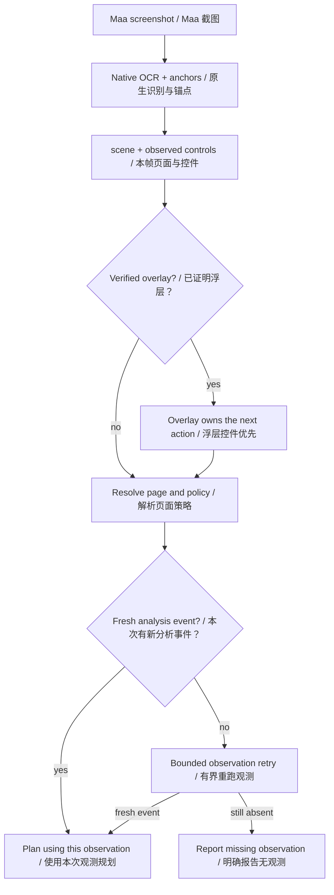
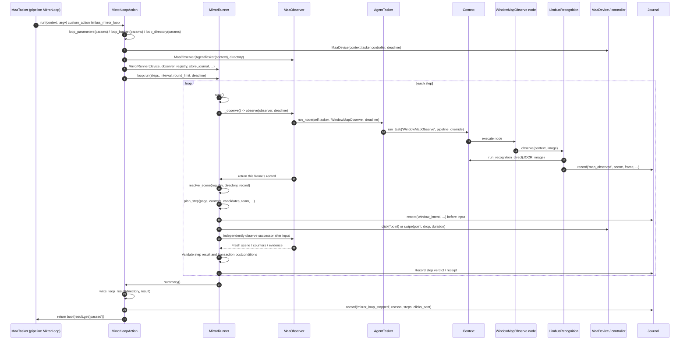
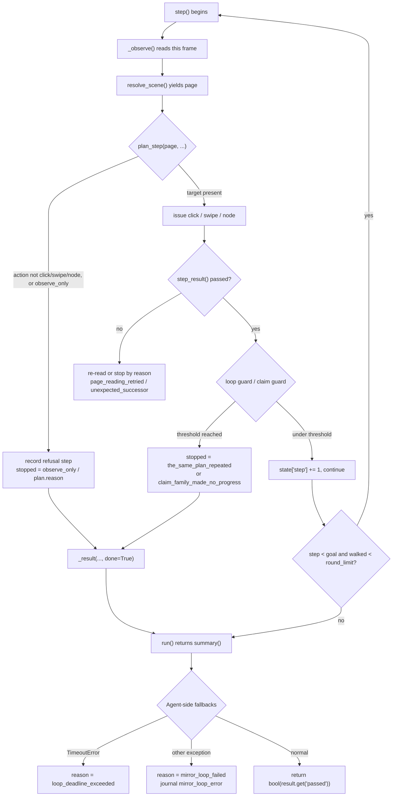
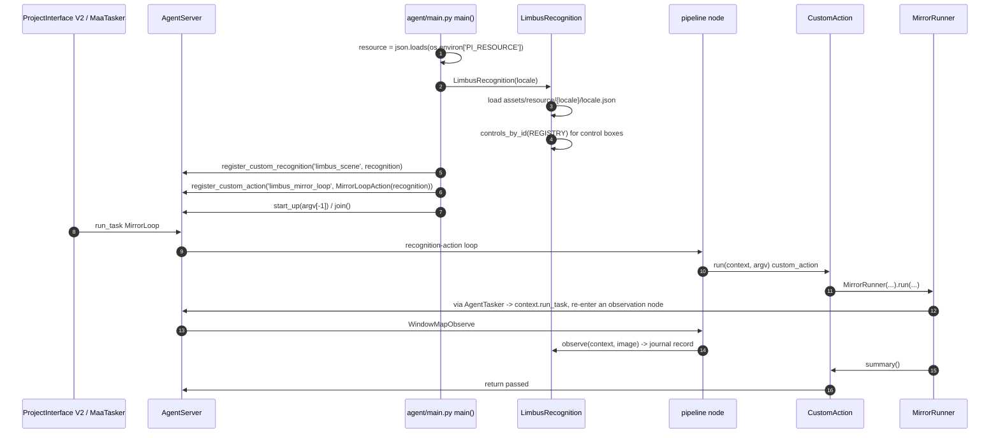
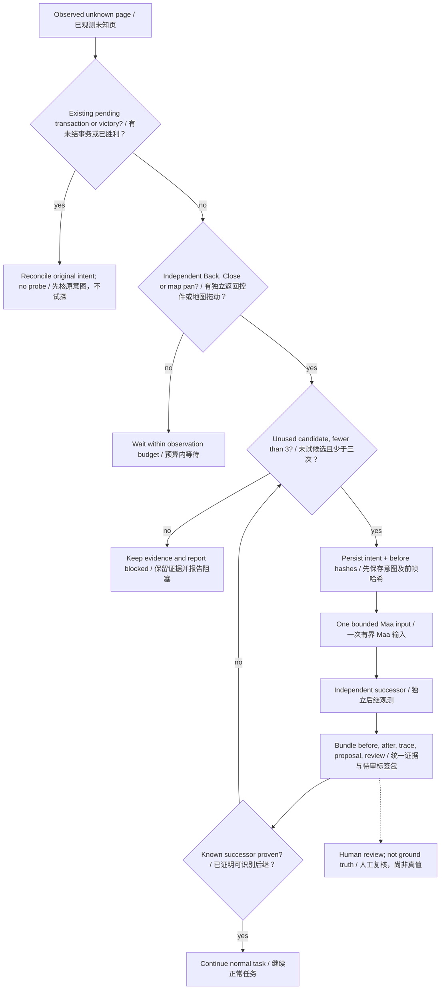
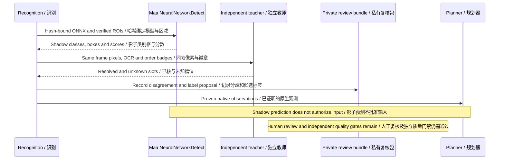
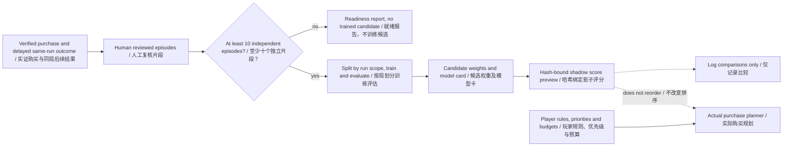

# 3 Runtime

[中文](../zh_cn/3-runtime.md) · [← Index](index.md)
This chapter explains what happens inside one run: how a frame becomes an action, how that action is issued, and when the loop stops.

- Upstream vocabulary: Controller (screen capture / input), Resource (images, models, Pipeline, localization), Tasker (the recognition-action loop that runs a Pipeline), Agent (custom recognitions / actions).
- Project-owned extension (MaaFramework has no such layer): Client = ProjectInterface V2 desktop GUI (`desktop/mxu/`).

Reading convention: `relative/path:line` is a verifiable anchor. Anything this chapter did not open and confirm is explicitly marked "not yet verified".

---

## 3.1 Recognition and the page model

### 3.1.1 Two namespaces: `scene` and `page`

At runtime there are **two** page identifiers, and they must not be confused.

| Identifier | Defined by | Entry point | Criterion |
|---|---|---|---|
| `scene` | OCR text + normalized position | `src/maalimbus/vision.py:63 def classify(records, locale, size)` | which strings were read this frame, inside which ROI |
| `page` | `pages[].id` in the anchor table | `src/maalimbus/runner.py:839 def resolve_scene(registry, directory, record)` | scene + anchor hits + overlay precedence |

- Text-reading primitive: `src/maalimbus/vision.py:19 def find(records, pattern, roi, size, threshold=.65)`; the record type is `src/maalimbus/vision.py:13 class Text` (`text / box / score`).
- The overlay outranks the label underneath: `src/maalimbus/window.py:79 def resolve_overlay(page, *, overlay_hit)`, which returns `'TUTORIAL'` when it hits (`src/maalimbus/window.py:88`). The reason is written at `src/maalimbus/window.py:82-86`: the overlay's own continue control does not change from card to card, so "a visible continue" outranks the label below it.
- Self-clearing pages, `WAIT_PAGES`: `src/maalimbus/window.py:76`, value `('UNKNOWN', 'BATTLE_RESULT', 'DEFEAT')`. The planner sends no input on these pages; the driver only waits for them to change.

### 3.1.2 The anchor table

File: `assets/resource/base/anchors.json` (3369 lines). Runtime constant: `src/maalimbus/runner.py:225 REGISTRY = ROOT / 'assets/resource/base/anchors.json'`.

Top level (`assets/resource/base/anchors.json:1-6`):

```json
{
  "version": 1,
  "reference_width": 1280,
  "reference_height": 720,
  "note": "...",
  "pages": []
}
```

Per-page fields (using the `map` page as the example, `assets/resource/base/anchors.json:7-45`):

| Field | Meaning | Example |
|---|---|---|
| `id` | page id — this *is* the runtime `page` | `"map"` (:8) |
| `title` | human-readable title | `"楼层地图（Exploring Floor N）"` (:9) |
| `evidence` | archived observations backing the assumption | `"evidence/runtime/map-advance-20261006-014737/frame-0001.json"` (:11) |
| `identity[]` | the recognition anchors | `map.floor` (:16), `map.pack_name` (:29) |
| `controls[]` | proven control boxes | empty on `map` (:42) |
| `live_derived[]` | quantities computed live, never hard-coded | `map_vision.node_markers(image)` (:44) |

An `identity` anchor has the shape `{id, kind, pattern, roi, threshold, note}` (`assets/resource/base/anchors.json:15-27`). Legal `kind` values: `src/maalimbus/anchors.py:19 KINDS = ('ocr', 'template', 'geometry')`.

Loading and offline re-checking all live in `src/maalimbus/anchors.py`:

- `src/maalimbus/anchors.py:24 def load(path)`, `src/maalimbus/anchors.py:31 def validate(registry)`, `src/maalimbus/anchors.py:53 def validate_anchor(anchor, page_id)`
- `src/maalimbus/anchors.py:92 def resolve_evidence(registry, root)`
- per-kind criteria: `check_ocr` (`:122`), `check_template` (`:132`), `check_geometry` (`:159`)
- aggregation: `src/maalimbus/anchors.py:169 def evaluate_anchor(...)`, `src/maalimbus/anchors.py:192 def evaluate(...)`, `src/maalimbus/anchors.py:212 def failures(report, *, require_geometry=False)`

At runtime the table is flattened into `{anchor name: pixel box}` by `src/maalimbus/runner.py:693 def controls_by_id(registry: dict) -> dict`. That mapping is exactly the `controls` the planner receives (`src/maalimbus/window.py:146-147` states it: `controls` maps anchor names such as `node_panel.enter_button` to pixel boxes).

### 3.1.3 Vision modules

All map-page geometry is computed live, and it is concentrated in `src/maalimbus/map_vision.py`:

- Threshold constants sit at the top of the file: `REFERENCE_WIDTH = 1280` (`:48`), `BADGE_THRESHOLD = 0.90` (`:49`), `LATTICE_PITCH = (384, 320)` (`:537`), `CLICK_SIDE = 40` (`:538`).
- Nodes and player: `class NodeMarker` (`:132`), `badge_nodes` (`:146`), `node_markers` (`:186`), `player_marker` (`:238`), `flame_player` (`:275`), `yellow_flame_player` (`:293`), `player_of` (`:396`), `train_player` (`:418`).
- Paths and candidates: `lit_nodes` (`:715`), `lit_rings` (`:720`), `path_end` (`:734`), `marker_boxes` (`:791`), `chevron_target` (`:816`), `advance_candidates` (`:490`), `advance_plan` (`:511`).
- Clicks and whole pages: `map_clicks` (`:853`), `map_header` (`:1147`), `map_page` (`:1196`), `read_map_asset` (`:1224`), `route_decision` (`:1239`).
- Non-map pages: `node_panel` (`:94`), `enter_target` (`:124`), `pre_battle_team_page` (`:1129`), `battle_target` (`:1140`).

Sibling vision modules in the same directory (taken from the import list at `agent/recognition.py:20-43`; their bodies were not opened this round): `battle_vision`, `team_vision`, `gift_vision`, `theme_vision`, `grace_vision`, `star_vision`, `overlay_vision`, `overlay_dismissal`, `shop_vision`, `event_vision`, `deployment`, `deployment_*`.

### 3.1.4 Localization overlays

**Conflict with the shared fact contract (code wins)**: the contract says `assets/resource/base/locale.json` is layered on top of `base`, but that file **does not exist**. The real layout is:

| File | Lines | Role |
|---|---|---|
| `assets/resource/en/locale.json` | 89 | English regex table used by the Agent's recognitions |
| `assets/resource/jp/locale.json` | 26 | the same table in Japanese |
| `assets/resource/en/pipeline/locale.json` | 1 (content `{}`) | MaaFramework pipeline text localization (en) |
| `assets/resource/jp/pipeline/locale.json` | not verified | the same (jp) |

There is exactly one load site, and it loads **only the selected language's file** — there is no base overlay:

- `agent/recognition.py:103 self.locale = json.loads((ROOT / f'assets/resource/{locale}/locale.json').read_text(encoding='utf-8'))`
- The language name comes from ProjectInterface's `resource.name`, defaulting to `'en'`: `agent/main.py:42-45` (`resource = json.loads(os.environ.get('PI_RESOURCE','{}'))`; `locale = resource.get('name','en')`; `recognition = LimbusRecognition(locale)`).

Usage is "take the regex by key, hand it to `vision.find`", for example:

- `agent/recognition.py:421` — `find(records, self.locale['gift_confirm'], (.53,.65,.68,.73), size, .85)`
- `agent/recognition.py:159` — `find(records, self.locale['inferno'], (.70,.07,.99,.3), size)`
- `src/maalimbus/vision.py:57` — `locale.get('cancel', r'(?!x)x')`

Every key in the `jp` table is written as a `japanese-pattern|english-pattern` alternation, e.g. `assets/resource/jp/locale.json:2 "home_drive": "^ドライブ$|^Drive$"`.

---


<a id="feature-3-1-5"></a>

### 3.1.5 Recognition, overlays and fresh observation

Scene, resolved page, overlay ownership and freshness are separate checks. No new analysis event is not an unknown page: the last journal entry cannot stand in for a post-input observation. An observed but unclassified frame enters 3.7. Overlay dismissal uses its own observed control.



Source boundaries: `src/maalimbus/runner.py:1` (`MaaObserver.observe`, `resolve_scene`); `src/maalimbus/overlay_dismissal.py:1`; `agent/recognition.py:1`.

## 3.2 Decision and execution

### 3.2.1 The single-input contract of `plan_step`

The entry signature (`src/maalimbus/window.py:110-114`, verbatim):

```python
def plan_step(page, *, controls=None, start_box=None, auto_assign=None,
              candidates=None, candidate_index=0, nodes=None, arrows=None, team=None,
              reward=None, gift=None, cards=None, graces=None, initial=None,
              search=None, check=None, defeat=None, bonus=None, difficulty=None,
              shop=None, battle_assignment='win_rate'):
```

- **What it takes**: one `page` string (an anchor id) plus keyword observation payloads. Every payload is a number or box already read from this frame (candidate node boxes, team-card badges, reward counters, the skill check's slot, and so on); the docstring lists them at `src/maalimbus/window.py:146-158`. The contract carries no history, no device, no network — it is a pure function.
- **What it returns**: a plan dict built by `src/maalimbus/window.py:91 def _plan(page, action, *, target=None, node=None, expect=(), reason, detail=None, advance=False, to=None, duration=None)`, with keys `page / action / target / node / expect / reason / advance` and the optional `to / duration_ms / detail` (`src/maalimbus/window.py:93-103`).
- **Refusal**: `src/maalimbus/window.py:106 def _refuse(page, reason)` returns `_plan(page, RECORD, reason=...)`.
- **The second verdict**: `plan_step`'s own body does exactly one thing — a target that lands on a `FORBIDDEN_CONTROLS` control (`src/maalimbus/window.py:50-63`) is re-issued as `control_is_forbidden` (`src/maalimbus/window.py:128-135`). Two whitelisted exceptions: `STAR_CONFIRM`'s `star_confirm.cancel_button` and `GIFT_PICK`'s `gift_pick.refuse_button` (`src/maalimbus/window.py:129-133`).
- **Split of work**: `src/maalimbus/window.py:139 def _plan_step(...)` shares the signature and carries the whole "page -> input" dispatch; `plan_step` is only the forbidden-control verdict plus delegation (`src/maalimbus/window.py:120-127`).
- **Caller**: `src/maalimbus/runner.py:2302-2312`, inside `MirrorRunner.step` (`src/maalimbus/runner.py:1456`): `plan = plan_step(page, controls=plan_controls, arrows=arrows, difficulty=difficulty, start_box=record.get('start_box'), auto_assign=record.get('auto_assign_buttons'), battle_assignment=settings.battle_assignment, candidates=candidates, candidate_index=choice_index, team=team, reward=reward, gift=gift, cards=cards, graces=graces, initial=initial, check=check, defeat=defeat, search={'mode': settings.gift_search}, shop=shop, bonus={'spend': state['run_settled_itself']})`.
- The import sits at `src/maalimbus/runner.py:67` (the `from maalimbus.window import ...` line). The module docstring at `src/maalimbus/runner.py:1-31` also names `tools/window_step.py` as the second frontend; that file was opened this round and its usability checked (419 lines; `tools/window_step.py:62-209` is its `build_parser()`, and `C:\Python313\python.exe tools\window_step.py --help` prints usage normally). Details in 3.5.

### 3.2.2 A real data-shape example

The object below is assembled from the real field definition of `_plan` (`src/maalimbus/window.py:93-96`) and the real `confirm_proven_owned_gift_refusal` branch on `UNKNOWN_DIALOG` (`src/maalimbus/runner.py:2321`); every field name comes from the code:

```python
plan = {
    'page': 'UNKNOWN_DIALOG',
    'action': 'click',
    'target': [x, y, w, h],              # progress/control box, in pixels
    'node': None,                        # non-None means: go through a pipeline node instead
    'expect': ['MAP', 'REWARD_CARD', 'UNKNOWN'],
    'advance': False,                    # True = this page's label should stay; a changed frame proves the click
    'reason': 'confirm_proven_owned_gift_refusal',
}
```

Field semantics (all anchored):

| Key | Semantics | Anchor |
|---|---|---|
| `page` | the page id the plan was made for | `window.py:93` |
| `action` | `'click'` / `SWIPE` / `NODE` / `RECORD` | `window.py:93`; constants imported at `src/maalimbus/runner.py:67` |
| `target` | the box to click/drag (`None` = no input) | `window.py:94` |
| `node` | set when running a pipeline node instead of a target | `window.py:95` |
| `expect` | the set of acceptable successor pages; `ANY` means "just change" | `window.py:95`, `window.py:978-980` |
| `reason` | decision-reason string, also the journal key | `window.py:95` |
| `advance` | the page is expected to stay; a frame change is the proof | `window.py:96`, `window.py:190` |
| `to` / `duration_ms` / `detail` | only on the drag and attached-detail branches | `window.py:97-102` |

The verdict record is assembled by `src/maalimbus/window.py:1052 def step_result(plan, *, sent, before, after, page, frame_changed=False)`, which returns `{action, reason, passed, page_before, page_after, expect, clicks_sent}` (`window.py:1050-1056`).

### 3.2.3 The loop guard (against repeating an action)

It lives at the tail of `MirrorRunner.step`: `src/maalimbus/runner.py:2820-2843`.

```python
if page not in LOOP_GUARD_EXEMPT and plan.get('reason') not in LOOP_GUARD_EXEMPT_REASONS:
    key = (page, plan['action'], plan.get('node'),
           None if plan.get('target') is None else tuple(plan['target']))
    state['repeated_plans'][key] = state['repeated_plans'].get(key, 0) + 1
    if state['repeated_plans'][key] >= max(2, settings.loop_guard):
        entry['passed'] = False
        entry['stopped'] = 'the_same_plan_repeated'
        self.note('window_loop_guard', plan=list(key), repeats=state['repeated_plans'][key])
        return self._result(page, plan.get('target'), True, entry['stopped'], done=True)
```

- The counter is keyed by `(page, action, node, target box)`; it resets when the page changes (`src/maalimbus/runner.py:2814`).
- The default threshold is `loop_guard = 3` (`src/maalimbus/runner.py:160`), with CLI `--loop-guard` (`src/maalimbus/runner.py:3271`). The test is `>= max(2, loop_guard)`, so the smallest effective value is 2.
- Exemptions: page-level `LOOP_GUARD_EXEMPT = ('TUTORIAL','BATTLE_HUD','BATTLE_PLANNING')` (`src/maalimbus/runner.py:77`); reason-level `LOOP_GUARD_EXEMPT_REASONS` (`src/maalimbus/runner.py:88-117`, covering tutorial card turns, alternating battle steps, story clicking, and so on — each one carries its own live evidence).
- There is a second, cross-page counter for the "claim family": `CLAIM_FAMILY = ('RUN_CLAIM','RUN_REWARD_DIALOG','RUN_REWARD_CONFIRM')` (`src/maalimbus/runner.py:83`); when `claim_steps > max(1, settings.claim_tries)` it stops with `'claim_family_made_no_progress'` (`src/maalimbus/runner.py:2817-2824`).

### 3.2.4 Budgets (steps / time / spend)

Three unrelated budgets:

1. **Step budget**: `src/maalimbus/runner.py:2907 def run(self, *, steps=300, interval=6.0, round_limit=5, deadline=None)`; the main loop condition is `while self.state['step'] < goal and walked < max(0, int(round_limit))` (`src/maalimbus/runner.py:2922`). The CLI defaults are `steps = 1` and `rounds = 3` (`src/maalimbus/runner.py:154`).
2. **Time budget**: `deadline` (`src/maalimbus/runner.py:2907`). The Agent side derives it from the action parameters: `budget = loop_budget(params)`, `deadline = time.monotonic() + budget` (`agent/recognition.py:1503-1504`); `loop_budget` reads `params['budget']`, then an environment variable, then the default `LOOP_BUDGET_SECONDS` (`agent/recognition.py:1318-1323`). Expiry is a `TimeoutError`, collapsed into `result['reason'] = 'loop_deadline_exceeded'` (`agent/recognition.py:1540`).
3. **Spend budget** (Enkephalin / Modules): `src/maalimbus/budget.py`. `src/maalimbus/budget.py:66 def plan_spend(amount, *, budget, spent=None, purpose='module_conversion') -> dict` answers "may we spend this"; `src/maalimbus/budget.py:101 def apply_spend(...)` then adds what gets written to the ledger. The refusal reasons, in order, are `budget_not_configured` / `budget_amount_must_be_positive` / `purpose_not_allowed` / `budget_zero` / `budget_exhausted` / `request_exceeds_remaining` / `amount_not_multiple_of_step` (`src/maalimbus/budget.py:11-15`). The default `status='pending'` means the answer is always "no" (`src/maalimbus/budget.py:70-93` and the note at `budget.py:11`). The static table is `assets/resource/base/budget.json`.

### 3.2.5 Issuing the action

Three exits, by `plan['action']` (`src/maalimbus/runner.py:2498-2524`):

- `NODE` → `run_node(self.tasker, plan['node'], self.deadline)` (`runner.py:2503`; `run_node` at `runner.py:1136` is `tasker.post_task(name)` plus `wait_task`).
- `SWIPE` → jitter the start inside the target box, jitter the end within ±8px of `plan['to']`, then `self.device.swipe(point[0], point[1], drop[0], drop[1], duration)` (`runner.py:2504-2517`).
- anything else → `box = inset_box(tuple(plan['target']), .3)`, jitter a point inside it, `self.device.click(*point)` (`runner.py:2518-2524`).

The intent lands on disk before the input is sent: `self.note('window_intent', page=..., target=..., reason=..., point=..., delay_ms=...)` (`runner.py:2445` / `:2460` / `:2468`), and `note` hands off to `Journal.record` (`src/maalimbus/runner.py:1378`).

---

## 3.3 The runner loop

### 3.3.1 One round trip



Code behind it: `agent/recognition.py:1494-1553` (the action body), `src/maalimbus/runner.py:1456 def step`, `src/maalimbus/runner.py:598 class MaaObserver`, `agent/recognition.py:1410 class AgentTasker`, `src/maalimbus/runner.py:622 def observe`, `agent/recognition.py:1119 class MapObservation`, `agent/recognition.py:143 LimbusRecognition.observe`.

**Why observation must go through `AgentTasker` instead of `context.tasker.post_task`**: `context.tasker`'s executor is a single worker, so posting a node from inside a custom action queues it behind the very task that is waiting for it, and the wait eventually ends in a stop that kills the run; `Context.run_task` is the framework's own door for "run a node synchronously from a callback". That rationale is written out verbatim at `agent/recognition.py:1424-1431`. `post_task` also does one extra thing: before reading the one-shot nodes `WindowMapObserve` / `WindowBattleObserve` it must call `context.clear_hit_count(entry)`, otherwise `max_hit=1` would make every later observation a permanent skip (`agent/recognition.py:1440-1446`).

A second trap is documented in `MaaObserver.observe`'s docstring (`src/maalimbus/runner.py:622-633`): trusting "the latest event of this kind" would mistake the **previous** frame's page for this one's, so when the node records no event it re-runs `read_tries` times; the docstring names the live incident `evidence/runtime/packaged-mirror-20261012-032032`.

### 3.3.2 Exit conditions of the main loop



The four exit families, all anchored:

| Family | Trigger | `stopped` / `reason` value | Anchor |
|---|---|---|---|
| Success / natural finish | budget ran out or this page has nothing left to do; the loop returns | `run()` returns `summary()` | `src/maalimbus/runner.py:2907-2929`, `:2875` |
| Budget exhausted (steps) | `state['step'] >= goal` or `walked >= round_limit` | no stop string, `done=False` | `src/maalimbus/runner.py:2922` |
| Budget exhausted (time) | `deadline` expires, raising `TimeoutError` | `'loop_deadline_exceeded'` | `agent/recognition.py:1540` |
| Refusal (planner declines) | `plan['action']` is not an executable action | `'observe_only'` or `plan['reason']` | `src/maalimbus/runner.py:2331-2332` |
| Refusal (screen did not move / re-reads spent) | `step_result` says `passed=False` and no re-read is left | that step's own `reason` (e.g. `unexpected_successor`) | `src/maalimbus/runner.py:2562`, `:2345` |
| Refusal (protocol guard) | loop guard / claim family | `'the_same_plan_repeated'` / `'claim_family_made_no_progress'` | `src/maalimbus/runner.py:2837` / `:2824` |
| Refusal (caller-named page) | `stop_page` reached | `'stop_page_reached'` | `src/maalimbus/runner.py:1492`, `:2744` |
| Error | any uncaught exception | `'mirror_loop_failed'` + `journal mirror_loop_error` (with traceback) | `agent/recognition.py:1538-1546` |

`_result`'s `done` semantics: `'done': bool(done or stopped is not None)` (`src/maalimbus/runner.py:3091`) — the moment a step produces a stop string, the loop ends.

**Not yet verified**: `MirrorLoopAction.run`'s return value is `bool(result.get('passed'))` (`agent/recognition.py:1553`), but the full assignment path of `passed` (including the positive criterion for a whole successful run) was not traced line by line this round. The related fact we do have is that `record_ledger_event` sets `state['run_settled_itself'] = True` on the `final_victory` / `reward_received` events (`src/maalimbus/runner.py:2797`).

---

## 3.4 Agent integration

### 3.4.1 What gets registered

Lines 48-69 of `agent/main.py` are the whole registration surface:

**Custom recognitions (1)**

| Name | Implementation | Anchor |
|---|---|---|
| `limbus_scene` | `LimbusRecognition(locale)` | `agent/main.py:48` |

`LimbusRecognition` is a `CustomRecognition` subclass (`agent/recognition.py:103`); MaaFramework calls its `analyze(self, context, argv)` (`agent/recognition.py:397`), which reads the frame, compares it against the `scene` named in `custom_recognition_param`, and returns `None` when it does not match.

**Custom actions (15 in total)**

| Name | Implementation class | Anchor |
|---|---|---|
| `limbus_terminal` | `LimbusTerminal` | `agent/main.py:49` |
| `limbus_team` | `TeamAction` | `:50` |
| `limbus_star_proof` | `StarProof` | `:51` |
| `limbus_initial_gift_proof` | `InitialGiftProof` | `:52` |
| `limbus_initial_receipt_proof` | `InitialReceiptProof` | `:53` |
| `limbus_difficulty_proof` | `DifficultyProof` | `:54` |
| `limbus_preflight` | `InputPreflight` | `:55` |
| `limbus_theme_observe` | `ThemeObservation` | `:56` |
| `limbus_deployment_proof` | `DeploymentProof` | `:57` |
| `limbus_battle_plan_observe` | `BattlePlanObservation` | `:58` |
| `limbus_map_observe` | `MapObservation` | `:63` |
| `limbus_battle_observe` | `BattleObservation` | `:64` |
| `limbus_mirror_loop` | `MirrorLoopAction` | `:67` |
| `limbus_global_settings` | `GlobalSettingsAction` | `:68` |
| `limbus_main_task` | `MainTaskAction` | `:69` |

`main.py:59-62` keeps a comment explaining why the two read-only observation nodes must be registered too: a node whose `custom_action` is not registered cannot run at all.

The matching pipeline nodes (`assets/resource/base/pipeline/mirror.json`): `WindowMapObserve` (`:1455-1462`, `custom_action: limbus_map_observe`), `WindowBattleObserve` (`:1463-1470`), `MirrorLoop` (`:1526-1552`, `custom_action: limbus_mirror_loop`, parameters including `steps: 400` / `interval: 4.0` / `rounds: 3` / `run_store: config/user-run-ledger.json`), `MirrorLoopDone` (`:1553-1558`, `DoNothing`). `GlobalSettingsApply` (`:1559-1568`) → `MirrorLoop` is a second entry path. The `PIPELINE` constant at `runner.py:121-141` is the Python copy of the same node set (`prepare()` writes it out).

### 3.4.2 Agent-side registration and callbacks



Code behind it: `agent/main.py:20-72`, `agent/recognition.py:103-141`, `agent/recognition.py:1478-1561`.

### 3.4.3 How `MirrorLoopAction` / `MaaObserver` / `Context.run_task` relate

The three are three roles of one chain:

1. **`MirrorLoopAction`** (`agent/recognition.py:1478`) is the shell around a whole run. It hands the `runner` the three things the PI already gave the Agent: the controller as the device (`runner.MaaDevice(context.tasker.controller, deadline=deadline)`, `agent/recognition.py:1502-1510`), `context.run_task` as the tasker (`runner.MaaObserver(AgentTasker(context), directory)`, `:1510`), and the evidence directory as the journal (`journal = Journal(directory)`, `:1502`). Its docstring (`:1479-1492`) states the reason: input goes out through the controller's own `post_click`/`post_swipe`, because that controller is the side that owns the device.
2. **`MaaObserver`** (`src/maalimbus/runner.py:598`) is "read one page out of an Maa pipeline node". It depends on exactly three things on the context: `tasker`, `run`, `journal` (`:598-613`). It reads through the two node names `WindowMapObserve` / `WindowBattleObserve` (`:622-633`), and on a battle page it reads `battle_observed` once more (`:646`).
3. **`AgentTasker`** (`agent/recognition.py:1410`) is the adapter. It gives `MaaObserver` the familiar `post_task` interface while actually forwarding to `context.run_task(entry, pipeline_override)` (`agent/recognition.py:1428-1437`), wrapping the synchronous result as an `AgentJob` that is always `done=True` (`agent/recognition.py:1397-1407`).

**The boundary**: `agent/` does exactly two things — implement callbacks using the `maa` SDK types (`CustomAction` / `CustomRecognition` / `JOCR`, `agent/recognition.py:15-18`), and adapt the context the PI handed over into the interface `src/maalimbus` expects. All decision-making, recognition, ledgers, and vision live in `src/maalimbus/`; `agent/main.py` itself judges no page. `src/maalimbus/runner.py:70-72` explains why the adaptation layer is needed: the repository root must resolve relative to `runtime_paths.ROOT`, because the Maa agent's cwd is not the repository (`src/maalimbus/runtime_paths.py:8-20`).

### 3.4.4 Where evidence and results land

- One directory per whole run; the Agent-side default is `evidence/runtime/pi-<yyyymmdd-hhmmss>` (`agent/recognition.py:1337`). The project-wide shape for evidence directories is `evidence/runtime/<task-name>-<yyyymmdd-hhmmss>/`.
- The whole-run summary goes to `agent-result.json`: `agent/recognition.py:1361 def write_loop_result(directory, result)`.
- The human-readable log goes to `run.log`: `agent/recognition.py:1377 def write_run_log(directory, result)`.
- Per-step `observation` / `plan` / `frame` / `passed` / `clicks_sent` accumulate in `artifacts['steps']` and come back with `summary()` (`src/maalimbus/runner.py:2867-2898`).
- The crash path also lands on disk: after the `mirror_loop_error` event (with traceback) it still calls `write_loop_result` + `write_run_log` (`agent/recognition.py:1538-1546`).
- The module-level `_load_registry()` reads that same anchor table (`src/maalimbus/runner.py:3185`).

## 3.5 Driving one run locally

This section gives the real commands and where their artifacts land. The scripts themselves were only verified down to command-line parsing this round (see the open-items list at the end of this chapter).

**Entry point one: the UAC launcher** (`README.md:56-64`):

```powershell
./tools/start_native.ps1 -Binary <Maa native library dir> -Locale en -Seconds 180
```

- `-Binary` is required and that directory must contain `MaaFramework.dll`, otherwise the script throws immediately (`tools/start_native.ps1:4`, `:11`).
- `-Locale` accepts only `en` / `jp` (default `en`); `-Seconds` ranges over 1..3600 (default 180) (`tools/start_native.ps1:5-6`).
- It elevates through `-Verb RunAs` (standard Windows UAC) and never approves on behalf of the user (`tools/start_native.ps1:32-33`); if a controller is already running (`MaaLimbusAgent.exe` / `MaaLimbus.exe`, or a python process whose command line points at this repository `run_native.py`), the script throws `MaaLimbus already has a running controller; inspect its session first` before starting anything (`tools/start_native.ps1:12-16`).
- The real process is started by `tools/native_session.ps1`: `python -u tools/run_native.py --binary <dir> --locale <en|jp> --seconds <n> --live` (`tools/native_session.ps1:18-19`); it force-kills the child after `Seconds + 45` seconds and fixes the timeout exit code at `124` (`tools/native_session.ps1:22-28`).

**Where the artifacts land** (each one is readable in the scripts):

| Artifact | Path | Source |
| --- | --- | --- |
| Launch request and its status | `build/native-launch-request.json` | `tools/start_native.ps1:27-44`; the statuses are `uac_requested` / `launch_failed_or_cancelled` / `wrapper_started` |
| Wrapper process record | `build/native-launch.json` | `tools/start_native.ps1:45-47` |
| Exit code and whether it timed out | `build/native-launch-result.json` | `tools/native_session.ps1:29-31` |
| Live stdout / stderr | `build/native-live.stdout.log` / `build/native-live.stderr.log` | `tools/native_session.ps1:11-12` |
| Current session description | `build/live-session.json` | `tools/run_native.py:153` |
| Run evidence directory | `evidence/runtime/` (the agent side names its own `pi-<yyyymmdd-hhmmss>`) | `README.md:64`; `agent/recognition.py:1337-1347` |

**Entry point two: `tools/window_step.py`** (419 lines; a one-shot window tool that builds its own device, evidence directory and ledger):

- Required: `--binary` (`tools/window_step.py:65`), `--address` (`:74`) and `--authorize` (`:75`, the nonce).
- Common flags: `--steps` default 1 (`:76`), `--rounds` default 3 (`:78`), `--interval` default 4.0 (`:95`), `--loop-guard` default 3 (`:145`), `--claim-tries` default 6 (`:153`), `--observe-page` (`:160`), `--observe-only` (`:164`); the full list is `build_parser()` at `tools/window_step.py:62-209`.
- Before any input is sent, `build/map-probe-authorization.json` must grant `live_input_authorized` for the nonce passed on the command line (`tools/window_step.py:16-17`).
- The loop is not in this file: it keeps only the flags, the device, the evidence directory and the printing, while the loop lives in `src/maalimbus/runner.py` (`tools/window_step.py:19-22`).

## 3.6 Where to look when it stops

Start with the evidence directory of this run, then read the **stop reason string** in the log, then consult this table.

| Symptom | Where to look | Source |
| --- | --- | --- |
| One human-readable line per step | `run.log` | `agent/recognition.py:1377 def write_run_log` |
| The machine-readable event stream | `events.jsonl` (`window_intent` / `map_observed` / `battle_observed`) | `src/maalimbus/runner.py:1374 def note` |
| Result summary | `agent-result.json` | `agent/recognition.py:1361 def write_loop_result` |
| One sentence explaining a stop reason | the `GLOSSARY` table at `src/maalimbus/event_log.py:20-73` (`explain()` at `:79-89`) | it maps every reason to what it means and what to look at next |
| The same page kept offering the same plan | reason `the_same_plan_repeated` | `src/maalimbus/runner.py:2967` |
| The claim family made no progress | reason `claim_family_made_no_progress` | `src/maalimbus/runner.py:2954` |
| The input was sent but the page did not move | reason `unexpected_successor` | `src/maalimbus/runner.py:2722`, `src/maalimbus/runner.py:2722` |
| The time budget ran out | reason `loop_deadline_exceeded` | `agent/recognition.py:1528-1533` |
| The loop raised instead of stopping | event `mirror_loop_error` (with a traceback), reason `mirror_loop_failed` | `agent/recognition.py:1534-1546` |
| It stopped because the caller named this page | reason `stop_page_reached` | `src/maalimbus/runner.py:2744` |
| The page has no proven control, so it is recorded only | reason `page_is_observe_only` | `src/maalimbus/event_log.py:47-50` |
| Packaging / console logs | `build/*.log` (for example `build/mirror-console-*.log`) | run logs under the repository `build/` |
| A test fails with `PermissionError [Errno 13]` on `%LOCALAPPDATA%\MaaLimbus\controller.lock` | first check whether a real app or agent instance is running on this machine; the lock is held, which is not a code defect | the lock path comes from `src/maalimbus/controller_lease.py:12-14`; the suite-versus-live-instance row in `docs/wiki/en_us/7-quality.md` records the symptom |

---

## Not verified / open items (this chapter)

- The content and line count of `assets/resource/jp/pipeline/locale.json` were not opened.
- `tools/window_step.py` (the second frontend) has been opened: `--help` runs and its flags plus authorization gate were checked (see 3.5), but **it was never actually driven**, so its usability reaches only as far as command-line parsing, not end-to-end acceptance.
- The full assignment path of `passed` in `MirrorLoopAction`'s return value was not traced line by line (see 3.3.2).
- Vision modules other than `src/maalimbus/map_vision.py` are listed only from the import list at `agent/recognition.py:20-43`; their bodies were not opened one by one.
<a id="feature-3-7"></a>

## 3.7 Unknown-page exploration and proposed labels

Unknown does not always mean stop. Current exploration permits independently recognized navigation and bounded map viewport pans, up to three candidates per unresolved episode. Pixel movement alone does not prove node arrival. Spending, payout, run exit and existing pending intents are excluded. Before/after JSON/PNG, trace.log, proposal and review.json share a private bundle. Continuing the task neither approves labels nor promotes a production model.



Source boundaries: `src/maalimbus/unknown_exploration.py:1` (`candidates`, `Exploration.choose/reserve/finish`); `src/maalimbus/runner.py:3000` (`_explore_unknown`).


<a id="feature-3-8"></a>

## 3.8 Sinner model, independent teacher and promotion boundary

A real trained ONNX is wired into native MaaFramework shadow inference; describing it as absent is obsolete. Current quality gates have not passed and production_enabled/input_authorized remain false. The twelve-slot teacher independently reads cards and printed order badges; grid position is not deployment order. Predictions, teacher proposals and approved labels remain distinct to avoid self-validation.



Source boundaries: `src/maalimbus/neural_shadow.py:98` (`verified_model`, `observe`); `src/maalimbus/pre_battle_identity.py:1`; `src/maalimbus/learning_dataset.py:1`.


<a id="feature-3-9"></a>

## 3.9 Purchase-value learning versus rule execution

Offline training and shadow previews are connected, but real reviewed data is insufficient for a claim of neural shopping control. Unbought offers are not negative examples and payment success is not a benefit label; delayed outcomes must belong to the same scope. Missing/invalid candidates fall back to rules. Manual economy priorities and budgets still control execution; shadow preserves rule order.



Source boundaries: `src/maalimbus/shop_value_training.py:422` (`verify_episode_evidence`, `load_reviewed_episodes`, `split_by_scope`); `src/maalimbus/shop_value_shadow.py:7` (`rank_preview`).
