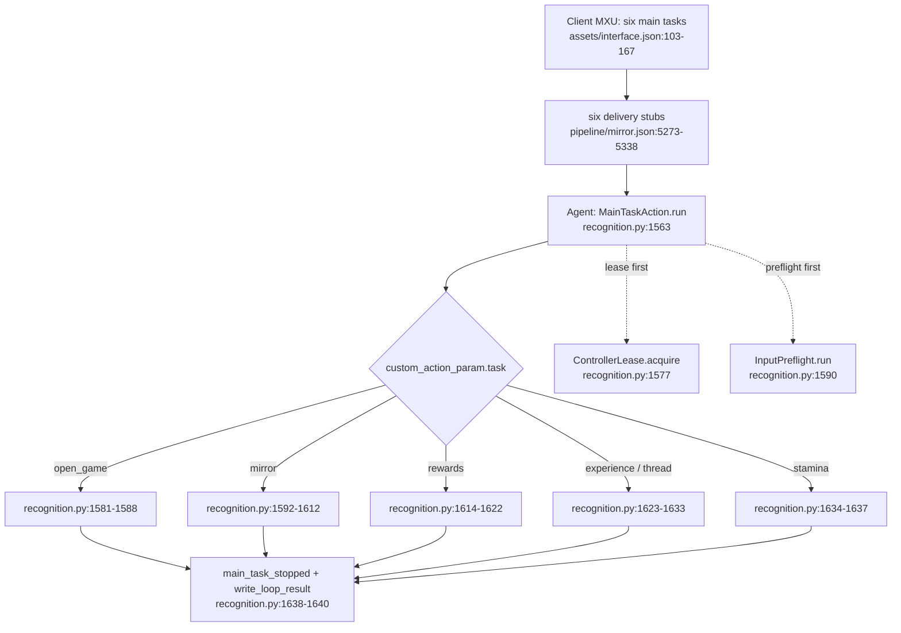
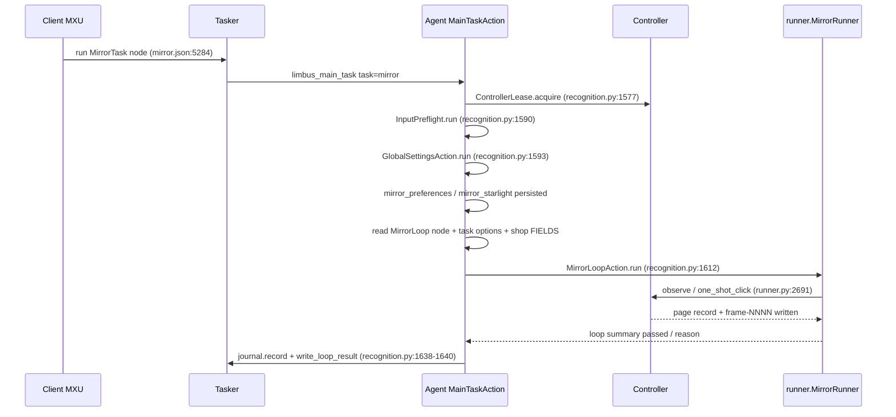

# 4 Business Flows

[中文](../zh_cn/4-business-flows.md) · [← Index](index.md)

This chapter answers "after the user clicks a main task in MXU, what actually happens in the game, and in what order". Vocabulary follows chapter 3: Controller (screenshots/input), Resource (images/models/Pipeline/localization), Tasker (the recognition-action loop that runs a Pipeline), Agent (custom recognition/actions), plus this project's own Client layer (`desktop/mxu/`, which MaaFramework does not have).

Reading convention: `path:line` is a verifiable anchor; anything this chapter did not open and confirm itself is collected in the final section "Unverified / To Be Confirmed".

Short forms used inside diagrams only (the body always writes full paths): `mirror.json` = `assets/resource/base/pipeline/mirror.json`; `recognition.py` = `agent/recognition.py`; `runner.py` = `src/maalimbus/runner.py`.

---

## 4.1 Six Entries and the Single Dispatch Function

### 4.1.1 The Entries Are Delivery Stubs, Not Flowcharts

ProjectInterface declares six main tasks (`assets/interface.json:103-167`), and each task's `entry` points at one Pipeline node:

| Task name | entry node | option | Declaration lines |
|---|---|---|---|
| `open_game` | `OpenGameTask` | none | `assets/interface.json:104-110` |
| `mirror_loop` | `MirrorTask` | 10 | `assets/interface.json:111-129` |
| `experience` | `ExperienceTask` | `experience_team` | `assets/interface.json:130-139` |
| `thread` | `ThreadTask` | `thread_team` | `assets/interface.json:140-149` |
| `rewards` | `RewardsTask` | `reward_module_budget` | `assets/interface.json:150-159` |
| `stamina` | `StaminaTask` | none | `assets/interface.json:160-166` |

The six nodes live in the same Pipeline file and **look identical**: `recognition: DirectHit`, `action: Custom`, `custom_action: limbus_main_task`, `custom_action_param.task` hard-coded to one of the six values above, and finally **`next: []`, `on_error: []`**.

- Node start lines: `assets/resource/base/pipeline/mirror.json:5273` (OpenGameTask), `:5284` (MirrorTask), `:5295` (ExperienceTask), `:5306` (ThreadTask), `:5317` (RewardsTask), `:5328` (StaminaTask).
- In other words: **the Pipeline graph performs no flow orchestration on these six paths.** It only delivers "which task the user clicked" to the Agent; the real branching, preflight checks, loops and shutdown all live in Python.
- The design is pinned by a test: `tests/test_main_task_dispatch.py:23 test_six_main_tasks_reference_saved_builds_and_no_diagnostic_entry` asserts all six `entry` nodes have `custom_action` equal to `limbus_main_task`, and that none of the six tasks is checked by default.
- Conversely, grepping under `src/maalimbus/` finds none of `ExperienceTask`/`ThreadTask`/`StaminaTask`/`RewardsTask`: the entries of these six paths exist only in the Pipeline and `assets/interface.json`.

### 4.1.2 The Unified Dispatch Skeleton

The Agent side registers exactly one custom action: `agent/main.py:69 AgentServer.register_custom_action('limbus_main_task',MainTaskAction(recognition))`. All business logic sits in `run()` of `agent/recognition.py:1556 class MainTaskAction` (`agent/recognition.py:1563`).

(For diagram short forms, see the top of this chapter.)

Three common steps happen before dispatch:

- Task-name validation: `from maalimbus.task_preferences import TASKS`, with `TASKS` defined at `src/maalimbus/task_preferences.py:5`; anything outside it raises `ValueError('Unknown main task')` (`agent/recognition.py:1566-1567`).
- Evidence directory: `agent/recognition.py:1337 def loop_directory(params)` first takes `params['directory']`, then the environment variable `MAALIMBUS_RUN_DIR` (constant at `agent/recognition.py:1265`); when neither exists it uses `ROOT/'evidence/runtime'/('pi-'+timestamp)` (`agent/recognition.py:1345-1346`). The six delivery stubs carry only `task` in `custom_action_param`, so the default evidence directory for a main task launched straight from the GUI is `evidence/runtime/pi-<yyyymmdd-hhmmss>/`; the `window-<...>` prefix used by the command-line tool does not go through this path.
- Single-controller gate: `ControllerLease.acquire(ROOT/'build/controller.lock')` (`agent/recognition.py:1577`). The lock's actual location is rewritten by `src/maalimbus/controller_lease.py:8 def lease_path` to `%LOCALAPPDATA%/MaaLimbus/controller.lock` (`src/maalimbus/controller_lease.py:12-14`), class defined at `src/maalimbus/controller_lease.py:18`. Failing to win the lock gives `reject('another_controller_owns_game')` (`agent/recognition.py:1578-1579`), with **zero input**.

### 4.1.3 Three Kinds of Termination and One Shared Exit

`run()` expresses "reject" through an inner function `reject(reason)` (`agent/recognition.py:1571`), which always writes `passed=False, reason=<cause>, input_sent=False, verified_clear=False`. Every branch ends at the same exit: `journal.record('main_task_stopped', **result)`, `write_loop_result(directory, result)`, `return bool(result.get('passed'))` (`agent/recognition.py:1638-1640`).

| Termination kind | Meaning | Typical reason | Input already sent |
|---|---|---|---|
| success | the path's own declared requirement was verified | `existing_windows_game_verified` / `game_foreground_after_native_launch` / `game_already_foreground` | branch-dependent |
| reject | a precondition failed; stops before any action | `another_controller_owns_game` / `Actual Windows game identity failed` / `Actual controller identity failed` | no |
| stop | reached a boundary or an unimplemented point, saves the scene, then stops | `task_page_policy_not_implemented` / `lux_navigation_successor_requires_verification` | branch-dependent |

Evidence output is always of two kinds: `Journal` (`agent/recognition.py:76`) appends `events.jsonl` into the directory (`agent/recognition.py:82-85`); `Journal.frame()` writes one `frame-NNNN.png` + `frame-NNNN.json` pair per frame (`agent/recognition.py:87-97`); finally `write_loop_result()` writes one `agent-result.json` (`agent/recognition.py:1372-1375`). Real instances: `dist/MaaLimbus/evidence/runtime/pi-20261012-112240/events.jsonl` (`docs/acceptance.md:10`), and `dist/MaaLimbus/evidence/runtime/pi-20261012-123906/` (66 frames, 179 events, `docs/acceptance.md:1367`).

---

## 4.2 `open_game`: Launch the Game

- **Trigger entry**: `OpenGameTask` (`assets/resource/base/pipeline/mirror.json:5273`), with `custom_action_param.task='open_game'` and no option. UI text at `assets/i18n/zh_cn.json:75-76`: on Android, launch with Maa and confirm foreground, and do not relaunch when the game is already open; on Windows, connect the game window first.
- **Step-by-step business actions** (`agent/recognition.py:1581-1588`):
  1. Read `context.tasker.controller.info.get('type')`.
  2. If it is already `win32`: run `InputPreflight` (`agent/recognition.py:1196`); failure gives `reject('Actual Windows game identity failed')`; passing returns directly with `passed=True, reason='existing_windows_game_verified', input_sent=False`, **without relaunching the game**.
  3. Otherwise call `maalimbus.game_launch.open_game(controller, data_directory(ROOT), journal)` (`src/maalimbus/game_launch.py:8`).
- **Cold launch internals** (`src/maalimbus/game_launch.py`): an ADB controller is required, otherwise it raises (`:11-12`); first it checks whether the game is already foreground, and a hit on `PACKAGE+'/'` returns `game_already_foreground` directly (`:19-24`); if the persistent intent file `user-open-game-transaction.json` (`:14`) already holds an unfinished transaction, a second launch is refused (`:25-26`); it writes the intent, `journal.record('game_launch_intent')`, then `controller.post_start_app(LAUNCH_INTENT)` (`:27-31`); up to 5 rounds independently confirm the foreground (`:32-39`), success being `game_foreground_after_native_launch`, otherwise `launch_foreground_not_proven` with `pending=True` (`:40`).
- **Termination conditions**: success = the foreground is independently confirmed (one of the three reasons above); reject = the controller is not ADB, another unfinished launch transaction exists, or the identity preflight fails; stop = 5 rounds still do not prove the foreground (`pending=True`).
- **Evidence produced**: `game_launch_intent` / `game_open_observed` events + `user-open-game-transaction.json` + `agent-result.json`.

## 4.3 `mirror`: Automatic Mirror Dungeon

- **Trigger entry**: `MirrorTask` (`assets/resource/base/pipeline/mirror.json:5284`), with 10 options (`assets/interface.json:117-128`); UI text at `assets/i18n/zh_cn.json:77-78`.
- **Step-by-step business actions** (`agent/recognition.py:1592-1612`):
  1. `GlobalSettingsAction.run` (`agent/recognition.py:1455`, `:1462`) first persists the globally edited teams and mirror queues from the overall settings, recording `global_build_settings_applied` with `device_input=False`.
  2. `mirror_preferences.collect` (`src/maalimbus/mirror_preferences.py:6`) → `apply` (`:21`): writes this run's per-item collector allow/deny and theme-pack preferences into the saved teams.
  3. `mirror_starlight.collect` (`src/maalimbus/mirror_starlight.py:74`) → `apply` (`:17`): source and budget of the Starlight rules.
  4. Read the `MirrorLoop` node's `custom_action_param`, then layer on the initial keywords, gift search, step cap and deployment assignment from `mirror_task_options.collect` (`src/maalimbus/mirror_task_options.py:5`).
  5. Use `shop_settings.FIELDS` (`src/maalimbus/shop_settings.py:45`) to overlay the three nodes `MirrorShopPolicy` / `MirrorShopRefreshLimit` / `MirrorShopCoinReserve` item by item into the parameters (`agent/recognition.py:1607-1610`); the resolution logic is `src/maalimbus/shop_settings.py:134 resolve_shop_settings` and `:282 collect`.
  6. Hand over to `MirrorLoopAction.run` (`agent/recognition.py:1473`, `:1494`): create the directory, read parameters and budget (`:1496-1499`, default 5400 seconds, `agent/recognition.py:1270`), assemble `runner.MaaDevice` (`:1509`) and `runner.MaaObserver` (`:1510`), then build `runner.MirrorRunner` (`:1257`, `:1518`) and call `run(steps, interval, round_limit, deadline)` (`src/maalimbus/runner.py:2691`).
  7. Inside the loop, each step's decision reads a set of independent policy pieces: `src/maalimbus/mirror_learning_policy.py:1304 strategy_score`, `:587 plan_route`, `:779 shop_plan`, `:931 skill_replacement`, `:432 gift_utility`; `src/maalimbus/route_plan.py:108 plan_route`, `src/maalimbus/gift_plan.py:15 load`, `src/maalimbus/shop_priority.py:5 load`, `src/maalimbus/auto_formation.py:17 choose_identity`, `src/maalimbus/budget.py:66 plan_spend`.
- **Step-by-step sequence**:

- **Termination conditions** (`agent/recognition.py:1528-1553`): success = loop summary `passed=true`; stop = this round's budget exhausted or a device job timed out, recorded as `loop_deadline_exceeded`; failure = the loop raised, recorded as `mirror_loop_error` (with traceback) returning `passed=False, reason='mirror_loop_failed'`.
- **Evidence produced**: `mirror_loop_start` / `mirror_loop_stopped` / `mirror_loop_error` events, `agent-result.json` and a human-readable run log.

## 4.4 `experience`: Automatic Experience Stage

- **Trigger entry**: `ExperienceTask` (`assets/resource/base/pipeline/mirror.json:5295`), option `experience_team` (`assets/interface.json:136-138`); UI text at `assets/i18n/zh_cn.json:79-80`, which states plainly that "stage selection, combat and cost verification are not supported yet".
- **Step-by-step business actions** (`agent/recognition.py:1623-1633`): first `lux_task.prepare(data_directory(ROOT), 'experience', choice)` (`src/maalimbus/lux_task.py:21`), where `choice` comes from `context.get_node_data('LuxExperienceTeam')['attach']['slot']`; `prepare` first runs `check_run` (`src/maalimbus/lux_task.py:11`) to refuse navigation while a mirror run is unfinished, then validates and saves the default team; failure gives `reject(str(error))`. Then it builds `local_device(..., deadline=now+45)` (`src/maalimbus/runner.py:379`) and calls `execute` (`src/maalimbus/lux_task.py:65`), with `result['saved_team']={slot, keywords, deployment}` attached.
- **Step-by-step business actions (navigation part)**: `target(record)` (`src/maalimbus/lux_task.py:45`) recognizes only two pages: `HOME`'s three independently readable widgets Window / Sinners / Inventory plus a unique `Drive`, and `DRIVE`'s `Luxcavation`; past `DRIVE` there is no independently verified next stop.
- **Termination conditions**: reject = an unfinished mirror run (`active_mirror_run_blocks_lux_navigation`), an illegal choice, or an existing intent belonging to another task/team; stop = the session ended or the input bound was exceeded, and `lux_task.execute` returns `lux_navigation_successor_requires_verification` after successfully clicking Drive (`src/maalimbus/lux_task.py:127-128`), which **does not count as pass**.
- **Evidence produced**: `lux-menu-home-input.json` / `lux-menu-drive-input.json` input reports, `user-lux-task-transaction.json` intent file, `lux_navigation_stopped` event, `agent-result.json`.

## 4.5 `thread`: Automatic Thread Stage

- **Trigger entry**: `ThreadTask` (`assets/resource/base/pipeline/mirror.json:5306`), option `thread_team` (`assets/interface.json:146-148`); UI text at `assets/i18n/zh_cn.json:81-82`, with the same unsupported scope as the experience stage.
- **Step-by-step business actions**: shares one code path with `experience` (`agent/recognition.py:1623-1633`), differing only in `task='thread'` and the node name `LuxThreadTeam`. `lux_task.prepare` (`src/maalimbus/lux_task.py:21`) selects the saved team via `luxcavation[task+'_team']`, and `lux_task.execute` (`src/maalimbus/lux_task.py:65`) uses the same `HOME`→`DRIVE` navigation.
- **Termination conditions**: exactly as in 4.4 (same function, same reason set).
- **Evidence produced**: same as 4.4, only with `task='thread'` in the report; event names remain `lux-menu-<scene>-input.json`.
- **Stated status**: `README.md:51` lists experience/thread as verified for "independent task entries referencing saved teams", with the unfinished part being "the actual stage, cost and combat flow; currently saves the scene and stops". `docs/acceptance.md:1315-1322` likewise admits only menu navigation, leaving actual Lux stage selection, farming, cost/receipt and GUI dispatch open.

## 4.6 `rewards`: Claim Rewards

- **Trigger entry**: `RewardsTask` (`assets/resource/base/pipeline/mirror.json:5317`), option `reward_module_budget` (`assets/interface.json:155-158`); UI text at `assets/i18n/zh_cn.json:83-84` (requires this round's module budget; mail and daily-quest claiming are not supported yet).
- **Step-by-step business actions** (`agent/recognition.py:1614-1622`): first `reward_task_budget.apply(..., get_node_data('RewardModuleBudget')['attach']['maximum'])` (`src/maalimbus/reward_task_budget.py:6`), which requires a currently existing "verified, unpaid five-floor clear" run and binds the cap to that scope; then `reward_task.execute` (`src/maalimbus/reward_task.py:72`), with a 90-second deadline (`agent/recognition.py:1619`).
- **Step-by-step business actions (claim loop)**: each round `execute` calls `runner.observe` (`src/maalimbus/runner.py:657`) to read one page; `action_for` (`src/maalimbus/reward_task.py:15`) maps the page to `claim` / `confirm` / `receipt` / `pass` (`src/maalimbus/reward_task.py:10 ACTIONS`); then `runner.one_shot_click` sends one click and writes a `reward-<action>-input.json` input report; only back on `HOME` does it call `finish` (`src/maalimbus/reward_task.py:27`) to audit receipts and advance rotation. The loop is bounded at 5 iterations (`src/maalimbus/reward_task.py:108`).
- **Termination conditions**: success = `finish` passes the receipt chain and the independent HOME verification, returning `mirror_payout_and_home_verified` (`src/maalimbus/reward_task.py:68`); reject = there is no verified complete mirror run, returning `completed_mirror_run_required` (`:97-99`); stop = the page/successor is unproven, the input bound is exhausted, or the device was interrupted (`:115`, `:129-132`).
- **Evidence produced**: `reward-<action>-input.json` input reports, `user-reward-claim-transaction.json` transaction, `user-run-ledger.json` ledger events, `reward_task_stopped` event, `agent-result.json`.

## 4.7 `stamina`: Stamina Exchange (Not Implemented)

- **Trigger entry**: `StaminaTask` (`assets/resource/base/pipeline/mirror.json:5328`), no option; UI text at `assets/i18n/zh_cn.json:85-86`: "in-budget stamina exchange recognition is still in development; it currently saves the scene and stops, without spending".
- **Step-by-step business actions** (`agent/recognition.py:1634-1637`): `stamina` falls into the branch beyond mirror — it only does one `runner.observe(observer, now+30)` (`src/maalimbus/runner.py:657`), then puts the observation record into the result and returns.
- **Termination conditions**: **it never passes.** The result is fixed at `passed=False, reason='task_page_policy_not_implemented', input_sent=False, verified_clear=False` (`agent/recognition.py:1636-1637`); no stamina or currency is spent.
- **Evidence produced**: the frame pair from one observation + a `main_task_stopped` event + `agent-result.json`; the unit test `tests/test_main_task_dispatch.py:44 test_unimplemented_task_captures_evidence_and_returns_failure_without_input` pins "captures evidence, returns failure, zero input".
- **Stated status**: `README.md:52` lists stamina exchange / daily rewards as verified for "independent entry and budget basis", with the unfinished part being "the actual page and settlement; currently saves the scene and stops"; `docs/acceptance.md:944` likewise admits only a pure budget boundary passing, with no spending implementation.

---

## 4.8 Unverified / To Be Confirmed

Every anchor this chapter opened and confirmed appears as a `path:line` above. The following are **not** independently verified here and are listed honestly:

- **End-to-end GUI dispatch unverified**: none of the six paths was clicked through a real-device GUI for this chapter. The "six native task entries" recorded at `docs/acceptance.md:156-158` only rendered six options on the same GUI, with the task disabled at the time, no game connection, and no GUI Start dispatch.
- **`open_game` cold launch unverified**: `docs/acceptance.md:158` states outright that cold launch is still unaccepted (only "MuMu already in foreground" was separately verified not to relaunch, with zero input).
- **`mirror` real-device result unverified**: the real-device run cited here (`pi-20261012-112240`) ended with `reason=unexpected_successor`, `passed=false` (`docs/acceptance.md:2-8`) — a stopping point, not a clear.
- **`experience`/`thread`/`stamina` page policies unimplemented**: all three still have no stage/page policy code, and the body records them as "unimplemented" per the current state at `src/maalimbus/lux_task.py:127-128`, `agent/recognition.py:1636-1637` and `README.md:51-52`.
- **`rewards` real-device paid claiming unverified**: `docs/acceptance.md:1284-1287` says the actual GUI Start dispatch and the current Team7 five-times paid claim are still unverified, with only the retained receipt chain proven offline.
- **Policy-piece internals not line-checked**: the `mirror_learning_policy.py` / `route_plan.py` / `gift_plan.py` / `shop_priority.py` / `auto_formation.py` / `budget.py` listed in 4.3 had only their top-level symbols and line numbers checked, not their full implementations read line by line.
- **Evidence directory prefix**: the default prefix from `loop_directory` is `pi-` (`agent/recognition.py:1345-1346`); this chapter did not compare the actual `evidence/runtime/` directory listing on every machine, and only cites paths already registered in `docs/acceptance.md`.
- **`InputPreflight`'s `win32` branch internals**: only the entry to window uniqueness and identity checking was read (`agent/recognition.py:1230-1239`); the later verification details and the `input_helpers` report format are not unfolded.
