# 4 Business Flows

[中文](../zh_cn/4-business-flows.md) · [← Index](index.md)

This chapter answers "after the user clicks a main task in MXU, what actually happens in the game, and in what order". Vocabulary follows chapter 3: Controller (screenshots/input), Resource (images/models/Pipeline/localization), Tasker (the recognition-action loop that runs a Pipeline), Agent (custom recognition/actions), plus this project's own Client layer (`desktop/mxu/`, which MaaFramework does not have).

Reading convention: `path:line` is a verifiable anchor; anything this chapter did not open and confirm itself is collected in the final section "Unverified / To Be Confirmed".

Short forms used inside diagrams only (the body always writes full paths): `mirror.json` = `assets/resource/base/pipeline/mirror.json`; `recognition.py` = `agent/recognition.py`; `runner.py` = `src/maalimbus/runner.py`.

---

## 4.1 Six Entries and the Single Dispatch Function

### 4.1.1 The Entries Are Delivery Stubs, Not Flowcharts

ProjectInterface declares six main tasks (`assets/interface.json:103-167`), and each task's `entry` points at one Pipeline node:

| Task name | entry node | option | Declaration lines |
|---|---|---|---|
| `open_game` | `OpenGameTask` | none | `assets/interface.json:104-110` |
| `mirror_loop` | `MirrorTask` | 10 | `assets/interface.json:111-129` |
| `experience` | `ExperienceTask` | `experience_team` | `assets/interface.json:130-139` |
| `thread` | `ThreadTask` | `thread_team` | `assets/interface.json:140-149` |
| `rewards` | `RewardsTask` | `reward_module_budget` | `assets/interface.json:150-159` |
| `stamina` | `StaminaTask` | none | `assets/interface.json:160-166` |

The six nodes live in the same Pipeline file and **look identical**: `recognition: DirectHit`, `action: Custom`, `custom_action: limbus_main_task`, `custom_action_param.task` hard-coded to one of the six values above, and finally **`next: []`, `on_error: []`**.

- Node start lines: `assets/resource/base/pipeline/mirror.json:5273` (OpenGameTask), `:5284` (MirrorTask), `:5295` (ExperienceTask), `:5306` (ThreadTask), `:5317` (RewardsTask), `:5328` (StaminaTask).
- In other words: **the Pipeline graph performs no flow orchestration on these six paths.** It only delivers "which task the user clicked" to the Agent; the real branching, preflight checks, loops and shutdown all live in Python.
- The design is pinned by a test: `tests/test_main_task_dispatch.py:24 test_six_main_tasks_reference_saved_builds_and_no_diagnostic_entry` asserts all six `entry` nodes have `custom_action` equal to `limbus_main_task`, and that none of the six tasks is checked by default.
- Conversely, grepping under `src/maalimbus/` finds none of `ExperienceTask`/`ThreadTask`/`StaminaTask`/`RewardsTask`: the entries of these six paths exist only in the Pipeline and `assets/interface.json`.

### 4.1.2 The Unified Dispatch Skeleton

The Agent side registers exactly one custom action: `agent/main.py:69 AgentServer.register_custom_action('limbus_main_task',MainTaskAction(recognition))`. All business logic sits in `run()` of `agent/recognition.py:1564 class MainTaskAction` (`agent/recognition.py:1571`).

**Business-process view (Mirror):** This diagram shows business decisions and outcomes; function calls are not business steps.

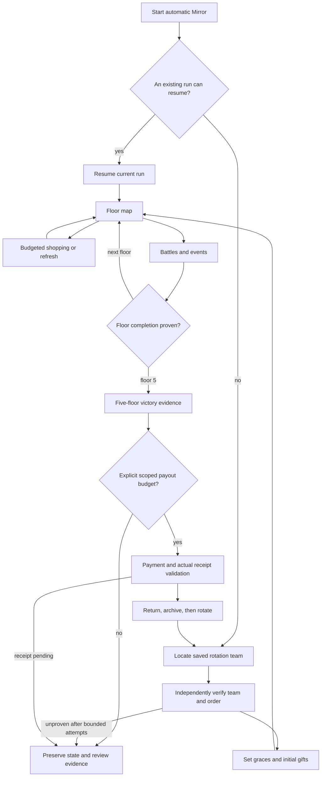

(For diagram short forms, see the top of this chapter.)

Three common steps happen before dispatch:

- Task-name validation: `from maalimbus.task_preferences import TASKS`, with `TASKS` defined at `src/maalimbus/task_preferences.py:5`; anything outside it raises `ValueError('Unknown main task')` (`agent/recognition.py:1566-1567`).
- Evidence directory: `agent/recognition.py:1326 def loop_directory(params)` first takes `params['directory']`, then the environment variable `MAALIMBUS_RUN_DIR` (constant at `agent/recognition.py:1265`); when neither exists it uses `ROOT/'evidence/runtime'/('pi-'+timestamp)` (`agent/recognition.py:1345-1346`). The six delivery stubs carry only `task` in `custom_action_param`, so the default evidence directory for a main task launched straight from the GUI is `evidence/runtime/pi-<yyyymmdd-hhmmss>/`; the `window-<...>` prefix used by the command-line tool does not go through this path.
- Single-controller gate: `ControllerLease.acquire(ROOT/'build/controller.lock')` (`agent/recognition.py:1577`). The lock's actual location is rewritten by `src/maalimbus/controller_lease.py:8 def lease_path` to `%LOCALAPPDATA%/MaaLimbus/controller.lock` (`src/maalimbus/controller_lease.py:12-14`), class defined at `src/maalimbus/controller_lease.py:18`. Failing to win the lock gives `reject('another_controller_owns_game')` (`agent/recognition.py:1578-1579`), with **zero input**.

### 4.1.3 Three Kinds of Termination and One Shared Exit

`run()` expresses "reject" through an inner function `reject(reason)` (`agent/recognition.py:1579`), which always writes `passed=False, reason=<cause>, input_sent=False, verified_clear=False`. Every branch ends at the same exit: `journal.record('main_task_stopped', **result)`, `write_loop_result(directory, result)`, `return bool(result.get('passed'))` (`agent/recognition.py:1638-1640`).

| Termination kind | Meaning | Typical reason | Input already sent |
|---|---|---|---|
| success | the path's own declared requirement was verified | `existing_windows_game_verified` / `game_foreground_after_native_launch` / `game_already_foreground` | branch-dependent |
| reject | a precondition failed; stops before any action | `another_controller_owns_game` / `Actual Windows game identity failed` / `Actual controller identity failed` | no |
| stop | reached a boundary or an unimplemented point, saves the scene, then stops | `task_page_policy_not_implemented` / `lux_navigation_successor_requires_verification` | branch-dependent |

Evidence output is always of two kinds: `Journal` (`agent/recognition.py:76`) appends `events.jsonl` into the directory (`agent/recognition.py:82-85`); `Journal.frame()` writes one `frame-NNNN.png` + `frame-NNNN.json` pair per frame (`agent/recognition.py:87-97`); finally `write_loop_result()` writes one `agent-result.json` (`agent/recognition.py:1372-1375`). Real instances: `dist/MaaLimbus/evidence/runtime/pi-20261012-112240/events.jsonl` (`docs/acceptance.md:10`), and `dist/MaaLimbus/evidence/runtime/pi-20261012-123906/` (66 frames, 179 events, `docs/acceptance.md:1367`).

---

## 4.2 `open_game`: Launch the Game

- **Trigger entry**: `OpenGameTask` (`assets/resource/base/pipeline/mirror.json:5273`), with `custom_action_param.task='open_game'` and no option. UI text at `assets/i18n/zh_cn.json:75-76`: on Android, launch with Maa and confirm foreground, and do not relaunch when the game is already open; on Windows, connect the game window first.
- **Step-by-step business actions** (`agent/recognition.py:1581-1588`):
  1. Read `context.tasker.controller.info.get('type')`.
  2. If it is already `win32`: run `InputPreflight` (`agent/recognition.py:1196`); failure gives `reject('Actual Windows game identity failed')`; passing returns directly with `passed=True, reason='existing_windows_game_verified', input_sent=False`, **without relaunching the game**.
  3. Otherwise call `maalimbus.game_launch.open_game(controller, data_directory(ROOT), journal)` (`src/maalimbus/game_launch.py:8`).
- **Cold launch internals** (`src/maalimbus/game_launch.py`): an ADB controller is required, otherwise it raises (`:11-12`); first it checks whether the game is already foreground, and a hit on `PACKAGE+'/'` returns `game_already_foreground` directly (`:19-24`); if the persistent intent file `user-open-game-transaction.json` (`:14`) already holds an unfinished transaction, a second launch is refused (`:25-26`); it writes the intent, `journal.record('game_launch_intent')`, then `controller.post_start_app(LAUNCH_INTENT)` (`:27-31`); up to 5 rounds independently confirm the foreground (`:32-39`), success being `game_foreground_after_native_launch`, otherwise `launch_foreground_not_proven` with `pending=True` (`:40`).
- **Termination conditions**: success = the foreground is independently confirmed (one of the three reasons above); reject = the controller is not ADB, another unfinished launch transaction exists, or the identity preflight fails; stop = 5 rounds still do not prove the foreground (`pending=True`).
- **Evidence produced**: `game_launch_intent` / `game_open_observed` events + `user-open-game-transaction.json` + `agent-result.json`.

### 4.2.1 Launch intent and foreground confirmation

This covers the implemented open-game task, not relogin or closing another game. It is not invoked during the current pause. Complete live cold-launch acceptance remains open.

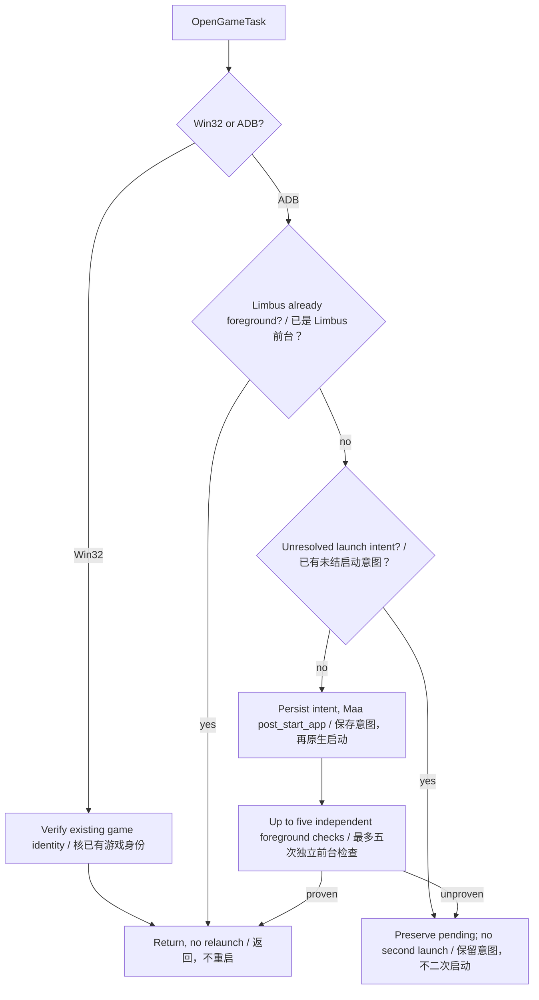

Source boundaries: `src/maalimbus/game_launch.py:8` (`open_game`); `agent/recognition.py:1` (`MainTaskAction.run`).

## 4.3 `mirror`: Automatic Mirror Dungeon

- **Trigger entry**: `MirrorTask` (`assets/resource/base/pipeline/mirror.json:5284`), with 10 options (`assets/interface.json:117-128`); UI text at `assets/i18n/zh_cn.json:77-78`.
- **Step-by-step business actions** (`agent/recognition.py:1592-1612`):
  1. `GlobalSettingsAction.run` (`agent/recognition.py:1455`, `:1462`) first persists the globally edited teams and mirror queues from the overall settings, recording `global_build_settings_applied` with `device_input=False`.
  2. `mirror_preferences.collect` (`src/maalimbus/mirror_preferences.py:6`) → `apply` (`:21`): writes this run's per-item collector allow/deny and theme-pack preferences into the saved teams.
  3. `mirror_starlight.collect` (`src/maalimbus/mirror_starlight.py:74`) → `apply` (`:17`): source and budget of the Starlight rules.
  4. Read the `MirrorLoop` node's `custom_action_param`, then layer on the initial keywords, gift search, step cap and deployment assignment from `mirror_task_options.collect` (`src/maalimbus/mirror_task_options.py:5`).
  5. Use `shop_settings.FIELDS` (`src/maalimbus/shop_settings.py:45`) to overlay the three nodes `MirrorShopPolicy` / `MirrorShopRefreshLimit` / `MirrorShopCoinReserve` item by item into the parameters (`agent/recognition.py:1607-1610`); the resolution logic is `src/maalimbus/shop_settings.py:134 resolve_shop_settings` and `:282 collect`.
  6. Hand over to `MirrorLoopAction.run` (`agent/recognition.py:1478`, `:1499`): create the directory, read parameters and budget (`:1501-1504`, default 5400 seconds, `agent/recognition.py:1259`), assemble `runner.MaaDevice` (`:1517`) and `runner.MaaObserver` (`:1518`), then build `runner.MirrorRunner` (`:1257`, `:1526`) and call `run(steps, interval, round_limit, deadline)` (`src/maalimbus/runner.py:2907`).
  7. Inside the loop, each step's decision reads a set of independent policy pieces: `src/maalimbus/mirror_learning_policy.py:1304 strategy_score`, `:587 plan_route`, `:779 shop_plan`, `:931 skill_replacement`, `:432 gift_utility`; `src/maalimbus/route_plan.py:108 plan_route`, `src/maalimbus/gift_plan.py:15 load`, `src/maalimbus/shop_priority.py:5 load`, `src/maalimbus/auto_formation.py:17 choose_identity`, `src/maalimbus/budget.py:66 plan_spend`.
- **Step-by-step sequence**:

- **Termination conditions** (`agent/recognition.py:1528-1553`): success = loop summary `passed=true`; stop = this round's budget exhausted or a device job timed out, recorded as `loop_deadline_exceeded`; failure = the loop raised, recorded as `mirror_loop_error` (with traceback) returning `passed=False, reason='mirror_loop_failed'`.
- **Evidence produced**: `mirror_loop_start` / `mirror_loop_stopped` / `mirror_loop_error` events, `agent-result.json` and a human-readable run log.

### 4.3.1 The inputs of one shop visit (including the dead-slot revive)

The shop page (`SHOP`) is not a page you glance at and leave: `src/maalimbus/window.py:594-652` allows exactly one input per shop frame, in a fixed order.

1. **Before buying anything, look for a dead slot.** `saved_order` / `unavailable` in `config/user-deployment-transaction.json` plus `shop_revive.key_losses(..., positions=KEY_POSITIONS=7)` (`src/maalimbus/shop_revive.py:269`) yield "the dead cards whose saved slot is among the first seven"; when that is not empty and the shop prints `Heal Sinner` (`shop_revive.py:85`, the service box inside `SERVICE_X=(180,660)` × `SERVICE_Y=(540,800)`, `:33-34`), that service is clicked first — `window.py:623`, `expect=(ANY,)`, `advance=True`, because the dialog it opens states what happens next on its own.
2. **Each of the dialog's three steps is proven by its own words.** `HEAL_SINNERS` (`vision.py:266-269`: the title **and** three numbered rows) → its own third row (`window.py:999`) → `REVIVE_PICK` (`vision.py:286-288`: `Select the Sinner to revive.` plus the title) → the dead portrait first (`shop_revive.slot_box(card)`, `BAR_FIRST_CENTER=112` + `BAR_PITCH=115`, `:180-187`), then the state button the dialog changes to (`window.py:583`) → `REVIVE_DONE` (`vision.py:283-285`: `… revived, returns to battle.` plus `Leave`) → its own `Leave` (`window.py:566`) back to the shop. Any step without its own words is refused right there (`_refuse`), never guessed.
3. **A revive spends money, so what is recorded is a receipt, not a click.** Planning writes `state['revive_receipt']=dict(card, cost, coins_before)`; back on the shop page, `deployment_transaction.book_revive` (`src/maalimbus/deployment_transaction.py:73`) is called — and `revives` written — only when `coins_before - current coins == cost`, otherwise `shop_revive_receipt_not_proven` is recorded. Live evidence `window-20261012-214803`: 3093 → 2993, `cost=100`, `card=6` (Hong Lu).
4. **The remaining inputs follow a fixed priority.** A card the gift plan wants, or one the visit must buy because it would otherwise carry out more than the cap (a `window.py:633` click, with the reason string `buying_the_gift_the_gift_plan_asked_for` / `spending_the_coins_this_visit_would_carry_out_on_the_shelf`) → a refresh (`window.py:643`, bounded by the refresh limit and the coin reserve) → leaving (`window.py:651`). A completed purchase is written at `shop_transaction.py:458` and a refresh receipt at `:478`; the confusable title matching is D14 in chapter 2.3.

The shape of those four steps — every hop gated by the words its own page prints, with no words meaning stop:

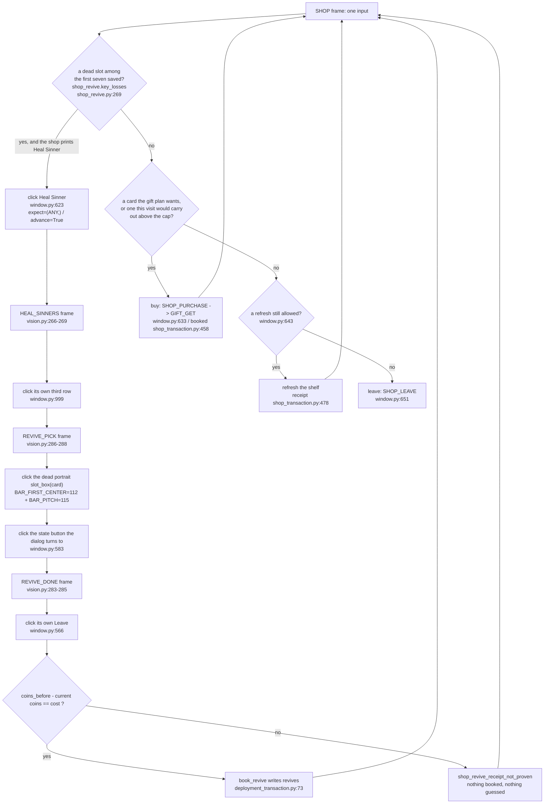

(Only the `window-20261012-214803` step has been walked live: the 3093 -> 2993 revive receipt. The whole route driven by one planner run is still on the unverified list, see 7.3.)

### 4.3.2 Entry and bidirectional team-list search

RunStore supplies the queue target; the currently selected game team does not override settings. A target above the viewport causes a downward finger swipe to return toward Team1/Team2. Two unchanged semantic lists reverse once, then block with evidence. The search spans loop steps and exits when found; twelve is a ceiling. Numbered slots 1–40 are supported; renamed slots require mapping. Live offscreen Team1/Team2 testing awaits resume.

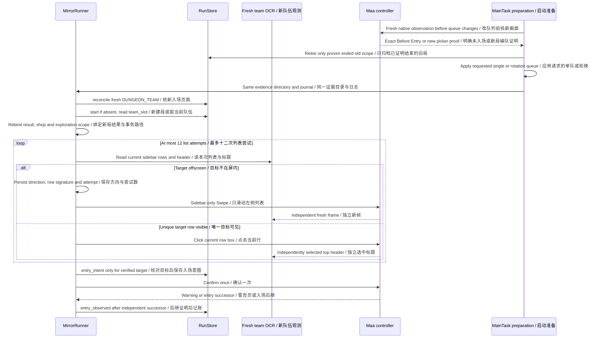

Startup does not clear old state from the broad MIRROR_ENTRY label: Before Entry and Enter require independent high-confidence readings with matching JSON/PNG hashes and dimensions. Active gameplay, pending entry and same-scope payout remain protected. Existing clear facts survive; no active dungeon does not imply payout. Queue changes follow this reconciliation. Expected settings refusal writes explicit result/human logs rather than an unexplained red task.

Source boundaries: `src/maalimbus/run_wiring.py:156` (`reconcile`); `src/maalimbus/team_navigation.py:1` (`browse`, `prepare`); `src/maalimbus/runner.py:1` (`MirrorRunner.step`).

### 4.3.3 Encounter deployment: reuse, correction and submission

Reuse requires printed deployment badges matching the saved sequence, not grid positions or a full participant count. Clear only a proven conflicting order. Capacity changes require independent unavailable-card evidence. Same-run revive receipts survive transaction preparation so a later encounter does not repay them.

The printed badge is not decided by one reading either: each card's band is read through three differently framed crops and a number is adopted only when two of them read the same one. A card no two framings can read keeps `None`, so the page continues collecting order evidence instead of being misread as a proven conflict that clears and re-picks. Live evidence: `evidence/runtime/packaged-mirror-20261014-063205/frame-0103.json` lost card 11's '4' to the original nested pair and the run stopped on `deployment_order_digits_incomplete_after_retries`; with a framing that keeps a margin all twelve read and the page clears and re-picks as a proven conflict. `evidence/runtime/packaged-mirror-20261012-101555/frame-0027.json` needs the original framing instead, so both are kept. `tools/verify_deployment_numbers_native.py` replays both pages without a controller and `tests/test_deployment_numbers.py` pins the framing rule.

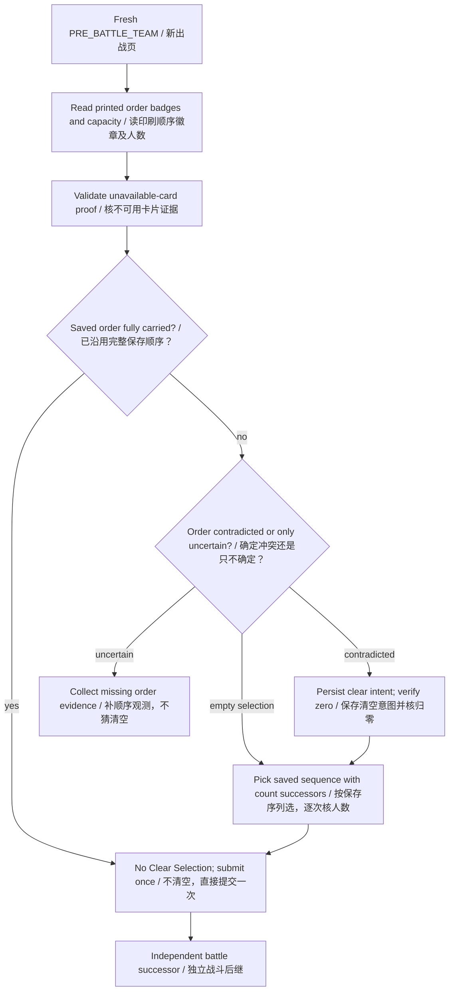

Source boundaries: `src/maalimbus/deployment_transaction.py:5` (`prepare`, `intent`, `observe`); `src/maalimbus/team_vision.py:1` (`assignment_numbers`, `carries_saved_order`); `src/maalimbus/deployment_numbers_native.py:1` (`read_assignments`).

### 4.3.4 Floor gifts: selection, receipts and recovery

Each edge is a guarded transaction transition, not an assumption that a click succeeded. GIFT_GET, GIFT_PICK, REWARD_CARD, THEME_PACKS and MAP are successor families; exact names, next offers or final completion conditions are still required. Recovery and immediate settling share the reader and never replay GET acknowledgement. Owned-gift substitutions retain expected/printed names.

```mermaid
stateDiagram-v2
  [*] --> Picking
  Picking --> PickPending: persist pick intent before input
  PickPending --> Picking: exact same offer and counter plus one
  Picking --> CommitPending: required selections; Select once
  CommitPending --> ReceiptPending: full named GET; persist ack intent
  ReceiptPending --> CommitPending: next named notice independently proven
  ReceiptPending --> Completed: final successor independently proven
  ReceiptPending --> ReceiptPending: missing successor; observe only, no replay
  PickPending --> PickPending: unknown counter; preserve pending
  Completed --> [*]
```

Source boundaries: `src/maalimbus/floor_gift_transaction.py:10` (`RECEIPT_SUCCESSOR_PAGES`, `observe_receipt`); `src/maalimbus/runner.py:1` (`_receipt_successor_offers`, `_resolve_floor_receipt`).

### 4.3.5 Initial gifts, search and floor themes

Starlight has a separate same-run visible-cost and budget gate; this diagram grants no spending. Initial named GET receipts, search-refusal confirmation and theme swipes are separate transactions and cannot replay merely because the next page is slow. This summarizes stages, not live acceptance of every search branch.

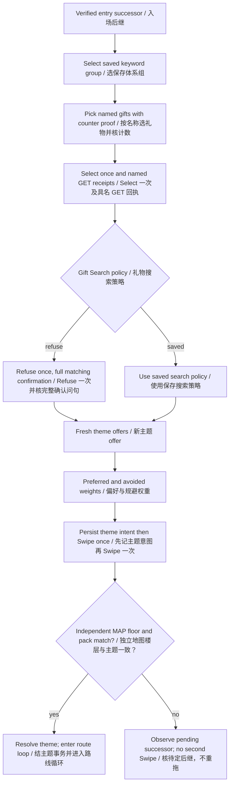

Source boundaries: `src/maalimbus/initial_gifts.py:1`; `src/maalimbus/initial_transaction.py:1`; `src/maalimbus/theme_transaction.py:5` (`intent`, `observe`).

### 4.3.5.1 Recovery of a sent star-card intent

`src/maalimbus/grace_balance_native.py:1` keeps two detected numeric reads under
an independent Available label. `src/maalimbus/grace_transaction.py:120`
reconciles only matching scope/configuration, retained frame hash/current visible
cost and an exact current delta. Missing evidence triggers observation retries,
never another purchase. Native retained tests pass; the current live recovery and
full-pipeline acceptance remain open. See the concrete plan in
[recovery and diagnostics](../../plan-20261014-recovery-diagnostics.md).

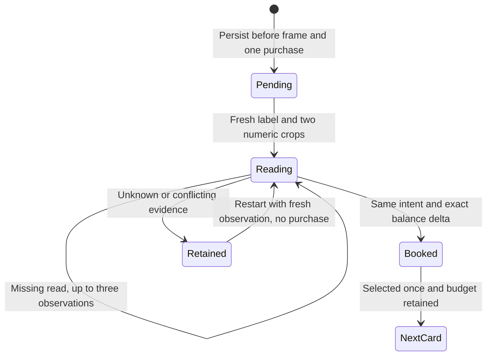

### 4.3.6 Battle assignment and actual progress

The saved option resolves to a concrete mode before this diagram. Individual skill-order editing and model-controlled assignment remain incomplete. Alternating HUD/UNKNOWN is not proof of battle progress; stalls retain the observed boundary. START commits a turn only.

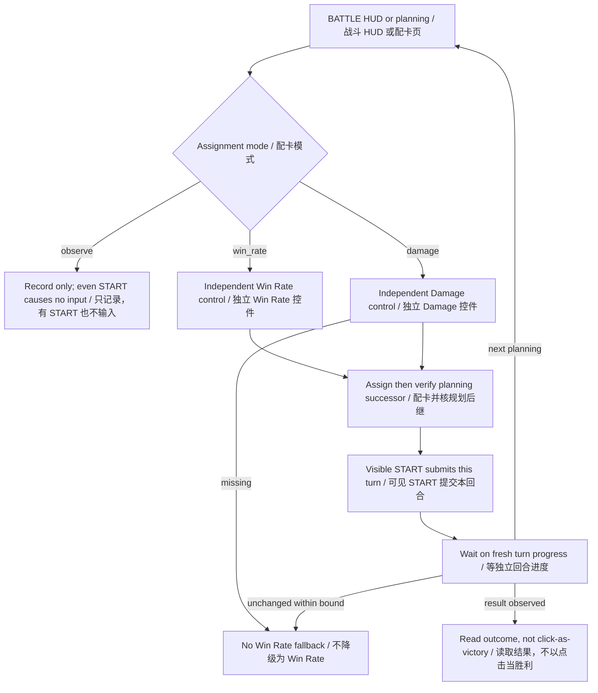

Source boundaries: `src/maalimbus/window.py:110` (`plan_step`); `src/maalimbus/battle_vision.py:1`; `src/maalimbus/runner.py:1`.

### 4.3.7 Routes and events are different decisions

A geometric node hit does not prove panel arrival. Unknown navigation, enemy trials and event choices have different policies; 3.7 return probes do not generalize to arbitrary Accept/Confirm. Missing policies can still block with evidence. Predicted story rewards are not acquired receipts.

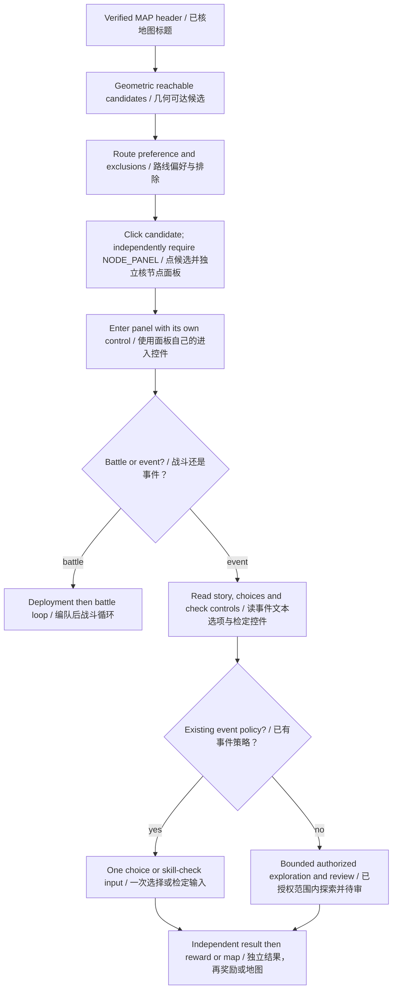

Source boundaries: `src/maalimbus/map_vision.py:1`; `src/maalimbus/event_vision.py:1`; `src/maalimbus/mirror_learning_policy.py:1`; `src/maalimbus/runner.py:1`.

### 4.3.8 Purchase and refresh settle separately

A Purchase dialog is still an offer, not a charge: deducted currency is not required on that page. Card, confirmation, GET and shelf receipt settle separately. The bought card may remain with its own Purchased badge or disappear. Refresh requires a complete independently changed shelf, not a guess from OCR counts. In-run coins are separate from Modules/Lunacy. Rules, economy priorities and refresh caps control execution; 3.9 models only preview scores.

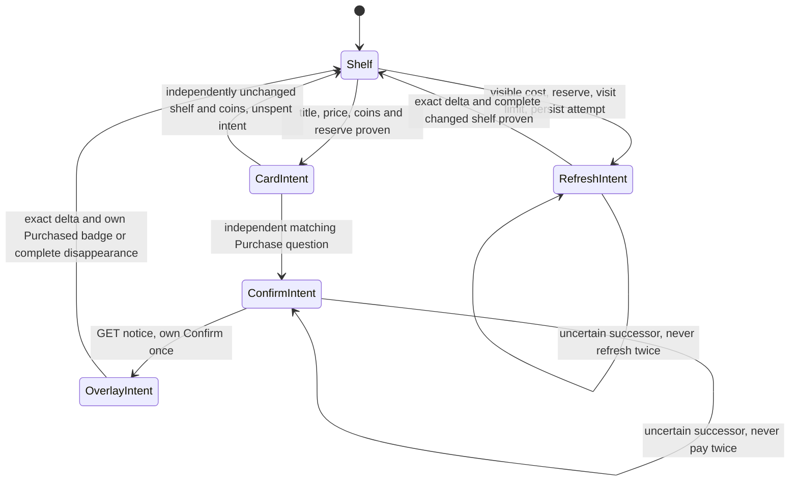

Source boundaries: `src/maalimbus/shop_transaction.py:147` (`ShopTransaction`); `src/maalimbus/shop_vision.py:1`; `src/maalimbus/shop_settings.py:1`; `src/maalimbus/shop_value_shadow.py:7`.

### 4.3.9 Catalogue, account box and automatic formation

The public catalogue does not contain account ownership; unobserved does not mean unowned. Mixed-system selection uses OR matching and ranks level before keyword coverage. A sinner detail-view round trip is not a complete box scan. Complete system-matched E.G.O equipping and live successors need separate acceptance; this diagram does not claim automatic equipment for every account.

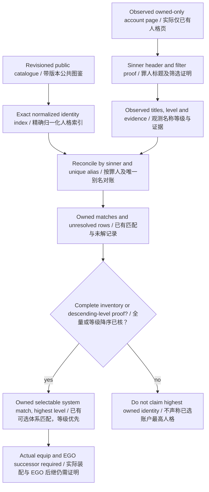

Source boundaries: `src/maalimbus/owned_inventory.py:1` (`build_index`, `reconcile_titles`); `src/maalimbus/sinner_collection.py:1`; `src/maalimbus/auto_formation.py:17` (`choose_identity`).

## 4.4 `experience`: Automatic Experience Stage

- **Trigger entry**: `ExperienceTask` (`assets/resource/base/pipeline/mirror.json:5295`), option `experience_team` (`assets/interface.json:136-138`); UI text at `assets/i18n/zh_cn.json:79-80`, which states plainly that "stage selection, combat and cost verification are not supported yet".
- **Step-by-step business actions** (`agent/recognition.py:1623-1633`): first `lux_task.prepare(data_directory(ROOT), 'experience', choice)` (`src/maalimbus/lux_task.py:21`), where `choice` comes from `context.get_node_data('LuxExperienceTeam')['attach']['slot']`; `prepare` first runs `check_run` (`src/maalimbus/lux_task.py:11`) to refuse navigation while a mirror run is unfinished, then validates and saves the default team; failure gives `reject(str(error))`. Then it builds `local_device(..., deadline=now+45)` (`src/maalimbus/runner.py:380`) and calls `execute` (`src/maalimbus/lux_task.py:65`), with `result['saved_team']={slot, keywords, deployment}` attached.
- **Step-by-step business actions (navigation part)**: `target(record)` (`src/maalimbus/lux_task.py:45`) recognizes only two pages: `HOME`'s three independently readable widgets Window / Sinners / Inventory plus a unique `Drive`, and `DRIVE`'s `Luxcavation`; past `DRIVE` there is no independently verified next stop.
- **Termination conditions**: reject = an unfinished mirror run (`active_mirror_run_blocks_lux_navigation`), an illegal choice, or an existing intent belonging to another task/team; stop = the session ended or the input bound was exceeded, and `lux_task.execute` returns `lux_navigation_successor_requires_verification` after successfully clicking Drive (`src/maalimbus/lux_task.py:127-128`), which **does not count as pass**.
- **Evidence produced**: `lux-menu-home-input.json` / `lux-menu-drive-input.json` input reports, `user-lux-task-transaction.json` intent file, `lux_navigation_stopped` event, `agent-result.json`.

### 4.4.1 Shared Experience and Thread menu chain

Both tasks share execution, differing in task key and saved team. Preparation gates precede configuration writes and device creation; execution checks Mirror exclusion again. Reaching the menu boundary is not farming completion: stage choice, cost, battle and receipts remain open.

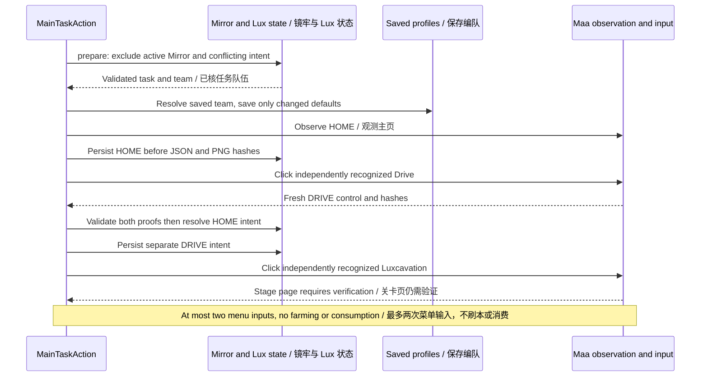

Source boundaries: `src/maalimbus/lux_task.py:11` (`check_run`, `prepare`, `execute`).

## 4.5 `thread`: Automatic Thread Stage

- **Trigger entry**: `ThreadTask` (`assets/resource/base/pipeline/mirror.json:5306`), option `thread_team` (`assets/interface.json:146-148`); UI text at `assets/i18n/zh_cn.json:81-82`, with the same unsupported scope as the experience stage.
- **Step-by-step business actions**: shares one code path with `experience` (`agent/recognition.py:1623-1633`), differing only in `task='thread'` and the node name `LuxThreadTeam`. `lux_task.prepare` (`src/maalimbus/lux_task.py:21`) selects the saved team via `luxcavation[task+'_team']`, and `lux_task.execute` (`src/maalimbus/lux_task.py:65`) uses the same `HOME`→`DRIVE` navigation.
- **Termination conditions**: exactly as in 4.4 (same function, same reason set).
- **Evidence produced**: same as 4.4, only with `task='thread'` in the report; event names remain `lux-menu-<scene>-input.json`.
- **Stated status**: `README.md:51` lists experience/thread as verified for "independent task entries referencing saved teams", with the unfinished part being "the actual stage, cost and combat flow; currently saves the scene and stops". `docs/acceptance.md:1315-1322` likewise admits only menu navigation, leaving actual Lux stage selection, farming, cost/receipt and GUI dispatch open.

## 4.6 `rewards`: Claim Rewards

- **Trigger entry**: `RewardsTask` (`assets/resource/base/pipeline/mirror.json:5317`), option `reward_module_budget` (`assets/interface.json:155-158`); UI text at `assets/i18n/zh_cn.json:83-84` (requires this round's module budget; mail and daily-quest claiming are not supported yet).
- **Step-by-step business actions** (`agent/recognition.py:1614-1622`): first `reward_task_budget.apply(..., get_node_data('RewardModuleBudget')['attach']['maximum'])` (`src/maalimbus/reward_task_budget.py:6`), which requires a currently existing "verified, unpaid five-floor clear" run and binds the cap to that scope; then `reward_task.execute` (`src/maalimbus/reward_task.py:72`), with a 90-second deadline (`agent/recognition.py:1619`).
- **Step-by-step business actions (claim loop)**: each round `execute` calls `runner.observe` (`src/maalimbus/runner.py:657`) to read one page; `action_for` (`src/maalimbus/reward_task.py:15`) maps the page to `claim` / `confirm` / `receipt` / `pass` (`src/maalimbus/reward_task.py:10 ACTIONS`); then `runner.one_shot_click` sends one click and writes a `reward-<action>-input.json` input report; only back on `HOME` does it call `finish` (`src/maalimbus/reward_task.py:27`) to audit receipts and advance rotation. The loop is bounded at 5 iterations (`src/maalimbus/reward_task.py:108`).
- **Termination conditions**: success = `finish` passes the receipt chain and the independent HOME verification, returning `mirror_payout_and_home_verified` (`src/maalimbus/reward_task.py:68`); reject = there is no verified complete mirror run, returning `completed_mirror_run_required` (`:97-99`); stop = the page/successor is unproven, the input bound is exhausted, or the device was interrupted (`:115`, `:129-132`).
- **Evidence produced**: `reward-<action>-input.json` input reports, `user-reward-claim-transaction.json` transaction, `user-run-ledger.json` ledger events, `reward_task_stopped` event, `agent-result.json`.

### 4.6.1 Payout and bookkeeping-only recovery

An unapproved budget preserves the offer; a previous run cap is not reused. Amounts and Pass values come from actual pages, not fixed 250/81 constants. Clear, reward acquisition, return and rotation are separate facts. Missing payout/return evidence neither disproves a clear nor permits inventing the completion chain. This task supports Mirror payout only, not mail/daily claims.

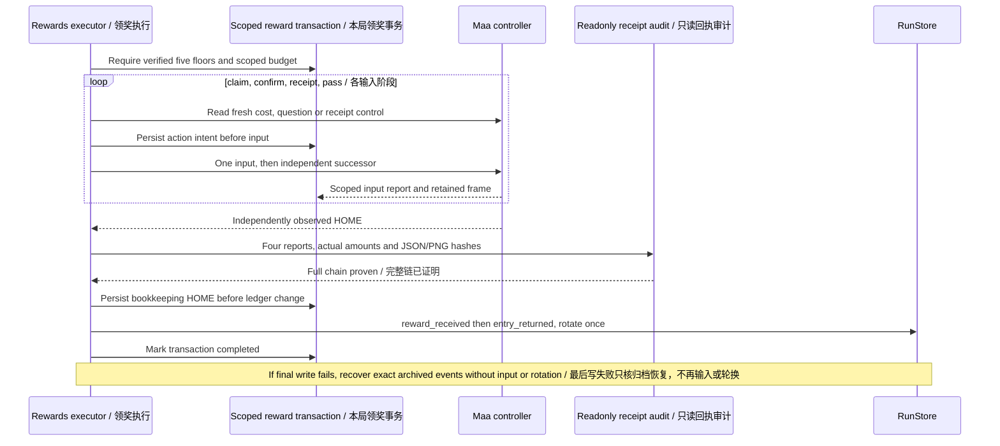

Source boundaries: `src/maalimbus/reward_task.py:27` (`finish`, `execute`); `src/maalimbus/reward_receipt_audit.py:1`; `src/maalimbus/storage.py:247` (`RunStore.record`).

## 4.7 `stamina`: Stamina Exchange (Not Implemented)

- **Trigger entry**: `StaminaTask` (`assets/resource/base/pipeline/mirror.json:5328`), no option; UI text at `assets/i18n/zh_cn.json:85-86`: "in-budget stamina exchange recognition is still in development; it currently saves the scene and stops, without spending".
- **Step-by-step business actions** (`agent/recognition.py:1634-1637`): `stamina` falls into the branch beyond mirror — it only does one `runner.observe(observer, now+30)` (`src/maalimbus/runner.py:657`), then puts the observation record into the result and returns.
- **Termination conditions**: **it never passes.** The result is fixed at `passed=False, reason='task_page_policy_not_implemented', input_sent=False, verified_clear=False` (`agent/recognition.py:1636-1637`); no stamina or currency is spent.
- **Evidence produced**: the frame pair from one observation + a `main_task_stopped` event + `agent-result.json`; the unit test `tests/test_main_task_dispatch.py:45 test_unimplemented_task_captures_evidence_and_returns_failure_without_input` pins "captures evidence, returns failure, zero input".
- **Stated status**: `README.md:52` lists stamina exchange / daily rewards as verified for "independent entry and budget basis", with the unfinished part being "the actual page and settlement; currently saves the scene and stops"; `docs/acceptance.md:944` likewise admits only a pure budget boundary passing, with no spending implementation.

---

### 4.7.1 Actual boundaries of unfinished tasks

Dashed edges mark gaps, not executable transitions. Existing budget helpers or independent task entries do not complete these workflows; the diagram separates planned capabilities from the running pipeline.

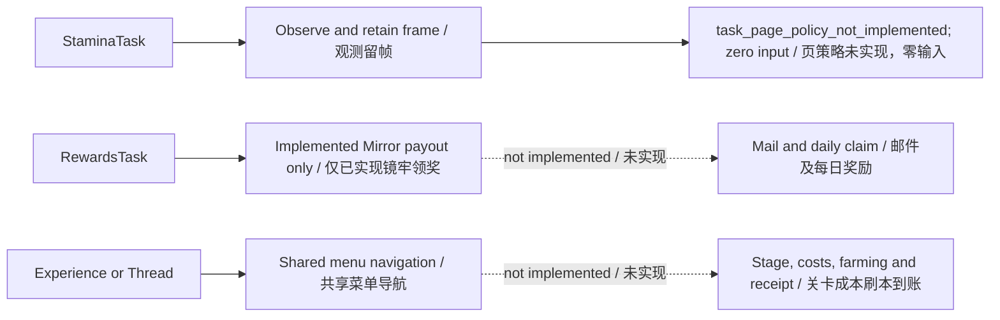

Source boundaries: `agent/recognition.py:1` (`MainTaskAction.run`); `src/maalimbus/lux_task.py:65`; `src/maalimbus/reward_task.py:72`.

## 4.8 Unverified / To Be Confirmed

Updated boundary (2026-10-13): older “GUI dispatch unverified” rows below are historical snapshots. Actual GUI Start reached DUNGEON_TEAM, warning, stars and initial gifts, proving entry execution, not a full run or live offscreen Team1/Team2 search. The user confirms the previous clear; incomplete independent payout/return bookkeeping remains a separate gap.

Every anchor this chapter opened and confirmed appears as a `path:line` above. The following are **not** independently verified here and are listed honestly:

- **End-to-end GUI dispatch unverified**: none of the six paths was clicked through a real-device GUI for this chapter. The "six native task entries" recorded at `docs/acceptance.md:156-158` only rendered six options on the same GUI, with the task disabled at the time, no game connection, and no GUI Start dispatch.
- **`open_game` cold launch unverified**: `docs/acceptance.md:158` states outright that cold launch is still unaccepted (only "MuMu already in foreground" was separately verified not to relaunch, with zero input).
- **`mirror` real-device result unverified**: the real-device run cited here (`pi-20261012-112240`) ended with `reason=unexpected_successor`, `passed=false` (`docs/acceptance.md:2-8`) — a stopping point, not a clear.
- **`experience`/`thread`/`stamina` page policies unimplemented**: all three still have no stage/page policy code, and the body records them as "unimplemented" per the current state at `src/maalimbus/lux_task.py:127-128`, `agent/recognition.py:1636-1637` and `README.md:51-52`.
- **`rewards` real-device paid claiming unverified**: `docs/acceptance.md:1284-1287` says the actual GUI Start dispatch and the current Team7 five-times paid claim are still unverified, with only the retained receipt chain proven offline.
- **Policy-piece internals not line-checked**: the `mirror_learning_policy.py` / `route_plan.py` / `gift_plan.py` / `shop_priority.py` / `auto_formation.py` / `budget.py` listed in 4.3 had only their top-level symbols and line numbers checked, not their full implementations read line by line.
- **Evidence directory prefix**: the default prefix from `loop_directory` is `pi-` (`agent/recognition.py:1345-1346`); this chapter did not compare the actual `evidence/runtime/` directory listing on every machine, and only cites paths already registered in `docs/acceptance.md`.
- **`InputPreflight`'s `win32` branch internals**: only the entry to window uniqueness and identity checking was read (`agent/recognition.py:1230-1239`); the later verification details and the `input_helpers` report format are not unfolded.

## 4.9 Rotation selection and bounded list search

Entry reconciliation must run before selecting the next team. The shop receipt helper is now named shop_reconcile so it does not shadow entry reconcile.

Team targeting uses independent OCR of the current sidebar rows, never stale screen positions. Offscreen targets trigger bounded vertical Swipes inside the sidebar. Two unchanged semantic lists reverse the direction; at most twelve attempts are allowed. A separate top-header reading must confirm the team before Confirm. Numbered TEAMS #1–#40 captions are supported; custom names still require a verified slot mapping and are not guessed from names or row positions. Attempts persist in private user-team-navigation.json.

The actual failed frame passes isolated reconciliation regression; installed-product and GUI continuation require separate validation.

## 4.10 Rotation policy and manual skip

The chosen policy is rotation after successful payout plus a separate manual skip, not automatic rotation on abandonment. Existing point_at supports explicit idle-team targeting; the dedicated panel, launcher command and idempotent ledger operation now exist in source. They are not rebuilt/installed/GUI accepted, so the diagram does not claim an installed button. The user confirms the previous clear; incomplete harness records are stated separately. Fixed Team1/Team2 and queue targets require the full MainTask-to-Runner-to-list path.

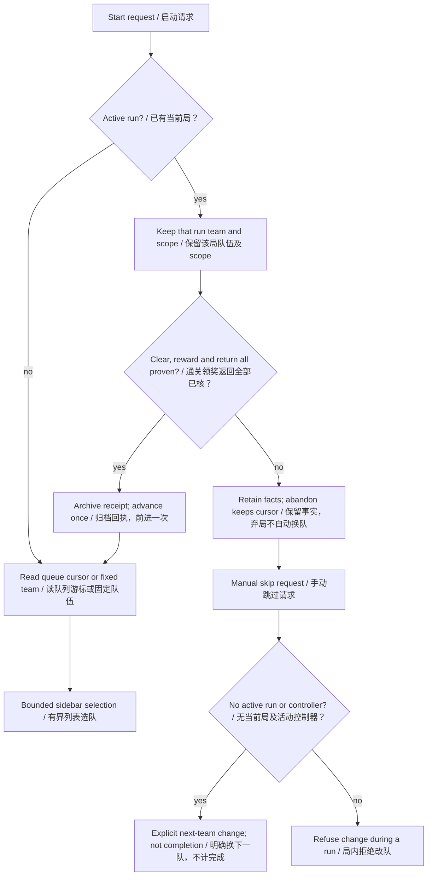

Source boundaries: `src/maalimbus/storage.py:151` (`point_at`, `abandon`, `record`); `src/maalimbus/task_preferences.py:1`; `src/maalimbus/team_navigation.py:1`.
