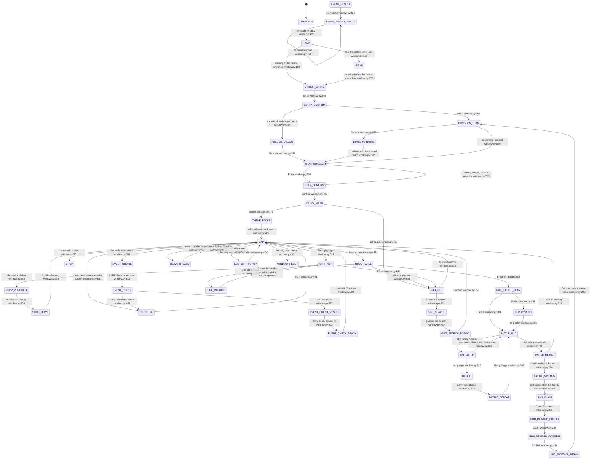
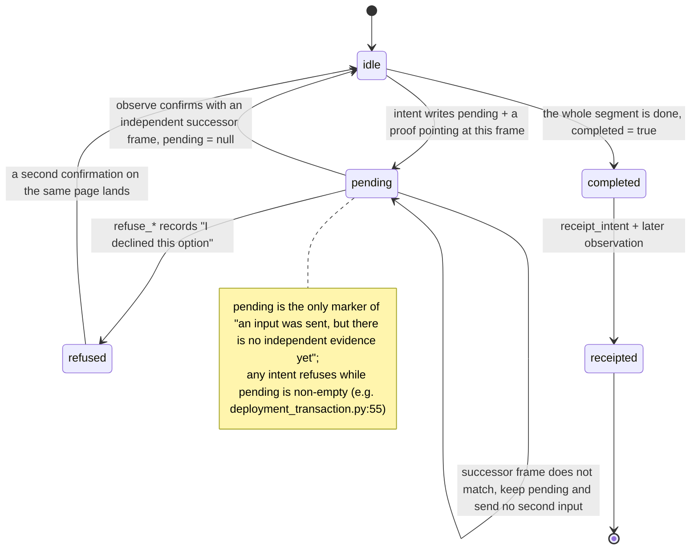
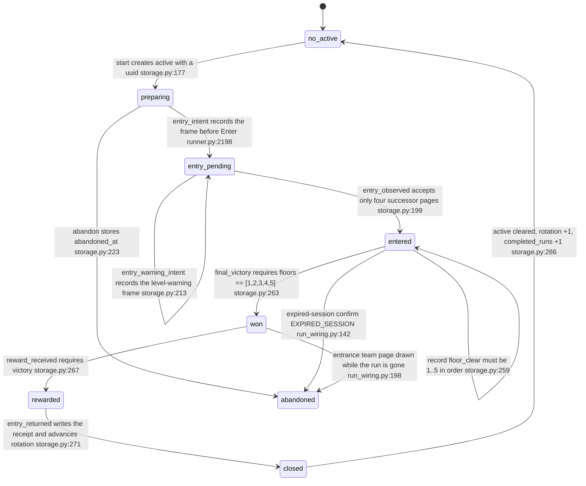
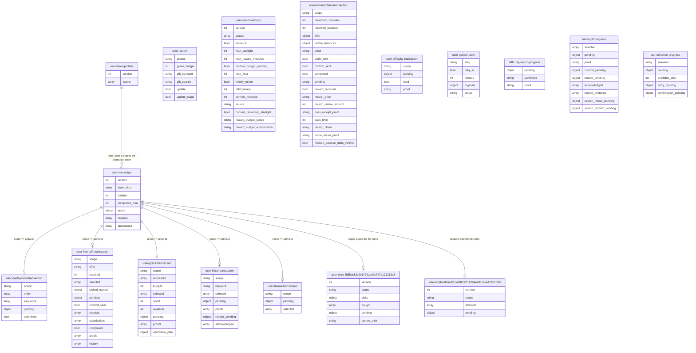

# 5 State and Data

[中文](../zh_cn/5-state-and-data.md) · [← Index](index.md)
This chapter answers three questions: **how exactly a frame is decided to be a "page"**, **why an irreversible input must be written to disk before it is sent**, and **which field decides the party for the next run once a run is over**.

State lives in exactly two places:

- `config/*.json` (17 files) — writable account-level and run-level state;
- `assets/` — the read-only resource and anchor registry (`assets/interface.json`, `assets/resource/base/anchors.json`, `assets/resource/base/pipeline/*.json`, `assets/resource/{en,jp}/locale.json`, `assets/i18n/*.json`).

> Every page name, field name and entity name in this chapter really exists in the file it is attributed to; `path:line` points at the current working tree. Anything without independent evidence is marked "unverified".

## 5.1 The page state machine

### 5.1.1 Where a page name comes from

The `page` the driver acts on is not a hand-written enum. It is the `scene` field of a frame observation, renamed step by step. It has four sources:

| Layer | Location | Output |
| --- | --- | --- |
| ① full-screen OCR + classification | `agent/recognition.py:140` `LimbusRecognition.observe()` takes full-screen OCR, `agent/recognition.py:168` calls `scene = classify(records, self.locale, size)`; `classify` is defined at `src/maalimbus/vision.py:63` | 45 page constants, falling back to `UNKNOWN` (`src/maalimbus/vision.py:439`) |
| ② local re-reads and standalone-page probes | `agent/recognition.py:169-201` re-reads the map header, `:202-209` the battle `TURN`, `:210-222` `HARD`; while `UNKNOWN`, standalone controls promote the page to `INITIAL_GIFTS` (`agent/recognition.py:223-224`), `STAR_GRACES` (`:225-226`), `DEPLOYMENT` (`:227-228`) | the corrected `scene` |
| ③ observation events | `limbus_map_observe` → `agent/recognition.py:1130` `MapObservation` writes `map_observed` (`agent/recognition.py:1146`); battle frames are written by `limbus_battle_observe` (`agent/recognition.py:1184`) | the `scene` field inside the observation record |
| ④ driver-side renaming | `src/maalimbus/runner.py:837` `resolve_scene()`: when `scene == 'UNKNOWN'` and the skill-check prompt reads `commence`, it promotes to `EVENT_CHECK` (`src/maalimbus/runner.py:844-845`); then `src/maalimbus/window.py:79` `resolve_overlay()` runs | the final `page` |

`resolve_overlay` (`src/maalimbus/window.py:79`) is the single place where **a later-decided overlay beats an earlier-decided page**: when the tutorial overlay matches, it returns `TUTORIAL` (`src/maalimbus/window.py:88`) whatever is underneath.

The evidence behind a decision is itself registered in `assets/resource/base/anchors.json`: 45 pages (`pages`), 3 pages not yet settled (`pending`: `identity_filter`, `reward_settle`, `run_end_entry_return`), a 1280×720 reference size, and offline re-checking of recorded observations by `tools/verify_anchors.py` (the registry's `note` field states the difference between `roi` and `geometry` anchors).

Two facts that are easy to get wrong:

- **`BEFORE_ENTRY` is not a recognised page.** `src/maalimbus/window.py:339` puts it in the same branch as `MIRROR_ENTRY` (`if page in ('MIRROR_ENTRY', 'BEFORE_ENTRY')`), and `assets/resource/base/anchors.json` carries a `before_entry` page; but it is not among the 47 `return` constants of `vision.classify`, and `agent/recognition.py` never produces it. It exists purely as a compatibility synonym branch.
- **The reviewed labels in `learning_dataset.py` are not runtime page names.** `src/maalimbus/learning_dataset.py:7` `LABELS` has only 11 entries (`STAR_GRACES`, `THEME_PACKS`, `MAP`, `PRE_BATTLE_TEAM`, `BATTLE_HUD`, `GIFT_PICK`, `GIFT_GET`, `EVENT_CHOICE`, `SHOP`, `RUN_COMPLETE`, `UNKNOWN`); it is a human label set for a future learned classifier, and the file says so itself: "Explicit reviewed page label required; OCR scene is not ground truth" (`src/maalimbus/learning_dataset.py:29`). It is neither the runtime page set nor a settlement-page list beyond `RUN_COMPLETE`.

### 5.1.2 The page state diagram

State names are the page constants from the code; each edge label is the only permitted input plus the line that produces it. Inside the diagrams the `src/maalimbus/` prefix is dropped for readability: `window.py:169` means `src/maalimbus/window.py:169`, and likewise `vision.py:439`, `storage.py:177`, `deployment_transaction.py:55`, `run_wiring.py:142`; prose outside the diagrams always gives the full path.

Three things to take from this diagram:

1. **`MAP` is the only hub.** The map page has exactly one proven forward input (`map_node_click_is_the_only_proven_forward_input`, `src/maalimbus/window.py:531`), and every in-floor page is entered and left through it.
2. **`[*]` is not the real start state.** The driver is started by an external task on an unknown page, so the first frame is usually `UNKNOWN`, and `HOME`/`DRIVE` are what walk it back to a known position.
3. **`RUN_REWARD_*` is an input receipt, not proof of payout.** The Confirm inputs on `RUN_REWARD_CONFIRM` and `RUN_REWARD_BONUS` deliberately record no ledger event at all (`src/maalimbus/run_wiring.py:68-73`); actual payout is proven by a separate receipt transaction (see 5.2).

### 5.1.3 Pages with exactly one safe input

Some pages look like they offer several buttons, but one of them spends irreversible resources or accepts a state the driver never chose; those pages are registered as observe-only. `src/maalimbus/window.py:36` `OBSERVE_ONLY` is that list:

| Page | What is disabled | Why |
| --- | --- | --- |
| `SHOP` | every purchase input | a purchase intent must be persisted by `shop_transaction` first |
| `EVENT_DIALOG` | every input | event-dialog options are out of scope this round |
| `REWARD_SETTLE` | every input | inputs are swallowed while the settlement animation plays |
| `FLOOR_GIFTS` | every input | the gift page must be driven by a transaction (`gift_pick`, not a whole-page tap) |
| `BATTLE_RESULT` | every input | inputs are swallowed during the result presentation (`src/maalimbus/window.py:328`) |
| `UNKNOWN` | every input | for an unnamed page the only safe input is the `UNKNOWN_DIALOG` close control |

Two further examples of the same "only one safe direction" rule: `WINDOW_RESET` allows only Cancel (`src/maalimbus/window.py:385` — Confirm on the weekly reset notice is never tapped), and `EXPIRED_SESSION` allows only Confirm (`src/maalimbus/window.py:190` — session expiry leaves claiming rewards as the only path).

5.1 evidence index

- Full page constants: `src/maalimbus/vision.py:63-439` (47 `return`s).
- Page-decision supplements: `agent/recognition.py:140-228`.
- Driver-side renaming and overlays: `src/maalimbus/runner.py:837`, `src/maalimbus/window.py:79-88`.
- Inputs and successors per page: `src/maalimbus/window.py:139-953` (`_plan_step`).
- Anchor registry: `assets/resource/base/anchors.json`; offline re-check: `tools/verify_anchors.py`.

## 5.2 The transaction state machine

The driver keeps 7 `*-transaction.json` files. They share one shape: **first the intended action is written as a `pending` bound to a frame of evidence, then the input is sent, then an independent successor frame confirms it, and only then is `pending` cleared.** If the process is killed anywhere in between, reading the file on restart says where it stopped instead of relying on memory.

The real fields of the seven files and their actual `pending` values:

| File | real `pending` values | intent / confirmation |
| --- | --- | --- |
| `config/user-floor-gift-transaction.json` | `{kind:'pick'}`, `{kind:'commit'}`, `{kind:'refuse_owned'}`, `{kind:'receipt'}` | `src/maalimbus/floor_gift_transaction.py:51`, `:103`, `:113`, `:148` |
| `config/user-grace-transaction.json` | `{card, cost, before, proof}` | `src/maalimbus/grace_transaction.py:109`, confirm `:113-117` |
| `config/user-initial-transaction.json` | `{row, title, before, capacity, proof}` | `src/maalimbus/initial_transaction.py:20`, confirm `:22-27` |
| `config/user-deployment-transaction.json` | `{kind:'card'\|'clear', before, capacity, card}` | `src/maalimbus/deployment_transaction.py:57`, confirm `:58-63` |
| `config/user-theme-transaction.json` | `{floor, name, proof}` | `src/maalimbus/theme_transaction.py:11`, confirm `:12-17` (adds `map_proof` on confirmation) |
| `config/user-reward-claim-transaction.json` | the strings `'reserved'` → `'claim'` → `'confirm'` (not a dict) | `src/maalimbus/reward_claim_transaction.py:66`, `:74` |
| `config/user-shop-<scope>.json` | `{kind:'purchase'\|'refresh', stage:'card_intent'\|'confirm_intent'\|'overlay_intent'\|'refresh_intent', ...}` | `src/maalimbus/shop_transaction.py:262`, `:289`, `:319`, `:359` |

Three shape differences read off the real data that must not be assumed away:

1. **`pending` is not always an object.** `user-reward-claim-transaction.json` uses strings (`'reserved'` / `'claim'` / `'confirm'`); the other six use dicts. In the current file its value is `null` while `completed=true` and `reward_received=true` (measured values below).
2. **Confirmation does not always return to `idle`.** In `floor_gift_transaction`, `commit` clears `pending` to `None` on the final successor page and sets `completed=True` (`src/maalimbus/floor_gift_transaction.py:192`), whereas `pick` goes back to `idle` to await the next choice (`:92-95`).
3. **`receipt` and "payout" are two different things.** In `config/user-reward-claim-transaction.json`, `module_balance_delta_verified` is currently `false`: the receipt proves "I pressed it and saw the receipt", not "the balance went up". The receipt-audit entry in `docs/design.md:32-41` says the same thing — it "never verifies an unseen balance delta".

5.2 measured values in the current working tree (for reference)

- `config/user-floor-gift-transaction.json`: `offer="b7a36f8ff0f9…"`, `required=1`, `selected` 1 entry, `commit_sent=true`, `completed=true`, `receipts` 1 entry, `history` 22 entries.
- `config/user-grace-transaction.json`: `requested` 3 entries, `budget=100`, `selected` 3 entries, `spent=60`, `available=0`, `pending=null`, `proofs` 4 entries.
- `config/user-initial-transaction.json`: `keyword="charge"`, `selected` 2 entries, `acknowledged` 2 entries, `proofs` 3 entries, `pending=null`.
- `config/user-deployment-transaction.json`: `scope="f855ac82c2b1429aae9c747a122213b8"`, `order` 12 entries, `sequence` 0 entries, `pending={kind:'card', before:0, capacity:11, card:6}`, `submitted=false`.
- `config/user-reward-claim-transaction.json`: `scope="d7c1499436f647208adc50860692a5c2"`, `maximum_modules=6`, `reserved_modules=6`, `pass_level=81`, `receipt_visible_amount=250`, `reward_received=true`, `module_balance_delta_verified=false`.

## 5.3 The rotation ledger state machine

`config/user-run-ledger.json` is the only file that records how many runs have been completed and which team the next run uses; it is implemented by `RunStore` at `src/maalimbus/storage.py:126`. Its central rule: **the rotation advances only after four things have been proven with evidence, in order — all five floors, the final victory, the reward payout, and the return to the entrance.**

The four phase values (`active.phase`) and their writers:

| `phase` | written by | precondition |
| --- | --- | --- |
| `preparing` | `RunStore.start()` (`src/maalimbus/storage.py:177`) | only when there is no active run |
| `entry_pending` | `RunStore.entry_intent()` (`src/maalimbus/storage.py:186`), called at `src/maalimbus/runner.py:2198` | requires the sha256 of the frame before Enter |
| `entry_pending` (warning added) | `RunStore.entry_warning_intent()` (`src/maalimbus/storage.py:213`), called at `src/maalimbus/runner.py:2200` | allowed only once per phase |
| `entered` | `RunStore.entry_observed()` (`src/maalimbus/storage.py:199`), called at `src/maalimbus/runner.py:1464` | the successor page must be one of `STAR_GRACES` / `INITIAL_GIFTS` / `THEME_PACKS` / `MAP` |

The three paths that advance (or roll back) the rotation all live in `src/maalimbus/run_wiring.py`:

- **normal close**: the `entry_returned` event moves the whole active run into `receipts` (truncated to the last 50), does `completed_runs += 1`, and sets `rotation = (rotation + 1) % len(team_slots)` (`src/maalimbus/storage.py:283-287`).
- **abandon**: after an expired-session confirmation the active run moves into `abandoned` (also truncated to 50) with an `abandoned_at`, and **the rotation does not move** — the same team comes back next time (`src/maalimbus/run_wiring.py:129-153`).
- **reconcile**: if the entrance team page is visible while the ledger still believes a run is active, the game has dropped that run. If `victory && reward` already hold, a compensating `entry_returned` is recorded as a receipt rather than an abandon (`src/maalimbus/run_wiring.py:183-197`); otherwise it is abandoned (`:198-205`).

**The weekly bonus is only spent on the run that earned it.** Claiming may ask a second time whether to spend the weekly bonus, and there are only three of them, reset weekly and never carried over. So the answer cannot be read from the screen — only derived from the ledger: `run_wiring.earned_its_payout()` (`src/maalimbus/run_wiring.py:208-252`) compares the `settled_at` of the newest receipt with the `abandoned_at` of the newest abandoned run, returning False if either is missing, because "I do not know" is not a reason to spend a scarce resource (`:243-250`).

Measured `config/user-run-ledger.json`: `team_slots=[5,4,1,6,2,7,3]`, `rotation=5` (slot 7), `completed_runs=2`, `active.team=7`, `active.floors=[1,2,3]`, `active.phase="entered"`, three `floor_clear` entries in `active.events`, `receipts` 2 entries, `abandoned` 7 entries. The `team_slots` order equals the `teams[].slot` order in `config/user-team-profiles.json` (the same `[5,4,1,6,2,7,3]`). That is no accident: `RunStore.__init__` validates an existing ledger against the `ProfileStore` slot order and refuses to start on a mismatch (`src/maalimbus/storage.py:137-142`).

The rotation changes through three explicit entry points only; editing `rotation` by hand is outside the supported range:

- `seed_run_store()` (`src/maalimbus/storage.py:96`) — writes only when the file does not exist; `overwrite=True` is allowed only while the ledger has recorded nothing;
- `RunStore.point_at()` (`src/maalimbus/storage.py:151`) — points the rotation at a stored team, refuses while a run is active;
- CLI: `tools/run_ledger.py:46` (seed), `:54` (abandon), `:64` (point_at).

## 5.4 The data model

Entity names are file names without the extension; the `<scope>` in `user-shop-<scope>` and `user-exploration-<scope>` is that run's `active.id`, so one file per run exists on disk (current instance: `config/user-shop-f855ac82c2b1429aae9c747a122213b8.json`). Attributes list **only keys that really exist in the current file**.

The resource side (read-only) has this real structure:

```mermaid
erDiagram
    interface {
        int interface_version
        string name
        string version
        object languages
        array controller
        array resource
        object agent
        array group
        array task
        object option
        array global_option
        array setting
    }
    anchors {
        int version
        int reference_width
        int reference_height
        string note
        array pages
        array pending
    }
    page {
        string id
        string title
        array evidence
        array identity
        array controls
        array live_derived
        string why
    }
    mirror {
        string recognition
        string action
        array next
        object attach
        string custom_action
        array on_error
        int timeout
        string target
        int max_hit
        int post_delay
    }
    sinner-neural {
        bool enabled
        object recognition
        object action
    }
    locale-en {
        string home_drive
        string initial_selected
        string gift_get
        string gift_search
    }
    budget {
        int version
        string status
        int module_budget
        int spent
        int conversion_step
        array allowed_purposes
        string note
    }
    i18n-zh_cn {
        string mumu_adb
        string mumu_adb_description
        string description
    }
    gift-plan {
        int version
        string note
        array default
        array teams
        array sources
    }

    interface ||--o{ mirror : "task.entry points at pipeline nodes"
    interface ||--o{ locale-en : "resource[].path decides the overlay order"
    interface ||--o{ i18n-zh_cn : "languages.zh_cn = i18n/zh_cn.json"
    anchors ||--o{ page : "pages[]"
    page ||--o{ mirror : "controls provide the click boxes"
    budget ||--o{ user-mirror-settings : "budget.json is the resource-side budget, settings the account-side value"
```

Two fields on the resource-side diagrams are optional: `page.why` (present on 14 of 45 pages) and `page.live_derived` (on 3 of 45); the full key union of `anchors.pages[]` is `id, title, evidence, identity, controls, live_derived, why`. The `pipeline/*.json` entities are **unions over node fields**: the union across the 792 nodes of `mirror.json` is `recognition, action, custom_action, next, timeout, on_error, custom_recognition, custom_recognition_param, target, max_hit, post_delay, custom_action_param, key, attach`, while the 12 nodes of `sinner-neural.json` carry only `enabled, recognition, action`.

Entities mapped to files and writers:

| Entity | File | Writer |
| --- | --- | --- |
| `user-run-ledger` | `config/user-run-ledger.json` | `RunStore` (`src/maalimbus/storage.py:126`) + `run_wiring` (`src/maalimbus/run_wiring.py:81`) |
| `user-team-profiles` | `config/user-team-profiles.json` | `ProfileStore` (`src/maalimbus/storage.py`); at most 40 teams, slots unique |
| `user-launch` | `config/user-launch.json` | the user / the launcher |
| `user-mirror-settings` | `config/user-mirror-settings.json` | the user; `module_budget_pending` together with the resource-side `budget.json.status` forms the "do not spend" constraint |
| `user-difficulty-transaction` | `config/user-difficulty-transaction.json` | the difficulty-evidence transaction (`hard=true`, account-level) |
| `difficulty-switch-progress` / `initial-gift-progress` / `star-selection-progress` | `config/*.json` | three progress files holding account-level prior choices and a `pending` interruption point |
| `user-*-transaction` × 4 | `config/user-{deployment,floor-gift,grace,initial,theme}-transaction.json` | see the 5.2 table |
| `user-reward-claim-transaction` | `config/user-reward-claim-transaction.json` | `src/maalimbus/reward_claim_transaction.py`; the native reward task also writes it directly (`src/maalimbus/reward_task.py:47-48`) |
| `user-shop-*` / `user-exploration-*` | `config/user-shop-<scope>.json` etc. | one file per run; `<scope>` in the file name equals the `scope` field |
| `user-update-state` | `config/user-update-state.json` | update check (ETag + `retry_at` backoff) |
| `interface` | `assets/interface.json` | the 3.5 MB declaration file; `option` has 711 keys, many of them per-team expansions such as `global_team_N_*` and `mirror_queue_N` |
| `anchors` / `page` | `assets/resource/base/anchors.json` | 45 pages + 3 pending; verified offline by `tools/verify_anchors.py` |
| `mirror` / `sinner-neural` | `assets/resource/base/pipeline/*.json` | `mirror.json` has 792 nodes; the three most common fields are `recognition` / `action` / `next` (792 each), plus 74 `custom_action` and 103 `on_error` |
| `locale-en` | `assets/resource/en/locale.json` | 87 keys; the JP file has 24. **`assets/resource/base/locale.json` does not exist** (see below) |
| `i18n-*` | `assets/i18n/{zh_cn,en_us,ja_jp}.json` | 161 keys each; ProjectInterface UI copy, referenced from `interface.json` as `$key` (the file itself stores the bare `key`) |
| `budget` | `assets/resource/base/budget.json` | `status="pending"`, `module_budget=0`, `allowed_purposes=["enkephalin_refill","module_conversion"]`; its `note` demands that "while pending or 0 every request is refused with a reason instead of clicking anything" |
| `gift-plan` | `assets/resource/base/gift-plan.json` | gives the initial-gift priority list per team (`default` + `teams` + `sources`); its `note` states outright that this is "not a universal optimal guide" |

### Conflicts with the shared contract

- **`assets/resource/base/locale.json` does not exist.** The shared fact contract lists `resource/{base,en,jp}/locale.json` as part of the resource layer; in the actual tree there is only `assets/resource/en/locale.json` (87 keys) and `assets/resource/jp/locale.json` (24 keys), with no `locale.json` under `base/`. `agent/recognition.py:103` also reads `assets/resource/{locale}/locale.json`, i.e. each language pack must ship its own copy and `base` is not a fallback.
- **`assets/resource/base/` holds far more files than the four the contract lists.** Besides `anchors.json` and `pipeline/`, there are `battle-catalog.json`, `budget.json`, `gift-catalog.json`, `gift-observed-catalog.json`, `gift-plan.json`, `identity-catalog.json`, `identity-index.json`, `theme-catalog.json`, `wiki-identity-*.json`, an `image/` directory and more. This chapter treats them only as read-only resource-side inputs and does not expand them.
- **The repo's `docs/` currently holds 31 flat `.md` files.** The ones directly related to state are `docs/design.md:298-302` (the design-level flow string: home → Drive → Mirror Dungeon → … → next run) and `docs/design.md:32-41` (the receipt audit does not verify an unseen balance delta). The page state machine here is finer-grained than either, but points the same way.

### Unverified / open questions

- The per-node semantics of `assets/resource/base/pipeline/*.json` (the value domains of `recognition`/`action`, and the real effect of `on_error`) were not checked node by node; only field names and counts were verified.
- The relationship between the `wiki-identity-*.json` files under `assets/resource/base/` and the 11-label set in `learning_dataset.py` was not verified.
- For `user-exploration-<scope>.json`, only the existence of the `attempts[]` sub-keys (`candidate` / `before` / `successor` / `reviewed`) was confirmed; their decision rules were not expanded.

Files actually opened while writing this chapter

`AGENTS.md`, `PROJECT.md` (conventions), `docs/design.md`, all 17 JSON files under `config/`, `assets/interface.json`, `assets/resource/base/anchors.json`, `assets/resource/base/pipeline/mirror.json`, `assets/resource/base/pipeline/sinner-neural.json`, `assets/resource/{en,jp}/locale.json`, `assets/resource/base/budget.json`, `assets/resource/base/gift-plan.json`, `assets/i18n/{zh_cn,en_us,ja_jp}.json`, `src/maalimbus/vision.py`, `src/maalimbus/window.py`, `src/maalimbus/runner.py`, `src/maalimbus/storage.py`, `src/maalimbus/run_wiring.py`, `src/maalimbus/learning_dataset.py`, `src/maalimbus/floor_gift_transaction.py`, `src/maalimbus/grace_transaction.py`, `src/maalimbus/initial_transaction.py`, `src/maalimbus/deployment_transaction.py`, `src/maalimbus/theme_transaction.py`, `src/maalimbus/reward_claim_transaction.py`, `src/maalimbus/shop_transaction.py`, `src/maalimbus/reward_task.py`, `src/maalimbus/shop_outcomes.py`, `agent/recognition.py`, `tools/run_ledger.py`.

