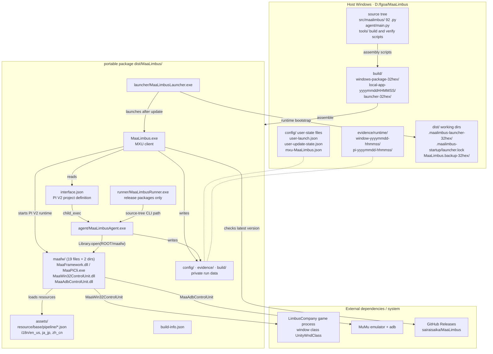
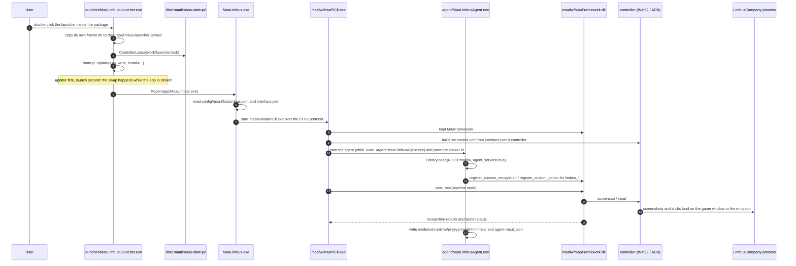
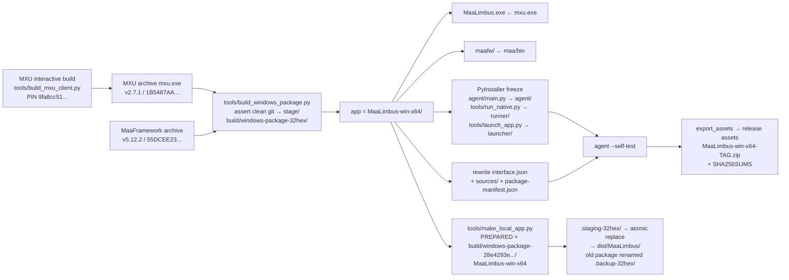
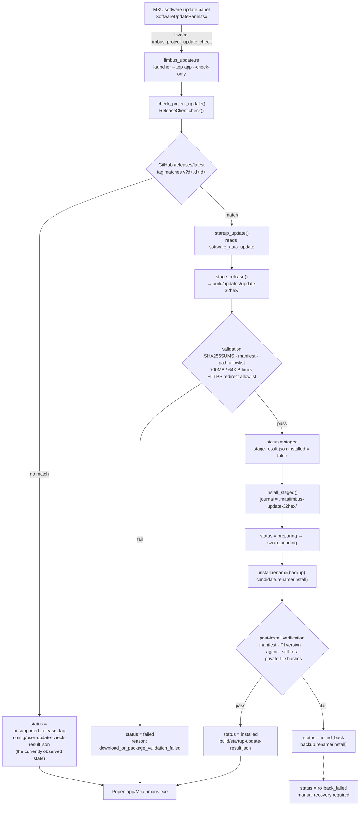

# 6 Deployment and Operations

[中文](../zh_cn/6-deployment.md) · [← Index](index.md)

> Scope of this chapter: MaaLimbus ships as a **portable package** for Windows — there is no installer, no registry
> writes, and no service. "Deployment" here means putting a directory on disk; "operations" means starting it,
> checking for updates, upgrading, rolling back, and reading evidence.
>
> Every technical claim in this chapter is bound to a verifiable anchor: a **source-script line number**, a
> **measured file listing with byte sizes**, or a **verification artifact retained in the repository**.
> Anything not backed by one of those three goes into 6.5 "Unverified / To Confirm" rather than being written as a
> conclusion.

## 6.1 Package Layout and Deployment Graph

### 6.1.1 Top-Level Layout (`dist/MaaLimbus/`, measured)

> Measurement time: after 2026-10-13T00:35Z. The portable package can be rebuilt at any moment by
> `tools/make_local_app.py` — it was rebuilt once during this session, which added one `MaaLimbus.backup-*` under
> `dist/`. Byte sizes and counts therefore drift with rebuilds; **paths and structure do not**.

| Item | Type | Size | Notes |
| --- | --- | --- | --- |
| `MaaLimbus.exe` | file | 31,158,272 B | MXU client (Tauri-built ProjectInterface V2 frontend) |
| `interface.json` | file | 3,732,723 B | ProjectInterface V2 project definition; the global default entry |
| `LICENSE` | file | 35,184 B | Full GPL-3.0 text |
| `README.md` / `README_en.md` | file | 8,297 / 7,859 B | In-package welcome pages pointed at by `interface.json`'s `welcome` |
| `build-info.json` | file | 933 B | Metadata and self-test result of this assembly |
| `agent/` | dir | `MaaLimbusAgent.exe` 5,880,171 B + `_internal/` | PyInstaller-frozen Python Agent |
| `launcher/` | dir | `MaaLimbusLauncher.exe` 2,012,660 B + `_internal/` | Out-of-package update launcher |
| `maafw/` | dir | 19 files + 2 subdirectories | MaaFramework native runtime |
| `assets/` | dir | `resource/`, `i18n/`, `misc/` | All recognition resources and translations |
| `docs/` | dir | 31 flat files + `agents/`, `wiki/` subdirs (45 files recursively) | User-facing documentation |
| `config/`, `evidence/`, `build/` | dir | created at runtime | Private run data, **never written by the build** |
| `THIRD_PARTY_NOTICES/` | dir | 6 license files + README | Third-party attribution |

Things that do **not** exist in the measured package — do not assume them on this page or elsewhere:

- `runner/MaaLimbusRunner.exe` — **release packages only**. The release assembly freezes `tools/run_native.py`
  (`tools/build_windows_package.py:149`); the local development assembly does not (grepping `MaaLimbusRunner` hits
  only `tools/build_windows_package.py`, `tools/make_local_app.py`, and `src/maalimbus/update_install.py:70`). The
  current `dist/MaaLimbus/` has no `runner/`.
- `sources/` — the release assembly writes it; the local development assembly writes it only with `--mxu-proof`
  (`tools/make_local_app.py:163-166`). `Test-Path dist/MaaLimbus/sources` is `False` for the current package.
- `package-manifest.json` — `Test-Path` is `False`. The release assembly generates it
  (`tools/build_windows_package.py:195-197`); the local development assembly does not.

### 6.1.2 Deployment Graph



### 6.1.3 Who Assembles Each Top-Level Item

| Top-level item | Release package source | Local development package source |
| --- | --- | --- |
| `MaaLimbus.exe` | `tools/build_windows_package.py:138` (copies `mxu.exe` from the MXU archive) | `tools/make_local_app.py:162` (same) |
| `maafw/` | `tools/build_windows_package.py:139` (from `stage/maa/bin`) | `tools/make_local_app.py:167` (from the build-time `--maafw`) |
| `agent/` | `tools/build_windows_package.py:148` (PyInstaller freezes `agent/main.py` → base name `MaaLimbusAgent`) | `tools/make_local_app.py:195` (same freeze logic) |
| `runner/` | `tools/build_windows_package.py:149` (freezes `tools/run_native.py` → `MaaLimbusRunner`) | not produced |
| `launcher/` | `tools/build_windows_package.py:151` (freezes `tools/launch_app.py` → `MaaLimbusLauncher`) | `tools/make_local_app.py:197` (same) |
| `interface.json` | rewritten by `tools/build_windows_package.py:152-160`; rules in `tools/make_local_app.py:71-82` (`packaged_interface()`) | `tools/make_local_app.py:188-189` |
| `assets/`, `docs/`, `THIRD_PARTY_NOTICES/` | copytree from the repository root | `tools/make_local_app.py:184-185` |
| `README.md`, `README_en.md`, `LICENSE` | copied from the same sources at `tools/make_local_app.py:186-187` | same |
| `config/`, `evidence/`, `build/` | **never written by the build**, created at runtime | same |

The path rewriting done by `packaged_interface()` is what makes the deployment correct
(`tools/make_local_app.py:71-82`):

- `agent.child_exec` → `./agent/MaaLimbusAgent.exe`
- `license` → `./LICENSE`
- `icon` → an icon under `assets/`
- `welcome` → `./README.md`
- `languages` → language files under `assets/`
- every `resource` path: `./resource/xxx` → `./assets/resource/xxx`

The release assembly additionally writes `sources/` (`tools/build_windows_package.py:161-167`, containing
`MXU-v2.7.1-source.zip`, `MaaFramework-v5.12.2-source.zip`, `MaaLimbus-source.zip`) and `package-manifest.json`
(`tools/build_windows_package.py:195-197`).

### 6.1.4 The `dist/` Directory Families Outside the Package

`dist/` is not merely "an app directory" — it doubles as the **runtime working area**. Measured counts:

| Directory family | Measured count | Created by |
| --- | --- | --- |
| `MaaLimbus.backup-<32hex>` | 37 | `tools/make_local_app.py:102` (`backup=out.parent/(out.name+'.backup-'+uuid.uuid4().hex)`: the old package is renamed and kept when the assembly is replaced) |
| `MaaLimbus.staging-<32hex>` | 1 | `tools/make_local_app.py:159` |
| `.maalimbus-launcher-<32hex>` | 5 | `tools/launch_app.py:37` (the launcher copies its own frozen directory next to the app before running) |
| `.maalimbus-startup/` | 1, containing `launcher.lock` | `tools/launch_app.py:60-61` (`work = app.parent/'.maalimbus-startup'`; `ControllerLease(work/'launcher.lock')`) |
| `private-state-before-binding-<hex>` | 1 | `tools/bind_local_state.py:32` |
| `.maalimbus-update-<32hex>` | **0** | the install journal directory from `src/maalimbus/update_install.py`; cleaned up after a normal completion |

Operational implication: `dist/` grows monotonically with every assembly and every launch. These directories are
rebuildable caches, **except** that `MaaLimbus.backup-*` is the only rollback evidence — do not delete them right
after an upgrade (see 6.4).

## 6.2 How MXU, MaaFramework, and the Agent Relate

MaaLimbus is not a monolith; it is **three processes plus one native library**:

### 6.2.1 The Three Processes

| Process | Executable | Role |
| --- | --- | --- |
| MXU client | `MaaLimbus.exe` | User interface. Reads `interface.json`, renders task panels and options, dispatches tasks to the PI V2 runtime |
| PI V2 runtime | `maafw/MaaPiCli.exe` | Started by MXU. Builds controllers, loads resources, and executes pipelines from the `controller` / `resource` / `task` definitions in `interface.json` |
| Python Agent | `agent/MaaLimbusAgent.exe` | Execution side for custom recognitions and custom actions. Registers every `limbus_*` node and handles game-specific scene recognition and business actions |
| (native library) | `maafw/MaaFramework.dll` and friends | The native implementation all three depend on |

### 6.2.2 The Contract: `interface.json` Is the Only Interface Between Them

Key anchors in `assets/interface.json`:

| Anchor | Content |
| --- | --- |
| `assets/interface.json:2-5` | `interface_version: 2`, `name: MaaLimbus`, `version: v0.1.2` |
| `assets/interface.json:9-13` | `languages`: `zh_cn` / `en_us` / `ja_jp` |
| `assets/interface.json:14` | the `controller` array, see below |
| `assets/interface.json:69-86` | `resource`: `en` → `./resource/base` + `./resource/en`; `jp` → `./resource/base` |
| `assets/interface.json:87-92` | `agent`: `child_exec: python`, `child_args: [../agent/main.py]` (source form) |
| `assets/interface.json:93-102` | `group`: `mirror`, `daily` |
| `assets/interface.json:103-170` | `task`: `open_game` / `mirror_loop` / `experience` / `thread` / `rewards` / `stamina` |
| `dist/MaaLimbus/interface.json:87-92` | packaged form: `child_exec: ./agent/MaaLimbusAgent.exe` |
| `dist/MaaLimbus/interface.json:146785` | `icon: assets/misc/Don-Quixote.png` |
| `dist/MaaLimbus/interface.json:146786` | `welcome: ./README.md` |

The four controllers and where they land:

| `controller` name | `interface.json` anchor | Control method | Code path |
| --- | --- | --- | --- |
| `windows-window` | `:16` | Win32; window class regex `^UnityWndClass$`, window title regex `^LimbusCompany$`; screencap `Background`, mouse `SendMessageWithCursorPos`, keyboard `PostMessage` | `src/maalimbus/windows_controller.py:9-22` (`controller_profile()` filters `type == 'Win32'`; `native_methods()` maps `MaaWin32ScreencapMethodEnum` / `MaaWin32InputMethodEnum`) |
| `windows-background` | `:31` | Win32; mouse `SendMessageWithWindowPos` | same |
| `windows` | `:46` | Win32; screencap `ScreenDC`, mouse/keyboard `Seize` (exclusive foreground) | same |
| `mumu-adb` | `:61` | `type: Adb` | `src/maalimbus/adb_device.py`: `discover()` goes through `Toolkit.find_adb_devices` (`:28`); `build()` constructs an `AdbController` (`:97-103`) |

The `mumu-adb` input method carries a **trap that was verified on real hardware**:
`src/maalimbus/adb_device.py:21` defines `INPUT_NAMES` (`1 AdbShell` / `2 MinitouchAndAdbKey` / `4 Maatouch` /
`8 EmulatorExtras`), `:22-23` defines `SCREENCAP_NAMES` (`64 EmulatorExtras`, etc.), and `:5-6` records the input
priority `EmulatorExtras > Maatouch > MinitouchAndAdbKey > AdbShell`. When screencap acceleration is not requested,
`input_policy()` (`:46-63`) falls back to `adb shell input tap` — and **the game ignores that path**. In the
2026-10-12 `maafw.log`, `AdbShellInput::click x=125 y=527` and `Controller.Action.Succeeded` appear together while
the `DUNGEON_TEAM` slot never changes. That is why `agent_binaries()` in `tools/make_local_app.py:44-68`
**hard-requires** `maatouch/universal/maatouch` and fails loudly instead of degrading silently (`:183` copies it
into the package's `maafw/MaaAgentBinary`).

### 6.2.3 What Is Inside `maafw/` (measured byte sizes)

| File | Bytes | Purpose |
| --- | --- | --- |
| `MaaFramework.dll` | 2,536,448 | Core library |
| `MaaPiCli.exe` | 958,464 | ProjectInterface V2 command-line runtime |
| `MaaWin32ControlUnit.dll` | 670,720 | Win32 control-unit implementation |
| `MaaAdbControlUnit.dll` | 787,456 | ADB control-unit implementation |
| `MaaToolkit.dll` | 540,160 | Device discovery and utilities (where `Toolkit.find_adb_devices` lives) |
| `MaaUtils.dll` | 632,832 | Shared utilities |
| `MaaAgentClient.dll` / `MaaAgentServer.dll` | 1,227,264 / 1,388,032 | Agent client / server |
| `MaaNode.node` / `MaaNodeServer.node` | 1,018,880 / 987,648 | Node bindings |
| `MaaCustomControlUnit.dll` | 315,392 | Custom control-unit base |
| `MaaGamepadControlUnit.dll` | 350,208 | Gamepad control unit |
| `MaaRecordControlUnit.dll` / `MaaReplayControlUnit.dll` | 341,504 / 402,432 | Record / replay control units |
| `onnxruntime_maa.dll` | 19,182,080 | Inference runtime |
| `opencv_world4_maa.dll` | 13,774,336 | Image processing |
| `DirectML.dll` | 18,527,776 | GPU inference backend |
| `fastdeploy_ppocr_maa.dll` | 1,138,688 | OCR |
| `ViGEmClient.dll` | 130,048 | Virtual gamepad driver client |
| `plugins/MaaPluginDemo.dll` | 9,728 | Plugin sample |
| `MaaAgentBinary/` | 92 files | On-device Android agent binaries: `maatouch/universal/maatouch`, `minicap/<abi>/` (arm64-v8a, armeabi-v7a, x86, x86_64, covering android-9..31), `minitouch/<abi>/minitouch`, `LICENSE`, `README.md` |

Deployment implication: `maafw/` is a **single 60 MB-scale unit**, and its integrity is enforced at package level
rather than per file. The release package is validated through `package-manifest.json` in `update_stage.py`
(see 6.4.2).

### 6.2.4 Startup Order



## 6.3 Build and Packaging

### 6.3.1 Two Pipelines

The repository has **two non-interchangeable** assembly pipelines whose outputs share a name but differ in content:

| Pipeline | Script | Output location | Positioning |
| --- | --- | --- | --- |
| Release package | `tools/build_windows_package.py` | `build/windows-package-<32hex>/MaaLimbus-win-x64/` | For distribution. Carries `runner/`, `sources/`, `package-manifest.json`, and exports release assets |
| Local development package | `tools/make_local_app.py` | `dist/MaaLimbus/` (atomic replace through `.staging-*` + `.backup-*`) | On-machine development and real-device verification. No `runner/` or `sources/` |

Evidence for the split: `tools/make_local_app.py:35-36` hard-codes
`MXU_SHA256 = '1B5487AA2442062A489E20134A82F946f76F57E733A8D8D284C3C76AAF8053E5'` and
`PREPARED = ROOT/'build/windows-package-28e4293e95e847dcb6f335d2b824cc7a/MaaLimbus-win-x64'` — meaning the local
development assembly **consumes** the release assembly's intermediate state. They are two stages of one chain, not
two independent implementations.

### 6.3.2 Release Package: `tools/build_windows_package.py`

Pinned versions and hashes (`ARCHIVES` at `:21-30`): MXU v2.7.1, MaaFramework v5.12.2. `:118` first asserts a clean
git worktree; `:128` creates `build/windows-package-<uuid4().hex>` as the stage.

Assembly steps:

1. `:136` `app = stage/'MaaLimbus-win-x64'`
2. `:138` `MaaLimbus.exe` ← the MXU archive's `mxu.exe`
3. `:139` `maafw/` ← `stage/maa/bin`
4. `:148-151` freeze the three Python entry points: `agent/main.py` → `MaaLimbusAgent`, `tools/run_native.py` →
   `MaaLimbusRunner`, `tools/launch_app.py` → `MaaLimbusLauncher`
5. `:152-160` rewrite `interface.json`
6. `:161-167` write `sources/` (three source archives)
7. `:168-174` run `agent --self-test`
8. `:178-194` write `build-info.json`
9. `:195-197` write `package-manifest.json`
10. `:199-201` `export_assets` → `build/windows-package-latest.json` (confirmed present)

The actual fields of `build-info.json` (sampled from the current `dist/MaaLimbus/build-info.json`):

```json
{
  "project": "MaaLimbus",
  "development_only": true,
  "packaged_app": false,
  "source_commit": "5e9dfc5528494550eca7ff01c9eea26f706aaf02",
  "source_dirty": true,
  "built_at": "2026-10-13T00:35:23.259095+00:00",
  "mxu_sha256": "1b5487aa2442062a489e20134a82f946f76f57e733a8d8d284c3c76aaf8053e5",
  "mxu_modified": false,
  "mxu_source_sha256": null,
  "pending": ["MXU UI validation", "live input postcondition", "full five-floor loop"],
  "self_test": {
    "passed": true,
    "application_root": "D:\\fgoa\\MaaLimbus\\dist\\MaaLimbus.staging-87ecfbf73a0c41b78282157772835029",
    "runner_root": "D:\\fgoa\\MaaLimbus\\dist\\MaaLimbus.staging-87ecfbf73a0c41b78282157772835029",
    "private_state_directory": "D:\\fgoa\\MaaLimbus\\dist\\MaaLimbus.staging-87ecfbf73a0c41b78282157772835029\\config",
    "device_controller": false,
    "locales": ["en", "jp"]
  }
}
```

Two fields deserve attention:

- `development_only: true` and `packaged_app: false` — the current package is a **development package**, not a
  distributable release artifact.
- `self_test.application_root` points at `MaaLimbus.staging-87ecfbf73a0c41b78282157772835029`, and that staging
  directory **no longer exists** in `dist/` (the surviving one is
  `MaaLimbus.staging-1619589fdb01498a8ad5905319306fb0`, left by a different assembly). In other words
  `build-info.json` records the path from assembly time, so it necessarily goes stale once the package is
  atomically replaced — and the staging directory it records is **never** the one left on disk. Any logic that
  trusts `application_root` must tolerate this.

### 6.3.3 Local Development Package: `tools/make_local_app.py`

Key behavior:

- `:159` creates `MaaLimbus.staging-<uuid4hex>` first; the entire assembly happens inside staging
- `:102` on replace, the old package is renamed to `MaaLimbus.backup-<uuid4hex>` (this is where the 36 backups in
  `dist/` come from)
- `:216` `replace_local_app(staged, out)` performs the atomic replace
- `:199-215` writes `build-info.json` (same schema as the release package)
- `:44-68` `agent_binaries()` hard-requires `maatouch/universal/maatouch`; `:183` copies it into the package's
  `maafw/MaaAgentBinary`

### 6.3.4 Building the MXU Client

`tools/build_mxu_client.py` (77 lines):

- `PIN = '9fa8cc51e8ff8cd89d99f3ea55fe3a7a82e6ede3'`
- `pnpm install --frozen-lockfile` → `pnpm tauri build --no-bundle`
- Outputs: `build/mxu-interactive-artifact/mxu.exe`, `MXU-MaaLimbus-source.zip`, `build-proof.json`

Its `build-proof.json` carries `ui_verified: false` — **the build script does not verify the UI**. This is the same
open item as `MXU UI validation` in the `pending` list of `dist/MaaLimbus/build-info.json`, recorded in two places.

Companions: `tools/patch_mxu_client.py` patches the MXU sources; `docs/windows-package.md` (83 lines) records the
pinned hashes and the build command:

```
python tools/build_windows_package.py --mxu <MXU archive.zip> --maa <Maa archive.zip> \
    --mxu-source <...> --maa-source <...>
```

Pinned values: MXU `825A62AF...` (v2.7.1), Maa `55DCEE23...` (v5.12.2), MXU source `B350877C...` (commit
`9fa8cc51e8ff8cd89d99f3ea55fe3a7a82e6ede3`), Maa source `0013BAAA...` (commit `f625a60edec...`).

### 6.3.5 Pipeline Graph



## 6.4 Update and Rollback

### 6.4.1 The Code and Files Involved

| Stage | Location |
| --- | --- |
| UI entry | `desktop/mxu/SoftwareUpdatePanel.tsx`: `invoke('limbus_project_update_check')`; option `optionKey="software_auto_update"` (`globalScope`); the panel notes that with auto-update enabled, a check "will not replace the software immediately" |
| Tauri command | `desktop/mxu/limbus_update.rs`: `#[tauri::command] pub async fn limbus_project_update_check() -> Result<serde_json::Value, String>`, resolves `current_exe`'s parent as the app, runs `app/launcher/MaaLimbusLauncher.exe --app <app> --check-only` with `creation_flags 0x08000000` (CREATE_NO_WINDOW), then reads back `config/user-update-check-result.json` |
| Launcher | `tools/launch_app.py`: `:37` self-copies to `.maalimbus-launcher-<hex>`; `:60-61` `work = app.parent/'.maalimbus-startup'` + `ControllerLease(work/'launcher.lock')`; `:67` `startup_update(app, work, install=installer)`; `:72` `Popen(app/'MaaLimbus.exe')` |
| Update decision | `src/maalimbus/startup_update.py`: `:28` `check_project_update()` writes `config/user-update-check-result.json`; `:32-44` `update_enabled()` reads `globalOptionValues.software_auto_update` from `config/mxu-MaaLimbus.json` (default `True`); `:47-82` `startup_update()`, with the version regex `v?\d+\.\d+\.\d+` at `:60` and `build/startup-update-result.json` written at `:81` |
| Remote query | `src/maalimbus/releases.py`: GitHub `releases/latest`, 2 MiB cap, ETag `If-None-Match`, `User-Agent: MaaLimbus/0.1.0` |
| Staging | `src/maalimbus/update_stage.py` (204 lines) |
| Install | `src/maalimbus/update_install.py` (176 lines) |
| Path resolution | `src/maalimbus/runtime_paths.py`: `:8-16` `application_root()` (frozen: `exe.parents[1]`); `:23-40` `data_directory()` reads `config/user-data-root.json` (rejects symlinks / junctions / chained paths); `:43-51` `ledger_path()` |
| Single-instance lock | `src/maalimbus/controller_lease.py`: `:12-14` `controller.lock` → `%LOCALAPPDATA%/MaaLimbus/controller.lock`; `msvcrt.locking` with `LK_NBLCK` |
| CLI entries | `tools/check_update.py` (`:18` `--check`; `:26` `--stage` → `stage_release(...)` into `build/updates`), `tools/install_update.py` (`:17` `install_staged(args.stage, args.install, ROOT/'build/controller.lock')`) |

### 6.4.2 State Transitions



Validation rules in `update_stage.py` (`select_assets`, `:27-41`):

- Only a **published stable release** is accepted, and the tag must match `v?\d+\.\d+\.\d+` (`:27`)
- **Exactly one** app archive: `MaaLimbus-win-x64.zip` or `MaaLimbus-win-x64-<tag>.zip` (`:32-35`)
- **Exactly one** checksum file: `SHA256SUMS` or `<zip>.sha256` (`:37-40`)
- Limits: archive ≤ 700,000,000 B and checksum ≤ 65,536 B (`:41`)
- HTTPS redirect allowlist: `github.com`, `release-assets.githubusercontent.com`,
  `objects.githubusercontent.com` (`:58-60`)

`verify_package` (`:125-134`) requires the manifest to contain at least these six keys: `MaaLimbus.exe`,
`interface.json`, `LICENSE`, `build-info.json`, `agent/MaaLimbusAgent.exe`, `runner/MaaLimbusRunner.exe`; and it
**rejects** any entry whose first path segment is `config` / `evidence` / `build` / `logs` (`:134`) — a package may
not smuggle private run data.

Key constraints in `update_install.py`:

- `PRIVATE = ('config', 'evidence', 'logs', 'build')` (`:14`) — these four directories are treated as private data
  during a swap and are not replaced
- `metadata()` (`:32-42`) validates `interface.json`'s `name == MaaLimbus`, `interface_version == 2`, the version
  regex, and the GitHub URL
- `closed_app()` (`:49-73`) uses PowerShell `Get-CimInstance Win32_Process` to check whether `maalimbus.exe` /
  `maalimbusagent.exe` / `maalimbusrunner.exe` are still running, excluding `external_launcher_pid` (`:64`)
- `self_test()` (`:76-85`) runs `agent --self-test`
- `install_staged()` (`:94-176`): journal = `install.parent/('.maalimbus-update-'+uuid4hex)` (`:124`), with
  `candidate/` and `backup/` (`:126`); downgrades are rejected (`:115-116`); an unresolved prior journal blocks a
  new install (`:117-122`)
- State machine: `preparing` / `swap_pending` / `installed` / `failed` / `rolled_back` / `rollback_failed`

### 6.4.3 Measured Evidence

Two **offline verification artifacts** are retained in the repository, and they are the entire basis for the claim
that the update chain works:

**Staging verification** (`build/update-stage-verification.json`, produced by `tools/verify_update_stage.py`,
1005 B):

- `scope: "retained development ZIP and derived stable release metadata; offline transport"`,
  `network_requested: false` — this is an **offline replay** that never touched the network.
- Result block: `status: staged`, `version: v0.1.2`, `installed: false`, `executed: false`,
  `created_at: 2026-10-10T03:34:38.127635+00:00`
- Stage directory: `build/update-replay/update-519b040d520d422e9497633b834d878b/`
- Package fingerprint: `files: 827`,
  `sha256: 9b968cb94eaf119a5903571f99dfd49ad7c17679a66aa72f621a3a597aaf1c11`
- Source package commit: `source_package_commit: c12960bfb6e52d0b22903e905a8541949396cea7`
- Three things it did **not** cover:
  `pending: ["installed process exit", "backup and rollback installation", "installed version/configuration verification"]`
- `public_release_verified: false`, `verified_clear: false`

**Install verification** (`build/update-install-verification.json`, produced by `tools/verify_update_install.py`,
1646 B):

- `scope: "isolated retained development package; real filesystem swap and Agent self-test"`,
  `network_requested: false`
- Baseline: `baseline_application: D:\fgoa\MaaLimbus\dist\MaaLimbus`, `version_before: v0.1.1` →
  `version_after: v0.1.2`
- Normal path: `install.status: installed`, `rolled_back: false`, `verification.agent_self_test: true`,
  `private_files: 1`; the backup lands in
  `build/update-install-verification-87058ed37d204bb1b10e4091972201c9/.maalimbus-update-099b3a0b49584997b4ce0c0d13b583ae/backup`
- Fault-injected path: with the fault injected into post-install verification, it produced
  `rollback.status: rolled_back`, `rolled_back: true`, `reason: installation_or_verification_failed` — so the
  rollback path was actually executed, not merely designed
- Both artifacts jointly state `desktop_install_changed: false`, `public_release_verified: false`,
  `game_input_sent: false`, `ui_verified: false`; the install side carries
  `pending: ["MXU UI restart/version verification"]`

**Current runtime state** (measured): both `dist/MaaLimbus/config/user-update-check-result.json` and
`dist/MaaLimbus/build/startup-update-result.json` report
`status = unsupported_release_tag`, `current_version = v0.1.2`, `available_version = maalimbus`,
`newer_available = false`, `requested = false`, `installed = false`.

The reason is straightforward: `update_stage.py:27` requires a tag matching `v?\d+\.\d+\.\d+`, while the current
release's `tag_name` is the literal string `maalimbus`. So **the update check currently runs only as far as
"recognized a candidate version, refused to install it"** — this is designed safety behavior, not a bug.

`dist/MaaLimbus/config/user-update-state.json` preserves the trace of that query: `etag`, `failures: 0`,
`retry_at`, and `payload` with GitHub release id `404282926`, `tag_name: "maalimbus"`,
`published_at: 2026-10-06T03:30:13Z`, `assets: []` (empty assets is consistent with "cannot be staged").

One deployment trap: `dist/MaaLimbus/config/user-data-root.json` is
`{"version": 1, "directory": "D:\\fgoa\\MaaLimbus\\config"}` — this portable package's private state is **bound to
the source tree's `config/`**, not to `dist/MaaLimbus/config/` inside the package. The two copies therefore
diverge. `dist/MaaLimbus/config/` holds 14 `user-*.json` transaction files, including `user-launch.json` (measured:
`{"graces":"2,4,5,7","grace_budget":100,"gift_keyword":"charge","gift_search":"refuse","update":true,"update_stage":true}`).

### 6.4.4 Honest Boundaries

These facts must be stated plainly, or readers will overestimate the maturity of the update chain:

1. **No install against a real release has ever been verified** (`public_release_verified: false`).
2. **No real desktop-UI update flow has ever been verified** (`ui_verified: false`, `desktop_install_changed: false`,
   `pending: ["MXU UI restart/version verification"]`).
3. **The current release cannot be staged at all** (its tag does not match the version regex).
4. `docs/deployment.md` (75 lines) is **not** a deployment document. It describes the in-game "deployment order"
   battle-prep task; the real packaging document is `docs/windows-package.md` (83 lines). The naming misleads, so
   when cross-referencing, go by filename rather than intuition.
5. The `application_root` in `build-info.json` is the staging path from assembly time and goes stale once the
   package is replaced.

## 6.5 Unverified / To Confirm

| Item | Current state | Action needed |
| --- | --- | --- |
| Staging against a real release | Only `staged` for an offline development ZIP | Publish a release whose tag matches `v\d+\.\d+\.\d+`, run `tools/check_update.py --stage`, and confirm `public_release_verified: true` |
| Update flow inside the MXU UI | `ui_verified: false` | On a real desktop, click "check for updates" once and observe the version number after restart |
| Portable-package private state location | Bound to the source tree's `config/` | Decide whether this is intentional (development mode) or needs rebinding |
| `dist/` working-directory growth | 36 backups + 5 launcher directories | Define a retention policy (backups are rollback evidence and must not be deleted blindly) |
| Release-vs-development package differences | Confirmed via source anchors | If distributing externally, re-run both 6.4.3 verifications against the release package |
| The name `docs/deployment.md` | Mismatched with this chapter's subject | Consider renaming to `docs/battle-deployment.md` to reduce cross-page mis-references |
