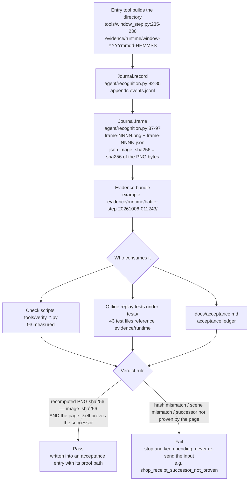
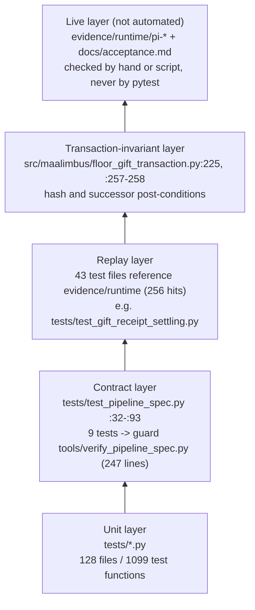

# 7 Quality and Acceptance

[中文](../zh_cn/7-quality.md) · [← Index](index.md)

This chapter answers three questions: how the repository defines "done" (7.1); where that definition lands in tests and check scripts (7.2); and what is **explicitly not yet accepted** (7.3).

Reading convention: every technical claim in this chapter is bound to a verifiable anchor (`relative/path:line`, a test name, or an `evidence/runtime/...` path). Where a number quoted from a document disagrees with the code or the on-disk tree, the code wins and the conflict is flagged in the body (see the end of 7.3).

---

## 7.1 Evidence and the acceptance standard

### 7.1.1 The definition of "done": a frame, a replay, a test, and a "not claimed"

The repository has no separate acceptance-criteria checklist; the standard lives in the way `docs/acceptance.md` is written. That file is a **reverse-chronological ledger of acceptance entries**: each entry records one run, one defect, or one fix, and always carries four kinds of information:

1. **Run facts** — run id, stop reason, step count, click count, pass/fail. Example: `docs/acceptance.md:3-10` records that `pi-20261012-112240` ended by itself with `reason=unexpected_successor steps=17 clicks_sent=17 passed=false`; all 17 clicks were MAP node attempts and all 454 observations kept `route.reason=current_position_not_proven verified_clear=false`, together with the journal path `dist/MaaLimbus/evidence/runtime/pi-20261012-112240/events.jsonl`.
2. **The cause read off a retained frame, never guessed** — `docs/acceptance.md:1514-1521` states outright "why the offline suite missed it": the older retained reward frame `evidence/runtime/window-20261008-111130/frame-0002.json` splits the OCR tokens into `Selectable` and `0/1`, so exact membership matched there and only there.
3. **The fix bound to `file:line`** — for example `docs/acceptance.md:1534-1540` names `runner.py:1784` as too narrow a guard and `runner.py:2131` as the mis-booked receipt intent.
4. **Proof plus `not claimed`** — a reproducible offline proof first, then an explicit statement of **what this pass did not prove**. Example: `docs/acceptance.md:1573-1581` concludes "Actual retained frame 0239 of `pi-20261012-170045` replays through the native Agent as SHOP_PURCHASE … This does not yet prove the live Purchase, GET acknowledgement, shelf receipt, GUI continuation, or whole five-floor run."

Point 4 is the core of this repository's acceptance standard: **"accepted" requires run evidence, a reproducible offline proof, a test that pins it, and an explicit `not claimed` paragraph, all at once**. That is why so many ledger entries end in `Still required:` (`docs/acceptance.md:1450-1452`, `:1491-1493`, `:1523-1525`, `:1569-1571`).

The other half of the standard is **how the suite result itself is qualified**. Immediately after reporting `1528 passed, 1 skipped ... 98.33 s`, `docs/acceptance.md:1618-1620` adds: "This is a source test result, not complete game or production-value acceptance." A fully green suite is not acceptance — that rule is written into the file, not inferred by the reader.

### 7.1.2 What an evidence directory actually holds

Evidence lives at `evidence/runtime/<task-name>-<yyyymmdd-hhmmss>/`. `evidence/runtime` currently holds **932 directories** (snapshot of 2026-10-12; it climbed from 929 to 932 during this very review, so the number only goes up). The directory-name prefix is chosen by the tool that produces it; prefixes observed on disk include `adb-probe-*`, `battle-step-*`, `window-*`, `pi-*`, and `native-deployment-ui-*`. The `window-*` construction point is verified at `tools/window_step.py:235-236`:

```python
directory = ROOT / ('evidence/runtime/window-' + datetime.now().strftime('%Y%m%d-%H%M%S'))
directory.mkdir(parents=True)
```

Three directories of different kinds, as listed by `Get-ChildItem`:

| Directory | Contents |
|---|---|
| `evidence/runtime/adb-probe-20261005-214515/` | `frame.png`, `result.json` (2 files) |
| `evidence/runtime/battle-step-20261006-011243/` | `events.jsonl`, `frame-0001..frame-0007` each as `.json` + `.png`, `result.json` (17 files) |
| `evidence/runtime/pi-20261012-135557/` | only `frame-0084.json/.png` and `frame-0085.json/.png` (4 files) |

The third row deserves a note: `pi-20261012-135557` is the retained evidence for the "renamed duplicate gift" dispute, and `docs/acceptance.md:1483-1484` cites exactly `frame-0084.*` and `frame-0085.*`. **Evidence directories are retained on demand, not recorded in full** — which frames survive is itself part of the verdict.

`result.json` carries the conclusion of one run. Fields measured on disk:

- `adb-probe`'s `result.json` keys: `pid, address, input_sent, verified_clear, input_method, controller, foreground_before, size, foreground_after, reason` (527 bytes).
- `battle-step`'s `result.json` keys include `clicks_sent, turn_submitted, victory_verified, verified_clear, before_observation, action, intent, rounds, settled, reason, passed`.

In other words, booleans like `verified_clear` / `passed` — "did this actually land?" — are **carried by the evidence directory itself**, not written in afterwards by a human.

### 7.1.3 Where the journal and the frame hash are implemented

There is one implementation: `class Journal` at `agent/recognition.py:76`.

- `agent/recognition.py:82-85` — `record(event, **details)` appends one JSON line to `events.jsonl`, each carrying `event`, `utc`, and the caller's details.
- `agent/recognition.py:87-97` — `frame(frame, records, scene, **extra)` writes `frame-%04d.png` under an incrementing index, then the same-named `.json`. The load-bearing line is `:94`:
  ```python
  'image_sha256': hashlib.sha256((self.directory/(name+'.png')).read_bytes()).hexdigest(),
  ```
  That is, `image_sha256` in the JSON **is the sha256 of the PNG bytes in the same directory**. The JSON also carries `scene`, `size`, `utc`, and `ocr` (a list of `{text, score, box}`).
- `agent/recognition.py:108` — the default directory comes from the `MAALIMBUS_EVIDENCE` environment variable, otherwise `evidence/runtime/agent`.
- `tools/window_step.py:285` passes that timestamped directory to the journal via `Journal(directory)`.

A measured frame file: `evidence/runtime/pi-20261012-135557/frame-0084.json` has keys `scene, size, utc, image_sha256, ocr, local_ocr, reward_cost, reward_cost_provenance, neural_sinners, overlay_dismissal`, with `scene` = `GIFT_GET` and `image_sha256` = `3af49f7b92e497d98db92fe6c8be2a45936a5030043be43f0d68702b4251c95f`. Different pipelines add their own fields through `extra`; the hash and `scene` are the common base.

The hash is not decoration — downstream code **recomputes and compares** it:

- `src/maalimbus/floor_gift_transaction.py:225` and `:257-258` recompute the PNG's sha256 when reading retained evidence and refuse on any mismatch with the stored `image_sha256`.
- `src/maalimbus/anchors.py:83-84` requires a geometry anchor to carry either a `frame` or a `sha256`, and `:93` fills it from the frame's `image_sha256`.
- `src/maalimbus/gift_vision.py:44`, `:52` validate the 64-hex digest and compare file hashes when reading icon files.

There are **931 `events.jsonl` files** under `evidence/runtime` (recursive count).

### 7.1.4 One run → evidence → who consumes it → pass/fail



The "never re-send the input" edge has both an implementation and documentation: `docs/acceptance.md:1534-1540` describes recovering a landed confirmation from evidence instead of replaying it, and `:1540-1547` folds the recovery path and the settling path into one successor rule.

---

## 7.2 Test layout

### 7.2.1 Size

| Object | Count | Command |
|---|---|---|
| `.py` files under `tests/` | 128 | `(Get-ChildItem tests -Recurse -File -Filter *.py).Count` |
| subdirectories under `tests/` | 0 (only `__pycache__`) | `Get-ChildItem tests -Directory` |
| `def test_*` functions under `tests/` | 1099 | `(Select-String -Path tests\*.py -Pattern 'def test_' -AllMatches).Count` |
| test files referencing `evidence/runtime` | 43 (256 matches) | `Select-String -Path tests\*.py -Pattern 'evidence/runtime'` |
| files under `tools/` | 158 (153 `.py`, 4 `.ps1`, 1 `.cmd`) | `(Get-ChildItem tools -Recurse -File \| Where-Object { $_.FullName -notmatch '__pycache__' }).Count` |
| `tools/verify_*.py` | 93 | `(Get-ChildItem tools -Filter 'verify_*.py' -File).Count` |
| `tools/probe_*.py` / `tools/measure_*.py` | 5 / 3 | same shape |

The table above is a **snapshot taken on 2026-10-12**, and the numbers drift with the working tree (`evidence/runtime` grew during this very review, and `tests/` keeps gaining cases). So the table only promises "a snapshot plus reproducible commands": to find out whether a number still holds today, **run the four commands below** instead of trusting a hard-coded figure.

```powershell
(Get-ChildItem tests -Recurse -File -Filter *.py).Count
(Select-String -Path tests\*.py -Pattern 'def test_' -AllMatches).Count
(Get-ChildItem tools -Recurse -File | Where-Object { $_.FullName -notmatch '__pycache__' }).Count
(Get-ChildItem evidence/runtime -Directory).Count
```

Note that the table deliberately uses `-Recurse` and excludes `__pycache__`: no recursion, or not excluding the cache directories, yields a different number (`tools/` is 220 with `__pycache__` included) — that is a difference in counting convention, not a change in the repository.

The 5 scripts under `tools/` are operator entry points, not tests: `install_desktop_shortcut.ps1`, `native_session.ps1`, `start_native.ps1`, `start-mirror.ps1`, `start-mirror.cmd`.

**The test tree is flat**: all 128 test files sit directly in `tests/`, with no per-layer subdirectories. Layers show up in naming and content, not in directory structure.

### 7.2.2 Three layers

**Unit layer**: pure module-level assertions over transaction objects, ledgers, OCR parsing, geometry, and so on. This is the bulk (1099 test functions across 128 files).

**Contract / protocol layer**: turns "what the upstream protocol says" into executable checks. The core is `tools/verify_pipeline_spec.py` (247 lines), whose module docstring names the three protocols it checks against: `docs/zh_cn/3.3-ProjectInterfaceV2协议.md` (the controller `type` value set, the `display_*` mutual exclusion, the Adb controller's auto-detected input/screencap, `task.entry`, and `option.cases[].pipeline_override` naming real nodes), `docs/zh_cn/3.1-任务流水线协议.md` (the node field set, `next`/`on_error`/`interrupt` naming an existing node or carrying a `[JumpBack]`/`[Error]`/`[Stop]`/`[DetectionMissed]` marker, and the meaning of `target: true`), and `docs/zh_cn/1.3-Custom&Agent.md` (a node's `custom_recognition`/`custom_action` must already be registered by `agent/main.py`). The script describes itself as read-only, exits 1 on a violation, and takes `--interface/--pipeline/--agent-main/--report`.

It is pinned by **9 tests** in `tests/test_pipeline_spec.py` (`:32`, `:39`, `:46`, `:55`, `:62`, `:68`, `:77`, `:85`, `:93`), four of which are negative cases (`:46`, `:77`, `:85`, `:93`: an unregistered action, a controller type outside the protocol, two scaling modes on one controller, an override naming no node). `docs/maaframework-conformance.md:125-132` records where this guard came from and its current result: `python tools/verify_pipeline_spec.py` → `ok — 0 problem(s)`.

**Replay / end-to-end layer**: 43 test files reference `evidence/runtime` and drive production code paths with real retained frames. The live end-to-end part is **not an automated test**; it is carried by `evidence/runtime/pi-*` directories plus entries in `docs/acceptance.md`.

### 7.2.3 Test layers



### 7.2.4 One known source of suite noise

`docs/acceptance.md:1484-1490` records a `1441 passed, 2 failed, 1 skipped` run: the two failures were `tests/test_controller_lease.py` and `tests/test_update_install.py` colliding with the lock held by a **real running app instance** (`controller_lease.lease_path` redirects every path named `controller.lock` to `%LOCALAPPDATA%/MaaLimbus/controller.lock`); reading that file directly reproduces the same `PermissionError [Errno 13]`, so the two failures are an environment collision, not a code defect. The lesson: **running the suite on this machine couples the result to real-instance state**, so red/green cannot be read naively.

---

## 7.3 Known boundaries and unaccepted items

This is the chapter's most important output. Every row states the current condition with a checkable anchor; no "some functionality needs further work" hand-waving.

| Item | Current condition | Impact | Evidence anchor |
|---|---|---|---|
| Full five-floor loop | The pipeline does not implement the dungeon's five-floor loop; `dist/MaaLimbus` can only run the entry chain (the `MirrorHard` chain), and the build info lists it as the first pending item | Clicking the `mirror_loop` task in MXU cannot complete a run; GUI end-to-end is not acceptable | `docs/handover-2026-10-08.md:130-132`; `dist/MaaLimbus/build-info.json:11-15` (`pending` = `MXU UI validation`, `live input postcondition`, `full five-floor loop`) |
| Map node identity (the map-identity blocker) | `pi-20261012-112240` ended by itself with `reason=unexpected_successor steps=17 clicks_sent=17 passed=false`; all 454 observations kept `route.reason=current_position_not_proven verified_clear=false`, and floor 2 never advanced | The run stops at the MAP stage; battle, shop, floor 3 and clear are never reached | `docs/acceptance.md:3-10` |
| GET-overlay acknowledgement **is** wired into the runner | `src/maalimbus/runner.py:1744` calls `ShopTransaction.reserve_overlay_acknowledgement` (`src/maalimbus/shop_transaction.py:347`) on the shop page; the `wired_in_runner=false` in `docs/acceptance.md:12-29` is the record from that moment and has been overturned by the code | The earlier worry that a real purchase must stop safely with `shop_receipt_successor_not_proven` no longer holds; the live purchase chain of 2026-10-12 (4.3.1) went through exactly this path | `src/maalimbus/runner.py:1744`; `src/maalimbus/shop_transaction.py:347` |
| Live purchase + shelf receipt | The live Purchase and the shelf receipt were driven through on 2026-10-12 (see 4.3.1; `docs/shop-revive.md` records the revive itself, 3093→2993); retained frame 0239's offline replay remains a second, independent proof; the GET acknowledgement, GUI continuation and a whole five-floor run are **still** unproven | There is now one live path for spending and its receipt; "one whole run" is still missing | `docs/acceptance.md:1573-1581` (the original); 4.3.1 on this page |
| The battle HUD's second layout offers no provable start control | Two HUD layouts appear in the same dungeon: the one with `START` visible gives `battle_vision.start_button` the dial; the other (Win Rate caption shifted left to x≈1484, the whole cluster ≈290px left) shows neither `START` nor a lit dial, so `start_box=None` and the window stops by design with `battle_progress_stalled` after 8 rounds without progress (`src/maalimbus/runner.py:1627`) | A battle in that layout cannot be advanced automatically; the run stops and waits for a person | `src/maalimbus/battle_vision.py:1`; measured: `tools/window_step.py --observe-page` reproduces `turn=7 start_box=null` on the same screen |
| Twelve-slot identity report absent from the live journal | The assembly logic is finished; the installed app predates the wiring, so the live journal carries no `pre_battle_identity_report` | The card-reading chain has only offline/retained-frame evidence | `docs/acceptance.md:1491-1493` |
| Neural detection (sinner detector) | The dataset has **0** reviewed real boxes, `readiness false`, the model is untrained and production detection is disabled; the live NN shadow yields 11 predicted boxes per pre-battle frame with `quality/input flags false` | Recognition still rests entirely on OCR + anchors; model confidence may not stand in for a victory or a reward receipt | `docs/acceptance.md:59-63`; `docs/acceptance.md:1601-1604`; `docs/learning.md:13` ("no accepted real sinner-card box labels") |
| Japanese recognition | Japanese native labels and the update/device sections have retained evidence, but this "does not prove Japanese game recognition or GUI task execution" | A Japanese deployment is not acceptable | `docs/acceptance.md:104-106` |
| Account reconciliation | 129 exact owned matches / 78 unresolved observations, "still partial"; the missing JP aliases and system row and the blank booleans are explicit unknowns | Inventory state may be incomplete | `docs/acceptance.md:36-37` |
| Team selection mapping | The deployed slot and the team actually taken into the game are not yet pinned by evidence, and the `DUNGEON_TEAM` slot→saved-team mapping lacks an anchor plus a test | The run may enter with the wrong team | `docs/handover-2026-10-08.md:124-125` |
| Self-update | `tools/check_update.py` already does conditional requests and stages into `build/updates`; what is missing is a **GitHub release with assets** | Users cannot receive updates | `docs/handover-2026-10-08.md:133-136` |
| Windows packaging | `tools/build_windows_package.py` needs three upstream zips and this machine has only unpacked products | The package cannot be built here | `docs/handover-2026-10-08.md:139` |
| Hard dungeon and desktop packaging | "Full hard dungeon and desktop packaging remain unverified" | Hard mode and desktop distribution are not accepted | `PROJECT.md:1428` |
| Daily / Lux / stamina task execution policies | "Four daily/lux/stamina task execution policies are still unfinished"; the `CurrentTeam7 paid5/weekly0` receipt remains unseen | The daily-task chain cannot run automatically | `docs/acceptance.md:152-154` |
| Lux stage / farm / receipt and GUI dispatch | The source change is not installed; "Lux stage/farm/receipt and GUI dispatch remain unverified" | The Lux flow is not accepted | `docs/acceptance.md:96-97` |
| GUI task dispatch and public update installation | "GUI task dispatch and public update installation remain unverified" | Not evidence that GUI tasks can execute | `docs/acceptance.md:125-126` |
| Scope of MaaFramework conformance | No ProjectInterface / MXU run was performed (the interface was read, not driven); the toolkit's auto-detection timing was not measured; the 33 nodes unreachable from the task entries are "reported, not deleted"; unused protocol features are asserted neither way | Conformance holds only for the fields this project uses | `docs/maaframework-conformance.md:136-144` |
| Documentation/code numeric drift | `docs/maaframework-conformance.md:110` says `mirror.json` holds `89 nodes`, while the measured top-level node count is **792**; `docs/handover-2026-10-08.md:129` says `tests/test_pipeline_spec.py` has 17 tests, while the measured count is **9** | Absolute numbers in old documents cannot be quoted directly | `docs/maaframework-conformance.md:110-111`; `docs/handover-2026-10-08.md:129`; measured `python -c "import json;print(len(json.load(open('assets/resource/base/pipeline/mirror.json',encoding='utf-8'))))"` → `792`; `Select-String -Path tests/test_pipeline_spec.py -Pattern '^def test_'` → 9 lines |
| Suite vs. real-instance resource contention | With the real app running, `tests/test_controller_lease.py` and `tests/test_update_install.py` raise `PermissionError [Errno 13]` on `%LOCALAPPDATA%/MaaLimbus/controller.lock` | On this machine, suite results need a human to separate environment failures from code defects | `docs/acceptance.md:1484-1490` |
| Other milestones | Floor policy, budgeted stamina conversion (`config/user-mirror-settings.json`: `max_starlight 100` / `refill_lunacy 0` / `convert_modules 0` / `module_budget_pending true`), and mail daily rewards | Unimplemented or unaccepted | `docs/handover-2026-10-08.md:137-139` |

### 7.3.1 The honesty constraint on this section

The table deliberately separates three states; do not blur them when writing:

1. **Implemented but not wired** (e.g. the GET-overlay acknowledgement, `wired_in_runner=false` at `docs/acceptance.md:26-29`).
2. **Offline-replayable but not proven on a live run** (e.g. the twelve-slot identity report, which has offline evidence only, `docs/acceptance.md:1491-1493`; retained frame 0239's SHOP_PURCHASE used to be a second example and was closed on a live run on 2026-10-12, see 4.3.1).
3. **Source changed but not installed** (e.g. the Lux preparation exclusion, `docs/acceptance.md:96-97` and `:113`).

`docs/acceptance.md:139` and `:158` show a fourth state: **the installed-side acceptance passed while the distribution chain did not** ("Main interaction, desktop new-version restart and public Release download are not accepted by that observation").

---

## Self-check for this chapter

- Every `path:line` anchor was opened and checked while writing; no line number exceeds its file's total line count.
- Every count carries the read-only command actually executed (see the 7.2.1 table and the last two rows of 7.3).
- The numeric conflicts with documentation are listed explicitly in the second-to-last row of the 7.3 table, with the measured code value taking precedence.
