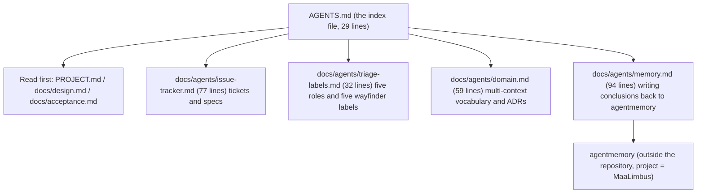
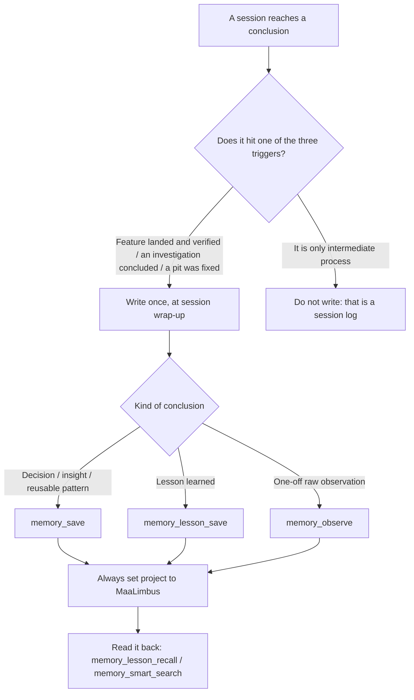

# 8 Agent Rules Layer

[中文](../zh_cn/8-agent-rules.md) · [← Index](index.md)

This chapter is about **what you must follow while working in this repository**, not about product behaviour. Its source files are `AGENTS.md` and the four rule documents under `docs/agents/`; this chapter reads them as one continuous line, but it does **not** replace them — `AGENTS.md` remains the entry point and those four files remain the operational source (`AGENTS.md:4`: `This file is the entry point for agents working in this repo.`).

## 8.1 Where the rules layer sits among the documents

This repository carries four kinds of prose, each with its own job and none replacing another: the **sources of truth** (`PROJECT.md` for progress and the development contract, `docs/design.md` for design constraints, `docs/acceptance.md` for the acceptance standard; `AGENTS.md:8-10` lists all three as required reading before touching code), the **narrative layer** (this wiki; `AGENTS.md:11` says outright that it does not replace those three), the **collaboration rules layer** (`AGENTS.md` plus the four files under `docs/agents/`, covering how to file tickets, how to label them, how to choose words, how to sediment conclusions), and the **out-of-repo conclusion store** (agentmemory, retrievable across sessions, see 8.5).

`AGENTS.md` is 29 lines long and every section under `## Agent skills` is a one-line pointer; the actual rule text lives entirely in those four files. That is deliberate: the entry file carries **dispatch**, not content.

## 8.2 Tickets and specs: GitHub Issues plus the deck tools

This repository's issues and specs are GitHub issues, on the remote `sairaisaika/MaaLimbus` (`origin`, main branch `main`) (`docs/agents/issue-tracker.md:71-75`). Reading and writing **go through the plugin's own deck tools; you do not hand-type tracker commands** — the tools do the work against whatever the current backend is and read it back to check, so the same instructions hold when the backend is not GitHub (`docs/agents/issue-tracker.md:7-13`).

| What you want to do | Tool |
| --- | --- |
| Create a ticket | `deck_issue_create` |
| Read a ticket, with its comments and labels | `deck_issue_get` |
| See which maps and open tickets exist | `deck_context` |
| See one map's child tickets and progress | `deck_map_snapshot` |
| Create a whole map at once (map + children + edges) | `deck_map_plan_create` |
| Add one edge, parent or blocking | `deck_map_link` |
| Change a ticket (comment / labels / claim / close / body) | `deck_issue_patch` |

Only two things fall outside the tools, and both happen outside the tracker: **logging in** (`gh auth login`, then confirm with `gh auth status`) and **creating a repository** (`gh repo create`; the panel's create-and-publish wizard normally does it for you) (`docs/agents/issue-tracker.md:17-22`).

One general rule for writing a body: **write the body to a file first** (real newlines, each `## section` on its own line, one blank line between paragraphs), then hand the file to the tool; do not paste the body into a command line, do not write newlines as the two literal characters `\n`, and do not let the body start with a BOM — then read it back to check (`docs/agents/issue-tracker.md:26-30`).

Blocking relations are preferably laid down as the backend's own **native dependency edges**; only when that is genuinely unavailable do you fall back to a `Blocked by: #n` line at the top of the child ticket's body, with several numbers separated by commas — that line is the **fallback** shared by all three backends and must not become the default (`docs/agents/issue-tracker.md:34-36`).

## 8.3 Triage labels

The skills speak in terms of five **canonical roles**; on the tracker those become five label strings, and in this repository the right column matches the left (`docs/agents/triage-labels.md:5-11`):

| Role | Meaning |
| --- | --- |
| `needs-triage` | A maintainer needs to evaluate this issue |
| `needs-info` | Waiting on the reporter for more information |
| `ready-for-agent` | Fully specified, ready for an AFK agent |
| `ready-for-human` | Requires human implementation |
| `wontfix` | Will not be actioned |

`/wayfinder` uses one further label family with **no role mapping** — the label string is the type (`docs/agents/triage-labels.md:17-23`):

| Label | Meaning |
| --- | --- |
| `wayfinder:map` | The map issue; owns Notes / Decisions so far / Fog |
| `wayfinder:research` | Research ticket |
| `wayfinder:prototype` | Prototype ticket |
| `wayfinder:grilling` | Open decision or discussion ticket |
| `wayfinder:task` | Task ticket |

All ten (five roles plus five wayfinder labels) were created on the remote during initialisation; `bug` uses GitHub's own. **No label is otherwise mandatory unless a skill explicitly asks for it** (`docs/agents/triage-labels.md:29-31`).

## 8.4 Domain vocabulary: multi-context

This repository's domain-document layout is **multi-context**: one `CONTEXT.md` per subproject, with a `CONTEXT-MAP.md` at the repository root pointing at them; system-wide decisions go to `docs/adr/` and decisions belonging to a single context to `<subproject>/docs/adr/` (`docs/agents/domain.md:5-11`). This layout is the conclusion confirmed with the user during initialisation.

Before exploring, read: `CONTEXT-MAP.md` at the root if it exists, then the `CONTEXT.md` of the context you are about to touch, then the ADRs under `docs/adr/` that cover that area. **If these files do not exist, proceed silently** — do not flag the absence and do not propose creating them upfront; `/domain-modeling` creates them lazily when a term or decision is actually written down (`docs/agents/domain.md:19-25`).

Vocabulary has discipline: when your output names a domain concept (a ticket title, a refactor proposal, a hypothesis, a test name), use the definition in `CONTEXT.md` and do not drift to synonyms the glossary explicitly avoids. A concept you need but the glossary lacks is itself a signal — either you are inventing language the project does not use, or there is a real gap (`docs/agents/domain.md:51-55`). **Surface a conflict with an existing ADR explicitly** instead of silently overriding it (`docs/agents/domain.md:57-59`).

## 8.5 Sedimenting conclusions: writing back to agentmemory

This discipline governs exactly one thing: **once a session reaches a conclusion, write it into agentmemory outside the repository** (`docs/agents/memory.md:3`). It exists because of an observable gap: agentmemory is not short of raw session records, it is short of **conclusions** — searching `MaaLimbus` usually turns up tool_use shells (which file was read, which command was run) rather than how something was finally decided or which approach proved unworkable, so the next session steps into the same pit again (`docs/agents/memory.md:7-11`).

Write **conclusions and criteria**, not a running log, and do not copy diffs: what was done (one sentence), why that way (including the rejected option and the reason), which approach proved unworkable (with the most characteristic error text or symptom), and the criteria / values / paths (acceptance standard, thresholds, version numbers, key file paths). A counter-example is read A, changed B, ran the tests; a good example is X does not work because Y (error text `...`), so switch to Z, and the criterion is command W printing P (`docs/agents/memory.md:33-50`).

`project` is always `MaaLimbus` — retrieval splits on this field, and leaving it blank or filling in the default workspace or an absolute repository path scatters this repository's conclusions into other projects, which is the same as not writing them. `concepts` / `files` / `tags` are comma-separated strings, not arrays. After writing, read back with `memory_lesson_recall` or `memory_smart_search` to confirm it is retrievable and `project` is right (`docs/agents/memory.md:62-69`).

It divides labour with `PROJECT.md` sharply: **`PROJECT.md` is the in-repo chronological ledger** (how far this round got, what comes next, which holes are still open) and **agentmemory is the out-of-repo conclusion store across sessions** (how this was decided last time, which approach does not work). **Do not copy one passage into both** — progress already written in PROJECT.md is not copied into agentmemory as body text, and a conclusion already in agentmemory is referenced from PROJECT.md by a one-line pointer only when a continuation needs it; when the conclusion already belongs to `docs/design.md`, `docs/acceptance.md` or `docs/agents/*.md`, one pointer line is enough (`docs/agents/memory.md:84-91`).

The non-applicable cases are stated too: a session that produced no conclusion (browsing, pure question and answer), and a conclusion that merely repeats what someone already wrote — in the latter case reinforce the existing memory instead, or simply do not write (`docs/agents/memory.md:92-94`).

## 8.6 How the rules layer is enforced

Three things are in play: **`AGENTS.md` is an index**, each section under `## Agent skills` being a one-line pointer (see the diagram in 8.1); **the skills read those four files directly**, so their paths are an interface and renaming them breaks callers; and **this wiki only narrates** — this chapter puts the rules into plain language while the rules themselves stay where they are (`docs/wiki/README.md:72` already registers those four files in the docs topic map so they are reachable from the wiki).

This layering also explains why `.gitignore:28-29` lets only two files through: the rules layer is by default **local configuration**, and only the part that must travel across sessions and between people ships with the repository — `!docs/agents/memory.md` and `!AGENTS.md` are exactly those two exceptions.

## Not verified / open questions

This section states honestly how far this chapter was verified and what was **not**.

1. **This chapter performed no ticket operation.** The tool list and the fallback in 8.2 are taken from the text of `docs/agents/issue-tracker.md`; this chapter neither created a ticket nor verified what the `deck_*` tools report on the current backend. The authority on the tool contract is the plugin, not this chapter.

2. **The label list is a snapshot.** The ten labels in 8.3 come from the current-state paragraph at `docs/agents/triage-labels.md:29-31`; this chapter did not query the remote repository to re-check that they still exist today.

3. **multi-context is the agreed layout, not a measured state.** 8.4 states the conclusion confirmed with the user during initialisation: this repository has **not** created `CONTEXT-MAP.md`, any `CONTEXT.md`, or `docs/adr/`; by the rule at `docs/agents/domain.md:19-25` their absence is to be passed over silently, so this chapter did not check whether they exist right now either.

4. **The line counts are measurements from the time of writing.** The figures 29 / 77 / 32 / 59 / 94 in the 8.1 diagram (`AGENTS.md` and the four rule files) and `docs/wiki/README.md:72` were measured on 2026-10-12 (America/Indianapolis); re-measure before quoting.

5. **The `.gitignore` exceptions state an intent, not an index.** Those two lines at `.gitignore:28-29` decide which files of the rules layer travel with the repository; this chapter only explains that design and does not claim what the git index currently holds — whether `AGENTS.md` has been `git add`ed is unrelated to this chapter's account.

6. **The two languages were not compared sentence by sentence.** Only headings, numbering, tables and paragraph order are guaranteed to correspond; `../zh_cn/8-agent-rules.md` is the source and this page is its mirror rather than an independent write, so a factual error in the Chinese page is inherited here.
