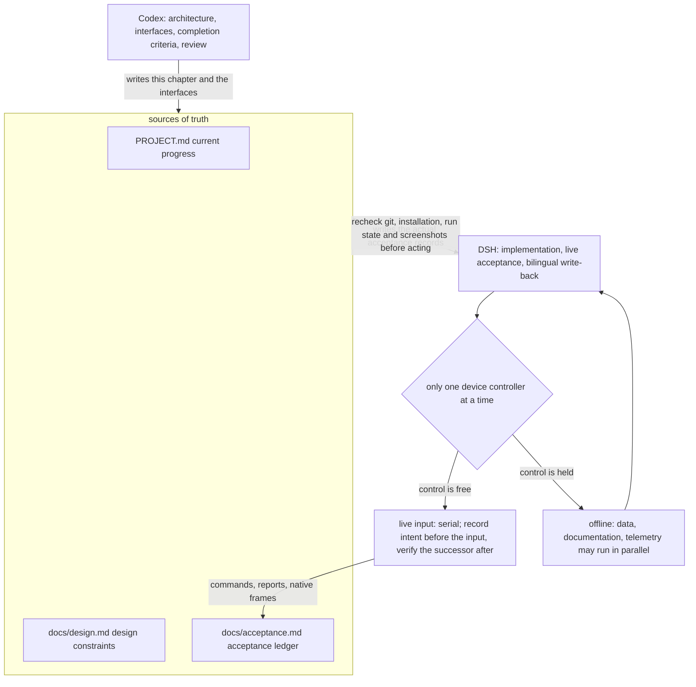
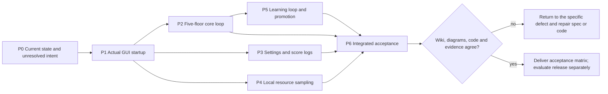
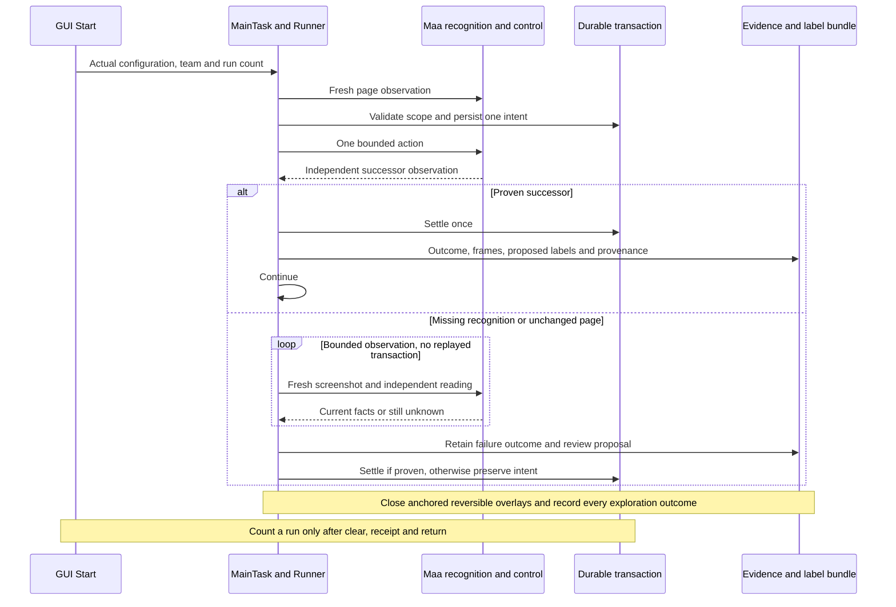
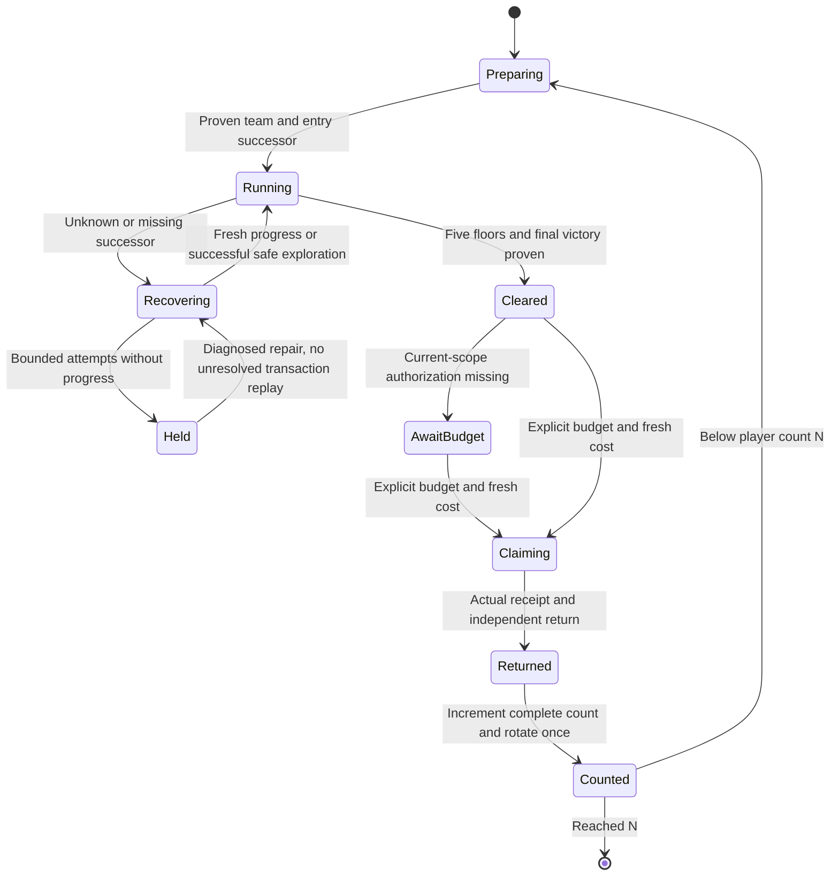
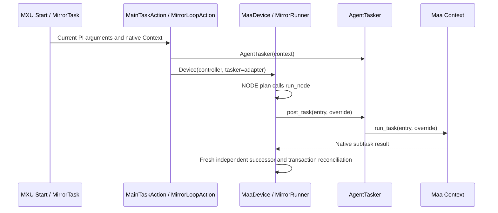
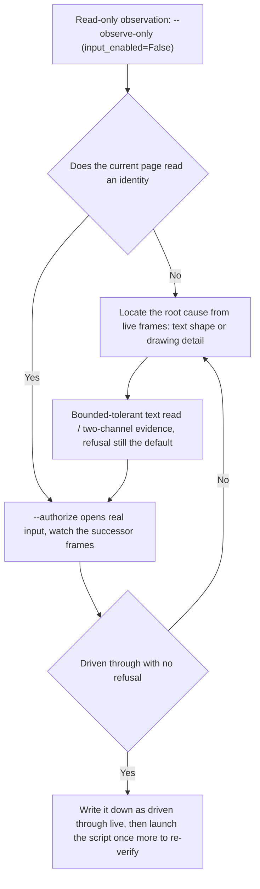
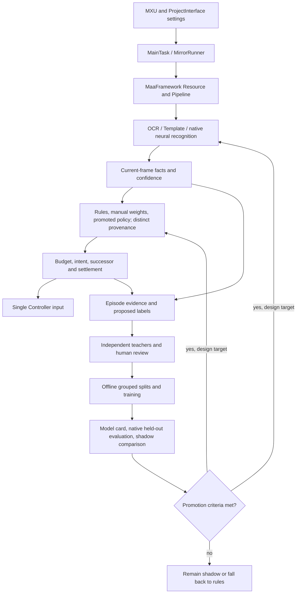
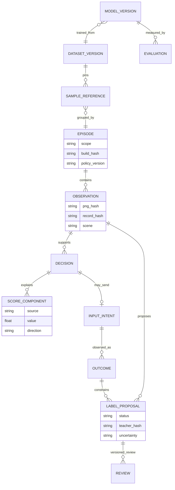
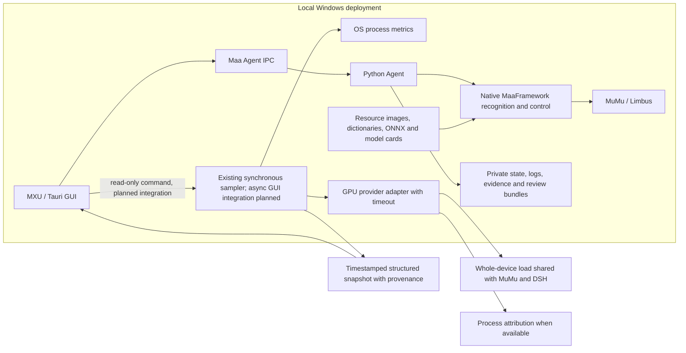
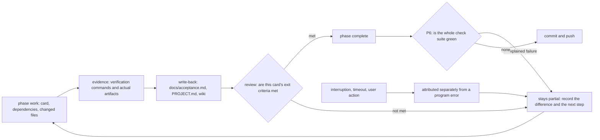

# 9 End-to-end repair and learning-system implementation plan

[中文](../zh_cn/9-execution-plan.md) · [← Index](index.md)

This is the **October 14 execution specification**, not a completion report. DSH implements; Codex owns architecture, interfaces, acceptance criteria and review. `PROJECT.md`, `docs/design.md` and `docs/acceptance.md` remain authoritative. Each board card references a phase, dependencies, changed files, checks and actual evidence. Starting work, passing unit tests or observing a repaint does not close a phase.

This is an adaptable technical plan, not a code lock, approval process or mandatory full-site read. Enter the relevant phase through [quick routes](../agent-index.md); independent work may proceed in parallel. Report routes used and actual deviations.

## 9.1 Baseline and ownership

| Area | Checked fact | Claim still unsupported |
| --- | --- | --- |
| Star balance | The original 75 only_rec reading fell below .85. Two detected crops and isolated recovery have evidence: `src/maalimbus/grace_balance_native.py:1`, `src/maalimbus/grace_transaction.py:120` | Every layout works or every historical purchase settled |
| Native navigation | AgentTasker at `agent/recognition.py:1410` runs callback subtasks through Context; source252c0d2 supplies the missing Device adapter | A source change updated every installed instance |
| DSH progress | `build/grace-stop-page-star-graces.json` records3 packaged-entry inputs to the star page and explicitly reports dungeon_complete=false. Later private state records four selected cards; reconcile each against its own native frames | Three inputs completed the dungeon; a transaction file alone proves the entire live chain |
| Settings and scores | Custom MXU was built/installed; the GitHub button visibly exists; `src/maalimbus/decision_log.py:1` formats scores | Portrait/star persistence was fully accepted or shadow predictions selected purchases |
| Models and usage | `src/maalimbus/neural_shadow.py:1` and `src/maalimbus/shop_value_shadow.py:1` separate perception, shadow prediction and control; `src/maalimbus/resource_diagnostics.py:1` now has a sampler prototype and read-only CLI; the GUI remains unverified | A model file means active policy inference; whole-GPU load belongs to this script; a backend sampler means the panel is complete |

Only one device controller may operate at a time. DSH may parallelize offline data, documentation and telemetry work; live inputs are serial. Codex maintains this specification/interfaces while DSH records actual acceptance. Preserve each other's uncommitted work. Recheck git, installation, current run state and screenshots before acting; the table is a baseline, not the current game screen.

## 9.2 Dependencies, board cards and phase exits

| Card | Depends on | Implementation and output | Evidence required to close |
| --- | --- | --- | --- |
| P0 Reconcile reality | None | Check active run, historical star intent, actual page and installed version; classify unresolved intents as settled, cancelled with history, or unproven | Same-scope before/after PNG/JSON/hashes and visible cost/balance; no repeated purchase; write the disposition into acceptance |
| P1 Actual startup pipeline | P0 | Install the adapter; GUI Start through MainTask, MirrorLoop and native subtasks; bind GUI mode/target, ledger and selected game header | Real GUI-start trace, matching Agent/resources and page progression; another CLI entry cannot substitute for a GUI click |
| P2 Core dungeon loop | P1 | Map, events/battles, rewards, shop and floors; reuse verified deployment; repair and resume each successor failure | One actual five-floor Hard clear, traceable floor/purchase/refresh/GET successors; script-operated play, not manually bypassed stages |
| P3 Settings and explanatory logs | P1; delivery depends on P2 | Forty slots, portrait order, base stars, fixed/rotation, explicit run count versus step/time bounds; weights and final scores | Save, normal close/reopen, native parameters and selected game header agree; repeated starts do not reapply transactions; real logs contain components, tie-breaks and exclusion reasons |
| P4 Local usage | After P1, parallel with P2 | Implement CPU/RAM/GPU/VRAM collection and UI under 9.6 | Independent same-window measurements; missing provider, timeout, exited process and disabled sampling cases; no background busy loop when off |
| P5 Learning loop | Real P2 trajectories; offline collection can start earlier | Evidence bundles, labels, review, grouped splits, training, native evaluation, shadow comparison and reversible promotion under 9.4/9.5 | Independent episodes, model/dataset/teacher/evaluation hashes and actual inference-node logs; unpromoted candidates stay explicitly shadow |
| P6 Integrated acceptance | P2–P5 | Latest merged tests, packaged self-test, GUI-start/continuous-run evidence and wiki/design reconciliation | Completed 9.7 matrix with evidence, correct installed build and no unexplained failure; public release has separate license/privacy/update requirements |

P0/P1 have partial evidence but still need final reconciliation. Do not bulk-close P2–P6. Add trigger, original evidence, hypothesis, change, positive/negative cases and resumed run to the relevant card. An unrelated green test does not resolve the original failure.

## 9.3 Automatic recovery and run count

Unknown does not immediately terminate the whole task. Distinguish animation, missing recognition, reversible overlays, sent transactions, unknown effects and missing resource authorization. Use Maa for proven controls. Unknown effects may participate in existing bounded exploration under player budgets, with uncertainty in the score. **An unread purchase result calls for rereading and reconciliation, not another purchase.**

Specify attempt/time/no-progress bounds by action. Star purchases currently have up to 3 observation-only retries; that is not a universal retry policy. Candidate attempts record target region, before/after frames and whether the expected page changed. Pause that branch only after its bound; independent collection, offline work and defect repair may continue. Closing an overlay must not become an unapproved payment.

Run count is the player's number of complete dungeons, separate from step and time bounds. Saved means read saved configuration; deployment size, team count and loop steps cannot imply dungeon count. Repeating N runs needs per-scope spending authorization. Missing authorization retains cleared/unpaid state; historical 6-module approval is not reusable permission.

**Delivered (2026-10-14)**: the player's saved complete-run count is `Settings.run_count` (`src/maalimbus/runner.py:158`) with the PI option `mirror_run_count` (`assets/interface.json:68144`), carried by the pipeline node `MirrorRunCount` (`assets/resource/base/pipeline/mirror.json:5579`) and read at `src/maalimbus/mirror_task_options.py:9`. Reaching it is judged only from the ledger's own delta: `MirrorRunner._run_count_reached` (`src/maalimbus/runner.py:1393`) subtracts this launch's baseline from `RunLedger.completed_runs`, a total that advances only on `entry_returned` (`src/maalimbus/storage.py:287`) -- an event the ledger refuses without five cleared floors, a victory and a claimed reward. At the player's N the window stops with `run_count_reached` (`src/maalimbus/runner.py:2807`), the step record and `summary()` carry `verified_runs={target,completed}` (`src/maalimbus/runner.py:3196`), and the log prints `verified runs: x of y this launch (z in the ledger)` (`src/maalimbus/event_log.py:149`). **Not yet exercised live**: no run in the current window has finished, so this stop path is covered by unit tests only.

### 9.3.1 Actual adapter from GUI Start to native subtasks

The implemented chain is `MainTaskAction.run → MirrorLoopAction.run → MaaDevice → MirrorRunner → run_node → AgentTasker.post_task → Context.run_task`. Use `python tools/wiki_route.py startup --limit 1` for current symbol locations rather than static line numbers in a diagram. `MirrorLoopAction.run` must pass `AgentTasker(context)` to Device. Runner obtains that tasker from Device to execute NODE plans through the native Pipeline. The missing adapter caused the historical `a node plan needs a Maa tasker` error.

The CustomAction already occupies the framework worker. Do not replace this with `context.tasker.post_task` and wait for its own queue; `AgentTasker` documents why. This view explains implemented wiring, **not, on its own, a live GUI Start or a five-floor completion**; those still need the installed version, the actual GUI selection and the successor frames. Hit-count resets apply only to read-only observation nodes, never input nodes or transaction history.

**Delivered (2026-10-14)**: the app rebuilt from `8ca1ac1` (whose parent `d574a26` is the node-panel identity fix) was launched as a real GUI (`dist/MaaLimbus/MaaLimbus.exe`, process 34940) and its own Start button was pressed with real pointer input at 07:22 local. The run `dist/MaaLimbus/evidence/runtime/pi-20261014-072228` opened on scene `NODE_PANEL` -- the state the packaged CLI run was stopped on before `d574a26` -- and dispatched `CUTSCENE -> EVENT_CHOICE -> EVENT_RESULT -> GIFT_GET -> PRE_BATTLE_TEAM -> BATTLE_HUD -> MAP -> NODE_PANEL -> GIFT_GET`, so the chain above is now observed live rather than only wired. Still not proven this way: a complete five-floor run and the saved-run count's stop path.

**Reached live, then repaired (2026-10-14)**: the same run went on to 254 frames / 71 inputs -- `BATTLE_HUD` 20, `MAP` 8 node clicks, `SHOP` 7 including 4 `SHOP_PURCHASE`, `GIFT_GET` 6, `NODE_PANEL` 5 (every one through `panel_enter_is_the_only_forward_input`, so the identity fix was exercised live), `GIFT_PICK` 4 and `REWARD_CARD` 2 -- and stopped on `floor_gift_commit_receipt_not_proven`: its `Select 2/2` press was answered with a notice printing `Dark Vestige`, a name from neither the pick page's offers nor the two cards the run's own clicks ticked (`frame-0252`), while the receipt rule required the notice to name one of the selections. The rule now keeps the two facts apart: the notice page and its own name plate prove the press, and the receipt retains both names -- the pick it answers and what the device printed (`FloorGiftTransaction.notice_matches_a_pick` and `receipt_intent(..., on_notice_page=True)` in `src/maalimbus/floor_gift_transaction.py`, the gate and the labelled note in `src/maalimbus/runner.py`, pinned by `tests/test_gift_receipt_settling.py` against the retained frame `evidence/runtime/gui-20261014-072228/frame-0254.json`). A name the selection cannot account for is still refused on any page that is not a notice page, because the middle band is a loose read. In the live retest that followed (`pi-20261014-080122`, 08:01 local) the same page shape came back with a name that did match: that run's own `floor_gift_ranking` selected `Today's Expression` (`selection_source: single_free_select_button`), the `Select` click was answered by the notice, and the transaction committed a receipt whose printed title and successor frame are both recorded (`config/user-floor-gift-transaction.json`, `receipts[0]`: `frame-0059.json` -> `frame-0060.json`), so the chain continued past the point where it had stopped before. The outside-selection branch itself -- a notice whose printed name answers none of the picks -- is still only unit-tested.

**The shelf and the store (2026-10-14)**: the next launch on the folded build stopped after 3 inputs on the same refusal, one blank wide -- that run's own reservation frame `frame-0002` read the 144-coin slot as `Crownof Roses` and its returning `frame-0008` printed `Crown of Roses`, so `_fold` now drops the blanks beside the confusable class and the `rn` ligature (a title still cannot be shortened: the letters and digits have to agree one for one). Underneath it the phase would have ended for good: the launch after that raised `Configuration/state exceeds 2 MiB` before its first input, because the decision context recorded `owned_bought` as the whole purchase records and every record carries its own context, so `config/user-shop-<scope>.json` had reached 2,464,332 bytes. The runner now records their names, `shop_transaction._context` enforces that shape at the store boundary, and `tools/prune_shop_state.py` rewrote the live files (2,464,332 -> 46,950 bytes) touching only that field. Both are unit-tested -- the prune tool included -- and the repaired shelf was replayed against the real frames, which now list no offending offer; the rebuilt app is what has to show it live.

**The same reader gap, on the shelf (2026-10-14)**: that retest run then walked on to floor 3 and stopped at `Shop successor shows an offer the shelf never held` (68 steps / 67 clicks, `passed: false`) while settling its `Rusted Cutting Knife` purchase (244 coins, 1530 -> 1286). The store kept `pending.stage: overlay_intent`, and the returning shelf held the same six slots with the bought card under its own `Purchased` badge -- but the visit's own reservation frames read the 160-coin slot as `Thomy Path` and the returning shelf read `Thorny Path`, its catalogue name (`assets/resource/base/gift-catalog.json`, `gifts[280]`), so a strict title comparison called a card the shelf had held all along an offer it never held. The shop's fold now closes the condensed `rn` ligature into `m` beside the typeface's other confusable glyphs (`src/maalimbus/shop_transaction.py`), pinned by `tests/test_shop_transaction.py::test_a_condensed_ligature_reads_as_the_same_slot` and its negative; replaying the stopped store against the returning frame settles it (`reconcile_purchase: True`, `bought[-1] = Rusted Cutting Knife`, `pending` cleared). The installed application has to carry the fold before the five-floor clear can be attempted again.

**Waiting for the shelf to finish redrawing (2026-10-14)**: the rebuilt app was started from its own button again (`pi-20261014-193945`, 19:39 local) and stopped after one input -- the shelf held nothing the plan wanted, so the run paid the 15-coin refresh (`[1478,168,86,28]`, currency 1127) and the successor frame `frame-0004` read two of the six slots with the still pre-refresh counter, proving neither the delta nor a changed complete shelf. The transaction rule is right to refuse that frame (`ShopTransaction.reconcile_refresh`, `src/maalimbus/shop_transaction.py`), so the runner now waits instead of stopping: up to three unproven successor frames in one visit are noted as `shop_refresh_settling` and re-observed, the intent stays unclaimed through the wait, and the fourth still stops the window (`src/maalimbus/runner.py`, pinned by `tests/test_runner.py::test_a_refresh_successor_read_mid_change_waits_before_it_stops`). The live proof is the next launch on that shop.

### 9.3.2 Plan for adapting to the redesigned Mirror Dungeon (2026-10-15)

The game replaced the mirror dungeon UI wholesale in 2026-10: the entrance is now `Mirror of Sisyphus` (`DUNGEON 08`), the right column reads `Exploring / Weekly Bonuses / Parallel Superposition Mode / INFINITY MIRROR`, and the grace page and the buy confirmation were redrawn entirely. The recognition layer compares no artwork: it reads OCR text and normalised boxes only (`find` at `src/maalimbus/vision.py:19`, `classify` at `src/maalimbus/vision.py:63`), so the redesign broke it only through **text shape** and **drawing detail**; the adaptation proceeds "read-only first, real input second, and fix only the one place the live run proves broken".

Read-only proof: `python tools/verify_packaged_mirror_loop.py --app dist/MaaLimbus --address 127.0.0.1:16416 --adb "<MuMu>/adb.exe" --observe-only --stop-page MIRROR_ENTRY` builds the controller with `input_enabled=False` (`tools/verify_packaged_mirror_loop.py:117`) and clicks nothing; real input needs `--authorize <nonce>`, gated by `AUTHORIZATION` and `authorized(nonce)` in `src/maalimbus/runner.py`.

| Page | How the redesign broke it | Live evidence | State |
| --- | --- | --- | --- |
| MIRROR_ENTRY / ENTRY_CONFIRM / DUNGEON_TEAM / LEVEL_WARNING | unaffected | `evidence/runtime/packaged-mirror-20261015-071912/frame-0001..0009` | driven through live |
| STAR_GRACES | the page was redrawn: OCR reads `Select All Graces` as `Select Al Graoes`, and the card geometry and badge offset moved too | `frame-0010` of the same run, judged by `build/probe_star_page.py` and `build/probe_grace_grid.py` | fixed in `45adac7` |
| STAR_CONFIRM | the checkbox was redrawn: the old artwork goes 1.00 → 0.83 ticked / 0.15 empty, so the 0.92 exact gate called it unknown | `frame-0011` of the same run, both states kept as `evidence/runtime/star-confirm-20261015/{checked,unchecked}.png` | fixed in `c6df293` |
| INITIAL_GIFTS / GIFT_GET / GIFT_SEARCH / GIFT_SEARCH_FORGO / THEME_PACKS / MAP / NODE_PANEL / CUTSCENE / EVENT_CHOICE / EVENT_RESULT_READY / EVENT_CHECK / EVENT_CHECK_RESULT | unaffected | the `map_observed.scene` sequence of `frame-0012..0036` in the same run | driven through live |
| transitional `UNKNOWN` frames | a mid-switch frame carries no identity | 2 such frames in the same run, re-read and continued on its own | waiting is allowed, no input |

The fix in `45adac7` relaxes character-exact matching into **bounded tolerance** (`close_to` / `find_read` in `src/maalimbus/vision.py`, edit distance at most 2, still requiring exactly one candidate per token), and lets the grace page try the proved geometry first and then locate the card borders from measured edges (±24px, density floor 0.04), returning failure rather than guessing when ten bordered cards are not there. The fix in `c6df293` reads the checkbox state from **two independent channels**: the retained template and the bright stroke inside the box (0.17 ticked, 0.00 empty), answering unknown and refusing when they disagree (`conversion_state` at `src/maalimbus/grace_vision.py:206`).

What still needs live proof (the unfinished part of this plan): a full five-floor clear and the payout page; the stop path that honours a saved run count (this round pinned `mirror_run_count=3`, `mirror_run_bounds=2000`, single team 2) has no live evidence yet; and a GUI Start that walks five floors by itself. Also, this machine has no Rust toolchain and the `desktop/mxu` overlay changes make `tools/make_local_app.py` refuse to reinstall with `Modified MXU artifact is stale` (`src/maalimbus/mxu_distribution.py:10`), so verification at this stage goes through `build/refreeze_agent.py`, which re-freezes the agent (keeping a backup and a self-test); the MXU panel itself stays unverified.

The reconciliation discipline for this section: a redesign adaptation re-anchors only from live frames and never from guessed coordinates, and every change must be verified by launching the real script once more before it may be written down as "driven through live".

## 9.4 Learning and policy architecture

Promoted inference/policy below is a **design target**, not a claim that production already enables it. Existing foundations are `src/maalimbus/unknown_exploration.py:1`, `src/maalimbus/semantic_labels.py:1`, `src/maalimbus/learning_dataset.py:1`, `src/maalimbus/neural_shadow.py:1`, `src/maalimbus/shop_learning.py:1` and `src/maalimbus/shop_value_shadow.py:1`. MaaFramework supplies recognition, control and pipelines; training, review and promotion are project extensions, not a built-in Maa trainer.

Inventory actual model callers versus proposal-only/shadow/off nodes, with hashes and runtime traces. Perception and purchase value require separate acceptance: a successful purchase proves a transaction, not gift strength; repainting or winning one encounter does not prove optimal choice. Manual priorities, reserve, refresh cap and allow/block lists remain effective. Models cannot expand spending limits.

Split perception training/validation/test by episode; adjacent frames from one run are not independent acceptance. Fix classes, thresholds, error metrics and fallback conditions before promotion, then evaluate through native Maa on new episodes. Compare purchase policies with the rule baseline through replay and shadow ranking using measured outcomes. Insufficient evidence keeps shadow status; loading a model is not applied learned control.

## 9.5 Labels, scores and evidence data model

This is a **logical model**, not a claim that each entity already has a database table. Map existing JSON/JSONL fields explicitly; specify missing fields before implementing them. Separate original frames, OCR facts, outcomes, inferred labels and human judgments. Keep correction versions. Logs show only weights actually used, components, final score, tie-break, exclusion reason and actual model participation.

A review bundle includes manifest, before/after frames/OCR, intent/outcome, score trace, label proposal and review state. Pin references by hash, not replaceable names alone. Collect failures too, but unknown is not a negative example and no progress does not necessarily mean the button was wrong. Evidence/review controls training eligibility; a model's own prediction cannot recursively become its independent teacher.

## 9.6 Resource monitoring deployment and interface

Monitoring owns no controller, takes no screenshots and blocks no inputs. Disable stops its background work. Start with low-frequency sampling; expose the interval and measure overhead. Read overall GPU/VRAM and script CPU/RAM. Process GPU requires provider and attribution semantics. Missing values are null plus reason, not zero.

Current source boundary: `resource_diagnostics.sample` implements process CPU/RAM and whole-device GPU/VRAM sampling; `NvidiaSmiProvider` has fixed arguments and a timeout. `tools/resource_diagnostics.py` is a read-only CLI. CPU 100% means one busy core and may exceed 100% across cores. Process GPU has an injectable interface only, defaulting to `unsupported / no_per_process_gpu_provider`; concrete attribution is not implemented. GUI async integration, toggling and independent same-window live measurements remain unverified. Query the `gpu` route for current symbols and narrow tests. Structural route validation cannot prove these behavior claims.

Use the [diagnostics contract](../../plan-20261014-recovery-diagnostics.md): version, sampled_at, interval_ms; process role/pid/cpu_percent/rss_bytes/status; GPU provider/device_name/util_percent/vram_used_bytes/vram_total_bytes/status. Separate totals and process samples; state CPU normalization. Do not collect/publish GPU UUID, user/machine identifiers or raw command output; do not change system privileges.

P4 covers independent same-window measurement, non-NVIDIA/missing tools, timeout, exited Agent, multiple GPUs, toggling and sampling during play. If inference creates GPU load but attribution is unavailable, show overall-only/unavailable process metrics. DSH chooses the adapter and documents it here without changing the architecture boundary.

## 9.7 Acceptance matrix and reconciliation

- [ ] P0: Native evidence gives historical card4 a definite disposition; settlement and cancellation differ; no repeat purchase or invented receipt.
- [ ] P1: One actual packaged GUI Start enters the intended pipeline; native navigation works and evidence identifies the installed build.
- [ ] P2: The script clears five Hard floors, reuses correct deployment and retains each floor reward/purchase/refresh settlement.
- [ ] P3: Verify Team1, Team2 and Team22 systems/order/EGO individually; offscreen browsing uses fresh rows and selected headers; fixed and rotation modes do not leak. Unimplemented EGO equipment cannot pass.
- [ ] P3: Portrait/star persistence and native application agree; dungeon count N is separate from step/time bounds; candidate/components/final score/provenance/reason appear in logs.
- [ ] P4: Resource measurements agree with independent readings, missing values are honest, toggling works and sampling never owns a controller.
- [ ] P5: Unknown attempts, success/failure bundles, human review, episode splits, native evaluation, actual inference and policy promotion each have distinct evidence.
- [ ] P6: Latest merged suite has no unexplained failure; actual GUI→five floors→receipt→return→one rotation/reentry, with explicit current budgets.
- [ ] P6: Paired wiki/local diagrams match code/evidence; planned components are relabelled by actual state; privacy and release are checked separately.

Close cards with requirement→actual code/configuration→check→artifact→difference→resolution, not merely another progress paragraph. Partial work keeps a next step. Distinguish interruption, bounded timeout, user actions and program errors; old-run frames cannot prove a new run. Acceptance/PROJECT hold current progress; this chapter keeps stable completion criteria.

## Unverified / open questions

This chapter delivers an executable plan and design views, **not completed P0–P6**. GPU UI, model promotion, explicit continuous count, Team22 system/EGO and the integrated loop require their own artifacts. Observe DSH's active run; documentation work must not restart its controller or replace the running application.
