# 9 End-to-end repair and learning-system implementation plan

[中文](../zh_cn/9-execution-plan.md) · [← Index](index.md)

This is the **October 14 execution specification**, not a completion report. DSH implements; Codex owns architecture, interfaces, acceptance criteria and review. `PROJECT.md`, `docs/design.md` and `docs/acceptance.md` remain authoritative. Each board card references a phase, dependencies, changed files, checks and actual evidence. Starting work, passing unit tests or observing a repaint does not close a phase.

This is an adaptable technical plan, not a code lock, approval process or mandatory full-site read. Enter the relevant phase through [quick routes](../agent-index.md); independent work may proceed in parallel. Report routes used and actual deviations.

## 9.1 Baseline and ownership

| Area | Checked fact | Claim still unsupported |
| --- | --- | --- |
| Star balance | The original 75 only_rec reading fell below .85. Two detected crops and isolated recovery have evidence: `src/maalimbus/grace_balance_native.py:1`, `src/maalimbus/grace_transaction.py:120` | Every layout works or every historical purchase settled |
| Native navigation | AgentTasker at `agent/recognition.py:1410` runs callback subtasks through Context; source252c0d2 supplies the missing Device adapter | A source change updated every installed instance |
| DSH progress | `build/grace-stop-page-star-graces.json` records3 packaged-entry inputs to the star page and explicitly reports dungeon_complete=false. Later private state records four selected cards; reconcile each against its own native frames | Three inputs completed the dungeon; a transaction file alone proves the entire live chain |
| Settings and scores | Custom MXU was built/installed; the GitHub button visibly exists; `src/maalimbus/decision_log.py:1` formats scores | Portrait/star persistence was fully accepted or shadow predictions selected purchases |
| Models and usage | `src/maalimbus/neural_shadow.py:1` and `src/maalimbus/shop_value_shadow.py:1` separate perception, shadow prediction and control; `src/maalimbus/resource_diagnostics.py:1` now has a sampler prototype and read-only CLI; the GUI remains unverified | A model file means active policy inference; whole-GPU load belongs to this script; a backend sampler means the panel is complete |

Only one device controller may operate at a time. DSH may parallelize offline data, documentation and telemetry work; live inputs are serial. Codex maintains this specification/interfaces while DSH records actual acceptance. Preserve each other's uncommitted work. Recheck git, installation, current run state and screenshots before acting; the table is a baseline, not the current game screen.

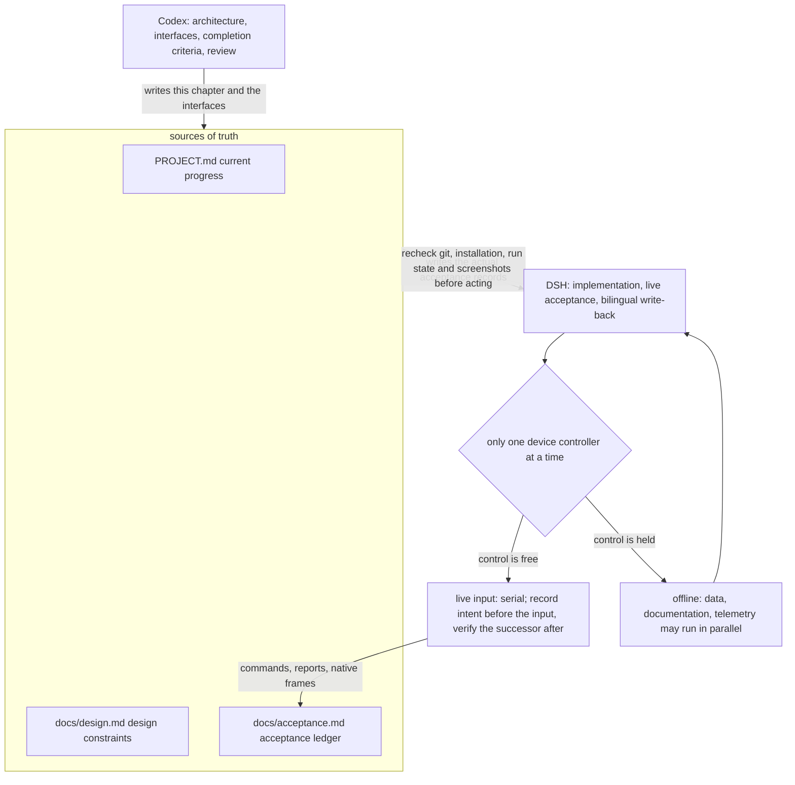

## 9.2 Dependencies, board cards and phase exits

| Card | Depends on | Implementation and output | Evidence required to close |
| --- | --- | --- | --- |
| P0 Reconcile reality | None | Check active run, historical star intent, actual page and installed version; classify unresolved intents as settled, cancelled with history, or unproven | Same-scope before/after PNG/JSON/hashes and visible cost/balance; no repeated purchase; write the disposition into acceptance |
| P1 Actual startup pipeline | P0 | Install the adapter; GUI Start through MainTask, MirrorLoop and native subtasks; bind GUI mode/target, ledger and selected game header | Real GUI-start trace, matching Agent/resources and page progression; another CLI entry cannot substitute for a GUI click |
| P2 Core dungeon loop | P1 | Map, events/battles, rewards, shop and floors; reuse verified deployment; repair and resume each successor failure | One actual five-floor Hard clear, traceable floor/purchase/refresh/GET successors; script-operated play, not manually bypassed stages |
| P3 Settings and explanatory logs | P1; delivery depends on P2 | Forty slots, portrait order, base stars, fixed/rotation, explicit run count versus step/time bounds; weights and final scores | Save, normal close/reopen, native parameters and selected game header agree; repeated starts do not reapply transactions; real logs contain components, tie-breaks and exclusion reasons |
| P4 Local usage | After P1, parallel with P2 | Implement CPU/RAM/GPU/VRAM collection and UI under 9.6 | Independent same-window measurements; missing provider, timeout, exited process and disabled sampling cases; no background busy loop when off |
| P5 Learning loop | Real P2 trajectories; offline collection can start earlier | Evidence bundles, labels, review, grouped splits, training, native evaluation, shadow comparison and reversible promotion under 9.4/9.5 | Independent episodes, model/dataset/teacher/evaluation hashes and actual inference-node logs; unpromoted candidates stay explicitly shadow |
| P6 Integrated acceptance | P2–P5 | Latest merged tests, packaged self-test, GUI-start/continuous-run evidence and wiki/design reconciliation | Completed 9.7 matrix with evidence, correct installed build and no unexplained failure; public release has separate license/privacy/update requirements |

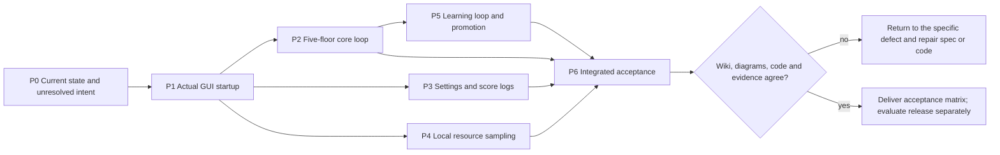

P0/P1 have partial evidence but still need final reconciliation. Do not bulk-close P2–P6. Add trigger, original evidence, hypothesis, change, positive/negative cases and resumed run to the relevant card. An unrelated green test does not resolve the original failure.

## 9.3 Automatic recovery and run count

Unknown does not immediately terminate the whole task. Distinguish animation, missing recognition, reversible overlays, sent transactions, unknown effects and missing resource authorization. Use Maa for proven controls. Unknown effects may participate in existing bounded exploration under player budgets, with uncertainty in the score. **An unread purchase result calls for rereading and reconciliation, not another purchase.**

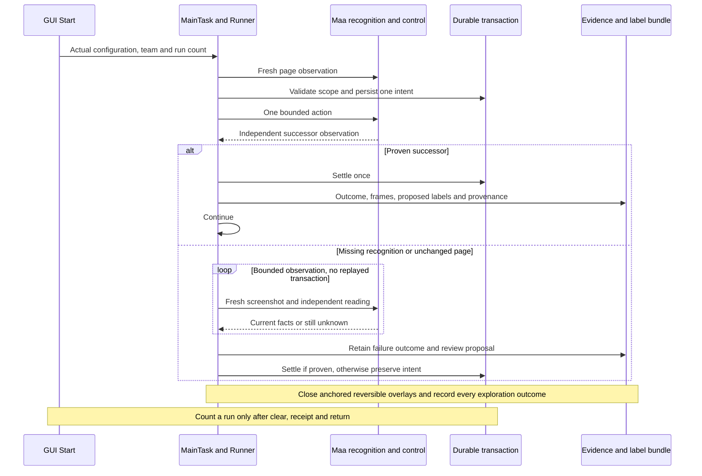

Specify attempt/time/no-progress bounds by action. Star purchases currently have up to 3 observation-only retries; that is not a universal retry policy. Candidate attempts record target region, before/after frames and whether the expected page changed. Pause that branch only after its bound; independent collection, offline work and defect repair may continue. Closing an overlay must not become an unapproved payment.

Run count is the player's number of complete dungeons, separate from step and time bounds. Saved means read saved configuration; deployment size, team count and loop steps cannot imply dungeon count. Repeating N runs needs per-scope spending authorization. Missing authorization retains cleared/unpaid state; historical 6-module approval is not reusable permission.

**Delivered (2026-10-14)**: the player's saved complete-run count is `Settings.run_count` (`src/maalimbus/runner.py:158`) with the PI option `mirror_run_count` (`assets/interface.json:68144`), carried by the pipeline node `MirrorRunCount` (`assets/resource/base/pipeline/mirror.json:5579`) and read at `src/maalimbus/mirror_task_options.py:9`. Reaching it is judged only from the ledger's own delta: `MirrorRunner._run_count_reached` (`src/maalimbus/runner.py:1393`) subtracts this launch's baseline from `RunLedger.completed_runs`, a total that advances only on `entry_returned` (`src/maalimbus/storage.py:287`) -- an event the ledger refuses without five cleared floors, a victory and a claimed reward. At the player's N the window stops with `run_count_reached` (`src/maalimbus/runner.py:2807`), the step record and `summary()` carry `verified_runs={target,completed}` (`src/maalimbus/runner.py:3196`), and the log prints `verified runs: x of y this launch (z in the ledger)` (`src/maalimbus/event_log.py:149`). **Not yet exercised live**: no run in the current window has finished, so this stop path is covered by unit tests only.

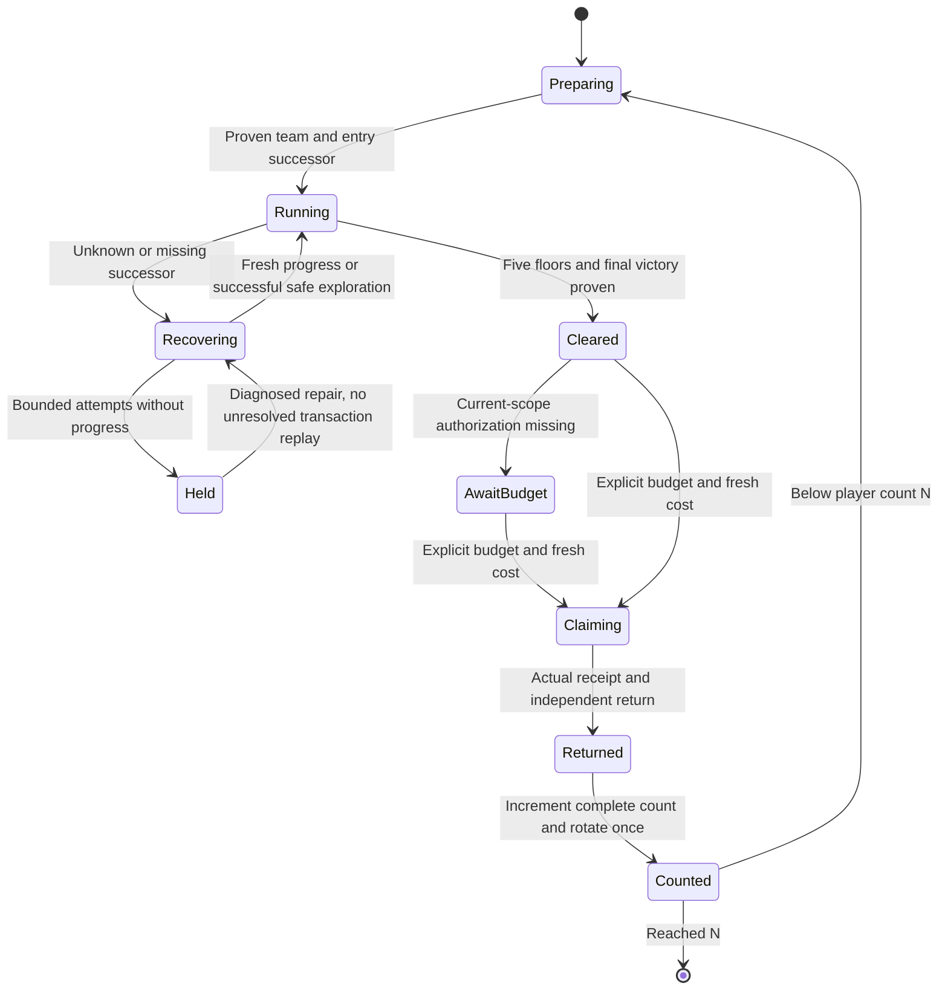

### 9.3.1 Actual adapter from GUI Start to native subtasks

The implemented chain is `MainTaskAction.run → MirrorLoopAction.run → MaaDevice → MirrorRunner → run_node → AgentTasker.post_task → Context.run_task`. Use `python tools/wiki_route.py startup --limit 1` for current symbol locations rather than static line numbers in a diagram. `MirrorLoopAction.run` must pass `AgentTasker(context)` to Device. Runner obtains that tasker from Device to execute NODE plans through the native Pipeline. The missing adapter caused the historical `a node plan needs a Maa tasker` error.

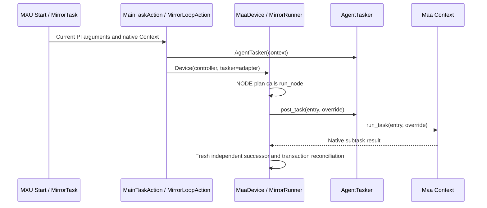

The CustomAction already occupies the framework worker. Do not replace this with `context.tasker.post_task` and wait for its own queue; `AgentTasker` documents why. This view explains implemented wiring, **not, on its own, a live GUI Start or a five-floor completion**; those still need the installed version, the actual GUI selection and the successor frames. Hit-count resets apply only to read-only observation nodes, never input nodes or transaction history.

**Delivered (2026-10-14)**: the app rebuilt from `8ca1ac1` (whose parent `d574a26` is the node-panel identity fix) was launched as a real GUI (`dist/MaaLimbus/MaaLimbus.exe`, process 34940) and its own Start button was pressed with real pointer input at 07:22 local. The run `dist/MaaLimbus/evidence/runtime/pi-20261014-072228` opened on scene `NODE_PANEL` -- the state the packaged CLI run was stopped on before `d574a26` -- and dispatched `CUTSCENE -> EVENT_CHOICE -> EVENT_RESULT -> GIFT_GET -> PRE_BATTLE_TEAM -> BATTLE_HUD -> MAP -> NODE_PANEL -> GIFT_GET`, so the chain above is now observed live rather than only wired. Still not proven this way: a complete five-floor run and the saved-run count's stop path.

**Reached live, then repaired (2026-10-14)**: the same run went on to 254 frames / 71 inputs -- `BATTLE_HUD` 20, `MAP` 8 node clicks, `SHOP` 7 including 4 `SHOP_PURCHASE`, `GIFT_GET` 6, `NODE_PANEL` 5 (every one through `panel_enter_is_the_only_forward_input`, so the identity fix was exercised live), `GIFT_PICK` 4 and `REWARD_CARD` 2 -- and stopped on `floor_gift_commit_receipt_not_proven`: its `Select 2/2` press was answered with a notice printing `Dark Vestige`, a name from neither the pick page's offers nor the two cards the run's own clicks ticked (`frame-0252`), while the receipt rule required the notice to name one of the selections. The rule now keeps the two facts apart: the notice page and its own name plate prove the press, and the receipt retains both names -- the pick it answers and what the device printed (`FloorGiftTransaction.notice_matches_a_pick` and `receipt_intent(..., on_notice_page=True)` in `src/maalimbus/floor_gift_transaction.py`, the gate and the labelled note in `src/maalimbus/runner.py`, pinned by `tests/test_gift_receipt_settling.py` against the retained frame `evidence/runtime/gui-20261014-072228/frame-0254.json`). A name the selection cannot account for is still refused on any page that is not a notice page, because the middle band is a loose read. In the live retest that followed (`pi-20261014-080122`, 08:01 local) the same page shape came back with a name that did match: that run's own `floor_gift_ranking` selected `Today's Expression` (`selection_source: single_free_select_button`), the `Select` click was answered by the notice, and the transaction committed a receipt whose printed title and successor frame are both recorded (`config/user-floor-gift-transaction.json`, `receipts[0]`: `frame-0059.json` -> `frame-0060.json`), so the chain continued past the point where it had stopped before. The outside-selection branch itself -- a notice whose printed name answers none of the picks -- is still only unit-tested.

**The shelf and the store (2026-10-14)**: the next launch on the folded build stopped after 3 inputs on the same refusal, one blank wide -- that run's own reservation frame `frame-0002` read the 144-coin slot as `Crownof Roses` and its returning `frame-0008` printed `Crown of Roses`, so `_fold` now drops the blanks beside the confusable class and the `rn` ligature (a title still cannot be shortened: the letters and digits have to agree one for one). Underneath it the phase would have ended for good: the launch after that raised `Configuration/state exceeds 2 MiB` before its first input, because the decision context recorded `owned_bought` as the whole purchase records and every record carries its own context, so `config/user-shop-<scope>.json` had reached 2,464,332 bytes. The runner now records their names, `shop_transaction._context` enforces that shape at the store boundary, and `tools/prune_shop_state.py` rewrote the live files (2,464,332 -> 46,950 bytes) touching only that field. Both are unit-tested -- the prune tool included -- and the repaired shelf was replayed against the real frames, which now list no offending offer; the rebuilt app is what has to show it live.

**The same reader gap, on the shelf (2026-10-14)**: that retest run then walked on to floor 3 and stopped at `Shop successor shows an offer the shelf never held` (68 steps / 67 clicks, `passed: false`) while settling its `Rusted Cutting Knife` purchase (244 coins, 1530 -> 1286). The store kept `pending.stage: overlay_intent`, and the returning shelf held the same six slots with the bought card under its own `Purchased` badge -- but the visit's own reservation frames read the 160-coin slot as `Thomy Path` and the returning shelf read `Thorny Path`, its catalogue name (`assets/resource/base/gift-catalog.json`, `gifts[280]`), so a strict title comparison called a card the shelf had held all along an offer it never held. The shop's fold now closes the condensed `rn` ligature into `m` beside the typeface's other confusable glyphs (`src/maalimbus/shop_transaction.py`), pinned by `tests/test_shop_transaction.py::test_a_condensed_ligature_reads_as_the_same_slot` and its negative; replaying the stopped store against the returning frame settles it (`reconcile_purchase: True`, `bought[-1] = Rusted Cutting Knife`, `pending` cleared). The installed application has to carry the fold before the five-floor clear can be attempted again.

**Waiting for the shelf to finish redrawing (2026-10-14)**: the rebuilt app was started from its own button again (`pi-20261014-193945`, 19:39 local) and stopped after one input -- the shelf held nothing the plan wanted, so the run paid the 15-coin refresh (`[1478,168,86,28]`, currency 1127) and the successor frame `frame-0004` read two of the six slots with the still pre-refresh counter, proving neither the delta nor a changed complete shelf. The transaction rule is right to refuse that frame (`ShopTransaction.reconcile_refresh`, `src/maalimbus/shop_transaction.py`), so the runner now waits instead of stopping: up to three unproven successor frames in one visit are noted as `shop_refresh_settling` and re-observed, the intent stays unclaimed through the wait, and the fourth still stops the window (`src/maalimbus/runner.py`, pinned by `tests/test_runner.py::test_a_refresh_successor_read_mid_change_waits_before_it_stops`). The live proof is the next launch on that shop.

### 9.3.2 Plan for adapting to the redesigned Mirror Dungeon (2026-10-15)

The game replaced the mirror dungeon UI wholesale in 2026-10: the entrance is now `Mirror of Sisyphus` (`DUNGEON 08`), the right column reads `Exploring / Weekly Bonuses / Parallel Superposition Mode / INFINITY MIRROR`, and the grace page and the buy confirmation were redrawn entirely. The recognition layer compares no artwork: it reads OCR text and normalised boxes only (`find` at `src/maalimbus/vision.py:19`, `classify` at `src/maalimbus/vision.py:63`), so the redesign broke it only through **text shape** and **drawing detail**; the adaptation proceeds "read-only first, real input second, and fix only the one place the live run proves broken".

Read-only proof: `python tools/verify_packaged_mirror_loop.py --app dist/MaaLimbus --address 127.0.0.1:16416 --adb "<MuMu>/adb.exe" --observe-only --stop-page MIRROR_ENTRY` builds the controller with `input_enabled=False` (`tools/verify_packaged_mirror_loop.py:117`) and clicks nothing; real input needs `--authorize <nonce>`, gated by `AUTHORIZATION` and `authorized(nonce)` in `src/maalimbus/runner.py`.

| Page | How the redesign broke it | Live evidence | State |
| --- | --- | --- | --- |
| MIRROR_ENTRY / ENTRY_CONFIRM / DUNGEON_TEAM / LEVEL_WARNING | unaffected | `evidence/runtime/packaged-mirror-20261015-071912/frame-0001..0009` | driven through live |
| STAR_GRACES | the page was redrawn: OCR reads `Select All Graces` as `Select Al Graoes`, and the card geometry and badge offset moved too | `frame-0010` of the same run, judged by `build/probe_star_page.py` and `build/probe_grace_grid.py` | fixed in `45adac7` |
| STAR_CONFIRM | the checkbox was redrawn: the old artwork goes 1.00 → 0.83 ticked / 0.15 empty, so the 0.92 exact gate called it unknown | `frame-0011` of the same run, both states kept as `evidence/runtime/star-confirm-20261015/{checked,unchecked}.png` | fixed in `c6df293` |
| INITIAL_GIFTS / GIFT_GET / GIFT_SEARCH / GIFT_SEARCH_FORGO / THEME_PACKS / MAP / NODE_PANEL / CUTSCENE / EVENT_CHOICE / EVENT_RESULT_READY / EVENT_CHECK / EVENT_CHECK_RESULT | unaffected | the `map_observed.scene` sequence of `frame-0012..0036` in the same run | driven through live |
| transitional `UNKNOWN` frames | a mid-switch frame carries no identity | 2 such frames in the same run, re-read and continued on its own | waiting is allowed, no input |

The fix in `45adac7` relaxes character-exact matching into **bounded tolerance** (`close_to` / `find_read` in `src/maalimbus/vision.py`, edit distance at most 2, still requiring exactly one candidate per token), and lets the grace page try the proved geometry first and then locate the card borders from measured edges (±24px, density floor 0.04), returning failure rather than guessing when ten bordered cards are not there. The fix in `c6df293` reads the checkbox state from **two independent channels**: the retained template and the bright stroke inside the box (0.17 ticked, 0.00 empty), answering unknown and refusing when they disagree (`conversion_state` at `src/maalimbus/grace_vision.py:206`).

What still needs live proof (the unfinished part of this plan): a full five-floor clear and the payout page; the stop path that honours a saved run count (this round pinned `mirror_run_count=3`, `mirror_run_bounds=2000`, single team 2) has no live evidence yet; and a GUI Start that walks five floors by itself. Also, this machine has no Rust toolchain and the `desktop/mxu` overlay changes make `tools/make_local_app.py` refuse to reinstall with `Modified MXU artifact is stale` (`src/maalimbus/mxu_distribution.py:10`), so verification at this stage goes through `build/refreeze_agent.py`, which re-freezes the agent (keeping a backup and a self-test); the MXU panel itself stays unverified.

The reconciliation discipline for this section: a redesign adaptation re-anchors only from live frames and never from guessed coordinates, and every change must be verified by launching the real script once more before it may be written down as "driven through live".

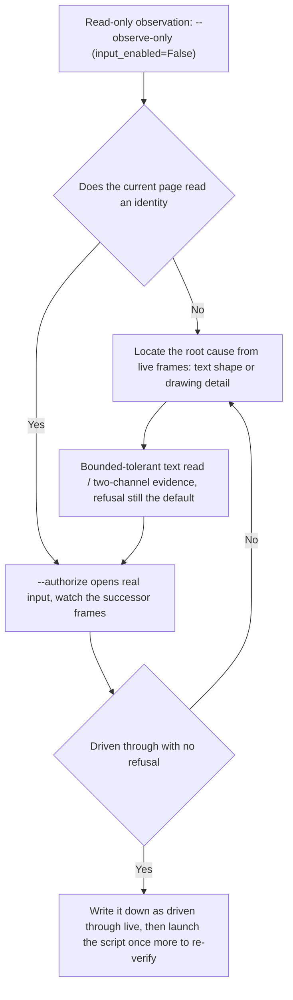

### 9.3.3 What a GUI Start decides when the old run is still playing (2026-10-15)

Live root cause (the scene this section was written from): the GUI Start was really pressed at 09:55, but the Mirror Dungeon entry stopped right after "启动前核对旧局与队伍设置" with `mirror_settings_rejected`, and `dist/MaaLimbus/evidence/runtime/pi-20261015-095517` holds 0 frames and 0 clicks. The two log errors are the observation node reading no page (`the observation node recorded no page for this frame`, `src/maalimbus/runner.py:648`, `:659`) and the local participant OCR having no evidence (`Maa local participant OCR returned no evidence`, `agent/recognition.py:284`).

Why the scene looked like that: the read-only and the live-authorized verifier runs (`evidence/runtime/packaged-mirror-20261015-070250`, `-071416`, `-071912`) had entered a real Hard run and left the game on `PRE_BATTLE_TEAM`; the ledger entry `active` (id `616264a2…`, team 1, phase `entered`) is still in the app's own data root `D:\fgoa\MaaLimbus\config` (pointed at by `dist/MaaLimbus/config/user-data-root.json`). **A run under way is not an idle entry**: `reconcile_idle_entry` (`src/maalimbus/run_wiring.py:255`) may only retire the old run when the freshly taken frame proves an idle `MIRROR_ENTRY` or a `DUNGEON_TEAM` picker; here the observation produced not even one frame, so the whole entry was refused.

The plan in this section: the entry pre-flight must separate two cases -- "the ledger has a run and this frame proves the game no longer holds it" retires it as before; "the ledger has a run, but this frame names no page at all" keeps that run and leaves page reading to the loop itself, and never sends input on a frame it could not read. The tolerant branch only records `mirror_entry_preparation` (`retired=False` plus the observation error verbatim), then continues into `GlobalSettingsAction.apply` and `MirrorLoopAction` exactly as it would with no stale entry; an unreadable frame is still handled as an unknown page -- no click, wait only.

| Scene | Expected behaviour | Evidence required |
| --- | --- | --- |
| ledger `active` is null | enter the Mirror Dungeon with the applied settings | the app log shows `mirror_loop_start` |
| ledger `active` set, frame proves idle entry or picker | retire the old run, then enter with the applied settings | `mirror_entry_preparation` with `retired=True` and a disposition |
| ledger `active` set, frame names no page (this section's live scene) | **keep that run**, continue into the loop and let it re-read the page | `mirror_entry_preparation` with `retired=False` plus the observation error verbatim, and no further `mirror_settings_rejected` |

The second fact that must be remembered too: the app's real data root is `D:\fgoa\MaaLimbus\config`, not `dist/MaaLimbus\config`. Settings written into `dist` are only displayed by the GUI, while the agent reads the former; pinning things like "single team slot 2 / 3 runs this session / 2000 steps" must write the app's own data root.

Acceptance wording: with the game parked on a Mirror Dungeon page that is under way, pressing the GUI Start must really reach the loop (readable in the app's own log), and must no longer stop at `mirror_settings_rejected` for "no evidence"; when the first frame cannot be read, the loop still stops honestly as an unknown page.

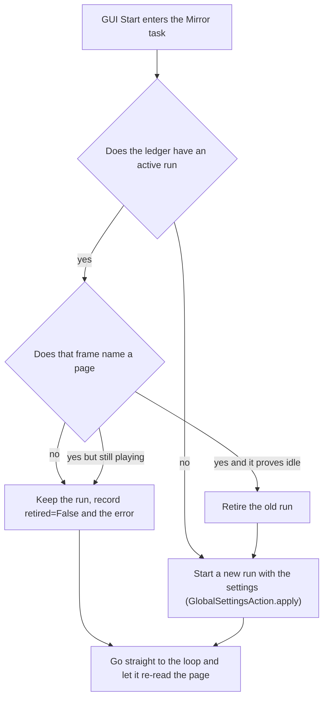

### 9.3.4 What the entrance and the deployment do when the participant counter cannot be read (2026-10-15)

Live root cause (13:01-13:08 on site): the entry observation raised `Maa local participant OCR returned no evidence` on the `PRE_BATTLE_TEAM` page, and the exception happened **inside the observation node** (the `PRE_BATTLE_TEAM` branch of `agent/recognition.py`), so the tolerance in 9.3.3 never got a chance to act: the Maa task failed first and the app showed a failed Mirror task (`dist/MaaLimbus/evidence/runtime/pi-20261015-130827`, 0 frames).

Measurement: the redesigned team page draws the counter as `2/12`, and a live frame reads it as `2/12` at box `[1610,745,250,80]` with score `0.997` (`evidence/runtime/packaged-mirror-20261015-131001/frame-0001.json`). `team_vision.participants` (`src/maalimbus/team_vision.py:46-62`, pattern `:9`, ROI `:10` = `(0.86,0.66,0.97,0.78)`) recomputes `(2,12)` offline on that frame; what used to fail was the old crop `(1680,738,180,92)`, which cut the numerator off, while the new crop `(1610,745,250,80)` keeps margin on both sides.

The plan in this section: whether the counter was read is not a condition for the page being a page -- a frame whose counter has not settled is still a frame. The node records the missing read and lets it through, and the loop's own bounded re-read (`src/maalimbus/runner.py:1696-1702`) decides whether to continue or to stop honestly; the node never fails the whole start-up over a missing read again.

| Situation | Expected behaviour | Evidence requirement |
| --- | --- | --- |
| The counter is readable | Judge the team and the deployment as before | A `2/12`-shaped count in the frame and a result under `deployment_participants` |
| The counter is unreadable (a rolling or unsettled frame) | The node records the missing read and continues; the loop re-reads a bounded number of times | The frame carries no count while the page identity holds, and no node-level exception appears |
| The re-reads run out | Stop honestly at the deployment step without sending input | Stop reason `deployment_transaction_or_counter_missing` with `clicks_sent` unchanged |

Acceptance: pressing the GUI Start again while the game sits on a settled `PRE_BATTLE_TEAM` page must reach `mirror_loop_start` and the deployment decision instead of letting the observation node fail the whole task.

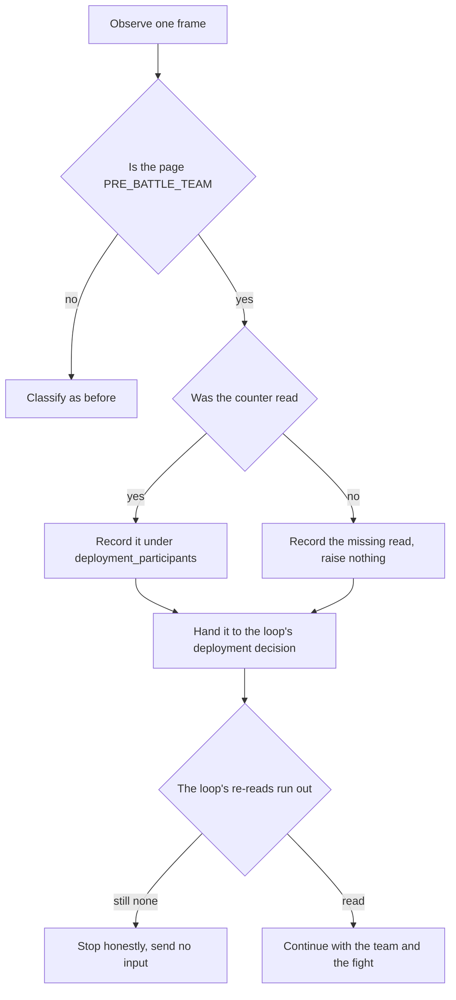

### 9.3.5 The redesigned purchase dialog: a currency badge read as one token (2026-10-15)

Situation: the 17:31 GUI start played all the way into its third shop and stopped on the purchase question with `the_shop_asked_about_a_purchase_and_its_confirm_was_not_read` (`src/maalimbus/window.py:614`), sitting on two `SHOP_PURCHASE` frames (`dist/MaaLimbus/evidence/runtime/pi-20261015-173132/frame-0250/0251.png`).

Root cause (reproduced offline): the redesigned question is titled `Purchase E.G.O Gifts` with a `Purchase` button, and all three `native_purchase_dialog` anchors matched -- but the currency transition `1102 > 895` is read as the single glued token `'1102895'`, so `purchase_balances` cannot find a 'before' number and returns None; `matching_purchase_question` (the authorization for spending) then returns None and the page can only refuse.

Fix: in `src/maalimbus/shop_vision.py`, `purchase_balances` first reads the two separated numbers of the older layout; when they are absent it splits the glued token with the after-token that sits beside it (`^\d{1,4}` plus that after-token plus `$`), and returns None when it cannot. Authorization still demands `before - after == price` and `before == the coins recorded with the intent`, so a wrong split cannot buy anything.

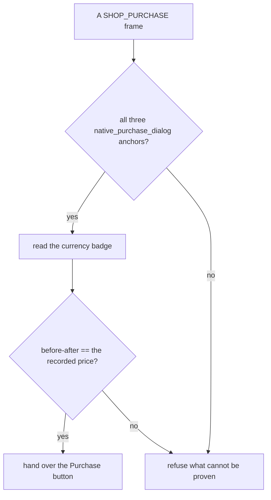

| Anchor | Redesigned reading | Rule |
| --- | --- | --- |
| Title | `Purchase E.G.O Gifts` [674,236,292,34] .999 | `^Purchase E\.G\.O Gifts$` in (.32,.20,.55,.27) |
| Confirm | `Purchase` [1092,706,128,34] 1.000 | `^Purchase$` in (.50,.58,.70,.80) |
| Cancel | `X Cancel` [710,702,156,42] .912 | `^[X×]?\s*Cancel$` in (.31,.58,.50,.80) |
| Badge | `1102895` plus `895` | the after-token splits out the before, and before-after=207=the price |

Acceptance: on that same frame `purchase_balances` returns (1102,895) and `matching_purchase_question(records,'Awe',207,coins=1102)` returns the `Purchase` box; with the price changed to 208 it must return None. Tests live in `tests/test_shop_vision.py`, including a live-frame case that skips when the frame is not retained.

### 9.3.6 Counting completed Mirror Dungeons, and opening the gift search (2026-10-15)

The user's rule (m01434): stop counting steps as the goal -- **count completed Mirror Dungeons** and keep the step window as a safety net; and **open up the gift search** so it learns its own purchase strategy, while the coins are neither hoarded nor drained to nothing.

What already holds: the stop condition is the loop's own completed-run count (`src/maalimbus/runner.py:2846` `_run_count_reached`, target recorded by `runner.py:3237` in `verified_runs`), not the step count; the step window comes from `MirrorRunBounds` (`src/maalimbus/mirror_task_options.py:27-30`, 1..2000). So when a run count is named the entry raises that window to at least 4000 (the `loop.run(steps=...)` call in `agent/recognition.py`), which keeps a five-floor dungeon from being cut halfway by a number the user picked to mean 'three dungeons'. The coin balance rules already exist: `CARRY_CAP_COINS = 1500` (`src/maalimbus/shop_settings.py`) with a reserve default of 500 (`:74` of the same file) -- keep a part, spend the excess, which is exactly 'not hoarded too much, not left at nothing'.

What is not implemented (and must not be written as if it were): the gift search page has only two paths today -- `refuse`, or leaving through Select without spending starlight (`src/maalimbus/window.py:763-785`) -- and the task option accepts only `saved`/`refuse` (`src/maalimbus/mirror_task_options.py:22-26`). To really open it, the run needs: pick at most three gifts off the pool by their score, pay starlight, prove the spend with a receipt-backed durable transaction, and never count a purchase without a receipt.

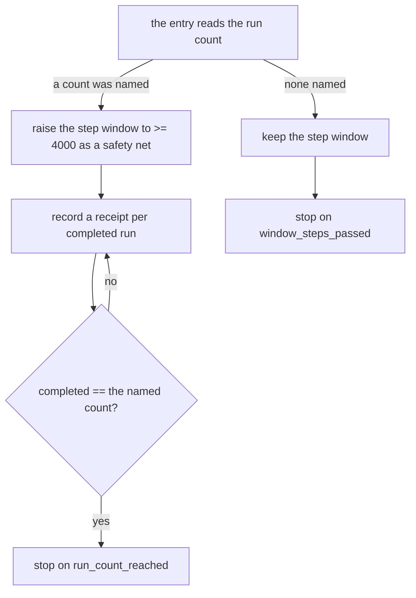

| Situation | Expected behaviour | Evidence requirement |
| --- | --- | --- |
| A completed-run count was named | Stop on the count; steps only as a safety net | The `run_count_reached` event with `verified_runs` |
| No count was named | Keep the original step-window behaviour | Stop reason `window_steps_passed` |
| The gift search once open | Pick by score and pay the starlight | A starlight-spend receipt plus the successor frame |
| The gift search today | Only refuse or leave, spending nothing | The event shows the refuse/select branch |

Acceptance: with the count set to three, one start must run through to the third completion receipt; until the search is open, neither a log nor a document may claim it is buying.

### 9.3.7 Two false stops on the reward page: a catalogue typo and what counts as a price (2026-10-15)

Both live stops happened on a reward page, and neither was the game changing: our own predicates were wrong.

**One: `floor_gift_identity_unknown`.** `dist/MaaLimbus/evidence/runtime/pi-20261015-180214` played 345 frames and then stopped on the reward page. The page did print a title, but the mirror catalogue `assets/resource/base/gift-catalog.json` spelled that gift `Arrested Hymm` while the client prints `Arrested Hymn` (all 20 occurrences in the retained `build/learning-review` corpus are Hymn). Normalised, the two differ by one letter, and over 12 characters `difflib` scores only 0.9167, under the 0.93 gate in `src/maalimbus/gift_vision.py` `text_identity`, so it returned None and the run stopped. Two things were done: the catalogue entry is now `Arrested Hymn` (**without** touching `icons[].path` or `sha256`, so icon integrity is unaffected), and `text_identity` gained a fallback that only accepts a single name of length ≥ 8 one edit away; a short name or two candidates still refuse, so the original ambiguity guard is not loosened.

**Two: `three_free_gift_trial_or_cost_present`.** `pi-20261015-172214` stopped on the three-choice reward page because the veto treated `Defense Level`, `Max HP`, `Cost` and similar words as evidence of a trial or a purchase page. The redesign prints **each card's own effect text inside the card**, and `Defense Level Down until` `[844,534,244,25]` is the first card's effect sentence on a page whose buttons are plainly `Refuse Gift` and `Select`. The veto now reads for wording that carries a price: a shop/trial noun (`Modules`/`Purchase`/`Shop`/`Lunacy`/`Mounting`/`Trials`) or a trial/price word immediately followed by a number (`Enemy Level`/`Defense Level`/`Damage Taken`/`Max HP`/`Cost`); plain effect phrasing no longer vetoes.

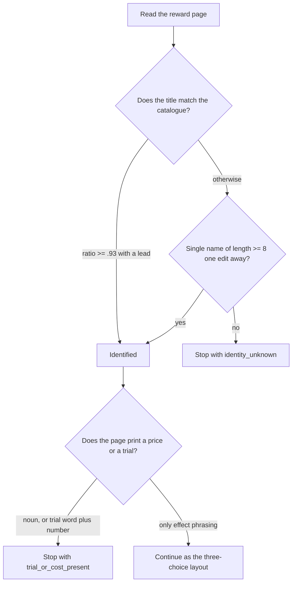

| Situation | Expected behaviour | Evidence required |
| --- | --- | --- |
| One wrong letter in the catalogue, client prints the right title | Still resolves to that gift | `tests/test_gift_vision.py` asserts `Arrested Hymm` resolves to `Arrested Hymn` |
| A plain effect sentence inside a card | Does not veto the three-choice layout | `tests/test_three_free_gifts.py` asserts the offers still come back for `Defense Level Down until` |
| Real trial or price wording | Still vetoes | The same file asserts it raises for `Enemy Level +2` and `Mounting Trials` |
| Icon paths and hashes | The rename touches neither | `gift-catalog.json` `icons[].path`/`sha256` unchanged, catalogue integrity check still passes |

Acceptance: one start gets past the three-choice reward page and the purchase confirmation and keeps playing; `three_free_gift_trial_or_cost_present` still appears when the page really is a trial or a purchase, while a gift outside the catalogue now falls back to the title the page printed (9.3.9) instead of stopping the run.

### 9.3.8 A page that cannot be read, and a recognition call that never returns: the viewport ladder and the stall watchdog (2026-10-15)

The spoken rule: four stops in one day, and the user asked for the pattern instead of a fifth patch — "do not fix one problem per problem" — and stated the rule directly: on a screen like this, always try zooming the map out first (m02370, m02456–m02457). The four stops (a purchase dialog whose currency badge could not be balanced, a floor zoomed in until a single tile filled the screen, a skill-check strip that had not faded in, a shop that never offered what the plan was waiting for) share one shape: **the view currently yields nothing, and a view can be moved by a gesture**. So the answer is two general mechanisms, not four more special cases.

**First mechanism: a step that did not land spends one rung of a viewport gesture before the run is allowed to end.** `RECOVERY_LADDER` (`src/maalimbus/runner.py:301-306`) is `pinch_out`, `drag_down`, `drag_up`, `wait`. The zoom-out rung reuses the gesture calibrated on the live game: `pinch_out` (`runner.py:315`) with `MAP_ZOOM_OUT = {'centre': (960, 540), 'radius': 320, 'factor': 0.55, 'seconds': 0.9}` (`runner.py:290`, the same values `tools/map_zoom.py` proved), two fingers walking in from +/-320 to +/-176 over 12 steps; a controller that cannot simulate two fingers raises `NotImplementedError` and **never degrades into clicking the map**. `_recover` (`runner.py:3321`) keys on `page|stop reason`, spends one rung per stop (`state['recovery_rung']`), and only a stop that has spent the whole ladder ends the run; the events are `window_recovery` and `window_recovery_exhausted`, counted on their own as `artifacts['recoveries']`. The safety property is in the comment and in the tests: **every rung moves the view and presses no game control**, which is what makes the ladder safe on a page whose layout is not known yet. Set `recovery_tries` to 0 to turn the behavior off.

**On the map the first rung is spent before another candidate node is tried.** A map click that leaves the page exactly where it was means the node the plan aimed at was never on screen: live run `pi-20261015-200848` clicked five candidates in ninety seconds with `Exploring Floor 3` never changing, and the run looked wedged until the user stopped it. `_map_zoom_once` (`runner.py:3304`) therefore spends the pinch on the first stalled map click, books it as the ladder's rung 0 (`state['recovery_for']` and `recovery_rung = 1`) so the ladder cannot spend the same rung twice, and only the *next* stalled click falls back to another candidate (`window_map_retry`). The event is a `window_recovery` with `gesture=pinch_out` and `before_another_candidate=true`; a step that does land clears `map_zoom_for` together with the rest of the recovery state.

**Second mechanism: a recognition call that never returns cannot be recovered by any gesture, so the process is ended from outside the loop.** In `dist/MaaLimbus/evidence/runtime`, run `pi-20261015-191205` wedged inside one OCR call at 19:16:07 and then produced no frame, no event and no result for twelve minutes; the user saw "it stopped and cannot even be opened" (m02283). The process was alive with every thread waiting: a hang, not a loop. `stall_watchdog` (`runner.py:342`) watches the frame heartbeat: `_observe` refreshes `artifacts['heartbeat']` on every frame (`runner.py:1582`), and once no frame has arrived for `stall_seconds` (default 300, `STALL_SECONDS` at `runner.py:3358`) a daemon thread writes the stop through `_record_stall` (`runner.py:3382`) into the run's own directory and then calls `os._exit(4)`, so the GUI reports a failed task instead of hanging silently.

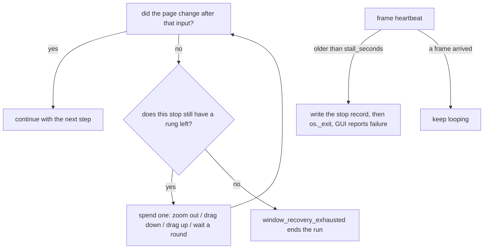

| Situation | Expected behavior | Evidence required |
| --- | --- | --- |
| The map is zoomed in and the nodes are off screen | pinch the map out first, then read the page again | `window_recovery` with `gesture=pinch_out`, `artifacts['recoveries']` rising |
| A map click moved nothing at all | pinch the map out *before* trying another node, once per stalled click | `window_recovery` with `before_another_candidate=true`; `tests/test_recovery_ladder.py::test_the_map_view_moves_before_another_candidate_is_tried` |
| The same page fails again for the same reason | one rung per stop; only a spent ladder ends the run | `tests/test_recovery_ladder.py::test_the_ladder_is_spent_once_per_stop_and_then_the_run_ends` |
| A recognition call never returns | after the limit, write the record and end the process; the GUI reports failure | the `stall_watchdog` cases return once given `rounds`; live heartbeat is `artifacts['heartbeat']` |
| The controller cannot simulate two fingers | raise instead of degrading to a click | `test_a_controller_that_cannot_simulate_two_fingers_refuses_instead_of_clicking` |
| The old behavior is wanted | with `recovery_tries = 0` a failed step ends the run immediately | the legacy cases pass that setting and still assert their original stop reason |

Acceptance: on the live game, failing on a zoomed-in map must first stop the step with `the_view_is_pinched_out_so_the_page_shows_all_of_itself` and a `window_recovery` event instead of ending the run; a wedged recognition must end as a failure within `stall_seconds` instead of hanging silently. This ladder only covers "the view cannot be read"; it does not fix a wrong criterion (that is 9.3.5 and 9.3.7).

### 9.3.9 A modal that cannot be read does not end the run: the dialog's own Cancel, and gifts outside the catalogue (2026-10-15)

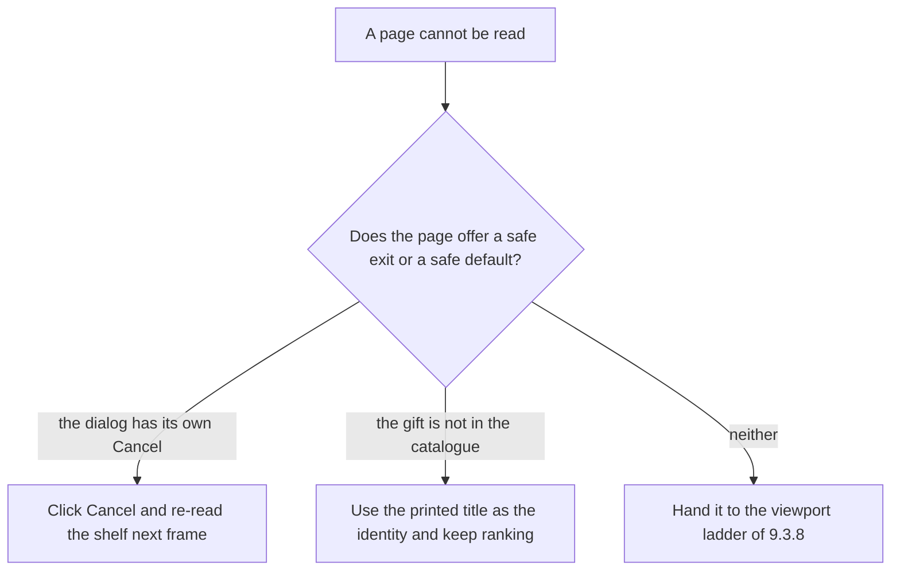

User wording (m08238): "be more structured, more frameworked -- this plainly has a more fault-tolerant upstream implementation", plus the direct question "surely every gift that is not in the catalogue will not stop the run?". Both stops share one upstream fact: **the page already offered a safe exit or a safe default, and the criterion treated it as nothing to continue with.**

**The purchase dialog: its own Cancel is the answer.** The live run `dist/MaaLimbus/evidence/runtime/pi-20261015-202635` stopped on the redesigned purchase dialog (`Purchase E.G.O Gifts` + `Purchase` / `✗ Cancel`) with `the_shop_asked_about_a_purchase_and_its_confirm_was_not_read`. The criterion chain, `matching_purchase_question` (`src/maalimbus/shop_vision.py:354`), demanded the gift name, `before - after == price` and `balances[0] == coins` all strictly equal; the shop had just read `1808` while the dialog badge read `1809`, and one token of drift refused the purchase. The new `purchase_dialog_answer` (`shop_vision.py:408`) treats the modal as a question with a safe exit: only a name that is adjacent (`close_to(..., 1)`) **and** a badge that spends exactly the reserved price answers `('purchase', box)`; every other reading answers `('cancel', box)`, with `COIN_DRIFT = 2`. `window.py:610` clicks that Cancel and re-reads the shelf on the next frame instead of ending the run, and the old refusal survives only for a dialog whose Cancel cannot be read either.

**A gift outside the catalogue: the page's own printed title is the identity.** `floor_gifts.observe` (`src/maalimbus/floor_gifts.py`) used to raise `floor_gift_identity_unknown` whenever `catalog.text_identity` returned `None`, so any gift missing from `assets/resource/base/gift-catalog.json` ended the run. `identity_of` now falls back to the title the page itself printed: no string is invented, the offer still ranks and still reaches the receipts, and its keyword set is simply empty (`keywords_of`) -- `rank` already treats "no keywords" as no roster benefit, and learning records the sample under the name it saw.

| Situation | Expected behaviour | Evidence |
| --- | --- | --- |
| The dialog cannot be read as the reserved purchase | Click its own Cancel and re-read the shelf next frame | `tests/test_shop_vision.py::test_the_dialogs_own_cancel_answers_a_question_it_cannot_authorize` |
| Shop currency and dialog badge differ by a token or two | Still confirm the reserved purchase | `COIN_DRIFT = 2`; `test_a_drifted_coin_counter_is_the_reader_not_another_purchase` |
| A reward page offers a gift the catalogue lacks | Use the printed title as the identity and keep ranking | `identity_of` / `keywords_of`; `tests/test_floor_gifts.py` green |

Acceptance: neither an unreadable modal nor a gift outside the catalogue may end a run by itself; the only remaining single-run ender is an exhausted viewport ladder (9.3.8).

### 9.3.10 A scene read is not an authorization: the button on the purchase page, and the retired reservation (2026-10-15)

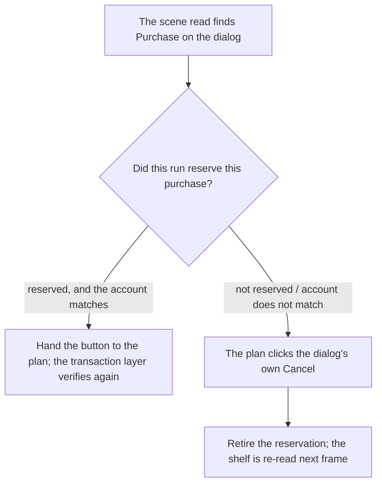

The operator's wording (m08238): 'how does *this* fail too?', asking for the more fault-tolerant upstream implementation. 9.3.9 fixed the "cannot be read" half; this section fixes the other half: **a reading was treated as an authorization**. The live run `dist/MaaLimbus/evidence/runtime/pi-20261015-212438` started at 21:24:38 and stopped two seconds later with `mirror_loop_failed; Full matching purchase title/price/question not proven` (`src/maalimbus/shop_transaction.py:384`): a 159-coin reservation left by the previous run met a dialog whose own badge asked 390, the button the scene read was planned anyway, the transaction layer refused to authorize it, and the whole run ended.

Three structural changes:

- **A scene read no longer poses as an authorization.** On the `SHOP_PURCHASE` page `shop_state` (`src/maalimbus/runner.py:1111`) no longer hands a `confirm` over: the dialog's `Purchase` is only a scene anchor, and what was read (`readable`) only writes the trace reason. The page's only authorization comes from the `SHOP_PURCHASE` branch of `_observe` (`runner.py:2074`), which computes `purchase_dialog_answer` from the reserved intent's name, price and coin count, and falls back to `shop['cancel']` when the account does not match.
- **A question nobody reserved also has an exit.** When the page carries no reservation at all (the operator clicked the card, or the previous run died on the dialog), the `Cancel` that `native_purchase_dialog` reads is the only input offered (`a_purchase_question_this_run_never_reserved`).
- **The reservation must be retired together with the Cancel.** `ShopTransaction.retire_pending` (`shop_transaction.py:390`) clears `pending` before the Cancel lands and records why in the visit (`visits[...]['retired']`). Without it the shelf would refuse every later purchase as 'already reserved' and the run would sit on the same dialog forever.
- **A wrapped gift name is read by its words, not by the order its lines arrived in.** The dialog folds its own gift name over two or three stacked lines, and the recogniser orders those boxes by where they land rather than by reading order: the live `pi-20261015-213416/frame-0001.json` read `Clear Mirror, Calm Water` as the three boxes `Mirror, Calm`, `Clear`, `Water`, so the name check never held, every frame answered the dialog with its own Cancel, and the shelf picked the same gift again - the 21:34 run clicked that one card five times and ended on `the observation node recorded no page for this frame`. `names_match` (`src/maalimbus/shop_vision.py`) compares the band as a **word multiset** instead: the order of the lines is not part of the proof, the client font's single-glyph slips still are. The same live frame confirms a 390-coin reservation on its first frame.

| Situation | Expected behaviour | Evidence required |
| --- | --- | --- |
| The scene read finds `Purchase` on the dialog | Not handed to the plan; only a proven account is | `tests/test_shop_vision.py::test_the_purchase_pages_own_button_is_never_an_authorization` |
| The page carries a question this run never reserved | Its own Cancel is clicked; nothing is bought and the run continues | the `SHOP_PURCHASE` branch at `runner.py:2074` |
| After the Cancel | The reservation is retired and the shelf can be bought from again | `tests/test_shop_transaction.py::test_a_reservation_the_modal_never_asked_about_is_retired` |
| A gift name wrapped over several lines, its boxes out of order | Still read as that gift and the purchase confirmed | `tests/test_shop_vision.py::test_a_wrapped_gift_name_is_read_in_whatever_order_its_lines_came` |

Acceptance: within one start, a purchase question is answered with its own Cancel and the run continues, whether it could not be read or was never reserved; a button the transaction layer cannot authorize no longer ends the run. **The authorization step itself must also know the redesigned dialog**: it no longer asks for the `Would you like to purchase ...?` sentence the new client does not print, but uses the same evidence the plan does - the gift band matched by its words, the badge spending exactly the reserved price, the coin counter on the reserved intent (`ShopTransaction.reserve_confirm` asks `purchase_dialog_answer` first and falls back to the older question sentence only when the dialog cannot be read that way). The live `pi-20261015-214921` run died on that sentence (started 21:49:21, stopped eleven seconds later, inputs=1): the plan had authorized the dialog, the transaction layer could not find the question, and the run ended.

### 9.3.11 A purchase is labelled by what the same run later observed: gated participation of the value model (2026-10-15)

**Symptom**: the purchase samples kept being recorded (`shop_purchase_learning_samples.neural_policy_applied=false` in `dist/MaaLimbus/evidence/runtime/pi-*/agent-result.json`, the log line "购买学习样本已记录：7；价值神经模型尚未应用"), but the runtime root `assets/resource/base/model/shop-value` did not exist, so `shop_value_shadow.rank_preview` took `purchase_value_model_missing_rule_fallback` every time. Samples were captured and nothing labelled them; "human review" was a gate nobody operated.

**The rule**: the benefit of a purchase is **not written by a human**, it is what that same run observed *after* it — `shop_value_training.label_from_outcomes()` derives it: a floor clear is worth its floor (0.2 each), a victory 1.0, a reward or an early return 0.1. The label digest covers only the hash-bound bits (`outcomes_digest`), so the order the evidence arrived in cannot change the label. `review_sample()` writes `review.json`/`outcome.json` only when a **ledger-bound later observation** exists (`approved_by=observed_run_return_in_scope`, `training_eligible=true`, `human_approved` still false); a folder with no bound later observation stays pending and is counted (`delayed_outcome_evidence_missing`) instead of inventing a benefit. The loading side (`load_reviewed_episodes`) trusts nothing on disk: it re-derives, excludes a sample whose claimed benefit disagrees with its evidence as `objective_label_mismatch`, and re-checks `action_executed`, `training_eligible`, content address and ledger binding.

**Participation is gated**: the trainer holds out whole runs with `split_by_scope` and only writes `participation=ranked` when the candidate proved its own ordering on that holdout (at least 4 pairs and accuracy 0.6); otherwise it writes `shadow`. `rank_preview` re-verifies the hash chain on every load (`weights_sha256`, `dataset_sha256` equal in three places, `evidence_verified`, `reviewed_episodes` equal to `verified_episodes`, weights finite and in bounds) and then honours the participation: `ranked` sorts **inside the set the plan already approved**, `shadow` reports scores and leaves the order alone. Neither overrides "the gift the plan asked for" (`the_gift_plan_asked_for_this_offer`) — the model only decides which of the plan's own candidates is bought first.

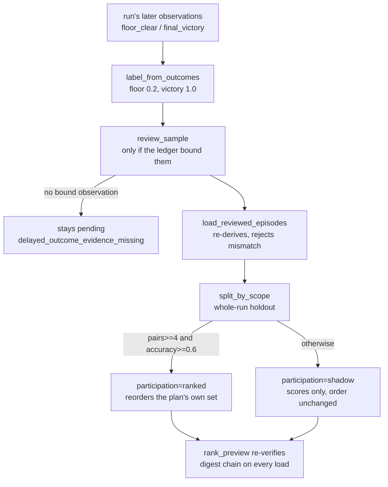

| Situation | Expected behaviour | Evidence required |
| --- | --- | --- |
| The run cleared a floor after the purchase | the label follows the floor, written into the review file | `tests/test_shop_value_review.py::test_the_label_is_the_runs_own_later_observation` |
| Evidence without a bound digest | not a label | `tests/test_shop_value_review.py::test_a_later_observation_without_a_bound_digest_is_not_a_label` |
| Nothing bound was observed after the purchase | stays pending, nothing invented | `tests/test_shop_value_review.py::test_a_purchase_the_run_never_followed_up_stays_pending` |
| The candidate cannot prove held-out ordering | shadow only, order unchanged | `tests/test_shop_value_review.py::test_a_promoted_candidate_reorders_the_offers_and_a_shadow_one_does_not` |
| The stored label disagrees with its evidence | re-derived and excluded at load | `tests/test_shop_value_review.py::test_a_candidate_with_a_dataset_digest_that_does_not_re_derive_is_ignored` |

Acceptance: `python tools/shop_value_review.py --install` reviews the folders, trains, and installs `weights.json` and `modelcard.json` into `assets/resource/base/model/shop-value`. Measured state on 2026-10-15: of 10 folders, 7 are labelled from observation and 3 stay pending (no later observation); 1 verified run / 6 rows, a 0-pair holdout with unknown accuracy, therefore participation is **shadow** (scores visible, order unchanged). **This is not "the network is live"**: steering starts when a second verified run makes a held-out comparison possible — what is missing is runs that finish, not a human reviewer.

## 9.4 Learning and policy architecture

Promoted inference/policy below is a **design target**, not a claim that production already enables it. Existing foundations are `src/maalimbus/unknown_exploration.py:1`, `src/maalimbus/semantic_labels.py:1`, `src/maalimbus/learning_dataset.py:1`, `src/maalimbus/neural_shadow.py:1`, `src/maalimbus/shop_learning.py:1` and `src/maalimbus/shop_value_shadow.py:1`. MaaFramework supplies recognition, control and pipelines; training, review and promotion are project extensions, not a built-in Maa trainer.

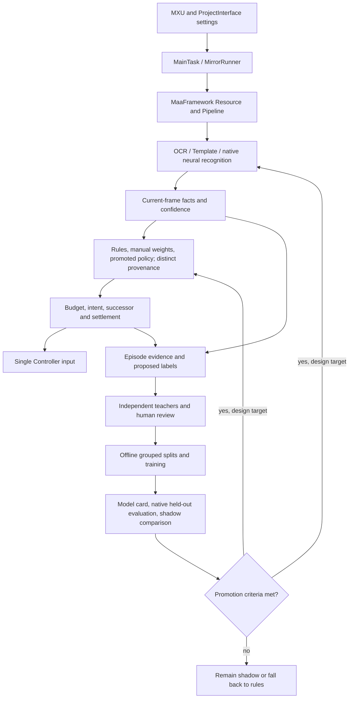

Inventory actual model callers versus proposal-only/shadow/off nodes, with hashes and runtime traces. Perception and purchase value require separate acceptance: a successful purchase proves a transaction, not gift strength; repainting or winning one encounter does not prove optimal choice. Manual priorities, reserve, refresh cap and allow/block lists remain effective. Models cannot expand spending limits.

Split perception training/validation/test by episode; adjacent frames from one run are not independent acceptance. Fix classes, thresholds, error metrics and fallback conditions before promotion, then evaluate through native Maa on new episodes. Compare purchase policies with the rule baseline through replay and shadow ranking using measured outcomes. Insufficient evidence keeps shadow status; loading a model is not applied learned control.

## 9.5 Labels, scores and evidence data model

This is a **logical model**, not a claim that each entity already has a database table. Map existing JSON/JSONL fields explicitly; specify missing fields before implementing them. Separate original frames, OCR facts, outcomes, inferred labels and human judgments. Keep correction versions. Logs show only weights actually used, components, final score, tie-break, exclusion reason and actual model participation.

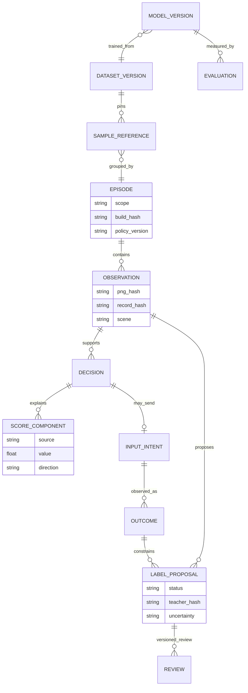

A review bundle includes manifest, before/after frames/OCR, intent/outcome, score trace, label proposal and review state. Pin references by hash, not replaceable names alone. Collect failures too, but unknown is not a negative example and no progress does not necessarily mean the button was wrong. Evidence/review controls training eligibility; a model's own prediction cannot recursively become its independent teacher.

## 9.6 Resource monitoring deployment and interface

Monitoring owns no controller, takes no screenshots and blocks no inputs. Disable stops its background work. Start with low-frequency sampling; expose the interval and measure overhead. Read overall GPU/VRAM and script CPU/RAM. Process GPU requires provider and attribution semantics. Missing values are null plus reason, not zero.

Current source boundary: `resource_diagnostics.sample` implements process CPU/RAM and whole-device GPU/VRAM sampling; `NvidiaSmiProvider` has fixed arguments and a timeout. `tools/resource_diagnostics.py` is a read-only CLI. CPU 100% means one busy core and may exceed 100% across cores. Process GPU has an injectable interface only, defaulting to `unsupported / no_per_process_gpu_provider`; concrete attribution is not implemented. GUI async integration, toggling and independent same-window live measurements remain unverified. Query the `gpu` route for current symbols and narrow tests. Structural route validation cannot prove these behavior claims.

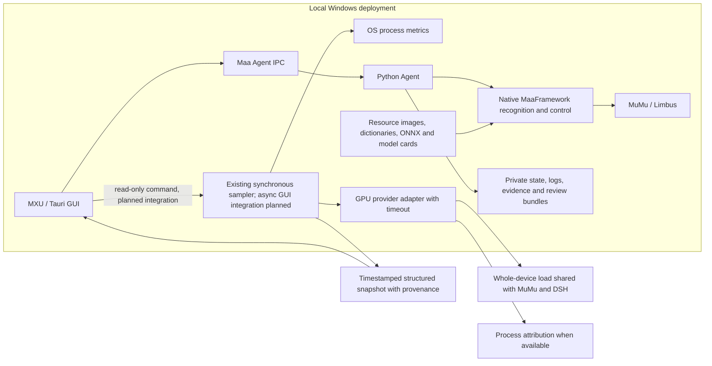

Use the [diagnostics contract](../../plan-20261014-recovery-diagnostics.md): version, sampled_at, interval_ms; process role/pid/cpu_percent/rss_bytes/status; GPU provider/device_name/util_percent/vram_used_bytes/vram_total_bytes/status. Separate totals and process samples; state CPU normalization. Do not collect/publish GPU UUID, user/machine identifiers or raw command output; do not change system privileges.

P4 covers independent same-window measurement, non-NVIDIA/missing tools, timeout, exited Agent, multiple GPUs, toggling and sampling during play. If inference creates GPU load but attribution is unavailable, show overall-only/unavailable process metrics. DSH chooses the adapter and documents it here without changing the architecture boundary.

## 9.7 Acceptance matrix and reconciliation

- [ ] P0: Native evidence gives historical card4 a definite disposition; settlement and cancellation differ; no repeat purchase or invented receipt.
- [ ] P1: One actual packaged GUI Start enters the intended pipeline; native navigation works and evidence identifies the installed build.
- [ ] P2: The script clears five Hard floors, reuses correct deployment and retains each floor reward/purchase/refresh settlement.
- [ ] P3: Verify Team1, Team2 and Team22 systems/order/EGO individually; offscreen browsing uses fresh rows and selected headers; fixed and rotation modes do not leak. Unimplemented EGO equipment cannot pass.
- [ ] P3: Portrait/star persistence and native application agree; dungeon count N is separate from step/time bounds; candidate/components/final score/provenance/reason appear in logs.
- [ ] P4: Resource measurements agree with independent readings, missing values are honest, toggling works and sampling never owns a controller.
- [ ] P5: Unknown attempts, success/failure bundles, human review, episode splits, native evaluation, actual inference and policy promotion each have distinct evidence.
- [ ] P6: Latest merged suite has no unexplained failure; actual GUI→five floors→receipt→return→one rotation/reentry, with explicit current budgets.
- [ ] P6: Paired wiki/local diagrams match code/evidence; planned components are relabelled by actual state; privacy and release are checked separately.

Close cards with requirement→actual code/configuration→check→artifact→difference→resolution, not merely another progress paragraph. Partial work keeps a next step. Distinguish interruption, bounded timeout, user actions and program errors; old-run frames cannot prove a new run. Acceptance/PROJECT hold current progress; this chapter keeps stable completion criteria.

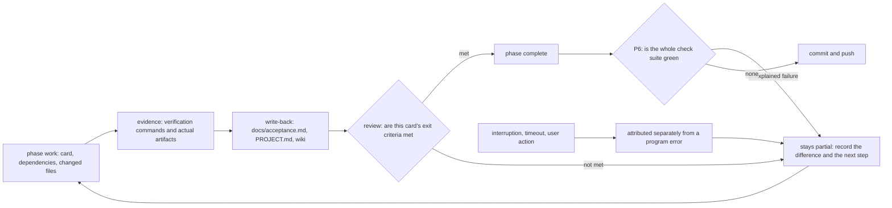

## Unverified / open questions

This chapter delivers an executable plan and design views, **not completed P0–P6**. GPU UI, model promotion, explicit continuous count, Team22 system/EGO and the integrated loop require their own artifacts. Observe DSH's active run; documentation work must not restart its controller or replace the running application.
