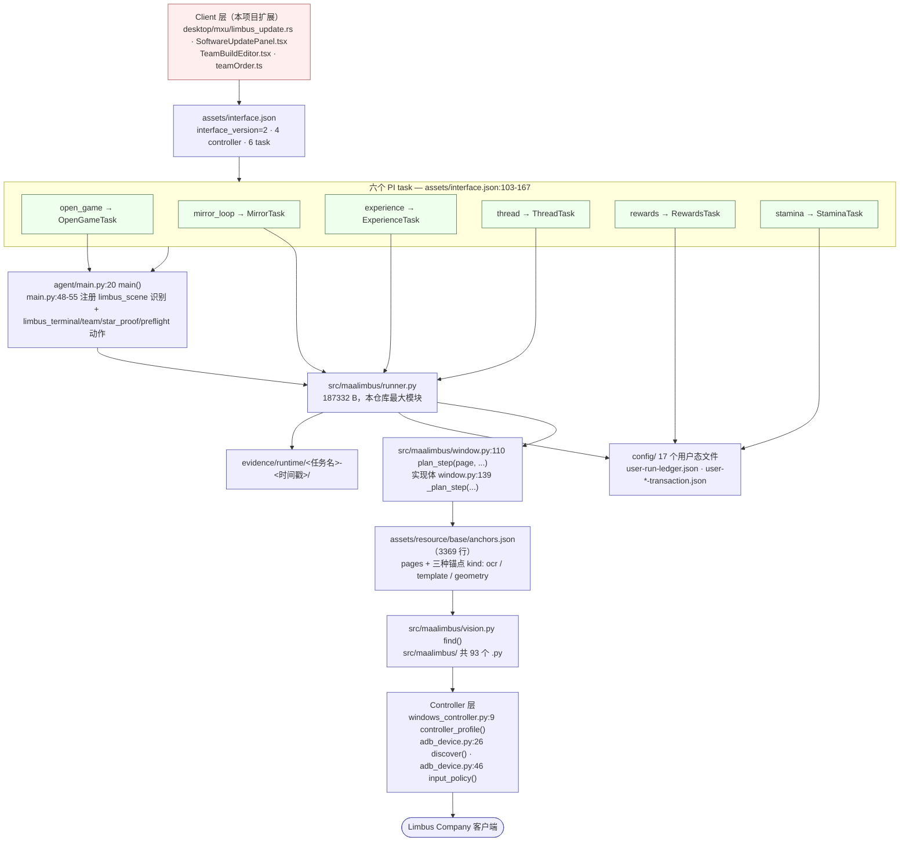
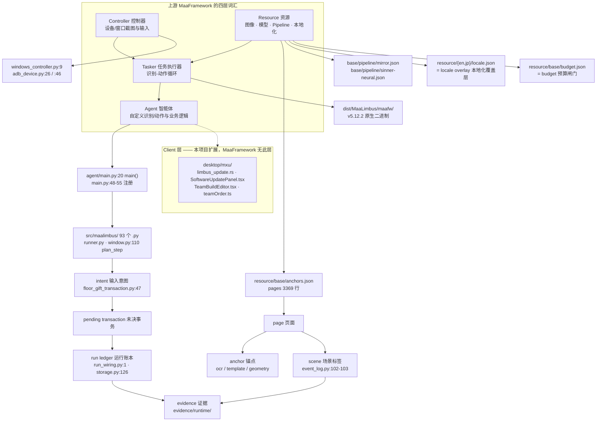

# 1 概览与术语

[English](../en_us/1-overview.md) · [← 索引](index.md)

本章回答四个问题：MaaLimbus 是什么、六个主任务各做什么、现在完成到什么程度、文档里的词和依赖边界怎么读。每个技术断言都绑定可核验锚点（`相对路径:行号`、测试名或 `evidence/runtime/...`）；核验不到的显式写「未验收」。

## 1.1 这是什么 & 完成度

### 目标链路

- 一句话：**困难镜牢 1–5 层 → 确认领奖 → 切换已保存队伍 → 继续刷取**；之后是预算内的 Enkephalin 兑换/补充、邮件与每日任务（`PROJECT.md:9-10`、`README.md:25`）。
- 技术定位：MaaFramework Win32 controller + ProjectInterface V2 + MXU + Python Agent（`AGENTS.md:3`），面向 Limbus Company Windows 原生客户端，提供英语与日语资源包（`README.md:8`、`README.md:23`）。
- 上游版本钉死：`pyproject.toml:10` → `dependencies = ["maafw==5.12.2", "numpy>=2", "opencv-python>=4.10"]`；本机运行包捆绑的是同一个 release v5.12.2（`docs/maaframework-conformance.md:24-27`）。
- Pipeline 只有两个文件：`assets/resource/base/pipeline/mirror.json`、`assets/resource/base/pipeline/sinner-neural.json`。

### 六个主任务

任务声明在 `assets/interface.json:103-167`；标签与描述以仓库自带的 i18n 为准（`assets/i18n/zh_cn.json:75-86`、`assets/i18n/en_us.json:75-86`、`assets/i18n/ja_jp.json`）。

| task name | entry | 中文标签 | 仓库自述的职责 |
| --- | --- | --- | --- |
| `open_game` | `OpenGameTask`（`assets/interface.json:105-107`） | 打开游戏（`assets/i18n/zh_cn.json:75`） | Android 用 Maa 启动并确认前台；已打开时不重复启动。Windows 需先连接游戏窗口（`assets/i18n/zh_cn.json:76`） |
| `mirror_loop` | `MirrorTask`（`assets/interface.json:112-114`） | 自动镜牢（`assets/i18n/zh_cn.json:77`） | 用总设置保存的队伍、体系和出战顺序，在此选单队或轮换；默认困难，消费须有配置预算（`assets/i18n/zh_cn.json:78`） |
| `experience` | `ExperienceTask`（`assets/interface.json:131-133`） | 自动经验本（`assets/i18n/zh_cn.json:79`） | 引用保存队伍，经 Drive 进入 Luxcavation；未完成镜牢会阻止导航（`assets/i18n/zh_cn.json:80`） |
| `thread` | `ThreadTask`（`assets/interface.json:141-143`） | 自动纺锤本（`assets/i18n/zh_cn.json:81`） | 引用保存队伍，经 Drive 进入 Luxcavation；未完成镜牢会阻止导航（`assets/i18n/zh_cn.json:82`） |
| `rewards` | `RewardsTask`（`assets/interface.json:151-153`） | 领取奖励（`assets/i18n/zh_cn.json:83`） | 领取当前已通关镜牢的奖励，需要本轮模块预算（`assets/i18n/zh_cn.json:84`） |
| `stamina` | `StaminaTask`（`assets/interface.json:161-163`） | 体力兑换（`assets/i18n/zh_cn.json:85`） | 预算内体力兑换识别尚在开发，当前保存现场后停止、不消费（`assets/i18n/zh_cn.json:86`） |

四个 controller 也在同一文件里声明：`windows-window`、`windows-background`、`windows`、`mumu-adb`（`assets/interface.json:14-68`）；资源声明 `en`/`jp` 两份（`:69-86`）。

### 完成度（诚实版）

`README.md:45-54` 的对照表是当前最集中的口径：

| 功能 | 已验证范围 | 未完成部分 |
| --- | --- | --- |
| Windows / ADB 控制 | MuMu 原生 Maa 输入、随机框内落点、进程和单控制器门禁 | Windows 游戏输入及日语实机 |
| 总设置与任务 | 六个 MXU 主任务入口、全局队伍、镜牢单队/轮换选择 | 总设置完整编辑重启与 GUI 开始执行验收 |
| 困难镜牢 | 英语实际五层（CLI/`window_step` 路径，见下）、完整藏品回执、真实付费领奖、Team2→Team7 再入场 | 任意布局、商店/融合、长期无人值守 |
| 战斗与选包 | 原生触摸 WinRate/START、独立 Hard/标题门禁、有界下拖 | 智能配卡、完整策略与日语 |
| 经验本 / 纺锤本 | 独立任务入口引用已保存队伍 | 实际关卡、消费和战斗流程；当前保存画面停止 |
| 体力兑换 / 每日奖励 | 独立入口和预算基础 | 实际页面和到账；当前保存画面停止 |
| GitHub 更新 | 桌面启动器接入缓存、持久限流、校验、保配置安装/失败回滚 | 公开新版本下载及可见重启版本 |
| 黑盒学习 | 已审阅图像哈希、按真实运行分组的训练数据准备 | 当前两样本不足，未训练或启用模型 |

**关于「困难镜牢 — 英语实际五层」这一行的限定**：那条五层实证来自 CLI / `tools/window_step.py` 驱动的保留帧路径，**不是**打包后的 MXU 端到端运行。第 7 章的 7.3 节记着相反方向的事实：`dist/MaaLimbus` 目前只有入口链能跑，在 MXU 里点 `mirror_loop` 走不完（`docs/handover-2026-10-08.md:130-132`、`dist/MaaLimbus/build-info.json:11-15`，详见[第 7 章](7-quality.md)）。两句话并存且不矛盾：这条能力在源码/CLI 路径上被证实，在打包分发形态上尚未被证实——读这张表时不要把「已验证范围」当成「打包形态可用」。

再补三条必须知道的口径：

- **没有已验收的发布包**，且「启动进程、任务返回成功和离线测试通过均不代表镜牢通关」（`README.md:31-32`）。一次英语困难五层链路（含领奖与保存队伍轮换再入场）有 MuMu 实机证据（`README.md:23`、`README.md:25`），但任意布局、版本与长期无人值守都未被承诺。
- **仍缺三件实证**：一次 journal 里带 `pre_battle_identity_report` 的实机运行、绑定真实购买的 GET 覆盖层确认、以及完整的 2→5 层运行（`PROJECT.md:75-77`）。
- **商店 GET 覆盖层**离线已读通并实现 `ShopTransaction.reserve_overlay_acknowledgement`；`docs/acceptance.md:26-28` 当时记的 `wired_in_runner=false` 已被代码推翻——`src/maalimbus/runner.py:1744` 现在就在商店页调它，实机 2026-10-12 的购买链条（4.3.1）走的正是这条（原先「真实购买必以 `shop_receipt_successor_not_proven` 停止」的说法随之作废）。**黑盒学习**只有 2 样本/2 episode 的数据准备，`training_ready=False`、`model_trained=False`、`production=False`（`docs/acceptance.md:160`）。

**证据落点**：运行证据在 `evidence/runtime/<任务名>-<yyyymmdd-hhmmss>/`，启动记录在 `build/native-launch*.json`，日志在 `build/native-live.*.log`（`README.md:64`）。本仓库当前该形态的运行目录为 918 个（本地目录计数，2026-10-12；数量会随运行增长）。

### 图 1：项目全景图

## 1.2 术语表

### MaaFramework 的四层词 + 本项目扩展的一层

上游把系统分成 Controller / Resource / Tasker / Agent 四层；MaaLimbus 沿用这套词汇并给出自己的落点。**注意最后一层 Client 是本项目的扩展，MaaFramework 里没有这一层**，本 wiki 一律显式标注。

| 层 | 英文原名 | 中文 | 职责 | MaaLimbus 落点 |
| --- | --- | --- | --- | --- |
| 1 | Controller | 控制器 | 设备/窗口截图与输入 | `src/maalimbus/windows_controller.py:9 def controller_profile(interface_path: Path, name: str)`；`src/maalimbus/adb_device.py:26 def discover(serial, adb_path=None)`、`adb_device.py:46 def input_policy(record, allow_fallback=True)` |
| 2 | Resource | 资源 | 图像/模型/Pipeline/本地化 | 声明在 `assets/interface.json:69-86`（en/jp）；`assets/resource/base/anchors.json:6`；`assets/resource/base/pipeline/mirror.json`、`assets/resource/base/pipeline/sinner-neural.json`；`assets/i18n/{zh_cn,en_us,ja_jp}.json` |
| 3 | Tasker | 任务执行器 | 执行 Pipeline 的识别-动作循环 | 上游 MaaFramework 二进制（运行包内 `dist/MaaLimbus/maafw/`）；版本与出处核验见 `docs/maaframework-conformance.md:8-27` |
| 4 | Agent | 智能体 | 自定义识别/动作与业务逻辑 | `agent/main.py:20 def main()`；`agent/main.py:48-55` 注册自定义识别与动作（`limbus_scene`、`limbus_terminal`、`limbus_team`、`limbus_star_proof`、`limbus_initial_gift_proof`、`limbus_initial_receipt_proof`、`limbus_difficulty_proof`、`limbus_preflight`）；实现体在 `src/maalimbus/` |
| 5 | **Client（本项目扩展，MaaFramework 无此层）** | 客户端 GUI | ProjectInterface V2 客户端界面 | `desktop/mxu/limbus_update.rs`、`desktop/mxu/SoftwareUpdatePanel.tsx`、`desktop/mxu/TeamBuildEditor.tsx`、`desktop/mxu/teamOrder.ts` |

### 本项目自有词

| 英文原名 | 中文 | 一句话定义 | 落点 |
| --- | --- | --- | --- |
| page | 页面 | 由一幅画面推导出的、登记在锚点文件里的界面状态（截图是哪个界面） | `assets/resource/base/anchors.json:6`（`pages` 列表）、`assets/resource/base/anchors.json:5`（登记与离线复检说明）；`src/maalimbus/anchors.py:1-9`；`src/maalimbus/window.py:110 def plan_step(page, ...)` |
| anchor | 锚点 | 一条可机器复检的识别断言，只有三种 kind：`ocr` 正则、`template` 模板、`geometry` 单帧几何 | `src/maalimbus/anchors.py:1-9`（三种 kind 的定义与「绝不猜」原则）；`assets/resource/base/anchors.json:5` 指向离线复检工具 `tools/verify_anchors.py` |
| scene | 场景标签 | 记录在观察/帧证据里的页面名，用来把一条证据绑回具体画面 | `src/maalimbus/event_log.py:102-103`（接受 `scene_before`）、`src/maalimbus/event_log.py:143-144`（打印 `page: {scene}`）；消费侧 `src/maalimbus/floor_gift_transaction.py:77` |
| intent | 输入意图 | 一次「已经发出的输入」的持久记录：输入前先落盘，崩溃/重启后据此拒绝重复输入 | `src/maalimbus/floor_gift_transaction.py:47 def intent(self, title, count, proof, *, owned=False)`；`src/maalimbus/game_launch.py:1`（durable intent） |
| pending transaction | 未决事务 | 输入已发出但后置条件尚未被证明的状态；未证明就不允许再次输入 | `src/maalimbus/floor_gift_transaction.py:1`（「未知后置条件绝不允许再次输入」）；`src/maalimbus/theme_transaction.py:4`；`src/maalimbus/shop_transaction.py:319 def _pending(...)` |
| run ledger | 运行账本 | 一次镜牢运行的事件账本；`RunStore` 拒绝乱序或没有证据的事件 | `src/maalimbus/run_wiring.py:1-18`（哪个页面证明哪个完成事件）、`run_wiring.py:156 def reconcile(...)`；`src/maalimbus/storage.py:126 class RunStore`；落盘 `config/user-run-ledger.json` |
| locale overlay | 本地化覆盖层 | 按语言覆盖的识别文本/资源层，en 与 jp 各一份，叠加在 base 之上 | `assets/resource/en/locale.json`、`assets/resource/jp/locale.json`、`assets/resource/{en,jp}/pipeline/locale.json`；消费侧 `src/maalimbus/battle_vision.py:14 def planning_anchors(image, catalog, locale='en')` |
| budget | 预算闸门 | 任何消费 Enkephalin/Module 前的离线闸门；预算为 0 时一切请求只拒绝、不点击 | `src/maalimbus/budget.py:1-6`（「绝不对游戏说话，先问闸门再决定是否输入」）；`assets/resource/base/budget.json:3-7`（`status: "pending"`、`module_budget: 0`） |
| evidence | 证据 | 一次运行留档的帧/观察/日志，是「这件事发生过」的唯一凭据 | `README.md:64`；`evidence/runtime/<任务名>-<yyyymmdd-hhmmss>/`；账本本身也是证据（`config/user-run-ledger.json`） |

### 图 2：术语关系图

## 1.3 依赖与许可边界

### 上游 vendored 关系

- `sources/upstream/MaaFramework/` 是本仓库内的一份 MaaFramework 源码检出，当前 HEAD = `cc5fef675f42ca899e12bc4932ff37ac1278853c`（本地 `git rev-parse HEAD`，2026-10-12）。许可与来源清单记录的规格/API 阅读锚点正是该 commit（`THIRD_PARTY_NOTICES/README.md:9-16`）。该检出 `git describe --tags` 无 tag 可用，所以**以 commit 为准**，不要引用 tag。
- 运行包捆绑的是同一个 release v5.12.2：`docs/maaframework-conformance.md:24-27` 记录本机 `build/portable check .../build-info.json` 的 `inputs.maa = MAA-win-x86_64-v5.12.2.zip`，与 `pyproject.toml:10` 的 `maafw==5.12.2` 一致。
- 本机另有 `build/maafw-v5.12.2/`（读规格时的本地副本）与 `build/maafw-src/`（`docs/maaframework-conformance.md:17-22` 列出的阅读清单）。

### MXU

- MXU 2.7.1，commit `9fa8cc51e8ff8cd89d99f3ea55fe3a7a82e6ede3`，是本项目改过的 Windows 桌面可执行文件的基础；原始 AGPL 声明在 `THIRD_PARTY_NOTICES/MXU-AGPL-3.0.txt`（`THIRD_PARTY_NOTICES/README.md:19-20`），随包源码 `sources/MXU-v2.7.1-source.zip`（`THIRD_PARTY_NOTICES/README.md:22`）。改动候选另带 `MXU-MaaLimbus-source.zip`（`THIRD_PARTY_NOTICES/README.md:23`）。
- **边界**：MXU 的 AGPL-3.0 标注在（`THIRD_PARTY_NOTICES/README.md:26`），根许可证不重新授权第三方材料（`README.md:70-74`）。

### 许可文本与边界

- 本仓库自有代码：AGPL-3.0-or-later，见根 `LICENSE`（`THIRD_PARTY_NOTICES/README.md:3`、`README.md:70`）。这是本项目此前的选择，**不是 MaaFramework 要求应用采用 AGPL**（`README.md:70`）。
- MaaFramework 原生运行时 5.12.2 是 **LGPL-3.0**（不是 AGPL）：原文 `THIRD_PARTY_NOTICES/MaaFramework-LGPL-3.0.md`，及其引用的 `THIRD_PARTY_NOTICES/GPL-3.0.txt`（`THIRD_PARTY_NOTICES/README.md:9-10`、`README.md:72`）；v5.12.2 的实际 release commit 与源码压缩包见 `THIRD_PARTY_NOTICES/README.md:14-16`。
- LALC 来源素材 AGPL-3.0（`THIRD_PARTY_NOTICES/README.md:26`）；MaaCommonAssets（`dabcd4681ac990dc4361de26416d986abd80e4aa`）MIT（`THIRD_PARTY_NOTICES/README.md:39-40`）；PaddleOCR Apache-2.0（`THIRD_PARTY_NOTICES/README.md:41-42`）。
- 冻结 Python/MaaDeps 运行时 notice：新 Windows 包需要保留 MaaDeps v2.12.2 Windows 运行时（`THIRD_PARTY_NOTICES/README.md:49-57`）。
- 分发边界：新 Windows 包需附带许可文本、来源版本、构建说明及适用的对应源码，**目前尚未发布该包**（`README.md:76-78`）；Lix 来源的素材不能靠替换根许可证改成 LGPL（`README.md:74`）。

## 本章未覆盖

- 各模块的职责边界与设计取舍 → 第 2 章。
- 一次运行内部的控制流与时序 → 第 3 章。
- 端到端业务链路的分步说明 → 第 4 章（本轮预留未交付）。
- `config/` 17 个用户态文件的字段含义与 run ledger 的完整数据模型 → 第 5 章。
