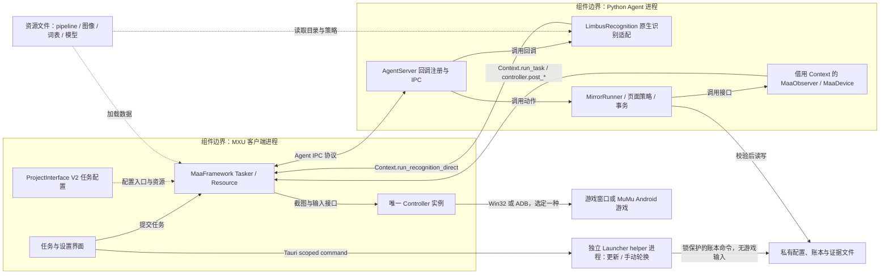
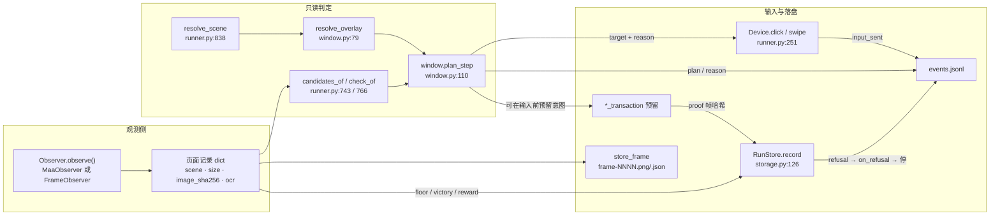

# 2 架构

[English](../en_us/2-architecture.md) · [← 索引](index.md)

本章回答一件事：**这套代码是谁在什么时候被谁加载的**，以及据此为什么长成现在这个形状。

上行入口是 `index.md`；本章只陈述可以从仓库里读出来的结构与理由，不复制 `PROJECT.md` 的续做流水账。所有技术论断都绑定 `路径:行号`、测试名或 `evidence/` 取证路径。

本章的子页（只在对应小节处链接，索引页不链接它们）：

- [2.2 模块地图](2.2-modules.md) —— 93 个 Python 模块的聚类与逐个职责
- [2.3 决策详录](2.3-decisions.md) —— 12 条关键设计决策的完整理由与代码

---

## 2.1 分层总览

### 图 2-1 分层总架构图

### 表 2-1 分层职责与落点

| 层 | 归谁所有 | 职责 | 落点 | 边界 |
| --- | --- | --- | --- | --- |
| Client | 本项目自有扩展（上游 MaaFramework 没有这一层） | 任务勾选、任务设置编辑、更新面板 | `desktop/mxu/TeamBuildEditor.tsx`、`desktop/mxu/teamOrder.ts`、`desktop/mxu/SoftwareUpdatePanel.tsx`、`desktop/mxu/limbus_update.rs` | 写 PI 配置及受锁保护的私有轮换命令，不直接发游戏输入 |
| Resource | 本项目 | 控制器/任务/选项声明、锚点、流水线节点、本地化 | `assets/interface.json:2`（`interface_version: 2`）、`assets/resource/base/anchors.json`、`assets/resource/base/pipeline/mirror.json`、`assets/i18n/` | 只声明，不含判定逻辑 |
| Tasker | 上游 MaaFramework `v5.12.2` | 截图、识别、图调度、输入换算、超时 | `maafw/`（`pyproject.toml` 钉 `maafw==5.12.2`，见 `docs/maaframework-conformance.md:11`） | 不做业务判断；坐标换算在 `ControllerAgent::preproc_touch_point`（`docs/maaframework-conformance.md:37-48`） |
| Agent | 本项目 | 自定义识别与自定义动作，把页面转成结构化证据 | `agent/main.py:48-69`、`agent/recognition.py:103`、`agent/recognition.py:1478` | 不自己建第二个 controller |
| 业务（`src/maalimbus/`） | 本项目 | 页面→动作规划、账本、事务、离线学习 | `src/maalimbus/runner.py:1`（95 个模块） | 规划/事务为纯逻辑；runner 适配器与 neural_shadow 仍调用 Maa，目录并非全纯业务 |
| Controller | MaaFramework + 本项目选型 | 唯一的真实设备所有权 | `src/maalimbus/windows_controller.py:9`、`src/maalimbus/adb_device.py:1` | 同一时刻只允许一个 controller（`src/maalimbus/controller_lease.py:1`） |

### 端到端链路

1. MXU 按 `assets/interface.json:103` 的 `task` 表把用户勾选变成一次任务，`task.entry` 指向一个 pipeline 入口节点（如 `mirror_loop` → `MirrorTask`）。
2. MaaFramework Tasker 加载 `assets/resource/base/pipeline/mirror.json`，命中需要自定义识别/动作的节点时回调 Agent 进程。
3. `agent/main.py:48-69` 注册的 1 个 custom recognition + 15 个 custom action 被框架按名字调用（`limbus_scene`、`limbus_mirror_loop`、`limbus_map_observe`、……）。
4. 动作内部调用 `src/maalimbus/` 的业务逻辑与 Maa 适配器。`MirrorLoopAction`（`agent/recognition.py:1478`）就是整条闭环：它把 PI 的 controller 包成 `runner.MaaDevice`，把 `AgentTasker` 包成 `runner.MaaObserver`，然后交给 `runner.MirrorRunner`（`agent/recognition.py:1509-1522`）。
5. 业务层的每一个输入都通过 `MaaDevice` 的 `post_click` / `post_swipe` 回到 PI 自己的 controller，不新建设备通道（`docs/agent-loop.md:105-107`）。

> 关键约束：**输入只有一个出口**。`src/maalimbus/runner.py:251` 的 `Device` Protocol 与 `:550` 的 `Observer` Protocol 是业务层与设备之间唯一的两个缝。这也是它能离线测试的原因——`FrameObserver`（`:566`）重放归档帧，`FakeDevice`（`:386`）记录发出去的输入，于是 `tests/test_runner.py` 用真实归档证据驱动真实循环而完全不接设备。

### 三个外部依赖与它们的许可

| 依赖 | 钉住的版本 / 提交 | 许可 | 在本章里的角色 |
| --- | --- | --- | --- |
| MaaFramework | `maafw==5.12.2`（`docs/maaframework-conformance.md:11`），规范读取于同版本 tag `v5.12.2` | LGPL-3.0（`docs/design.md:346`） | Tasker + Controller 层 |
| MaaFramework 源码引用 | `cc5fef675f42ca899e12bc4932ff37ac1278853c`（`docs/design.md:346`） | LGPL-3.0 | 协议与坐标空间的事实来源 |
| LixAssistantLimbusCompany | `431b432e22f0b0da08b95d7c478fa213be20b3e8`（`docs/design.md:350`） | AGPL-3.0 | 只取静态偏好与几何常量，**不导入其 controller/runtime**（`PROJECT.md:1339`） |

---

## 2.2 模块地图

`src/maalimbus/` 共 **95 个 `.py`**（含 `__init__.py`）。每个模块的职责都由它自己的模块 docstring 在第 1 行声明——完整清单与逐个职责见 [2.2 模块地图](2.2-modules.md)。

### 图 2-2 模块依赖图（按实测 import 关系）

```mermaid
flowchart TD
    subgraph ORCH["编排层"]
        RUNNER["runner.py<br/>MirrorRunner.step / run"]
        WIRING["run_wiring.py<br/>ledger_event / settle / expire / reconcile"]
        FLOWS["session_flow.py<br/>具名实机会话流"]
        JOBS["jobs.py<br/>有限期 Maa job 轮询"]
        ELOG["event_log.py<br/>人读运行日志"]
    end

    subgraph DECIDE["决策层（纯函数）"]
        WINDOW["window.py<br/>plan_step"]
        POLICIES["policies.py<br/>rank_gifts / ResourceBudget / RunLedger"]
        ROUTE["route_plan.py<br/>plan_route"]
        MLP["mirror_learning_policy.py<br/>静态启发式 + 有界学习项"]
        BUDGET["budget.py<br/>消耗闸门"]
    end

    subgraph SEE["视觉/页面读取层"]
        VISION["vision.py<br/>Text + 归一化位置"]
        MAPV["map_vision.py<br/>地图身份与有界路线读数"]
        BATTLEV["battle_vision.py"]
        SHOPV["shop_vision.py"]
    SHOPREV["shop_revive.py<br/>服务按钮 / 选项 / 位框 / 状态按钮"]
        GCAT["gift_vision.py<br/>GiftCatalog"]
        TEAMV["team_vision.py<br/>team_row / card_states"]
        THEMEV["theme_vision.py<br/>ThemeCatalog"]
        EVENTV["event_vision.py"]
        REWARDV["reward_vision.py"]
    end

    subgraph DURABLE["持久层"]
        STORAGE["storage.py<br/>write_json / ProfileStore / RunStore"]
        TXN["*_transaction.py<br/>reserve-before-input"]
        PS["runtime_paths.py<br/>ROOT / data_directory / ledger_path"]
    end

    subgraph EXEC["任务执行层"]
        REWTASK["reward_task.py / lux_task.py"]
        SHOPTXN["shop_transaction.py"]
    end

    RUNNER --> WINDOW
    RUNNER --> WIRING
    RUNNER --> FLOWS
    RUNNER --> JOBS
    RUNNER --> ELOG
    RUNNER --> MAPV
    RUNNER --> BATTLEV
    RUNNER --> SHOPV
    RUNNER --> SHOPREV
    SHOPREV --> SHOPV
    RUNNER --> GCAT
    RUNNER --> TEAMV
    RUNNER --> THEMEV
    RUNNER --> EVENTV
    RUNNER --> REWARDV
    RUNNER --> TXN
    RUNNER --> STORAGE
    RUNNER --> PS
    RUNNER --> BUDGET
    RUNNER --> ROUTE
    MAPV --> ROUTE
    MAPV --> VISION
    STORAGE --> POLICIES
    ROUTE --> POLICIES
    WINDOW --> POLICIES
    WIRING --> STORAGE
    TXN --> STORAGE
    REWTASK --> RUNNER
    SHOPTXN --> STORAGE
```

图中每一根边的依据：`src/maalimbus/runner.py:46-72`（模块级 import 块）、`src/maalimbus/map_vision.py:16-17`、`src/maalimbus/storage.py:12`、`agent/recognition.py:20-43`、`src/maalimbus/runner.py:1862`（函数内 import `shop_revive`）与 `src/maalimbus/shop_revive.py:20`（它只依赖 `shop_vision` 的读数助手）。

### 十个簇与它们的规模

| 簇 | 模块数 | 一句话 | 代表模块 |
| --- | --- | --- | --- |
| 编排与驱动 | 7 | 把一局游戏走完，并把该记的记下来 | `runner.py:1`、`run_wiring.py:1` |
| 决策与策略（纯函数） | 10 | 只算「下一步该做什么」，不碰设备 | `window.py:1`、`policies.py`、`route_plan.py:1` |
| 视觉 / 页面读取 | 30 | 把一帧变成可判定的证据 | `vision.py:1`、`map_vision.py:1`、`anchors.py:1` |
| 持久层 | 9 | 先落盘再输入，路径与 cwd 解耦 | `storage.py:1`、`runtime_paths.py:1` |
| 任务执行 | 7 | 独立任务入口（奖励、Lux、商店） | `reward_task.py:1`、`lux_task.py:1` |
| 设置与迁移 | 9 | 用户偏好的读写与从旧 build 播种 | `global_settings.py:1`、`task_preferences.py:1` |
| 更新与打包 | 8 | 更新检查、暂存、安装事务与制品校验 | `startup_update.py:1`、`update_install.py:1` |
| 设备与前置检查 | 6 | 构造唯一的 controller，并在之前只读地检查 | `windows_controller.py:1`、`adb_preflight.py:1` |
| 探索与数据集 | 6 | 有界导航探测与已复核训练集 | `unknown_exploration.py:1`、`learning_dataset.py:1` |
| 包声明 | 1 | 声明本包的边界 | `__init__.py:1` |

### 视觉层是三类读取，不是一种

| 方式 | 定义位置 | 用什么判定 | 典型模块 |
| --- | --- | --- | --- |
| 文本 + 归一化位置 | `src/maalimbus/vision.py:19` `find(records, pattern, roi, size, threshold=.65)` | OCR 文本命中指定 ROI | `map_vision.py`、`reward_vision.py`、`event_vision.py` |
| 模板匹配 | `src/maalimbus/anchors.py:132` `check_template(...)` | 钉住的位图 + 阈值 | `gift_vision.py`、`battle_counter_native.py` |
| 几何 | `src/maalimbus/anchors.py:159` `check_geometry(...)` | 归一化 ROI 与尺寸关系 | `theme_vision.py`、`star_vision.py` |

锚点注册表由 `assets/resource/base/anchors.json` 承载（`src/maalimbus/runner.py:226` 把 `REGISTRY` 指向它），`anchors.validate()`（`src/maalimbus/anchors.py:31`）在加载时先校验结构，`anchors.evaluate()`（`:192`）在运行时逐锚点求值。

---

## 2.3 关键设计决策

表 2-2 是决策总览与每条的压缩理由；完整推导见 [2.3 决策详录](2.3-decisions.md)。

### 表 2-2 决策总览

| # | 决策 | 理由（一句话） | 锚点 |
| --- | --- | --- | --- |
| D1 | Maa 只负责截图/输入与有界 Pipeline 调度，业务逻辑全在纯 Python | 让判定可离线复现、可单测 | `PROJECT.md:1338`、`docs/runner.md:3-14` |
| D2 | 循环做成库，页面与输入注入 | 循环原先锁死在 CLI 里，无法测试也无法被 App 复用 | `docs/runner.md:5-14`、`src/maalimbus/runner.py:1-31` |
| D3 | 一页最多一个输入，没有可靠控件就拒绝 | 误点会丢掉一个已经打了一半的运行 | `src/maalimbus/window.py:13-19`、`window.py:106` |
| D4 | 存在一张永远不会被点的控件黑名单 | 有些控件是可用的页面标识，但点了就丢运行 | `src/maalimbus/window.py:50-63`、`window.py:128-135` |
| D5 | 输入前先持久化意图（reserve-before-input） | 崩溃/重启后不得重放或扩大预算 | `src/maalimbus/storage.py:126`、`run_wiring.py:81` |
| D6 | 账本只接受页面真正证明的事件 | 事件乱序或无证据时账本会拒收 | `src/maalimbus/run_wiring.py:41-79` |
| D7 | 结算永远不把「输入」当作「收款」 | 点击不是收据 | `src/maalimbus/run_wiring.py:68-73`、`docs/design.md:358-371` |
| D8 | 私有状态路径独立于 cwd 与 PyInstaller 解包 | 打包后仍找到同一份配置 | `src/maalimbus/runtime_paths.py:8-20` |
| D9 | 同一时刻只有一个 controller，OS 锁跨进程 | 两个输入源会互相踩 | `src/maalimbus/controller_lease.py:1`、`PROJECT.md:1344` |
| D10 | 观察节点在回调里走 `Context.run_task` | 框架只有一个 task worker，`post_task` 会自我死锁 | `docs/agent-loop.md:93-103` |
| D11 | PI 的 Win32 profile 是唯一控制器真相 | 避免 CLI 与 App 用不同输入方式 | `src/maalimbus/windows_controller.py:1` |
| D12 | 地牢美术、赛季编号、货币数字与整屏背景都不是锚点 | 这些会随赛季变化，且无法证明页面身份 | `PROJECT.md:1341`、`docs/design.md:219-222` |

---

## 2.4 数据与控制流总览

### 图 2-3 一次 `step()` 的读写

### 表 2-3 读写落点对照

| 数据 | 写在哪里 | 谁写 | 锚点 |
| --- | --- | --- | --- |
| 每页 PNG + JSON 记录 | `<run_dir>/frame-NNNN.png` / `.json` | `store_frame()` | `src/maalimbus/runner.py:498` |
| 运行日志（机器读） | `<run_dir>/events.jsonl` | `Journal.record` / `MirrorRunner.note()` | `agent/recognition.py:76`、`runner.py:1375` |
| 运行摘要 | `<run_dir>/agent-result.json` | `MirrorLoopAction.run` 收尾 | `agent/recognition.py:1547-1548` |
| 人读日志 | 同次运行的文本报告 | `event_log.report()` | `src/maalimbus/event_log.py:131` |
| 完成事件（有序、有证据） | 运行账本 | `RunStore.record()` | `src/maalimbus/storage.py:126` |
| 队伍轮换 | 运行账本 | `RunLedger.complete()` | `src/maalimbus/policies.py:140-148` |
| 队伍与偏好 | `config/user-team-profiles.json` 等 17 份 | `ProfileStore` | `src/maalimbus/storage.py:69` |
| 锚点与模板 | `assets/resource/base/anchors.json` | 仓库维护，运行时只读 | `src/maalimbus/runner.py:226` |
| 地图探测授权 | `build/map-probe-authorization.json` | `runner.authorized(nonce)` 只读校验 | `src/maalimbus/runner.py:226`、`:238` |

`run_dir` 的解析优先级写在 `docs/agent-loop.md:68-69`：`custom_action_param["directory"]` → 环境变量 `MAALIMBUS_RUN_DIR` → 应用根下的 `evidence/runtime/pi-<YYYYmmdd-HHMMSS>`；相对路径按应用根解析。

### 观测节点与流水线节点的对应

`src/maalimbus/runner.py:120-140` 的 `PIPELINE` 字典是运行时按需写的三个节点，与 `assets/resource/base/pipeline/mirror.json` 里**已发布**的节点同名：

| 节点 | 识别 | 动作 | 定义位置 |
| --- | --- | --- | --- |
| `WindowMapObserve` | `DirectHit` | `Custom` → `limbus_map_observe` | `runner.py:121-125`；`mirror.json:1455` |
| `WindowBattleObserve` | `DirectHit` | `Custom` → `limbus_battle_observe` | `runner.py:126-130`；`mirror.json:1463` |
| `WindowDrive` | `Custom` → `limbus_scene`（scene `DRIVE`，token `mirror_menu`） | `Click`，`target: True` | `runner.py:133-139` |
| `MirrorLoop` | `DirectHit` | `Custom` → `limbus_mirror_loop` | `mirror.json:1526-1529` |
| `MirrorLoopDone` | — | 终端节点 | `mirror.json:1553` |

`docs/agent-loop.md:29-33` 解释了为什么这两个观察节点必须发布在 `assets/resource/base/pipeline/mirror.json`：打包应用只加载 `assets/` 下面的东西，而隔离的 `MapObserve`/`BattleObserve` 节点与 `MirrorHard` 入口链没有被改动。

`docs/maaframework-conformance.md:110-113` 记录了当前规模：`mirror.json` 有 89 个节点，其中 56 个可从五个任务入口到达，另外 33 个可由工具按名字驱动（例如 `MapObserve`，`tools/map_live_observe.py` 直接跑），因此报告为提示而不是失败。

### 一致性守卫

`tools/verify_pipeline_spec.py` 把 `3.1-任务流水线协议.md` 与 `3.3-ProjectInterfaceV2协议.md` 里本章依赖的规则变成可执行检查：加载 `assets/interface.json`、每个 `assets/resource/*/pipeline/*.json` 与 `agent/main.py`，报告协议未定义的字段，违规时退出 1（`--interface/--pipeline/--agent-main/--report`）。`tests/test_pipeline_spec.py` 用 9 个测试钉住它，包括四个反例（未知 controller type、同一 controller 上两种缩放模式、指向不存在节点的 override、节点引用了未注册的动作）。

当前结果：`python tools/verify_pipeline_spec.py` → `ok — 0 problem(s)`（`docs/maaframework-conformance.md:132`）。

这次核查抓到过一个真实缺陷（`docs/maaframework-conformance.md:117-123`）：`MapObserve` 用 `limbus_map_observe`、`BattleObserve` 用 `limbus_battle_observe`，但 `agent/main.py` 只注册了 11 个名字，两个都不在其中——`custom_action` 没被注册的节点根本无法运行。类一直都在（`agent/recognition.py:1130` `MapObservation`、`:1165` `BattleObservation`），所以修法就是补注册，现在是 `agent/main.py:63-64`。

那三处协议文件名是 MaaFramework 手册里的**相对路径**（写作 `docs/zh_cn/3.3-ProjectInterfaceV2协议.md` 等，见 `tools/verify_pipeline_spec.py:5`、`tools/verify_pipeline_spec.py:11`、`tools/verify_pipeline_spec.py:15`），而本仓库**没有** `docs/zh_cn/` 目录；手册真实的 vendored 位置是 `sources/upstream/MaaFramework/docs/zh_cn/3.3-ProjectInterfaceV2协议.md`（1379 行）。按名字找手册时请去那里。

## 2.5 扩展一个任务

在本仓库里「加一个任务」是四处同时改：少改一处就会缺文案、缺入口，或者运行期根本跑不起来。下面以六个主任务中的一个（镜牢 `mirror_loop`）为例走完整条链。

1. **在 PI 里声明任务**：`assets/interface.json:103-167` 的 `task` 数组。每个条目至少有 `name`（ProjectInterface 里的任务名）、`entry`（**必须是真实存在的 pipeline 节点名**）与 `default_check`（是否默认勾选），另有 `label` 与 `description`（以 `$` 开头的是 i18n 键）以及可选的 `option` 列表。六个主任务是 `open_game`（`assets/interface.json:105-110`，entry `OpenGameTask`）、`mirror_loop`（`:112-129`，entry `MirrorTask`）、`experience`（`:131-139`，`ExperienceTask`）、`thread`（`:141-149`，`ThreadTask`）、`rewards`（`:151-159`，`RewardsTask`）、`stamina`（`:161-166`，`StaminaTask`）。
2. **补齐三个语言的文案**：`assets/i18n/zh_cn.json`、`assets/i18n/en_us.json`、`assets/i18n/ja_jp.json` 都要加同名键，否则对应语言就缺文案；六个主任务的 `$main_*` 与 `$main_*_description` 在三个文件里都落在 `:75-86`。
3. **写入口节点**：`assets/resource/base/pipeline/mirror.json:5273-5338` 是这六个任务的入口桩，形态完全一致——`recognition: "DirectHit"` + `action: "Custom"` + `custom_action: "limbus_main_task"` + `custom_action_param: {"task": "<名字>"}`，另带 `timeout`、`next: []`、`on_error: []`。注意**节点名与 `custom_action_param.task` 不是同一个字符串**：PI 的 `mirror_loop` 指向节点 `MirrorTask`（`assets/resource/base/pipeline/mirror.json:5284-5294`），而该节点传下去的 `task` 是 `"mirror"`。
4. **注册自定义动作**：`agent/main.py:48-69` 是 Agent 侧的注册清单——一个 `register_custom_recognition('limbus_scene', ...)` 加十五个 `register_custom_action`，其中 `limbus_main_task` 在 `agent/main.py:69`。同一批注册在原生命令行工具里还有一份：`tools/run_native.py:143`。**节点引用了一个没注册的动作，这个节点就根本无法运行**（`docs/maaframework-conformance.md:117-123` 记录了两个观察节点正是这样被抓出来的）。
5. **跑一致性守卫**：`tools/verify_pipeline_spec.py` 把上一节那些规则变成可执行检查（`entry` 必须指向真实节点、`custom_action` 必须已在 `agent/main.py` 注册、override 里的名字必须是真实节点），违规退出 1；上游依据见 `docs/maaframework-conformance.md`。当前结果是 `ok — 0 problem(s)`（`docs/maaframework-conformance.md:132`）。

只加 pipeline 节点、不加任务入口也是合法路径：`mirror.json` 里并非所有节点都挂在入口链上，工具可以按名字直接驱动它们（`docs/maaframework-conformance.md:110-113`）。

---

## 本章的未解问题（未验收）

这些是架构层面的开放项，写在这里以免下一章把它们当成已完成的事实：

1. **节点身份未证实**：地图面板的节点类别与路线仍是拒绝状态，需要一个实机会话先点一个观测到的节点并记录后继页（`docs/design.md:210-213`）。
2. **五层实机清关未验证**：`PROJECT.md:1349` 明确写「No live dungeon completion has been verified yet」。
3. **日文实机路径未验证**：`docs/design.md:437-438` 与 `:196-197` 都记着日文菜单本地化未验证，不在英文实机证据范围内。
4. **`MirrorLoop` 还没有 PI 任务入口**：`docs/agent-loop.md:111-113` 说明 `MirrorLoop` 刻意不在 `assets/interface.json` 里，加一个任务即可，当时没有任何其他节点改变含义；`assets/interface.json:112` 的 `mirror_loop` 现在指向的是 `MirrorTask`。
