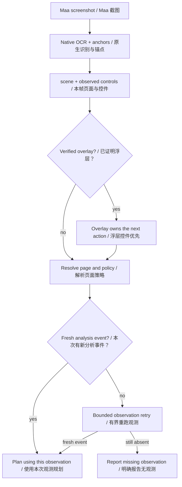
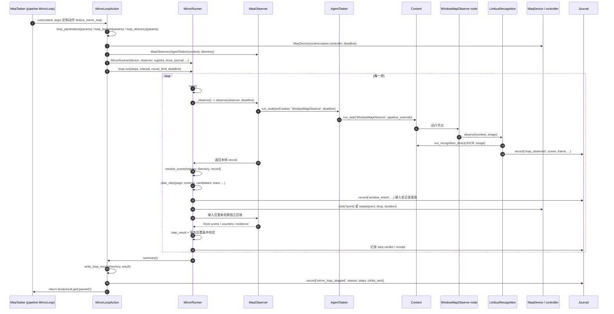
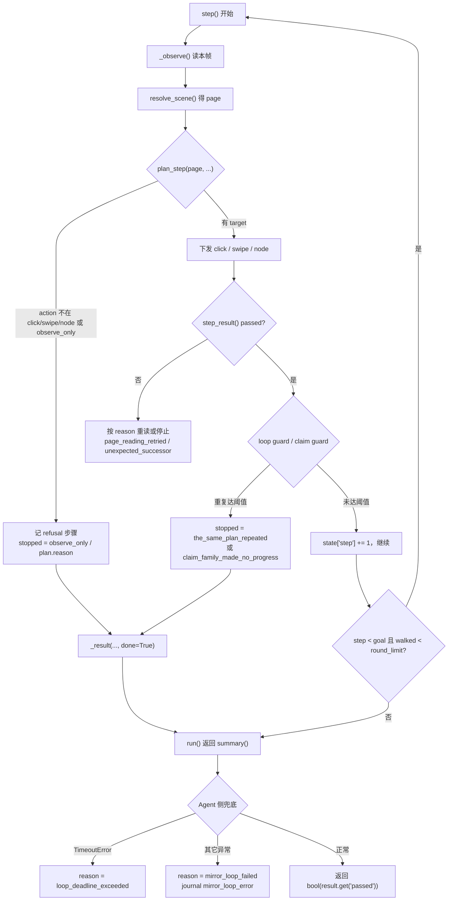
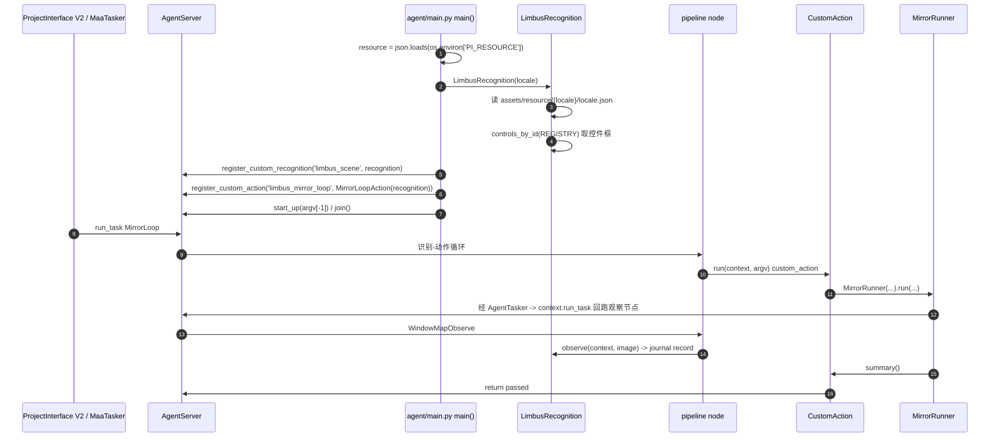
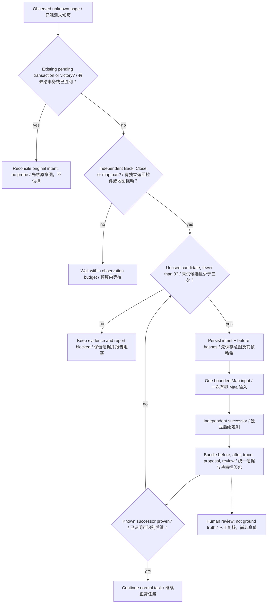
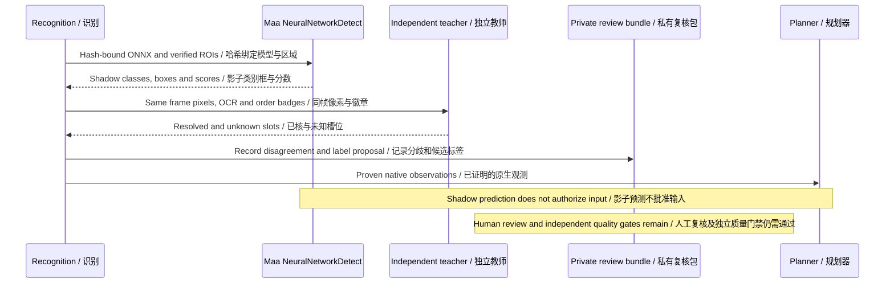
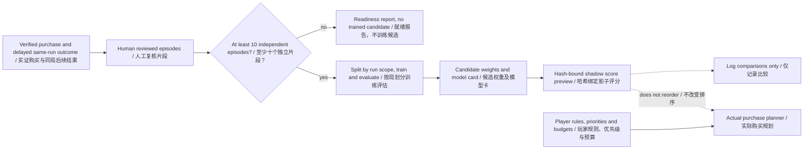

# 3 运行时

[English](../en_us/3-runtime.md) · [← 索引](index.md)
本章讲「一次运行里，画面怎么变成动作、动作怎么发出去、循环什么时候停」。

- 上游词汇对照：Controller（截图/输入）、Resource（图像/模型/Pipeline/本地化）、Tasker（跑 Pipeline 的识别-动作循环）、Agent（自定义识别/动作）。
- 本项目自有扩展（MaaFramework 无此层）：Client = ProjectInterface V2 客户端 GUI（`desktop/mxu/`）。

阅读约定：`相对路径:行号` 是可核验锚点；凡未亲自打开确认的内容，本章显式标注「未验收」。

---

## 3.1 识别与页面模型

### 3.1.1 两层命名：`scene` 与 `page`

运行时有**两个**页面标识，不要混用。

| 标识 | 定义者 | 入口 | 判据 |
|---|---|---|---|
| `scene` | OCR 文本 + 归一化位置 | `src/maalimbus/vision.py:63 def classify(records, locale, size)` | 本帧读到哪些字符串、落在哪个 ROI |
| `page` | 锚点表 `pages[].id` | `src/maalimbus/runner.py:838 def resolve_scene(registry, directory, record)` | scene + 锚点命中 + overlay 优先级 |

- 文本读取原语：`src/maalimbus/vision.py:19 def find(records, pattern, roi, size, threshold=.65)`；文本记录类型 `src/maalimbus/vision.py:13 class Text`（`text / box / score`）。
- overlay 压过底层标签：`src/maalimbus/window.py:79 def resolve_overlay(page, *, overlay_hit)`，命中即返回 `'TUTORIAL'`（`src/maalimbus/window.py:88`）。理由写在 `src/maalimbus/window.py:82-86`：overlay 自己的 continue 控件不随卡片变化，所以「看得见 continue」优先于下面的标签。
- 自清页面列表 `WAIT_PAGES`：`src/maalimbus/window.py:76`，值为 `('UNKNOWN', 'BATTLE_RESULT', 'DEFEAT')`。这些页面 planner 不发输入，driver 只等它自己变。

### 3.1.2 anchor 表

文件：`assets/resource/base/anchors.json`（共 3369 行）。运行期常量：`src/maalimbus/runner.py:225 REGISTRY = ROOT / 'assets/resource/base/anchors.json'`。

顶层结构（`assets/resource/base/anchors.json:1-6`）：

```json
{
  "version": 1,
  "reference_width": 1280,
  "reference_height": 720,
  "note": "...",
  "pages": []
}
```

每页字段（以 `map` 页为例，`assets/resource/base/anchors.json:7-45`）：

| 字段 | 含义 | 例 |
|---|---|---|
| `id` | 页面 id，就是运行时的 `page` | `"map"`（:8） |
| `title` | 人读的标题 | `"楼层地图（Exploring Floor N）"`（:9） |
| `evidence` | 该假设的留档观测路径 | `"evidence/runtime/map-advance-20261006-014737/frame-0001.json"`（:11） |
| `identity[]` | 判据锚点 | `map.floor`（:16）、`map.pack_name`（:29） |
| `controls[]` | 已证明的控件框 | `map` 页为空（:42） |
| `live_derived[]` | 不写死坐标、现算的量 | `map_vision.node_markers(image)`（:44） |

`identity` 锚点的形状是 `{id, kind, pattern, roi, threshold, note}`（`assets/resource/base/anchors.json:15-27`）。`kind` 的合法值：`src/maalimbus/anchors.py:19 KINDS = ('ocr', 'template', 'geometry')`。

锚点表的加载与离线复检全在 `src/maalimbus/anchors.py`：

- `src/maalimbus/anchors.py:24 def load(path)`、`src/maalimbus/anchors.py:31 def validate(registry)`、`src/maalimbus/anchors.py:53 def validate_anchor(anchor, page_id)`
- `src/maalimbus/anchors.py:92 def resolve_evidence(registry, root)`
- 逐 kind 的判据：`check_ocr`（`:122`）、`check_template`（`:132`）、`check_geometry`（`:159`）
- 汇总：`src/maalimbus/anchors.py:169 def evaluate_anchor(...)`、`src/maalimbus/anchors.py:192 def evaluate(...)`、`src/maalimbus/anchors.py:212 def failures(report, *, require_geometry=False)`

运行期把锚点表摊成 `{anchor 名: 像素框}`：`src/maalimbus/runner.py:692 def controls_by_id(registry: dict) -> dict`。planner 拿到的 `controls` 就是这个映射（`src/maalimbus/window.py:146-147` 的 docstring 明确：`controls` maps anchor names such as `node_panel.enter_button` to pixel boxes）。

### 3.1.3 视觉识别模块

地图页几何全部现算，集中在 `src/maalimbus/map_vision.py`：

- 阈值常量集中在文件头：`REFERENCE_WIDTH = 1280`（`:48`）、`BADGE_THRESHOLD = 0.90`（`:49`）、`LATTICE_PITCH = (384, 320)`（`:537`）、`CLICK_SIDE = 40`（`:538`）。
- 节点与玩家：`class NodeMarker`（`:132`）、`badge_nodes`（`:146`）、`node_markers`（`:186`）、`player_marker`（`:238`）、`flame_player`（`:275`）、`yellow_flame_player`（`:293`）、`player_of`（`:396`）、`train_player`（`:418`）。
- 通路与候选：`lit_nodes`（`:715`）、`lit_rings`（`:720`）、`path_end`（`:734`）、`marker_boxes`（`:791`）、`chevron_target`（`:816`）、`advance_candidates`（`:490`）、`advance_plan`（`:511`）。
- 点击与整页：`map_clicks`（`:853`）、`map_header`（`:1147`）、`map_page`（`:1196`）、`read_map_asset`（`:1224`）、`route_decision`（`:1239`）。
- 非地图页：`node_panel`（`:94`）、`enter_target`（`:124`）、`pre_battle_team_page`（`:1129`）、`battle_target`（`:1140`）。

同目录下的其它视觉模块（依据 `agent/recognition.py:20-43` 的 import 列表，本次未逐个打开正文）：`battle_vision`、`team_vision`、`gift_vision`、`theme_vision`、`grace_vision`、`star_vision`、`overlay_vision`、`overlay_dismissal`、`shop_vision`、`event_vision`、`deployment`、`deployment_*`。

### 3.1.4 本地化 overlay

**与共享事实契约的冲突（以代码为准）**：契约写「`assets/resource/base/locale.json` 叠在 base 上」，但该文件**不存在**。实际布局是：

| 文件 | 行数 | 作用 |
|---|---|---|
| `assets/resource/en/locale.json` | 89 | Agent 识别用的英文正则表 |
| `assets/resource/jp/locale.json` | 26 | 同上的日文表 |
| `assets/resource/en/pipeline/locale.json` | 1（内容 `{}`） | MaaFramework 管线文本本地化（en） |
| `assets/resource/jp/pipeline/locale.json` | 未验收 | 同上（jp） |

加载点只有一个，且**只加载所选语言那一份**，没有 base 叠加：

- `agent/recognition.py:103 self.locale = json.loads((ROOT / f'assets/resource/{locale}/locale.json').read_text(encoding='utf-8'))`
- 语言名来自 ProjectInterface 的 `resource.name`，缺省 `'en'`：`agent/main.py:42-45`（`resource = json.loads(os.environ.get('PI_RESOURCE','{}'))`；`locale = resource.get('name','en')`；`recognition = LimbusRecognition(locale)`）。

用法是「按 key 取正则再交给 `vision.find`」，例：

- `agent/recognition.py:421` — `find(records, self.locale['gift_confirm'], (.53,.65,.68,.73), size, .85)`
- `agent/recognition.py:156` — `find(records, self.locale['inferno'], (.70,.07,.99,.3), size)`
- `src/maalimbus/vision.py:57` — `locale.get('cancel', r'(?!x)x')`

`jp` 表每个 key 都写成 `日文正则|英文正则` 的交替式，例如 `assets/resource/jp/locale.json:2 "home_drive": "^ドライブ$|^Drive$"`。

---


<a id="feature-3-1-5"></a>

### 3.1.5 识别、浮层与新观测

scene、page、浮层和观测新鲜度是四个不同判断。无新分析事件不是未知页面，不能回用上一次日志当点击后继；有画面但页面未知，才进入 3.7 的探索分支。浮层返回只使用独立读到的控件，不用底层页面的按钮。



源码落点：`src/maalimbus/runner.py:1` (`MaaObserver.observe`, `resolve_scene`); `src/maalimbus/overlay_dismissal.py:1`; `agent/recognition.py:1`.

## 3.2 决策与执行

### 3.2.1 `plan_step` 的单输入契约

入口签名（`src/maalimbus/window.py:110-114`，逐字）：

```python
def plan_step(page, *, controls=None, start_box=None, auto_assign=None,
              candidates=None, candidate_index=0, nodes=None, arrows=None, team=None,
              reward=None, gift=None, cards=None, graces=None, initial=None,
              search=None, check=None, defeat=None, bonus=None, difficulty=None,
              shop=None, battle_assignment='win_rate'):
```

- **收什么**：一个 `page` 字符串（锚点 id）+ 关键字观测载荷。载荷全部是本帧已读到的数字与框（候选节点框、队伍卡徽章、奖励计数、技能检定的 slot 等），docstring 逐项列在 `src/maalimbus/window.py:146-158`。契约里没有历史、没有设备、没有网络——它是纯函数。
- **返回什么**：一个 plan 字典，由 `src/maalimbus/window.py:91 def _plan(page, action, *, target=None, node=None, expect=(), reason, detail=None, advance=False, to=None, duration=None)` 构造，键为 `page / action / target / node / expect / reason / advance`，可选 `to / duration_ms / detail`（`src/maalimbus/window.py:93-103`）。
- **拒答**：`src/maalimbus/window.py:106 def _refuse(page, reason)` 返回 `_plan(page, RECORD, reason=...)`。
- **二次判决**：`plan_step` 本体只做一件事——把落在 `FORBIDDEN_CONTROLS`（`src/maalimbus/window.py:50-63`）里的 target 改判为 `control_is_forbidden`（`src/maalimbus/window.py:128-135`）。两个例外白名单：`STAR_CONFIRM` 的 `star_confirm.cancel_button` 与 `GIFT_PICK` 的 `gift_pick.refuse_button`（`src/maalimbus/window.py:129-133`）。
- **实现分工**：`src/maalimbus/window.py:139 def _plan_step(...)` 与入口同签名，承载「page → 输入」的全部分派；`plan_step` 只是禁区判决 + 委派（`src/maalimbus/window.py:120-127`）。
- **调用方**：`src/maalimbus/runner.py:2302-2312`，在 `MirrorRunner.step`（`src/maalimbus/runner.py:1444`）内：`plan = plan_step(page, controls=plan_controls, arrows=arrows, difficulty=difficulty, start_box=record.get('start_box'), auto_assign=record.get('auto_assign_buttons'), battle_assignment=settings.battle_assignment, candidates=candidates, candidate_index=choice_index, team=team, reward=reward, gift=gift, cards=cards, graces=graces, initial=initial, check=check, defeat=defeat, search={'mode': settings.gift_search}, shop=shop, bonus={'spend': state['run_settled_itself']})`。
- 导入点在 `src/maalimbus/runner.py:67`（`from maalimbus.window import ...` 那一行）。`src/maalimbus/runner.py:1-31` 的顶部 docstring 另点名 `tools/window_step.py` 是第二个前端；该文件本轮已打开并核实可用（419 行，`tools/window_step.py:62-209` 是它的 `build_parser()`，`C:\Python313\python.exe tools\window_step.py --help` 能正常打印用法），细节见 3.5。

### 3.2.2 一个真实的数据形状示例

下面这份按 `_plan` 的真实字段定义（`src/maalimbus/window.py:93-96`）与 `UNKNOWN_DIALOG` 上 `confirm_proven_owned_gift_refusal` 这个真实分支（`src/maalimbus/runner.py:2321`）组装；字段名逐字来自代码：

```python
plan = {
    'page': 'UNKNOWN_DIALOG',
    'action': 'click',
    'target': [x, y, w, h],              # progress/控件框，像素
    'node': None,                        # 非 None 时改走 pipeline 节点
    'expect': ['MAP', 'REWARD_CARD', 'UNKNOWN'],
    'advance': False,                    # True = 本页标签应保持不变，靠帧变化证明
    'reason': 'confirm_proven_owned_gift_refusal',
}
```

字段语义（全部有代码锚点）：

| 键 | 语义 | 锚点 |
|---|---|---|
| `page` | 规划时的页面 id | `window.py:93` |
| `action` | `'click'` / `SWIPE` / `NODE` / `RECORD` | `window.py:93`；常量从 `src/maalimbus/runner.py:67` import |
| `target` | 点击/drag 的框（`None` = 不发输入） | `window.py:94` |
| `node` | 走 pipeline 节点时不设 target | `window.py:95` |
| `expect` | 成功后继页集合，`ANY` 表示「只要变」 | `window.py:95`、`window.py:978-980` |
| `reason` | 决策理由字符串，同时是日志键 | `window.py:95` |
| `advance` | 本页预期不变，帧变化即证据 | `window.py:96`、`window.py:190` |
| `to` / `duration_ms` / `detail` | 仅 drag 与带附件的分支 | `window.py:97-102` |

判决记录由 `src/maalimbus/window.py:1041 def step_result(plan, *, sent, before, after, page, frame_changed=False)` 组装，返回 `{action, reason, passed, page_before, page_after, expect, clicks_sent}`（`window.py:1050-1056`）。

### 3.2.3 loop guard（防重复动作）

实现在 `MirrorRunner.step` 的收尾处：`src/maalimbus/runner.py:2820-2843`。

```python
if page not in LOOP_GUARD_EXEMPT and plan.get('reason') not in LOOP_GUARD_EXEMPT_REASONS:
    key = (page, plan['action'], plan.get('node'),
           None if plan.get('target') is None else tuple(plan['target']))
    state['repeated_plans'][key] = state['repeated_plans'].get(key, 0) + 1
    if state['repeated_plans'][key] >= max(2, settings.loop_guard):
        entry['passed'] = False
        entry['stopped'] = 'the_same_plan_repeated'
        self.note('window_loop_guard', plan=list(key), repeats=state['repeated_plans'][key])
        return self._result(page, plan.get('target'), True, entry['stopped'], done=True)
```

- 计数以「(页, 动作, 节点, 目标框)」为键；页面一换就清零（`src/maalimbus/runner.py:2814`）。
- 默认阈值 `loop_guard = 3`（`src/maalimbus/runner.py:160`），CLI `--loop-guard`（`src/maalimbus/runner.py:3271`）。判据是 `>= max(2, loop_guard)`，所以最小有效值是 2。
- 豁免名单：页面级 `LOOP_GUARD_EXEMPT = ('TUTORIAL','BATTLE_HUD','BATTLE_PLANNING')`（`src/maalimbus/runner.py:77`）；理由级 `LOOP_GUARD_EXEMPT_REASONS`（`src/maalimbus/runner.py:88-117`，含教程翻卡、战斗交替、剧情连点等，每条都留了 live 证据）。
- 跨页的「领奖家族」另有一个计数器：`CLAIM_FAMILY = ('RUN_CLAIM','RUN_REWARD_DIALOG','RUN_REWARD_CONFIRM')`（`src/maalimbus/runner.py:83`），`claim_steps > max(1, settings.claim_tries)` 时以 `'claim_family_made_no_progress'` 停止（`src/maalimbus/runner.py:2817-2824`）。

### 3.2.4 budget（步数 / 时间 / 花费）

三类预算，互不相干：

1. **步数预算**：`src/maalimbus/runner.py:2845 def run(self, *, steps=300, interval=6.0, round_limit=5, deadline=None)`；主循环条件 `while self.state['step'] < goal and walked < max(0, int(round_limit))`（`src/maalimbus/runner.py:2860`）。CLI 默认 `steps = 1`、`rounds = 3`（`src/maalimbus/runner.py:154`）。
2. **时间预算**：`deadline`（`src/maalimbus/runner.py:2845`）。Agent 侧由动作参数算出：`budget = loop_budget(params)`、`deadline = time.monotonic() + budget`（`agent/recognition.py:1498-1499`）；`loop_budget` 读 `params['budget']` → 环境变量 → 默认 `LOOP_BUDGET_SECONDS`（`agent/recognition.py:1329-1334`）。超时是 `TimeoutError`，收敛为 `result['reason'] = 'loop_deadline_exceeded'`（`agent/recognition.py:1532`）。
3. **花费预算**（Enkephalin / Modules）：`src/maalimbus/budget.py`。`src/maalimbus/budget.py:66 def plan_spend(amount, *, budget, spent=None, purpose='module_conversion') -> dict` 给「能不能花」，`src/maalimbus/budget.py:101 def apply_spend(...)` 再补上要落盘的账。拒绝原因按顺序是 `budget_not_configured` / `budget_amount_must_be_positive` / `purpose_not_allowed` / `budget_zero` / `budget_exhausted` / `request_exceeds_remaining` / `amount_not_multiple_of_step`（`src/maalimbus/budget.py:11-15`）。默认 `status='pending'` ⇒ 一律回答「否」（`src/maalimbus/budget.py:70-93` 与 `budget.py:11` 的说明）。静态表在 `assets/resource/base/budget.json`。

### 3.2.5 动作下发

`plan['action']` 的三条出口（`src/maalimbus/runner.py:2443-2470`）：

- `NODE` → `run_node(self.tasker, plan['node'], self.deadline)`（`runner.py:2449`；`run_node` 见 `runner.py:1135`：`tasker.post_task(name)` + `wait_task`）。
- `SWIPE` → 起点在目标框内抖动、终点在 `plan['to']` 附近 ±8px 抖动，`self.device.swipe(point[0], point[1], drop[0], drop[1], duration)`（`runner.py:2451-2465`）。
- 其它 → `box = inset_box(tuple(plan['target']), .3)`，框内抖动一点，`self.device.click(*point)`（`runner.py:2466-2470`）。

输入发出前先落意图：`self.note('window_intent', page=..., target=..., reason=..., point=..., delay_ms=...)`（`runner.py:2445` / `:2460` / `:2468`），`note` 转手 `Journal.record`（`src/maalimbus/runner.py:1378`）。

---

## 3.3 Runner 循环

### 3.3.1 一次往返



对应代码：`agent/recognition.py:1494-1553`（动作主体）、`src/maalimbus/runner.py:1444 def step`、`src/maalimbus/runner.py:597 class MaaObserver`、`agent/recognition.py:1421-1452 class AgentTasker`、`src/maalimbus/runner.py:621 def observe`、`agent/recognition.py:1130-1162 class MapObservation`、`agent/recognition.py:140-168 LimbusRecognition.observe`。

**为什么观察要绕 `AgentTasker` 而不是 `context.tasker.post_task`**：`context.tasker` 的任务执行器是单 worker，在自定义动作里 post 一个节点会排在「正在等它的那个任务」后面，等待最终以 stop 结束、杀掉本次运行；`Context.run_task` 是框架自己提供的「从回调里同步跑一个节点」的口子。这段理由逐字写在 `agent/recognition.py:1424-1431`，而 `post_task` 里额外做了一件事：读一次性节点 `WindowMapObserve` / `WindowBattleObserve` 前必须 `context.clear_hit_count(entry)`，否则 `max_hit=1` 会让下一次观察被永久跳过（`agent/recognition.py:1440-1446`）。

另一处容易踩的坑写在 `MaaObserver.observe` 的 docstring（`src/maalimbus/runner.py:621-632`）：只看「最新一条同类事件」会把**上一帧**的页面当成这一帧，所以节点没记事件时会重跑 `read_tries` 次，日志点名了 `evidence/runtime/packaged-mirror-20261012-032032` 这个真实踩坑现场。

### 3.3.2 主循环的退出条件



退出的四类，全部有锚点：

| 类别 | 触发 | `stopped` / `reason` 值 | 锚点 |
|---|---|---|---|
| 成功/正常收尾 | 预算走完或本页已无事可做，循环自然返回 | 由 `run()` 返回 `summary()` | `src/maalimbus/runner.py:2845-2867`、`:2875` |
| 预算耗尽（步数） | `state['step'] >= goal` 或 `walked >= round_limit` | 无 stop 字符串，`done=False` | `src/maalimbus/runner.py:2860` |
| 预算耗尽（时间） | `deadline` 到期抛 `TimeoutError` | `'loop_deadline_exceeded'` | `agent/recognition.py:1532` |
| 拒绝（planner 拒答） | `plan['action']` 不是可执行动作 | `'observe_only'` 或 `plan['reason']` | `src/maalimbus/runner.py:2331-2332` |
| 拒绝（页面没动 / 重读用尽） | `step_result` 判 `passed=False` 且不再重读 | 该步自己的 `reason`（如 `unexpected_successor`） | `src/maalimbus/runner.py:2562`、`:2345` |
| 拒绝（协议守门） | loop guard / claim family | `'the_same_plan_repeated'` / `'claim_family_made_no_progress'` | `src/maalimbus/runner.py:2837` / `:2824` |
| 拒绝（调用方点名的页） | `stop_page` 到达 | `'stop_page_reached'` | `src/maalimbus/runner.py:1492`、`:2744` |
| 错误 | 任何未捕获异常 | `'mirror_loop_failed'` + `journal mirror_loop_error`（带 traceback） | `agent/recognition.py:1538-1546` |

`_result` 的 `done` 语义：`'done': bool(done or stopped is not None)`（`src/maalimbus/runner.py:3029`）——只要这一步产生了停止字符串，就结束。

**未验收项**：`MirrorLoopAction.run` 的返回值是 `bool(result.get('passed'))`（`agent/recognition.py:1553`），而 `passed` 的完整赋值路径（含「整局成功」的正向判据）本次未逐行验收；已知相关的是 `record_ledger_event` 在 `final_victory` / `reward_received` 事件上置 `state['run_settled_itself'] = True`（`src/maalimbus/runner.py:2690`）。

---

## 3.4 Agent 集成

### 3.4.1 注册了什么

`agent/main.py` 的第 48-69 行是全部注册点：

**自定义识别（1 个）**

| 名字 | 实现 | 锚点 |
|---|---|---|
| `limbus_scene` | `LimbusRecognition(locale)` | `agent/main.py:48` |

`LimbusRecognition` 是 `CustomRecognition` 子类（`agent/recognition.py:100`），MaaFramework 调它的 `analyze(self, context, argv)`（`agent/recognition.py:407-413`）——`custom_recognition_param` 里给 `scene`，`analyze` 读帧后比对，不等就返回 `None`。

**自定义动作（共 15 个）**

| 名字 | 实现类 | 锚点 |
|---|---|---|
| `limbus_terminal` | `LimbusTerminal` | `agent/main.py:49` |
| `limbus_team` | `TeamAction` | `:50` |
| `limbus_star_proof` | `StarProof` | `:51` |
| `limbus_initial_gift_proof` | `InitialGiftProof` | `:52` |
| `limbus_initial_receipt_proof` | `InitialReceiptProof` | `:53` |
| `limbus_difficulty_proof` | `DifficultyProof` | `:54` |
| `limbus_preflight` | `InputPreflight` | `:55` |
| `limbus_theme_observe` | `ThemeObservation` | `:56` |
| `limbus_deployment_proof` | `DeploymentProof` | `:57` |
| `limbus_battle_plan_observe` | `BattlePlanObservation` | `:58` |
| `limbus_map_observe` | `MapObservation` | `:63` |
| `limbus_battle_observe` | `BattleObservation` | `:64` |
| `limbus_mirror_loop` | `MirrorLoopAction` | `:67` |
| `limbus_global_settings` | `GlobalSettingsAction` | `:68` |
| `limbus_main_task` | `MainTaskAction` | `:69` |

`main.py:59-62` 留了一条注释解释为什么两个只读观察节点也必须注册：`custom_action` 未注册的节点根本跑不起来。

Pipeline 侧的对应节点（`assets/resource/base/pipeline/mirror.json`）：`WindowMapObserve`（`:1455-1462`，`custom_action: limbus_map_observe`）、`WindowBattleObserve`（`:1463-1470`）、`MirrorLoop`（`:1526-1552`，`custom_action: limbus_mirror_loop`，参数含 `steps: 400`/`interval: 4.0`/`rounds: 3`/`run_store: config/user-run-ledger.json`）、`MirrorLoopDone`（`:1553-1558`，`DoNothing`）。`GlobalSettingsApply`（`:1559-1568`）→ `MirrorLoop` 是另一条入口。`runner.py:120-140` 的 `PIPELINE` 常量是同一批节点的 Python 副本（`prepare()` 会写出来）。

### 3.4.2 Agent 侧注册与回调



对应代码：`agent/main.py:20-72`、`agent/recognition.py:100-138`、`agent/recognition.py:1473-1553`。

### 3.4.3 `MirrorLoopAction` / `MaaObserver` / `Context.run_task` 的调用关系

三者是一条链上的三个角色：

1. **`MirrorLoopAction`**（`agent/recognition.py:1473`）是整局的外壳。它把 PI 已经给 Agent 的三样东西转交给 `runner`：controller 当设备（`runner.MaaDevice(context.tasker.controller, deadline=deadline)`，`agent/recognition.py:1502-1510`）、`context.run_task` 当 tasker（`runner.MaaObserver(AgentTasker(context), directory)`，`:1510`）、证据目录当日志（`journal = Journal(directory)`，`:1502`）。它的 docstring（`:1473-1490`）写明：输入经 controller 自己的 `post_click`/`post_swipe` 出去，因为那个 controller 才是拥有设备的一方。
2. **`MaaObserver`**（`src/maalimbus/runner.py:597`）是「从 Maa 管线节点读一页」。它只依赖 context 上的三个东西：`tasker`、`run`、`journal`（`:597-612`）。它按 `WindowMapObserve` / `WindowBattleObserve` 两个节点名读（`:621-632`），战斗页会追加读一次 `battle_observed`（`:646`）。
3. **`AgentTasker`**（`agent/recognition.py:1421`）是适配器。它让 `MaaObserver` 看到熟悉的 `post_task` 接口，实际转到 `context.run_task(entry, pipeline_override)`（`agent/recognition.py:1439-1448`），并把同步结果包成恒为 `done=True` 的 `AgentJob`（`agent/recognition.py:1408-1418`）。

**边界**：`agent/` 只做两件事——用 `maa` SDK 的类型（`CustomAction` / `CustomRecognition` / `JOCR`，`agent/recognition.py:15-18`）实现回调，以及把 PI 给的 context 适配成 `src/maalimbus` 认识的接口。所有决策、识别、账本、视觉都在 `src/maalimbus/` 里；`agent/main.py` 自己不判断任何页面。`src/maalimbus/runner.py:70-72` 说明了为什么需要这层适配：仓库根要相对 `runtime_paths.ROOT` 解析，因为 Maa agent 的 cwd 不是仓库（`src/maalimbus/runtime_paths.py:8-20`）。

### 3.4.4 证据与结果落盘

- 一次整局一个目录，Agent 侧默认 `evidence/runtime/pi-<yyyymmdd-hhmmss>`（`agent/recognition.py:1337`）；本项目证据目录的统一形态是 `evidence/runtime/<任务名>-<yyyymmdd-hhmmss>/`。
- 整局摘要写 `agent-result.json`：`agent/recognition.py:1372 def write_loop_result(directory, result)`。
- 人类可读日志写 `run.log`：`agent/recognition.py:1388 def write_run_log(directory, result)`。
- 每步的 `observation` / `plan` / `frame` / `passed` / `clicks_sent` 攒在 `artifacts['steps']` 里，随 `summary()` 一起返回（`src/maalimbus/runner.py:2867-2898`）。
- 崩溃路径也会落盘：`mirror_loop_error` 事件（带 traceback）之后仍然 `write_loop_result` + `write_run_log`（`agent/recognition.py:1538-1546`）。
- 模块级 `_load_registry()` 读的也是同一份锚点表（`src/maalimbus/runner.py:3122`）。

## 3.5 如何本地驱动一次运行

本节给出真实命令与产物落点。脚本本身本轮只核实到命令行解析这一层（见本章末尾的未验收清单）。

**入口一：带 UAC 的启动器**（`README.md:56-64`）：

```powershell
./tools/start_native.ps1 -Binary <Maa 原生库目录> -Locale en -Seconds 180
```

- `-Binary` 必填，且该目录里必须存在 `MaaFramework.dll`，否则脚本直接抛错（`tools/start_native.ps1:4`、`:11`）。
- `-Locale` 只接受 `en` / `jp`（默认 `en`）；`-Seconds` 取值范围 1..3600（默认 180）（`tools/start_native.ps1:5-6`）。
- 它用 `-Verb RunAs` 走标准 Windows UAC，不替用户批准（`tools/start_native.ps1:32-33`）；若已经有一个控制器在跑（`MaaLimbusAgent.exe` / `MaaLimbus.exe`，或命令行指向本仓库 `run_native.py` 的 python 进程），脚本会在启动前抛出 `MaaLimbus already has a running controller; inspect its session first`（`tools/start_native.ps1:12-16`）。
- 真正的进程由 `tools/native_session.ps1` 拉起：`python -u tools/run_native.py --binary <dir> --locale <en|jp> --seconds <n> --live`（`tools/native_session.ps1:18-19`）；它在 `Seconds + 45` 秒后强杀子进程，超时退出码固定为 `124`（`tools/native_session.ps1:22-28`）。

**产物落点**（每一条都能在脚本里查到）：

| 产物 | 路径 | 出处 |
| --- | --- | --- |
| 启动请求与状态 | `build/native-launch-request.json` | `tools/start_native.ps1:27-44`；状态有 `uac_requested` / `launch_failed_or_cancelled` / `wrapper_started` |
| 包装进程记录 | `build/native-launch.json` | `tools/start_native.ps1:45-47` |
| 退出码与是否超时 | `build/native-launch-result.json` | `tools/native_session.ps1:29-31` |
| 实时 stdout / stderr | `build/native-live.stdout.log` / `build/native-live.stderr.log` | `tools/native_session.ps1:11-12` |
| 当前会话描述 | `build/live-session.json` | `tools/run_native.py:153` |
| 运行证据目录 | `evidence/runtime/`（Agent 侧目录名形如 `pi-<yyyymmdd-hhmmss>`） | `README.md:64`；`agent/recognition.py:1337-1347` |

**入口二：`tools/window_step.py`**（419 行，自带设备、证据目录与账本的一次性窗口工具）：

- 必填 `--binary`（`tools/window_step.py:65`）、`--address`（`:74`）与 `--authorize`（`:75`，nonce）。
- 常用开关：`--steps` 默认 1（`:76`）、`--rounds` 默认 3（`:78`）、`--interval` 默认 4.0（`:95`）、`--loop-guard` 默认 3（`:145`）、`--claim-tries` 默认 6（`:153`）、`--observe-page`（`:160`）、`--observe-only`（`:164`）；完整清单在 `tools/window_step.py:62-209` 的 `build_parser()`。
- 发任何输入之前，必须在 `build/map-probe-authorization.json` 里为命令行传入的 nonce 授权 `live_input_authorized`（`tools/window_step.py:16-17`）。
- 循环体不在这个文件里：它只做命令行、设备、证据目录与打印，循环在 `src/maalimbus/runner.py`（`tools/window_step.py:19-22`）。

## 3.6 出问题先看哪里

先看这次运行的证据目录，再看日志里的**停止原因字符串**，最后查下面这张表。

| 现象 | 到哪里看 | 依据 |
| --- | --- | --- |
| 每步一行的人类可读日志 | `run.log` | `agent/recognition.py:1388 def write_run_log` |
| 机器可读的逐事件流 | `events.jsonl`（`window_intent` / `map_observed` / `battle_observed`） | `src/maalimbus/runner.py:1374 def note` |
| 结果摘要 | `agent-result.json` | `agent/recognition.py:1372 def write_loop_result` |
| 停止原因的一句话解释与建议 | `src/maalimbus/event_log.py:20-73` 的 `GLOSSARY` 表（取词函数 `explain()` 在 `:79-89`） | 该表把每个 reason 映射成「什么意思、下一步看什么」 |
| 同一页同一动作反复走、停不下来 | reason `the_same_plan_repeated` | `src/maalimbus/runner.py:2837` |
| 领奖家族原地打转 | reason `claim_family_made_no_progress` | `src/maalimbus/runner.py:2824` |
| 输入发出去了但页面没动 | reason `unexpected_successor` | `src/maalimbus/runner.py:2722`、`src/maalimbus/runner.py:2722` |
| 时间预算用尽 | reason `loop_deadline_exceeded` | `agent/recognition.py:1528-1533` |
| 循环抛异常而不是正常停止 | 事件 `mirror_loop_error`（带 traceback），reason `mirror_loop_failed` | `agent/recognition.py:1534-1546` |
| 走到调用方点名的页就停 | reason `stop_page_reached` | `src/maalimbus/runner.py:2744` |
| 页面没有可靠控件，只记录不发输入 | reason `page_is_observe_only` | `src/maalimbus/event_log.py:47-50` |
| 打包 / 控制台日志 | `build/*.log`（例如 `build/mirror-console-*.log`） | 仓库 `build/` 下的运行日志 |
| 测试报 `PermissionError [Errno 13]`，路径是 `%LOCALAPPDATA%\MaaLimbus\controller.lock` | 先确认本机是否真有一个 app 或 agent 实例在跑；这是锁被占用，不是代码缺陷 | 锁路径由 `src/maalimbus/controller_lease.py:12-14` 决定；`docs/wiki/zh_cn/7-quality.md` 的「套件与真实实例的资源竞争」一行记着这个现象 |

---

## 未验收 / 存疑清单（本章）

- `assets/resource/jp/pipeline/locale.json` 的内容与行数未打开。
- `tools/window_step.py`（第二个前端）已打开：`--help` 能跑、开关与授权门禁都已核对（见 3.5），但**没有实际驱动过一次**，所以「能跑」只到命令行解析这一层，不是端到端验收。
- `MirrorLoopAction` 返回值中 `passed` 的完整赋值路径未逐行验收（见 3.3.2）。
- `src/maalimbus/map_vision.py` 之外的同目录视觉模块只依据 `agent/recognition.py:20-43` 的 import 列表列出，正文未逐个打开。
<a id="feature-3-7"></a>

## 3.7 未知页探索与待审标签

未知并非一律停止。当前探索只允许原生证明的导航控件和地图视口拖动，每个未解决片段最多三种候选；拖动画面改变不能单独证明打开了节点。支付、领奖、退出局和已有 pending 不由探索绕过。proposal、前后 JSON/PNG、trace.log、review.json 在同一私有目录；继续任务不等于自动批准标签或批准生产模型。



源码落点：`src/maalimbus/unknown_exploration.py:1` (`candidates`, `Exploration.choose/reserve/finish`); `src/maalimbus/runner.py:1` (`_explore_unknown`).


<a id="feature-3-8"></a>

## 3.8 罪人模型、独立教师与上线边界

真实 ONNX 已训练并接到 MaaFramework 原生影子推理；不能再写成“没有模型”。当前质量门禁未通过，production_enabled/input_authorized 为 false。十二槽教师独立读卡片与印刷 order badge，网格位置不等于部署序号。模型预测、教师候选、人工认可标签必须分开，不能让模型用自己的预测给自己验收。



源码落点：`src/maalimbus/neural_shadow.py:98` (`verified_model`, `observe`); `src/maalimbus/pre_battle_identity.py:1`; `src/maalimbus/learning_dataset.py:1`.


<a id="feature-3-9"></a>

## 3.9 购买价值学习与规则执行的分界

已接离线训练与影子预览，但当前真实样本不足，不能称神经网络正在决定购物。未买的商品不是负样本，支付成功也不是收益标签；必须关联同 scope 的后续结果。候选缺失或无效时沿用规则，手动经济饰品权重和预算仍是执行依据。影子函数保持原排序。



源码落点：`src/maalimbus/shop_value_training.py:422` (`verify_episode_evidence`, `load_reviewed_episodes`, `split_by_scope`); `src/maalimbus/shop_value_shadow.py:7` (`rank_preview`).
