# 4 业务流程

[English](../en_us/4-business-flows.md) · [← 索引](index.md)

本章讲「用户在 MXU 里点下一个主任务之后，游戏里实际按什么顺序发生什么」。词汇沿用第 3 章：Controller（截图/输入）、Resource（图像/模型/Pipeline/本地化）、Tasker（跑 Pipeline 的识别-动作循环）、Agent（自定义识别/动作），外加本项目自有的 Client 层（`desktop/mxu/`，MaaFramework 无此层）。

阅读约定：`路径:行号` 是可核验锚点；凡本章没有亲自打开确认的内容，统一收在最后一节「未验收 / 待核实清单」。

图内简写规则（只用于图内，正文一律写完整路径）：`mirror.json` = `assets/resource/base/pipeline/mirror.json`；`recognition.py` = `agent/recognition.py`；`runner.py` = `src/maalimbus/runner.py`。

---

## 4.1 六个入口与唯一的业务分发函数

### 4.1.1 入口是投递桩，不是流程图

ProjectInterface 声明六个主任务（`assets/interface.json:103-167`），每个任务的 `entry` 指向 Pipeline 里一个节点：

| 任务名 | entry 节点 | option | 声明行 |
|---|---|---|---|
| `open_game` | `OpenGameTask` | 无 | `assets/interface.json:104-110` |
| `mirror_loop` | `MirrorTask` | 10 个 | `assets/interface.json:111-129` |
| `experience` | `ExperienceTask` | `experience_team` | `assets/interface.json:130-139` |
| `thread` | `ThreadTask` | `thread_team` | `assets/interface.json:140-149` |
| `rewards` | `RewardsTask` | `reward_module_budget` | `assets/interface.json:150-159` |
| `stamina` | `StaminaTask` | 无 | `assets/interface.json:160-166` |

六个节点在同一个 Pipeline 文件里，而且**长得一模一样**：`recognition: DirectHit`、`action: Custom`、`custom_action: limbus_main_task`、`custom_action_param.task` 写死成上面六个值之一，最后 **`next: []`、`on_error: []`**。

- 节点起始行号：`assets/resource/base/pipeline/mirror.json:5273`（OpenGameTask）、`:5284`（MirrorTask）、`:5295`（ExperienceTask）、`:5306`（ThreadTask）、`:5317`（RewardsTask）、`:5328`（StaminaTask）。
- 也就是说：**Pipeline 图在这六条链路上不做任何流程编排**。它只把「用户点了哪个任务」投递给 Agent；真正的分支、前置校验、循环与停机都在 Python 里。
- 这个设计被测试钉住：`tests/test_main_task_dispatch.py:23 test_six_main_tasks_reference_saved_builds_and_no_diagnostic_entry` 断言六个 `entry` 的 `custom_action` 都是 `limbus_main_task`，且六个任务都不默认勾选。
- 反过来，在 `src/maalimbus/` 下 grep 不到 `ExperienceTask`/`ThreadTask`/`StaminaTask`/`RewardsTask` 这些名字：这六条链路的入口只存在于 Pipeline 与 `assets/interface.json`。

### 4.1.2 统一分发骨架

Agent 侧只注册了一个自定义动作：`agent/main.py:69 AgentServer.register_custom_action('limbus_main_task',MainTaskAction(recognition))`。业务全在 `agent/recognition.py:1556 class MainTaskAction` 的 `run()`（`agent/recognition.py:1563`）里。

**业务流程视图（镜牢）：** 此图只表达业务决策和结果，不把函数调用当作业务步骤。

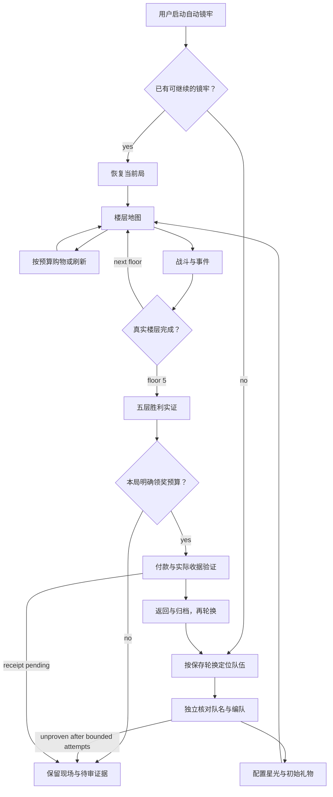

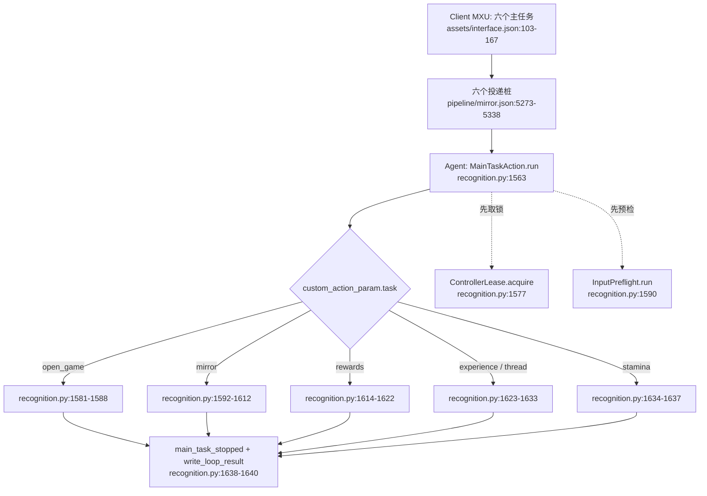

（图内简写见本章开头。）

分发前的三段公共动作：

- 任务名校验：`from maalimbus.task_preferences import TASKS`，`TASKS` 定义在 `src/maalimbus/task_preferences.py:5`；不在其中就抛 `ValueError('Unknown main task')`（`agent/recognition.py:1566-1567`）。
- 证据目录：`agent/recognition.py:1337 def loop_directory(params)` 先取 `params['directory']`、再取环境变量 `MAALIMBUS_RUN_DIR`（常量 `agent/recognition.py:1265`）；两个都没有就用 `ROOT/'evidence/runtime'/('pi-'+时间戳)`（`agent/recognition.py:1345-1346`）。六个投递桩的 `custom_action_param` 里只有 `task`，所以 GUI 直跑主任务的默认证据目录是 `evidence/runtime/pi-<yyyymmdd-hhmmss>/`；命令行工具用的 `window-<...>` 前缀不走这条路径。
- 单控制器门禁：`ControllerLease.acquire(ROOT/'build/controller.lock')`（`agent/recognition.py:1577`）。锁的实际落点由 `src/maalimbus/controller_lease.py:8 def lease_path` 改写到 `%LOCALAPPDATA%/MaaLimbus/controller.lock`（`src/maalimbus/controller_lease.py:12-14`），类定义在 `src/maalimbus/controller_lease.py:18`。抢不到锁就 `reject('another_controller_owns_game')`（`agent/recognition.py:1578-1579`），**零输入**。

### 4.1.3 三类终止与统一出口

`run()` 用内层函数 `reject(reason)`（`agent/recognition.py:1571`）表达「拒绝」，它固定写出 `passed=False, reason=<原因>, input_sent=False, verified_clear=False`。所有分支最后都走同一个出口：`journal.record('main_task_stopped', **result)`、`write_loop_result(directory, result)`、`return bool(result.get('passed'))`（`agent/recognition.py:1638-1640`）。

| 终止类 | 含义 | 典型 reason | 是否已发输入 |
|---|---|---|---|
| 成功 | 该链路自己声明的要求被验证 | `existing_windows_game_verified` / `game_foreground_after_native_launch` / `game_already_foreground` | 视分支 |
| 拒绝 | 前置条件不成立，动作开始前就停 | `another_controller_owns_game` / `Actual Windows game identity failed` / `Actual controller identity failed` | 否 |
| 停止 | 走到边界或未实现处，保存现场后停 | `task_page_policy_not_implemented` / `lux_navigation_successor_requires_verification` | 视分支 |

证据产物固定是两类：`Journal`（`agent/recognition.py:76`）往目录里追加 `events.jsonl`（`agent/recognition.py:82-85`）；`Journal.frame()` 每写一帧落一对 `frame-NNNN.png` + `frame-NNNN.json`（`agent/recognition.py:87-97`）；最后 `write_loop_result()` 写一份 `agent-result.json`（`agent/recognition.py:1372-1375`）。真实实例：`dist/MaaLimbus/evidence/runtime/pi-20261012-112240/events.jsonl`（`docs/acceptance.md:10`），以及 `dist/MaaLimbus/evidence/runtime/pi-20261012-123906/`（66 帧、179 事件，`docs/acceptance.md:1367`）。

---

## 4.2 `open_game`：打开游戏

- **触发入口**：`OpenGameTask`（`assets/resource/base/pipeline/mirror.json:5273`），`custom_action_param.task='open_game'`，无 option。界面文案见 `assets/i18n/zh_cn.json:75-76`：Android 用 Maa 启动并确认前台，游戏已经打开时不重复启动；Windows 请先连接游戏窗口。
- **逐步业务动作**（`agent/recognition.py:1581-1588`）：
  1. 读 `context.tasker.controller.info.get('type')`。
  2. 若已经是 `win32`：跑 `InputPreflight`（`agent/recognition.py:1196`），失败即 `reject('Actual Windows game identity failed')`；通过则直接返回 `passed=True, reason='existing_windows_game_verified', input_sent=False`，**不重新启动游戏**。
  3. 否则调用 `maalimbus.game_launch.open_game(controller, data_directory(ROOT), journal)`（`src/maalimbus/game_launch.py:8`）。
- **冷启动内部**（`src/maalimbus/game_launch.py`）：要求 ADB 控制器，否则抛错（`:11-12`）；先查是否已在前台，命中 `PACKAGE+'/'` 就直接返回 `game_already_foreground`（`:19-24`）；持久意图文件 `user-open-game-transaction.json`（`:14`）里已有未完成事务就拒绝第二次启动（`:25-26`）；写意图并 `journal.record('game_launch_intent')`，再 `controller.post_start_app(LAUNCH_INTENT)`（`:27-31`）；最多 5 轮独立确认前台（`:32-39`），成功是 `game_foreground_after_native_launch`，否则 `launch_foreground_not_proven` 并带 `pending=True`（`:40`）。
- **终止条件**：成功＝前台被独立确认（上述三种 reason 之一）；拒绝＝控制器不是 ADB、存在别的未完成启动事务、或身份预检失败；停止＝5 轮仍未证明前台（`pending=True`）。
- **产出证据**：`game_launch_intent` / `game_open_observed` 事件 + `user-open-game-transaction.json` + `agent-result.json`。

### 4.2.1 启动意图与前台确认

此图只覆盖实际实现的打开游戏任务，不包含重新登录或关闭别的游戏。当前暂停期间不调用此路径。冷启动完整实机验收仍开放。

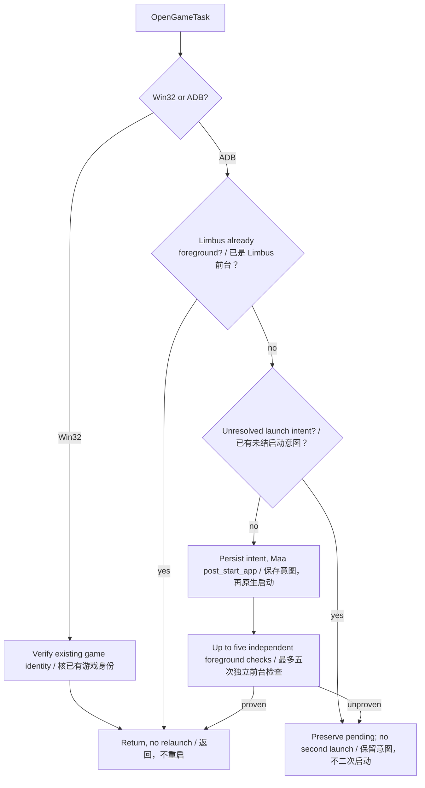

源码落点：`src/maalimbus/game_launch.py:8` (`open_game`); `agent/recognition.py:1` (`MainTaskAction.run`).

## 4.3 `mirror`：自动镜牢

- **触发入口**：`MirrorTask`（`assets/resource/base/pipeline/mirror.json:5284`），10 个 option（`assets/interface.json:117-128`）；文案见 `assets/i18n/zh_cn.json:77-78`。
- **逐步业务动作**（`agent/recognition.py:1592-1612`）：
  1. `GlobalSettingsAction.run`（`agent/recognition.py:1455`、`:1462`）先把总设置里显式编辑过的全局队伍与镜牢队列落盘，记 `global_build_settings_applied` 且 `device_input=False`。
  2. `mirror_preferences.collect`（`src/maalimbus/mirror_preferences.py:6`）→ `apply`（`:21`）：把本次勾选的藏品允许/禁用、主题包偏好写进保存队伍。
  3. `mirror_starlight.collect`（`src/maalimbus/mirror_starlight.py:74`）→ `apply`（`:17`）：星光规则来源与预算。
  4. 读 `MirrorLoop` 节点的 `custom_action_param`，再叠加 `mirror_task_options.collect`（`src/maalimbus/mirror_task_options.py:5`）得到的初始关键词、礼物搜索、步数上限、出战指派。
  5. 用 `shop_settings.FIELDS`（`src/maalimbus/shop_settings.py:45`）把 `MirrorShopPolicy` / `MirrorShopRefreshLimit` / `MirrorShopCoinReserve` 三个节点逐项覆盖进参数（`agent/recognition.py:1607-1610`）；解析逻辑在 `src/maalimbus/shop_settings.py:134 resolve_shop_settings` 与 `:282 collect`。
  6. 交给 `MirrorLoopAction.run`（`agent/recognition.py:1473`、`:1494`）：建目录、读参数与预算（`:1496-1499`，默认 5400 秒，`agent/recognition.py:1270`），组装 `runner.MaaDevice`（`:1509`）与 `runner.MaaObserver`（`:1510`），再建 `runner.MirrorRunner`（`:1257`、`:1518`）并调 `run(steps, interval, round_limit, deadline)`（`src/maalimbus/runner.py:2845`）。
  7. 循环内部每步决策读的是一组独立的策略件：`src/maalimbus/mirror_learning_policy.py:1304 strategy_score`、`:587 plan_route`、`:779 shop_plan`、`:931 skill_replacement`、`:432 gift_utility`；`src/maalimbus/route_plan.py:108 plan_route`、`src/maalimbus/gift_plan.py:15 load`、`src/maalimbus/shop_priority.py:5 load`、`src/maalimbus/auto_formation.py:17 choose_identity`、`src/maalimbus/budget.py:66 plan_spend`。
- **逐步时序**：

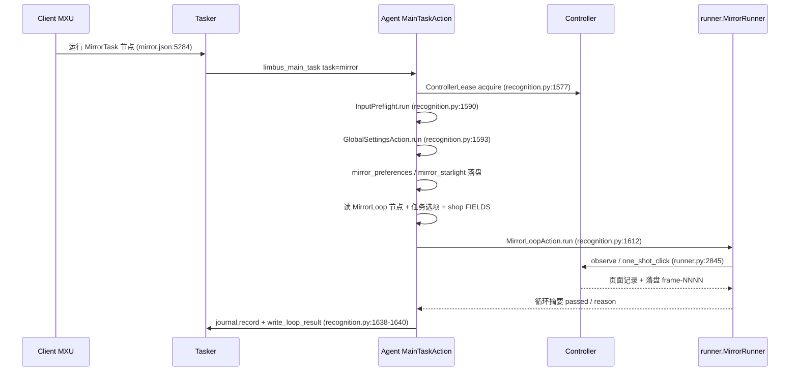

- **终止条件**（`agent/recognition.py:1528-1553`）：成功＝循环摘要 `passed=true`；停止＝本轮预算耗尽或设备作业超时，记 `loop_deadline_exceeded`；失败＝循环抛异常，记 `mirror_loop_error`（带 traceback）并返回 `passed=False, reason='mirror_loop_failed'`。
- **产出证据**：`mirror_loop_start` / `mirror_loop_stopped` / `mirror_loop_error` 事件，`agent-result.json` 与人类可读运行日志。

### 4.3.1 一次商店访问的输入（含死位复活）

商店页（`SHOP`）不是「看一眼就走」的页面：`src/maalimbus/window.py:594-652` 对一个商店帧只允许一个输入，顺序固定。

1. **买之前先看有没有死位。** `config/user-deployment-transaction.json` 的 `saved_order` / `unavailable` 加上 `shop_revive.key_losses(..., positions=KEY_POSITIONS=7)`（`src/maalimbus/shop_revive.py:269`）给出「前七个存档位里死掉的卡」；非空且店里印着 `Heal Sinner`（`shop_revive.py:85`，服务框在 `SERVICE_X=(180,660)` × `SERVICE_Y=(540,800)`，`:33-34`）就先点这颗服务——`window.py:623`，`expect=(ANY,)`、`advance=True`，因为弹窗自己会说明下面发生什么。
2. **弹窗的三步各自由自己的文字证明。** `HEAL_SINNERS`（`vision.py:266-269`：标题 **且** 三个编号行）→ 点它自己的第三行（`window.py:999`）→ `REVIVE_PICK`（`vision.py:286-288`：`Select the Sinner to revive.` + 标题）→ 先点死位头像（`shop_revive.slot_box(card)`，`BAR_FIRST_CENTER=112` + `BAR_PITCH=115`，`:180-187`）再点弹窗换出来的状态按钮（`window.py:583`）→ `REVIVE_DONE`（`vision.py:283-285`：`… revived, returns to battle.` + `Leave`）→ 点它自己的 `Leave`（`window.py:566`）回到商店。哪一步没有自己的字，就在那一步拒绝（`_refuse`），不猜。
3. **复活是花钱，所以记的是收据不是点击。** 规划时写下 `state['revive_receipt']=dict(card, cost, coins_before)`；回到商店页后只有 `coins_before - 当前币值 == cost` 才调 `deployment_transaction.book_revive`（`src/maalimbus/deployment_transaction.py:73`）写进 `revives`，否则记 `shop_revive_receipt_not_proven`。实机判据 `window-20261012-214803`：3093 → 2993，`cost=100`，`card=6`（Hong Lu）。
4. **其余输入按固定优先级。** 货架上 gift plan 想要的卡，或「这次会带出上限以上的钱」必须花掉的卡（`window.py:633`，原因串 `buying_the_gift_the_gift_plan_asked_for` / `spending_the_coins_this_visit_would_carry_out_on_the_shelf`）→ 刷新（`window.py:643`，受刷新次数与储备金约束）→ 离店（`window.py:651`）。买成的记账在 `shop_transaction.py:458`，刷新回执在 `:478`；卡片标题的混淆字比对见 2.3 的 D14。

上面四步的形状（每一跳都由它自己那一页印的字把关，没有字就停）：

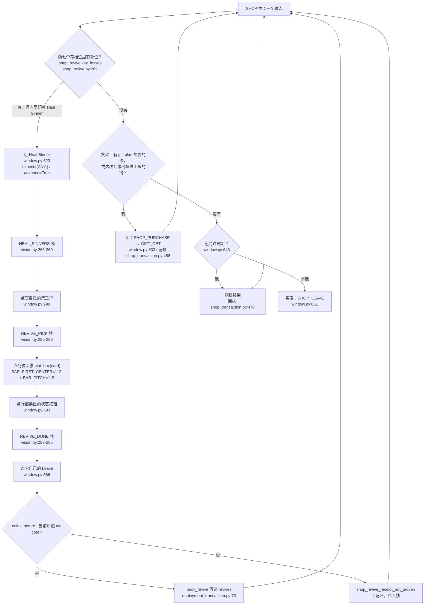

（实机走通的只有 `window-20261012-214803` 那一步：3093 → 2993 的复活收据；整条路由由一次 planner 运行跑完仍在待验收清单里，见 7.3。）

### 4.3.2 入场与列表上下查找

队列值由 RunStore 驱动，不从当前屏幕已选队伍反推设置。目标在上方时手指向下滑回 Team1/Team2；两次列表语义不变只反向一次，之后停并记录。图中的查找块可能由多次循环 step 完成，命中目标后退出搜索，不是强制执行十二次。默认编号 1–40 支持，重命名槽位仍需独立映射。实机 Team1/Team2 跨屏回滑尚待暂停解除后的产品入口测试。

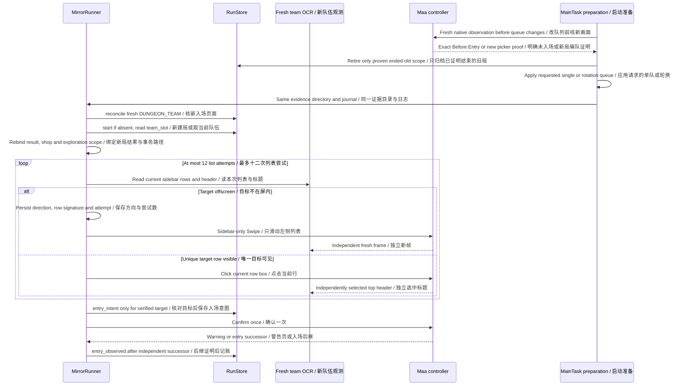

启动前不会仅凭 MIRROR_ENTRY 这个宽分类清旧状态：Before Entry 和 Enter 必须独立高置信读出，JSON/PNG 哈希和尺寸必须一致。真实活动局、入场 pending 和同局领奖 pending 保留。旧局通关事实保留，但不根据“现在无局”推断奖励已到账；新队列在此核对之后才应用。设置拒绝写明确结果/人类日志，不再只有红色失败。

源码落点：`src/maalimbus/run_wiring.py:156` (`reconcile`); `src/maalimbus/team_navigation.py:1` (`browse`, `prepare`); `src/maalimbus/runner.py:1` (`MirrorRunner.step`).

### 4.3.3 每场部署：复用、修正与提交

复用的依据是卡片印刷部署序号与保存顺序一致，不能用网格位置或人数满了代替。明确不同顺序才清空；人数变化与不可用卡片单独证明。复活回执在同局事务重建时保留，不会因新战斗重复花钱。

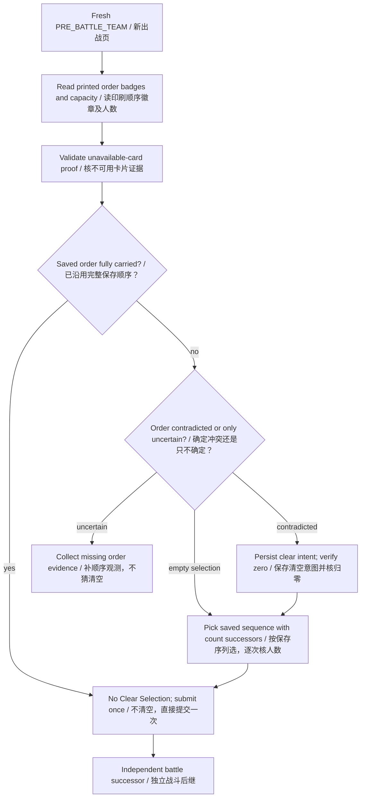

源码落点：`src/maalimbus/deployment_transaction.py:5` (`prepare`, `intent`, `observe`); `src/maalimbus/team_vision.py:1` (`assignment_numbers`, `carries_saved_order`).

### 4.3.4 楼层礼物选择、到账与恢复

状态图的每条边是事务守卫，不是点击成功的假定。GIFT_GET、GIFT_PICK、REWARD_CARD、THEME_PACKS、MAP 只是后继家族；仍须对应完整标题、下一份 offer 或最终完成条件。恢复与即时结算共用后继读取器，恢复不重发 GET 确认。已拥有礼物替换记录 expected/printed，不伪造原礼物到账。

```mermaid
stateDiagram-v2
  [*] --> Picking
  Picking --> PickPending: persist pick intent before input
  PickPending --> Picking: exact same offer and counter plus one
  Picking --> CommitPending: required selections; Select once
  CommitPending --> ReceiptPending: full named GET; persist ack intent
  ReceiptPending --> CommitPending: next named notice independently proven
  ReceiptPending --> Completed: final successor independently proven
  ReceiptPending --> ReceiptPending: missing successor; observe only, no replay
  PickPending --> PickPending: unknown counter; preserve pending
  Completed --> [*]
```

源码落点：`src/maalimbus/floor_gift_transaction.py:10` (`RECEIPT_SUCCESSOR_PAGES`, `observe_receipt`); `src/maalimbus/runner.py:1` (`_receipt_successor_offers`, `_resolve_floor_receipt`).

### 4.3.5 初始礼物、搜索与楼层主题

星光消费另受本局可见成本与预算门禁约束，图不授予消费。初始礼物 GET 回执、搜索 Refuse 确认和主题 Swipe 是三个独立事务，不能因页面稍慢而重放上一动作。图概括阶段，不代表所有搜索分支已有实机验收。

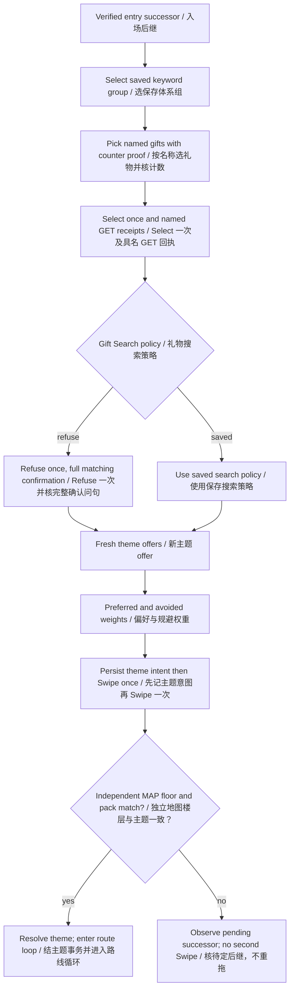

源码落点：`src/maalimbus/initial_gifts.py:1`; `src/maalimbus/initial_transaction.py:1`; `src/maalimbus/theme_transaction.py:5` (`intent`, `observe`).

### 4.3.6 战斗配卡与真实进度

saved 配置先解析为保存的具体模式；图从解析后开始。技能逐卡顺序编辑与模型直接配卡尚未完成。HUD 与 UNKNOWN 来回不等于战斗前进，进度停滞需记录具体边界；START 只提交当前回合。

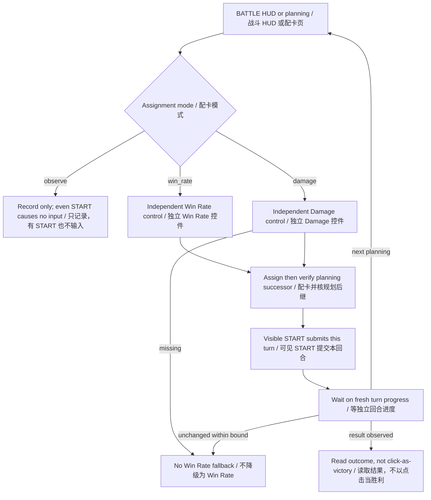

源码落点：`src/maalimbus/window.py:110` (`plan_step`); `src/maalimbus/battle_vision.py:1`; `src/maalimbus/runner.py:1`.

### 4.3.7 路线与事件是不同决策

节点几何命中并不证明进入面板。未知导航、未知敌方试炼与未知事件选择有各自策略，3.7 的返回探测不能泛化为任意 Accept/Confirm；没有匹配策略时仍可能保留现场停止。不能把故事文本猜出的收益当实际到账。

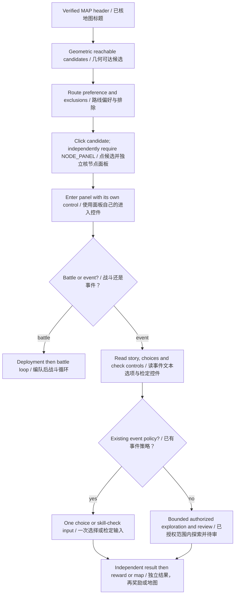

源码落点：`src/maalimbus/map_vision.py:1`; `src/maalimbus/event_vision.py:1`; `src/maalimbus/mirror_learning_policy.py:1`; `src/maalimbus/runner.py:1`.

### 4.3.8 购物与刷新分别结算

Purchase 弹窗报价尚未消费，不能在此页要求钱已扣完。card/confirm/GET/货架到账分别结算；卡片可能留在货架并显示自己的 Purchased 标记，也可能消失。刷新读数必须证明完整新货架，不能靠 OCR 数量变化猜已经成功。局内 coins 与 Modules/Lunacy 预算分开。静态硬规则、经济优先级和刷新上限控制当前行为，3.9 的模型仅作影子预览。

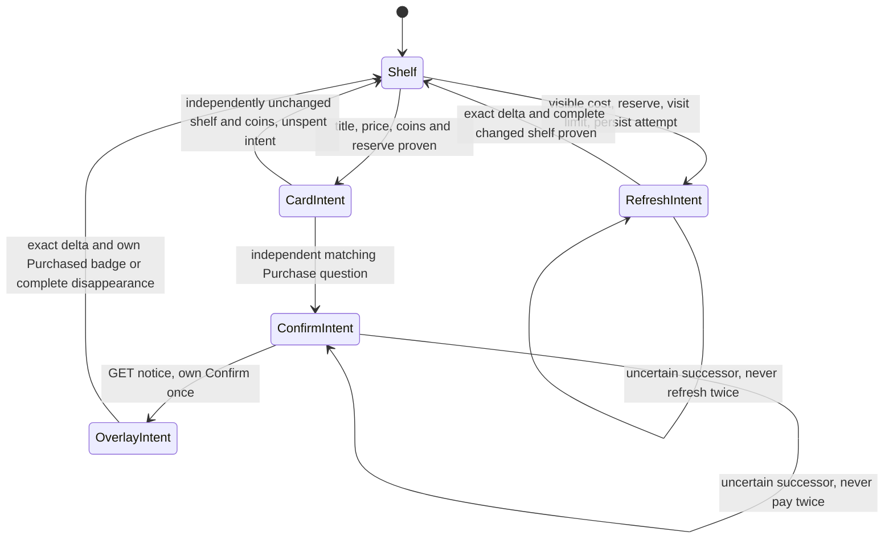

源码落点：`src/maalimbus/shop_transaction.py:147` (`ShopTransaction`); `src/maalimbus/shop_vision.py:1`; `src/maalimbus/shop_settings.py:1`; `src/maalimbus/shop_value_shadow.py:7`.

### 4.3.9 图鉴、账户 box 与自动编队

公共图鉴不包含账户 ownership；未观测不等于没有。选择器的混合体系是 OR 匹配，等级先于匹配体系数量。点击 sinner 的详情往返不能冒称已经扫描完整 box。体系 E.G.O 全量装配与实际后继仍须单独验收，此图不是已完成每个账户自动装备的证明。

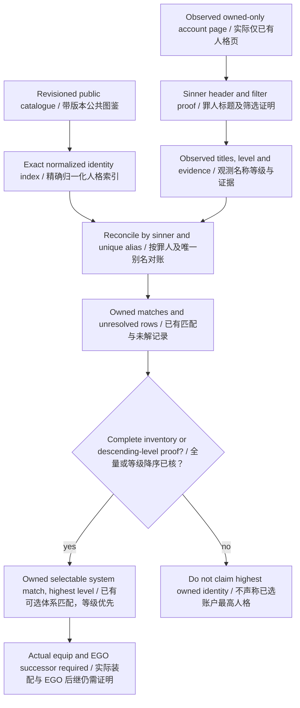

源码落点：`src/maalimbus/owned_inventory.py:1` (`build_index`, `reconcile_titles`); `src/maalimbus/sinner_collection.py:1`; `src/maalimbus/auto_formation.py:17` (`choose_identity`).

## 4.4 `experience`：自动经验本

- **触发入口**：`ExperienceTask`（`assets/resource/base/pipeline/mirror.json:5295`），option `experience_team`（`assets/interface.json:136-138`）；文案见 `assets/i18n/zh_cn.json:79-80`，其中明确「关卡选择、战斗及消耗验证尚未支持」。
- **逐步业务动作**（`agent/recognition.py:1623-1633`）：先 `lux_task.prepare(data_directory(ROOT), 'experience', choice)`（`src/maalimbus/lux_task.py:21`），`choice` 来自 `context.get_node_data('LuxExperienceTeam')['attach']['slot']`；`prepare` 先跑 `check_run`（`src/maalimbus/lux_task.py:11`）拒绝在未完成镜牢期间导航，再校验并保存默认队伍；失败即 `reject(str(error))`。随后建 `local_device(..., deadline=now+45)`（`src/maalimbus/runner.py:379`）并调 `execute`（`src/maalimbus/lux_task.py:65`），结果附加 `result['saved_team']={slot, keywords, deployment}`。
- **逐步业务动作（导航部分）**：`target(record)`（`src/maalimbus/lux_task.py:45`）只认两种页面：`HOME` 上独立可读的 Window / Sinners / Inventory 三个控件 + 唯一的 `Drive`，以及 `DRIVE` 上的 `Luxcavation`；到 `DRIVE` 之后没有已独立验证的下一站。
- **终止条件**：拒绝＝有未完成镜牢（`active_mirror_run_blocks_lux_navigation`）、选择非法、既有意图属于别的任务/队伍；停止＝会话结束或超出输入界，`lux_task.execute` 在成功点到 Drive 之后返回 `lux_navigation_successor_requires_verification`（`src/maalimbus/lux_task.py:127-128`），**不算通过**。
- **产出证据**：`lux-menu-home-input.json` / `lux-menu-drive-input.json` 输入报告、`user-lux-task-transaction.json` 意图文件、`lux_navigation_stopped` 事件、`agent-result.json`。

### 4.4.1 经验与纺锤共享的菜单链

两个任务共享实现，只在任务键和保存队伍不同。准备门禁在写配置与创建设备之前；执行再核镜牢排斥。成功走到菜单边界不是刷经验/纺锤完成，stage 选择、成本、战斗与到账仍未实现验收。

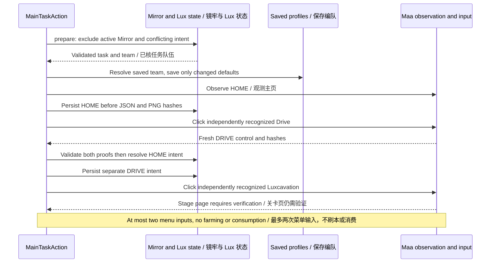

源码落点：`src/maalimbus/lux_task.py:11` (`check_run`, `prepare`, `execute`).

## 4.5 `thread`：自动纺锤本

- **触发入口**：`ThreadTask`（`assets/resource/base/pipeline/mirror.json:5306`），option `thread_team`（`assets/interface.json:146-148`）；文案见 `assets/i18n/zh_cn.json:81-82`，未支持范围与经验本相同。
- **逐步业务动作**：与 `experience` 共用同一条代码路径（`agent/recognition.py:1623-1633`），只差 `task='thread'` 与节点名 `LuxThreadTeam`。`lux_task.prepare`（`src/maalimbus/lux_task.py:21`）用 `luxcavation[task+'_team']` 选择保存队伍，`lux_task.execute`（`src/maalimbus/lux_task.py:65`）走同一套 `HOME`→`DRIVE` 导航。
- **终止条件**：与 4.4 完全一致（同一函数、同一 reason 集合）。
- **产出证据**：与 4.4 一致，只是报告里 `task='thread'`、事件名仍为 `lux-menu-<scene>-input.json`。
- **口径**：`README.md:51` 把经验本/纺锤本列为「独立任务入口引用已保存队伍」已验证，未完成部分是「实际关卡、消费和战斗流程；当前保存画面停止」。`docs/acceptance.md:1315-1322` 同样只承认菜单导航，实际 Lux 关卡选择、刷取、消耗/回执、GUI 派发仍是开放的。

## 4.6 `rewards`：领取奖励

- **触发入口**：`RewardsTask`（`assets/resource/base/pipeline/mirror.json:5317`），option `reward_module_budget`（`assets/interface.json:155-158`）；文案见 `assets/i18n/zh_cn.json:83-84`（需要本轮模块预算；邮件与每日任务领取尚未支持）。
- **逐步业务动作**（`agent/recognition.py:1614-1622`）：先 `reward_task_budget.apply(..., get_node_data('RewardModuleBudget')['attach']['maximum'])`（`src/maalimbus/reward_task_budget.py:6`），它要求当前存在「已验证、未领奖的五层通关」运行，并把上限绑定到该 scope；再 `reward_task.execute`（`src/maalimbus/reward_task.py:72`），deadline 为 90 秒（`agent/recognition.py:1619`）。
- **逐步业务动作（领奖循环）**：`execute` 每轮 `runner.observe`（`src/maalimbus/runner.py:657`）读一页；`action_for`（`src/maalimbus/reward_task.py:15`）把页面映射成 `claim` / `confirm` / `receipt` / `pass`（`src/maalimbus/reward_task.py:10 ACTIONS`）；再用 `runner.one_shot_click` 发一次点击并写 `reward-<action>-input.json` 输入报告；回到 `HOME` 才调 `finish`（`src/maalimbus/reward_task.py:27`）做回执审计并推进轮换。循环上限 5 次（`src/maalimbus/reward_task.py:108`）。
- **终止条件**：成功＝`finish` 通过回执链与 HOME 独立验证，返回 `mirror_payout_and_home_verified`（`src/maalimbus/reward_task.py:68`）；拒绝＝没有已验证的完整镜牢运行，返回 `completed_mirror_run_required`（`:97-99`）；停止＝页面/后继未被证明、输入界耗尽或设备中断（`:115`、`:129-132`）。
- **产出证据**：`reward-<action>-input.json` 输入报告、`user-reward-claim-transaction.json` 事务、`user-run-ledger.json` 账本事件、`reward_task_stopped` 事件、`agent-result.json`。

### 4.6.1 领奖与只记账恢复

未授权预算保留报价页，不能借用上一局预算。确认金额和 Pass 数值来自实际页面，不固定 250/81。通关、奖励到账、返回与轮换分别记账；已通关但领奖/返回证据缺失，不能推断没通关，也不能伪造完成链。此任务当前只实现 Mirror 子流程，不含邮件/每日奖励。

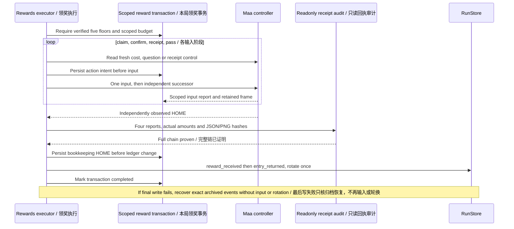

源码落点：`src/maalimbus/reward_task.py:27` (`finish`, `execute`); `src/maalimbus/reward_receipt_audit.py:1`; `src/maalimbus/storage.py:247` (`RunStore.record`).

## 4.7 `stamina`：体力兑换（未实现）

- **触发入口**：`StaminaTask`（`assets/resource/base/pipeline/mirror.json:5328`），无 option；文案见 `assets/i18n/zh_cn.json:85-86`：「预算内体力兑换识别尚在开发，当前保存现场后停止，不消费」。
- **逐步业务动作**（`agent/recognition.py:1634-1637`）：`stamina` 落进镜像之外的分支——只做一次 `runner.observe(observer, now+30)`（`src/maalimbus/runner.py:657`），然后把观察记录塞进结果并返回。
- **终止条件**：**永远不通过**。结果固定为 `passed=False, reason='task_page_policy_not_implemented', input_sent=False, verified_clear=False`（`agent/recognition.py:1636-1637`）；没有消费任何体力或货币。
- **产出证据**：一次观察写入的 frame 对 + `main_task_stopped` 事件 + `agent-result.json`；单测 `tests/test_main_task_dispatch.py:44 test_unimplemented_task_captures_evidence_and_returns_failure_without_input` 钉住「保存证据、返回失败、零输入」。
- **口径**：`README.md:52` 把体力兑换/每日奖励列为「独立入口和预算基础」已验证，未完成部分是「实际页面和到账；当前保存画面停止」；`docs/acceptance.md:944` 也只承认纯预算边界通过、没有消费实现。

---

### 4.7.1 未完成任务的真实边界

虚线表示缺口，不是执行边。预算基础或独立入口存在不等于这些业务已完成；图保留边界，避免把想做的能力画成已经运行的 pipeline。

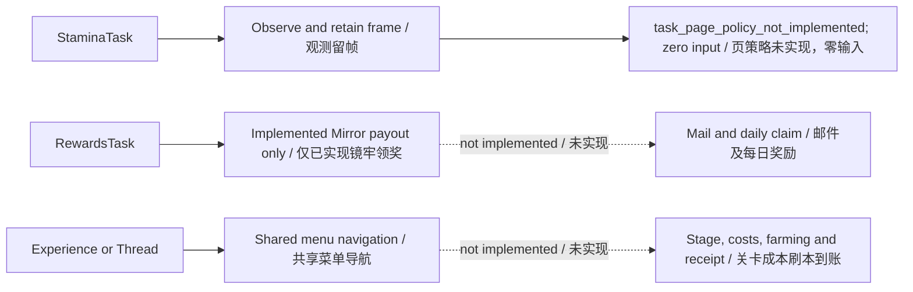

源码落点：`agent/recognition.py:1` (`MainTaskAction.run`); `src/maalimbus/lux_task.py:65`; `src/maalimbus/reward_task.py:72`.

## 4.8 未验收 / 待核实清单

更新边界（2026-10-13）：下列旧记录的“GUI 未派发”是当时快照。实际 GUI Start 已走过 DUNGEON_TEAM、警告、星光与初始礼物，证明入口已执行，但未证明整局和 Team1/Team2 实机跨屏滑动。用户确认上局通关；独立领奖/返回记账不全仍是另一项缺口。

本章已经逐条打开确认的锚点见上文每处 `路径:行号`。以下内容本章**没有**独立验证，如实列出：

- **端到端 GUI 派发未验收**：六条链路里没有任何一条被本章用真机 GUI 点过。`docs/acceptance.md:156-158` 记录的「六个原生任务入口」只在同一 GUI 上渲染出六个选项，当时任务被禁用、没有游戏连接、没有 GUI Start 派发。
- **`open_game` 冷启动未验收**：`docs/acceptance.md:158` 明说冷启动仍未接受（只单独验证过「已在前台的 MuMu」不重启、零输入）。
- **`mirror` 的实机结果未验收**：本章引用的真机 run（`pi-20261012-112240`）以 `reason=unexpected_successor`、`passed=false` 结束（`docs/acceptance.md:2-8`），是一个停机点而不是通关。
- **`experience`/`thread`/`stamina` 的页面策略未实现**：三者的关卡/页面策略都还没有代码，正文按 `src/maalimbus/lux_task.py:127-128`、`agent/recognition.py:1636-1637`、`README.md:51-52` 的现状写成「未实现」。
- **`rewards` 的真机付费领奖未验收**：`docs/acceptance.md:1284-1287` 说明实际 GUI Start 派发与当前 Team7 付费 5 次领奖仍未验证，只离线证明了保留回执链。
- **策略件的内部行为未逐行核对**：4.3 里列出的 `mirror_learning_policy.py` / `route_plan.py` / `gift_plan.py` / `shop_priority.py` / `auto_formation.py` / `budget.py` 只核对了顶层符号与其行号，没有逐行读完整实现细节。
- **证据目录前缀**：`loop_directory` 的默认前缀是 `pi-`（`agent/recognition.py:1345-1346`）；本章没有逐台机器比对 `evidence/runtime/` 下实际目录清单，只引用了 `docs/acceptance.md` 里已登记的路径。
- **`InputPreflight` 的 `win32` 分支内部**：只读到窗口唯一性与身份校验入口（`agent/recognition.py:1230-1239`），后续校验细节与 `input_helpers` 报告格式未展开。

## 4.9 轮换选队与有界列表搜索

加载下一队前必须先进行账本 reconcile；商店回执的局部调用现命名 shop_reconcile，避免遮蔽入场 reconcile。

队伍定位使用当前侧栏的独立 OCR 行，不用旧屏幕坐标。目标不在可见列表时只在侧栏内有界上下 Swipe；两次语义列表不变则换方向，最多十二次尝试。找到目标后仍须顶部标题独立证明选队成功，才能 Confirm。默认 TEAMS #1–#40 的编号可读；自定义队名仍需要经验证的槽位映射，不能把名字或列表位置猜成编号。导航尝试保存在私有 user-team-navigation.json。

本轮已用真实失败帧在隔离状态中证明 reconcile 不再异常；实际成品更新与 GUI 再启动仍须另行验证。

## 4.10 轮换政策与手动跳过

用户已选“成功领奖后轮换，另加手动跳过”，不是弃局自动轮换。当前 point_at 可在无 active 时手动定位已保存队伍；专用跳过按钮、launcher 命令及幂等 ledger 操作已新增源码；尚未重建/安装/GUI 验收，不能当已安装按钮。上把通关由用户确认；脚本保留记录不足时单独注明，不能将其称为游戏未过。Team1、Team2 固定与轮换目标需经过 MainTask→Runner→列表定位的完整路径测试。

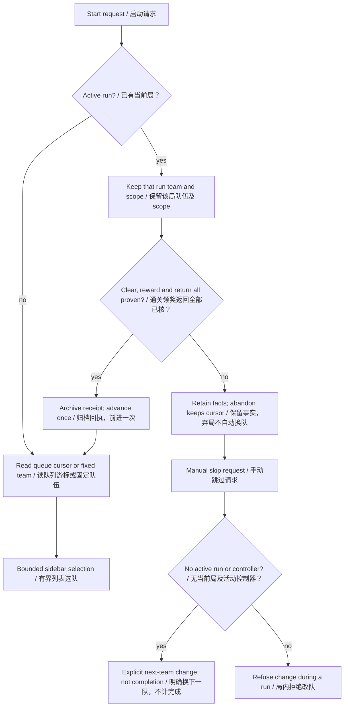

源码落点：`src/maalimbus/storage.py:151` (`point_at`, `abandon`, `record`); `src/maalimbus/task_preferences.py:1`; `src/maalimbus/team_navigation.py:1`.
