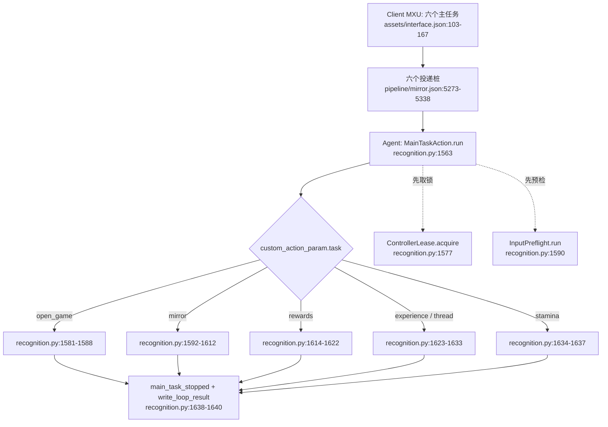

# 4 业务流程

[English](../en_us/4-business-flows.md) · [← 索引](index.md)

本章讲「用户在 MXU 里点下一个主任务之后，游戏里实际按什么顺序发生什么」。词汇沿用第 3 章：Controller（截图/输入）、Resource（图像/模型/Pipeline/本地化）、Tasker（跑 Pipeline 的识别-动作循环）、Agent（自定义识别/动作），外加本项目自有的 Client 层（`desktop/mxu/`，MaaFramework 无此层）。

阅读约定：`路径:行号` 是可核验锚点；凡本章没有亲自打开确认的内容，统一收在最后一节「未验收 / 待核实清单」。

图内简写规则（只用于图内，正文一律写完整路径）：`mirror.json` = `assets/resource/base/pipeline/mirror.json`；`recognition.py` = `agent/recognition.py`；`runner.py` = `src/maalimbus/runner.py`。

---

## 4.1 六个入口与唯一的业务分发函数

### 4.1.1 入口是投递桩，不是流程图

ProjectInterface 声明六个主任务（`assets/interface.json:103-167`），每个任务的 `entry` 指向 Pipeline 里一个节点：

| 任务名 | entry 节点 | option | 声明行 |
|---|---|---|---|
| `open_game` | `OpenGameTask` | 无 | `assets/interface.json:104-110` |
| `mirror_loop` | `MirrorTask` | 10 个 | `assets/interface.json:111-129` |
| `experience` | `ExperienceTask` | `experience_team` | `assets/interface.json:130-139` |
| `thread` | `ThreadTask` | `thread_team` | `assets/interface.json:140-149` |
| `rewards` | `RewardsTask` | `reward_module_budget` | `assets/interface.json:150-159` |
| `stamina` | `StaminaTask` | 无 | `assets/interface.json:160-166` |

六个节点在同一个 Pipeline 文件里，而且**长得一模一样**：`recognition: DirectHit`、`action: Custom`、`custom_action: limbus_main_task`、`custom_action_param.task` 写死成上面六个值之一，最后 **`next: []`、`on_error: []`**。

- 节点起始行号：`assets/resource/base/pipeline/mirror.json:5273`（OpenGameTask）、`:5284`（MirrorTask）、`:5295`（ExperienceTask）、`:5306`（ThreadTask）、`:5317`（RewardsTask）、`:5328`（StaminaTask）。
- 也就是说：**Pipeline 图在这六条链路上不做任何流程编排**。它只把「用户点了哪个任务」投递给 Agent；真正的分支、前置校验、循环与停机都在 Python 里。
- 这个设计被测试钉住：`tests/test_main_task_dispatch.py:23 test_six_main_tasks_reference_saved_builds_and_no_diagnostic_entry` 断言六个 `entry` 的 `custom_action` 都是 `limbus_main_task`，且六个任务都不默认勾选。
- 反过来，在 `src/maalimbus/` 下 grep 不到 `ExperienceTask`/`ThreadTask`/`StaminaTask`/`RewardsTask` 这些名字：这六条链路的入口只存在于 Pipeline 与 `assets/interface.json`。

### 4.1.2 统一分发骨架

Agent 侧只注册了一个自定义动作：`agent/main.py:69 AgentServer.register_custom_action('limbus_main_task',MainTaskAction(recognition))`。业务全在 `agent/recognition.py:1556 class MainTaskAction` 的 `run()`（`agent/recognition.py:1563`）里。

（图内简写见本章开头。）

分发前的三段公共动作：

- 任务名校验：`from maalimbus.task_preferences import TASKS`，`TASKS` 定义在 `src/maalimbus/task_preferences.py:5`；不在其中就抛 `ValueError('Unknown main task')`（`agent/recognition.py:1566-1567`）。
- 证据目录：`agent/recognition.py:1337 def loop_directory(params)` 先取 `params['directory']`、再取环境变量 `MAALIMBUS_RUN_DIR`（常量 `agent/recognition.py:1265`）；两个都没有就用 `ROOT/'evidence/runtime'/('pi-'+时间戳)`（`agent/recognition.py:1345-1346`）。六个投递桩的 `custom_action_param` 里只有 `task`，所以 GUI 直跑主任务的默认证据目录是 `evidence/runtime/pi-<yyyymmdd-hhmmss>/`；命令行工具用的 `window-<...>` 前缀不走这条路径。
- 单控制器门禁：`ControllerLease.acquire(ROOT/'build/controller.lock')`（`agent/recognition.py:1577`）。锁的实际落点由 `src/maalimbus/controller_lease.py:8 def lease_path` 改写到 `%LOCALAPPDATA%/MaaLimbus/controller.lock`（`src/maalimbus/controller_lease.py:12-14`），类定义在 `src/maalimbus/controller_lease.py:18`。抢不到锁就 `reject('another_controller_owns_game')`（`agent/recognition.py:1578-1579`），**零输入**。

### 4.1.3 三类终止与统一出口

`run()` 用内层函数 `reject(reason)`（`agent/recognition.py:1571`）表达「拒绝」，它固定写出 `passed=False, reason=<原因>, input_sent=False, verified_clear=False`。所有分支最后都走同一个出口：`journal.record('main_task_stopped', **result)`、`write_loop_result(directory, result)`、`return bool(result.get('passed'))`（`agent/recognition.py:1638-1640`）。

| 终止类 | 含义 | 典型 reason | 是否已发输入 |
|---|---|---|---|
| 成功 | 该链路自己声明的要求被验证 | `existing_windows_game_verified` / `game_foreground_after_native_launch` / `game_already_foreground` | 视分支 |
| 拒绝 | 前置条件不成立，动作开始前就停 | `another_controller_owns_game` / `Actual Windows game identity failed` / `Actual controller identity failed` | 否 |
| 停止 | 走到边界或未实现处，保存现场后停 | `task_page_policy_not_implemented` / `lux_navigation_successor_requires_verification` | 视分支 |

证据产物固定是两类：`Journal`（`agent/recognition.py:76`）往目录里追加 `events.jsonl`（`agent/recognition.py:82-85`）；`Journal.frame()` 每写一帧落一对 `frame-NNNN.png` + `frame-NNNN.json`（`agent/recognition.py:87-97`）；最后 `write_loop_result()` 写一份 `agent-result.json`（`agent/recognition.py:1372-1375`）。真实实例：`dist/MaaLimbus/evidence/runtime/pi-20261012-112240/events.jsonl`（`docs/acceptance.md:10`），以及 `dist/MaaLimbus/evidence/runtime/pi-20261012-123906/`（66 帧、179 事件，`docs/acceptance.md:1367`）。

---

## 4.2 `open_game`：打开游戏

- **触发入口**：`OpenGameTask`（`assets/resource/base/pipeline/mirror.json:5273`），`custom_action_param.task='open_game'`，无 option。界面文案见 `assets/i18n/zh_cn.json:75-76`：Android 用 Maa 启动并确认前台，游戏已经打开时不重复启动；Windows 请先连接游戏窗口。
- **逐步业务动作**（`agent/recognition.py:1581-1588`）：
  1. 读 `context.tasker.controller.info.get('type')`。
  2. 若已经是 `win32`：跑 `InputPreflight`（`agent/recognition.py:1196`），失败即 `reject('Actual Windows game identity failed')`；通过则直接返回 `passed=True, reason='existing_windows_game_verified', input_sent=False`，**不重新启动游戏**。
  3. 否则调用 `maalimbus.game_launch.open_game(controller, data_directory(ROOT), journal)`（`src/maalimbus/game_launch.py:8`）。
- **冷启动内部**（`src/maalimbus/game_launch.py`）：要求 ADB 控制器，否则抛错（`:11-12`）；先查是否已在前台，命中 `PACKAGE+'/'` 就直接返回 `game_already_foreground`（`:19-24`）；持久意图文件 `user-open-game-transaction.json`（`:14`）里已有未完成事务就拒绝第二次启动（`:25-26`）；写意图并 `journal.record('game_launch_intent')`，再 `controller.post_start_app(LAUNCH_INTENT)`（`:27-31`）；最多 5 轮独立确认前台（`:32-39`），成功是 `game_foreground_after_native_launch`，否则 `launch_foreground_not_proven` 并带 `pending=True`（`:40`）。
- **终止条件**：成功＝前台被独立确认（上述三种 reason 之一）；拒绝＝控制器不是 ADB、存在别的未完成启动事务、或身份预检失败；停止＝5 轮仍未证明前台（`pending=True`）。
- **产出证据**：`game_launch_intent` / `game_open_observed` 事件 + `user-open-game-transaction.json` + `agent-result.json`。

## 4.3 `mirror`：自动镜牢

- **触发入口**：`MirrorTask`（`assets/resource/base/pipeline/mirror.json:5284`），10 个 option（`assets/interface.json:117-128`）；文案见 `assets/i18n/zh_cn.json:77-78`。
- **逐步业务动作**（`agent/recognition.py:1592-1612`）：
  1. `GlobalSettingsAction.run`（`agent/recognition.py:1455`、`:1462`）先把总设置里显式编辑过的全局队伍与镜牢队列落盘，记 `global_build_settings_applied` 且 `device_input=False`。
  2. `mirror_preferences.collect`（`src/maalimbus/mirror_preferences.py:6`）→ `apply`（`:21`）：把本次勾选的藏品允许/禁用、主题包偏好写进保存队伍。
  3. `mirror_starlight.collect`（`src/maalimbus/mirror_starlight.py:74`）→ `apply`（`:17`）：星光规则来源与预算。
  4. 读 `MirrorLoop` 节点的 `custom_action_param`，再叠加 `mirror_task_options.collect`（`src/maalimbus/mirror_task_options.py:5`）得到的初始关键词、礼物搜索、步数上限、出战指派。
  5. 用 `shop_settings.FIELDS`（`src/maalimbus/shop_settings.py:45`）把 `MirrorShopPolicy` / `MirrorShopRefreshLimit` / `MirrorShopCoinReserve` 三个节点逐项覆盖进参数（`agent/recognition.py:1607-1610`）；解析逻辑在 `src/maalimbus/shop_settings.py:134 resolve_shop_settings` 与 `:282 collect`。
  6. 交给 `MirrorLoopAction.run`（`agent/recognition.py:1473`、`:1494`）：建目录、读参数与预算（`:1496-1499`，默认 5400 秒，`agent/recognition.py:1270`），组装 `runner.MaaDevice`（`:1509`）与 `runner.MaaObserver`（`:1510`），再建 `runner.MirrorRunner`（`:1257`、`:1518`）并调 `run(steps, interval, round_limit, deadline)`（`src/maalimbus/runner.py:2691`）。
  7. 循环内部每步决策读的是一组独立的策略件：`src/maalimbus/mirror_learning_policy.py:1304 strategy_score`、`:587 plan_route`、`:779 shop_plan`、`:931 skill_replacement`、`:432 gift_utility`；`src/maalimbus/route_plan.py:108 plan_route`、`src/maalimbus/gift_plan.py:15 load`、`src/maalimbus/shop_priority.py:5 load`、`src/maalimbus/auto_formation.py:17 choose_identity`、`src/maalimbus/budget.py:66 plan_spend`。
- **逐步时序**：

- **终止条件**（`agent/recognition.py:1528-1553`）：成功＝循环摘要 `passed=true`；停止＝本轮预算耗尽或设备作业超时，记 `loop_deadline_exceeded`；失败＝循环抛异常，记 `mirror_loop_error`（带 traceback）并返回 `passed=False, reason='mirror_loop_failed'`。
- **产出证据**：`mirror_loop_start` / `mirror_loop_stopped` / `mirror_loop_error` 事件，`agent-result.json` 与人类可读运行日志。

## 4.4 `experience`：自动经验本

- **触发入口**：`ExperienceTask`（`assets/resource/base/pipeline/mirror.json:5295`），option `experience_team`（`assets/interface.json:136-138`）；文案见 `assets/i18n/zh_cn.json:79-80`，其中明确「关卡选择、战斗及消耗验证尚未支持」。
- **逐步业务动作**（`agent/recognition.py:1623-1633`）：先 `lux_task.prepare(data_directory(ROOT), 'experience', choice)`（`src/maalimbus/lux_task.py:21`），`choice` 来自 `context.get_node_data('LuxExperienceTeam')['attach']['slot']`；`prepare` 先跑 `check_run`（`src/maalimbus/lux_task.py:11`）拒绝在未完成镜牢期间导航，再校验并保存默认队伍；失败即 `reject(str(error))`。随后建 `local_device(..., deadline=now+45)`（`src/maalimbus/runner.py:379`）并调 `execute`（`src/maalimbus/lux_task.py:65`），结果附加 `result['saved_team']={slot, keywords, deployment}`。
- **逐步业务动作（导航部分）**：`target(record)`（`src/maalimbus/lux_task.py:45`）只认两种页面：`HOME` 上独立可读的 Window / Sinners / Inventory 三个控件 + 唯一的 `Drive`，以及 `DRIVE` 上的 `Luxcavation`；到 `DRIVE` 之后没有已独立验证的下一站。
- **终止条件**：拒绝＝有未完成镜牢（`active_mirror_run_blocks_lux_navigation`）、选择非法、既有意图属于别的任务/队伍；停止＝会话结束或超出输入界，`lux_task.execute` 在成功点到 Drive 之后返回 `lux_navigation_successor_requires_verification`（`src/maalimbus/lux_task.py:127-128`），**不算通过**。
- **产出证据**：`lux-menu-home-input.json` / `lux-menu-drive-input.json` 输入报告、`user-lux-task-transaction.json` 意图文件、`lux_navigation_stopped` 事件、`agent-result.json`。

## 4.5 `thread`：自动纺锤本

- **触发入口**：`ThreadTask`（`assets/resource/base/pipeline/mirror.json:5306`），option `thread_team`（`assets/interface.json:146-148`）；文案见 `assets/i18n/zh_cn.json:81-82`，未支持范围与经验本相同。
- **逐步业务动作**：与 `experience` 共用同一条代码路径（`agent/recognition.py:1623-1633`），只差 `task='thread'` 与节点名 `LuxThreadTeam`。`lux_task.prepare`（`src/maalimbus/lux_task.py:21`）用 `luxcavation[task+'_team']` 选择保存队伍，`lux_task.execute`（`src/maalimbus/lux_task.py:65`）走同一套 `HOME`→`DRIVE` 导航。
- **终止条件**：与 4.4 完全一致（同一函数、同一 reason 集合）。
- **产出证据**：与 4.4 一致，只是报告里 `task='thread'`、事件名仍为 `lux-menu-<scene>-input.json`。
- **口径**：`README.md:51` 把经验本/纺锤本列为「独立任务入口引用已保存队伍」已验证，未完成部分是「实际关卡、消费和战斗流程；当前保存画面停止」。`docs/acceptance.md:1315-1322` 同样只承认菜单导航，实际 Lux 关卡选择、刷取、消耗/回执、GUI 派发仍是开放的。

## 4.6 `rewards`：领取奖励

- **触发入口**：`RewardsTask`（`assets/resource/base/pipeline/mirror.json:5317`），option `reward_module_budget`（`assets/interface.json:155-158`）；文案见 `assets/i18n/zh_cn.json:83-84`（需要本轮模块预算；邮件与每日任务领取尚未支持）。
- **逐步业务动作**（`agent/recognition.py:1614-1622`）：先 `reward_task_budget.apply(..., get_node_data('RewardModuleBudget')['attach']['maximum'])`（`src/maalimbus/reward_task_budget.py:6`），它要求当前存在「已验证、未领奖的五层通关」运行，并把上限绑定到该 scope；再 `reward_task.execute`（`src/maalimbus/reward_task.py:72`），deadline 为 90 秒（`agent/recognition.py:1619`）。
- **逐步业务动作（领奖循环）**：`execute` 每轮 `runner.observe`（`src/maalimbus/runner.py:657`）读一页；`action_for`（`src/maalimbus/reward_task.py:15`）把页面映射成 `claim` / `confirm` / `receipt` / `pass`（`src/maalimbus/reward_task.py:10 ACTIONS`）；再用 `runner.one_shot_click` 发一次点击并写 `reward-<action>-input.json` 输入报告；回到 `HOME` 才调 `finish`（`src/maalimbus/reward_task.py:27`）做回执审计并推进轮换。循环上限 5 次（`src/maalimbus/reward_task.py:108`）。
- **终止条件**：成功＝`finish` 通过回执链与 HOME 独立验证，返回 `mirror_payout_and_home_verified`（`src/maalimbus/reward_task.py:68`）；拒绝＝没有已验证的完整镜牢运行，返回 `completed_mirror_run_required`（`:97-99`）；停止＝页面/后继未被证明、输入界耗尽或设备中断（`:115`、`:129-132`）。
- **产出证据**：`reward-<action>-input.json` 输入报告、`user-reward-claim-transaction.json` 事务、`user-run-ledger.json` 账本事件、`reward_task_stopped` 事件、`agent-result.json`。

## 4.7 `stamina`：体力兑换（未实现）

- **触发入口**：`StaminaTask`（`assets/resource/base/pipeline/mirror.json:5328`），无 option；文案见 `assets/i18n/zh_cn.json:85-86`：「预算内体力兑换识别尚在开发，当前保存现场后停止，不消费」。
- **逐步业务动作**（`agent/recognition.py:1634-1637`）：`stamina` 落进镜像之外的分支——只做一次 `runner.observe(observer, now+30)`（`src/maalimbus/runner.py:657`），然后把观察记录塞进结果并返回。
- **终止条件**：**永远不通过**。结果固定为 `passed=False, reason='task_page_policy_not_implemented', input_sent=False, verified_clear=False`（`agent/recognition.py:1636-1637`）；没有消费任何体力或货币。
- **产出证据**：一次观察写入的 frame 对 + `main_task_stopped` 事件 + `agent-result.json`；单测 `tests/test_main_task_dispatch.py:44 test_unimplemented_task_captures_evidence_and_returns_failure_without_input` 钉住「保存证据、返回失败、零输入」。
- **口径**：`README.md:52` 把体力兑换/每日奖励列为「独立入口和预算基础」已验证，未完成部分是「实际页面和到账；当前保存画面停止」；`docs/acceptance.md:944` 也只承认纯预算边界通过、没有消费实现。

---

## 4.8 未验收 / 待核实清单

本章已经逐条打开确认的锚点见上文每处 `路径:行号`。以下内容本章**没有**独立验证，如实列出：

- **端到端 GUI 派发未验收**：六条链路里没有任何一条被本章用真机 GUI 点过。`docs/acceptance.md:156-158` 记录的「六个原生任务入口」只在同一 GUI 上渲染出六个选项，当时任务被禁用、没有游戏连接、没有 GUI Start 派发。
- **`open_game` 冷启动未验收**：`docs/acceptance.md:158` 明说冷启动仍未接受（只单独验证过「已在前台的 MuMu」不重启、零输入）。
- **`mirror` 的实机结果未验收**：本章引用的真机 run（`pi-20261012-112240`）以 `reason=unexpected_successor`、`passed=false` 结束（`docs/acceptance.md:2-8`），是一个停机点而不是通关。
- **`experience`/`thread`/`stamina` 的页面策略未实现**：三者的关卡/页面策略都还没有代码，正文按 `src/maalimbus/lux_task.py:127-128`、`agent/recognition.py:1636-1637`、`README.md:51-52` 的现状写成「未实现」。
- **`rewards` 的真机付费领奖未验收**：`docs/acceptance.md:1284-1287` 说明实际 GUI Start 派发与当前 Team7 付费 5 次领奖仍未验证，只离线证明了保留回执链。
- **策略件的内部行为未逐行核对**：4.3 里列出的 `mirror_learning_policy.py` / `route_plan.py` / `gift_plan.py` / `shop_priority.py` / `auto_formation.py` / `budget.py` 只核对了顶层符号与其行号，没有逐行读完整实现细节。
- **证据目录前缀**：`loop_directory` 的默认前缀是 `pi-`（`agent/recognition.py:1345-1346`）；本章没有逐台机器比对 `evidence/runtime/` 下实际目录清单，只引用了 `docs/acceptance.md` 里已登记的路径。
- **`InputPreflight` 的 `win32` 分支内部**：只读到窗口唯一性与身份校验入口（`agent/recognition.py:1230-1239`），后续校验细节与 `input_helpers` 报告格式未展开。
