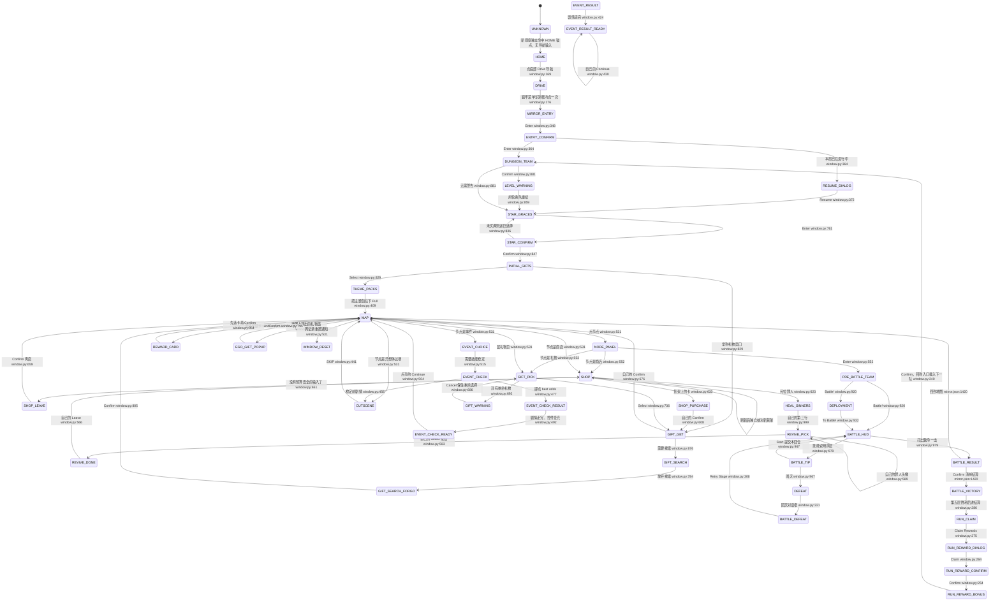
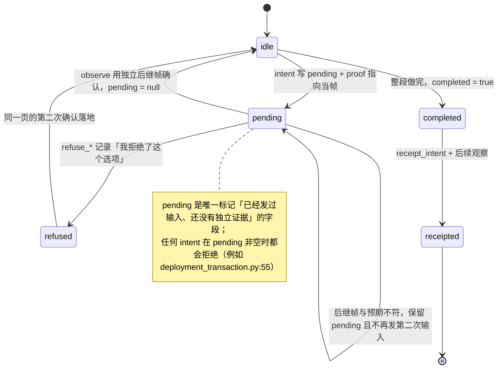
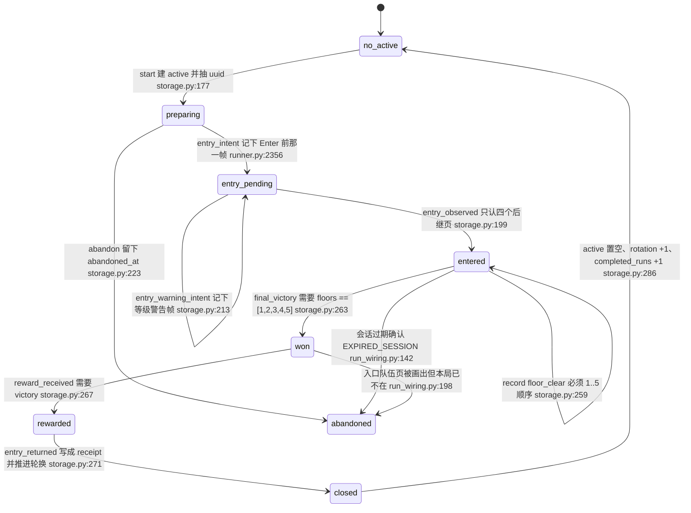
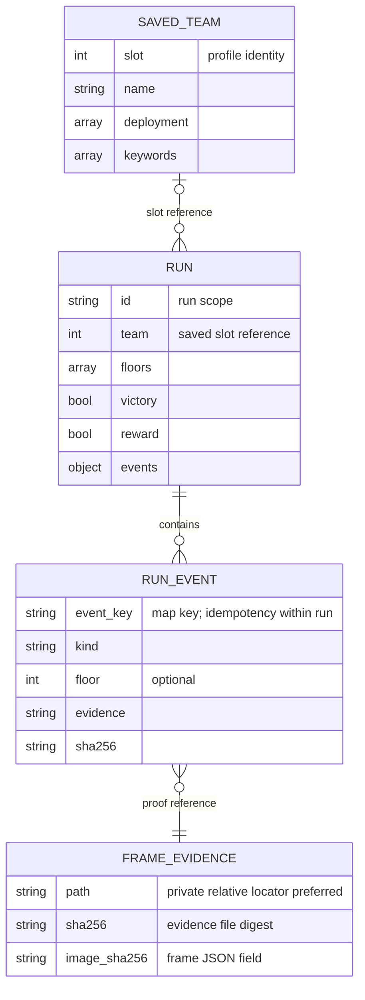
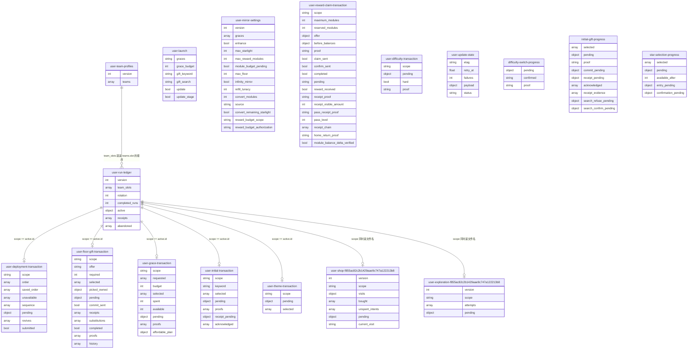
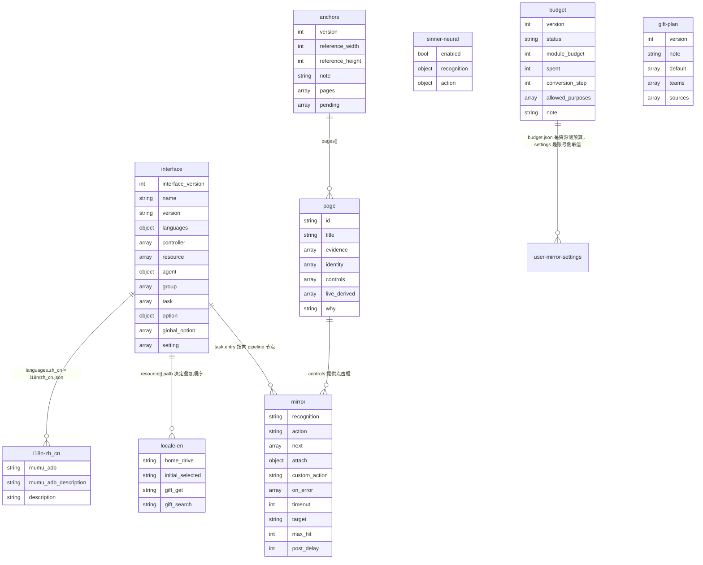

# 5 状态与数据

[English](../en_us/5-state-and-data.md) · [← 索引](index.md)
本章回答三个问题：**一帧画面到底是怎么被判定成一个「页面」的**、**一次不可回退的输入为什么必须先落盘再发**、**跑完一局之后是哪个字段决定下一局上哪支队**。

状态只落在两处：

- `config/*.json`（17 个文件）——可写的账号级与 run 级状态；
- `assets/`——只读的资源与锚点注册表（`assets/interface.json`、`assets/resource/base/anchors.json`、`assets/resource/base/pipeline/*.json`、`assets/resource/{en,jp}/locale.json`、`assets/i18n/*.json`）。

> 本章写出的每一个页面名、字段名、实体名都在对应文件里真实存在；`path:line` 指向本仓库当前工作树。凡是还没有独立证据的部分，一律标注「未验收」。

## 5.1 页面状态机

### 5.1.1 页面名从哪来

驱动里的 `page` 不是一个人工枚举，而是「一帧观测记录里的 `scene` 字段」经过逐级改名之后的名字。它有三层来源：

| 层 | 位置 | 产出 |
| --- | --- | --- |
| ① 全屏 OCR + 分类 | `agent/recognition.py:140` `LimbusRecognition.observe()` 取整屏 OCR，`agent/recognition.py:168` 调 `scene = classify(records, self.locale, size)`；`classify` 定义在 `src/maalimbus/vision.py:63` | 45 个页面常量，兜底 `UNKNOWN`（`src/maalimbus/vision.py:473`） |
| ② 局部复读与独立页探针 | `agent/recognition.py:169-201` 地图页头复读、`:202-209` 战斗 `TURN`、`:210-222` `HARD`；`UNKNOWN` 时再用独立控件把页面升为 `INITIAL_GIFTS`（`agent/recognition.py:223-224`）、`STAR_GRACES`（`:225-226`）、`DEPLOYMENT`（`:227-228`） | 修正后的 `scene` |
| ③ 观测事件落地 | `limbus_map_observe` → `agent/recognition.py:1130` `MapObservation` 写 `map_observed`（`agent/recognition.py:1146`）；战斗帧由 `limbus_battle_observe` 写 `battle_observed`（`agent/recognition.py:1184`） | 观战记录里的 `scene` 字段 |
| ④ 驱动侧改名 | `src/maalimbus/runner.py:838` `resolve_scene()`：`scene == 'UNKNOWN'` 且检定提示词读到 `commence` 时升为 `EVENT_CHECK`（`src/maalimbus/runner.py:846`）；随后交 `src/maalimbus/window.py:79` `resolve_overlay()` | 最终 `page` |

`resolve_overlay`（`src/maalimbus/window.py:79`）是唯一一处「**后判定的覆盖层压过先判定的页面**」：命中教学浮层时无论底下是什么页都返回 `TUTORIAL`（`src/maalimbus/window.py:88`）。

判定依据本身登记在锚点注册表 `assets/resource/base/anchors.json`：45 个页面（`pages`），3 个尚未定案的页面（`pending`：`identity_filter`、`reward_settle`、`run_end_entry_return`），reference 尺寸 1280×720，并由 `tools/verify_anchors.py` 用留档观测离线复检（`anchors.json` 的 `note` 字段原文说明了 roi 与 geometry 锚点的区别）。

两条容易踩的事实：

- **`BEFORE_ENTRY` 不是识别出来的页面。** `src/maalimbus/window.py:339` 把它和 `MIRROR_ENTRY` 放在同一个分支（`if page in ('MIRROR_ENTRY', 'BEFORE_ENTRY')`），`assets/resource/base/anchors.json` 里也有 `before_entry` 页面；但 `vision.classify` 的 50 个 `return` 常量里没有它，`agent/recognition.py` 也不会产出它。它是兼容用的同义分支。
- **`learning_dataset.py` 的 reviewed 标签不是运行时的页面名。** `src/maalimbus/learning_dataset.py:7` 的 `LABELS` 只有 11 个（`STAR_GRACES`、`THEME_PACKS`、`MAP`、`PRE_BATTLE_TEAM`、`BATTLE_HUD`、`GIFT_PICK`、`GIFT_GET`、`EVENT_CHOICE`、`SHOP`、`RUN_COMPLETE`、`UNKNOWN`），是给以后的学习型分类器准备的人工标签集，文件自己也写明「Explicit reviewed page label required; OCR scene is not ground truth」（`src/maalimbus/learning_dataset.py:29`）。它既不是运行时的页面全集，也不含 `RUN_COMPLETE` 之外的结算页。

### 5.1.2 页面状态图

状态名就是代码里的页面常量；箭头上的文字是「唯一被允许的输入」加上产它的那行代码。图内为了可读省略了 `src/maalimbus/` 前缀：`window.py:169` 即 `src/maalimbus/window.py:169`，`vision.py:473`、`storage.py:177`、`deployment_transaction.py:55`、`run_wiring.py:142` 同理；图外的正文一律写完整路径。

状态图的节点是持久的页面状态；边标签表示输入或独立后继观察。UNKNOWN 是识别状态，不表示自动回大厅。预算与完整后继未证明时保留 pending，不跳过事务。

读这张图的四个要点：

1. **`MAP` 是唯一枢纽。** 地图页只有一个被证明过的前向输入（`map_node_click_is_the_only_proven_forward_input`，`src/maalimbus/window.py:531`），所有楼层内页面都从它进出。
2. **`[*]` 不是开局时的真实状态。** 驱动是被外部任务在某一个不确定的页面上启动的，所以第一帧通常是 `UNKNOWN`，靠 `HOME`/`DRIVE` 回到已知位置。
3. **`RUN_REWARD_*` 只是输入回执，不是到账证据。** `RUN_REWARD_CONFIRM` 与 `RUN_REWARD_BONUS` 的 Confirm 在账本里刻意不记任何事件（`src/maalimbus/run_wiring.py:68-73`），真正的到账由独立回执事务证明（见 5.2）。
4. **箭头分两类，行号只保证第二类。** 只要该页的分支里有一次 `_plan(...)`，那行就是「唯一被允许的输入」，箭头本身也等于它的 `expect=(...)`；而 `MIRROR_ENTRY→ENTRY_CONFIRM`、`ENTRY_CONFIRM→RESUME_DIALOG`、`EVENT_CHOICE→EVENT_CHECK`、`EVENT_CHECK→EVENT_CHECK_RESULT`、`CUTSCENE→MAP`、`BATTLE_HUD→BATTLE_TIP` 这几条是实机跑出来的**页面顺序**，它们的目标不在那一行的 `expect` 里（计划只允许自身或更保守的后继，多出来的一跳会被记成 `unexpected_successor` 并重试一次）。`BATTLE_RESULT` 更彻底：`window.py:328` 在那一页只 `_refuse`，把结算推给 pipeline 的 `PostBattleObserve`（`assets/resource/base/pipeline/mirror.json:1420`，归属见 `docs/post-battle-ownership.md`）。

### 5.1.3 只有一种安全输入的页面

有些页面看起来有多个按钮，但其中一个会花掉不可逆的资源或接受驱动器没有选择的状态，于是这些页面被登记成「只观察」。`src/maalimbus/window.py:36` 的 `OBSERVE_ONLY` 就是这份名单：

| 页面 | 被禁掉的东西 | 为什么 |
| --- | --- | --- |
| `SHOP` | 任何购买输入 | 购买意图必须由 `shop_transaction` 先行落盘 |
| `EVENT_DIALOG` | 任何输入 | 事件对话框的选项不在本轮范围内 |
| `REWARD_SETTLE` | 任何输入 | 结算动画期间输入会被吞掉 |
| `FLOOR_GIFTS` | 任何输入 | 礼物选择页要由事务驱动（`gift_pick` 而不是整页点击） |
| `BATTLE_RESULT` | 任何输入 | 结果演出期输入会被吞掉（`src/maalimbus/window.py:328`） |
| `UNKNOWN` | 任何输入 | 未命名页面只有 `UNKNOWN_DIALOG` 的关闭控件一种安全输入 |

同一类「只有一个安全方向」的写法还有两处对照：`WINDOW_RESET` 只允许点 Cancel（`src/maalimbus/window.py:385`，周记录重置通知上的 Confirm 永远不点），`EXPIRED_SESSION` 只允许点 Confirm（`src/maalimbus/window.py:190`，会话过期只有领奖一条路）。

5.1 证据索引

- 页面常量全集：`src/maalimbus/vision.py:65-473`（50 个 `return`）。
- 页面判定补充：`agent/recognition.py:140-228`。
- 驱动侧改名与覆盖层：`src/maalimbus/runner.py:838`、`src/maalimbus/window.py:79-88`。
- 每个页面的输入与后继：`src/maalimbus/window.py:139-953`（`_plan_step`）。
- 锚点注册表：`assets/resource/base/anchors.json`；离线复检：`tools/verify_anchors.py`。

## 5.2 事务状态机

驱动里有 7 个 `*-transaction.json`。它们共享同一套形状：**先把「我准备做什么」写成 `pending` 并绑一帧证据，再发输入，再用独立的后继帧确认，确认之后才清 `pending`。** 这样即使进程在任意一步被杀掉，重启后读文件就知道自己停在哪一步，而不是靠记忆。

七个文件的真实字段与 `pending` 取值：

| 文件 | `pending` 的真实取值 | intent / 确认的位置 |
| --- | --- | --- |
| `config/user-floor-gift-transaction.json` | `{kind:'pick'}`, `{kind:'commit'}`, `{kind:'refuse_owned'}`, `{kind:'receipt'}` | `src/maalimbus/floor_gift_transaction.py:51`、`:103`、`:113`、`:148` |
| `config/user-grace-transaction.json` | `{card, cost, before, proof}` | `src/maalimbus/grace_transaction.py:109`，确认 `:113-117` |
| `config/user-initial-transaction.json` | `{row, title, before, capacity, proof}` | `src/maalimbus/initial_transaction.py:20`，确认 `:22-27` |
| `config/user-deployment-transaction.json` | `{kind:'card'\|'clear', before, capacity, card}` | `src/maalimbus/deployment_transaction.py:57`，确认 `:58-63`；另存 `saved_order` / `unavailable` 与复活收据 `revives`（`:69` 读、`:73` 记账） |
| `config/user-theme-transaction.json` | `{floor, name, proof}` | `src/maalimbus/theme_transaction.py:11`，确认 `:12-17`（确认时追加 `map_proof`） |
| `config/user-reward-claim-transaction.json` | 字符串 `'reserved'` → `'claim'` → `'confirm'`（不是 dict） | `src/maalimbus/reward_claim_transaction.py:66`、`:74` |
| `config/user-shop-<scope>.json` | `{kind:'purchase'\|'refresh', stage:'card_intent'\|'confirm_intent'\|'overlay_intent'\|'refresh_intent', ...}` | `src/maalimbus/shop_transaction.py:286`、`:313`、`:343`、`:383`；买成写 `bought`（`:458`）、刷新回执写 `refresh_receipts`（`:478`），标题比对走 `_same_title`（`:52`，混淆字表 `_CONFUSABLE` `:44`） |

三条从真实数据里读出来的形状差异，写代码或读账本时不能想当然：

1. **`pending` 不总是对象。** `user-reward-claim-transaction.json` 用字符串（`'reserved'` / `'claim'` / `'confirm'`），其余六个用 dict。当前文件里它的值是 `null`、并且 `completed=true`、`reward_received=true`（见下文实测值）。
2. **确认之后不一定回到 `idle`。** `floor_gift_transaction` 的 `commit` 在最终后继页上会直接把 `pending` 清成 `None` 并置 `completed=True`（`src/maalimbus/floor_gift_transaction.py:192`），而 `pick` 则回到 `idle` 等下一次选择（`:92-95`）。
3. **`receipt` 与「到账」是两件事。** `user-reward-claim-transaction.json` 里 `module_balance_delta_verified` 当前是 `false`：回执证明的是「我按了并且看到了回执」，不是「余额多了」。`docs/design.md:32-41` 的收据审计条目明确写了「never verifies an unseen balance delta」。

5.2 当前工作树上的实测值（用于对照）

- `config/user-floor-gift-transaction.json`：`offer="b7a36f8ff0f9…"`、`required=1`、`selected` 1 项、`commit_sent=true`、`completed=true`、`receipts` 1 项、`history` 22 项。
- `config/user-grace-transaction.json`：`requested` 3 项、`budget=100`、`selected` 3 项、`spent=60`、`available=0`、`pending=null`、`proofs` 4 项。
- `config/user-initial-transaction.json`：`keyword="charge"`、`selected` 2 项、`acknowledged` 2 项、`proofs` 3 项、`pending=null`。
- `config/user-deployment-transaction.json`：`scope="f855ac82c2b1429aae9c747a122213b8"`、`order` 12 项、`sequence` 0 项、`pending={kind:'card', before:0, capacity:11, card:6}`、`submitted=false`。
- `config/user-reward-claim-transaction.json`：`scope="d7c1499436f647208adc50860692a5c2"`、`maximum_modules=6`、`reserved_modules=6`、`pass_level=81`、`receipt_visible_amount=250`、`reward_received=true`、`module_balance_delta_verified=false`。

## 5.3 轮换账本状态机

`config/user-run-ledger.json` 是唯一记录「跑到哪一局、下一局用哪支队」的文件，实现在 `src/maalimbus/storage.py:126` 的 `RunStore`。它的核心规则是：**只有五个楼层、最终胜利、奖励到账、回到入口这四件事全部按顺序被证据证明过，轮换才前进一格。**

四个阶段字段（`active.phase`）与它们的写入者：

| `phase` | 谁写 | 前置条件 |
| --- | --- | --- |
| `preparing` | `RunStore.start()`（`src/maalimbus/storage.py:177`） | 没有 active 时才建 |
| `entry_pending` | `RunStore.entry_intent()`（`src/maalimbus/storage.py:186`），调用点 `src/maalimbus/runner.py:2356` | 必须先有 Enter 前那一帧的 sha256 |
| `entry_pending`（加警告） | `RunStore.entry_warning_intent()`（`src/maalimbus/storage.py:213`），调用点 `src/maalimbus/runner.py:2358` | 同一 phase 内只允许一次 |
| `entered` | `RunStore.entry_observed()`（`src/maalimbus/storage.py:199`），调用点 `src/maalimbus/runner.py:1464` | 后继页只能是 `STAR_GRACES` / `INITIAL_GIFTS` / `THEME_PACKS` / `MAP` 之一 |

推进（或回退）轮换的三条路径，都在 `src/maalimbus/run_wiring.py`：

- **正常收尾**：`entry_returned` 事件把 active 整个搬进 `receipts`（截断到最近 50 条）、`completed_runs += 1`、`rotation = (rotation + 1) % len(team_slots)`（`src/maalimbus/storage.py:283-287`）。
- **作废（`abandon`）**：会话过期确认后把 active 搬进 `abandoned`（同样截断到 50 条）并附 `abandoned_at`，**轮换不动**，同一支队下次再来（`src/maalimbus/run_wiring.py:129-153`）。
- **对账（`reconcile`）**：如果在账本还认为有局在跑时却看到了入口队伍页，说明游戏那边这局已经没了；此时若 `victory && reward` 已经成立，就补记一次 `entry_returned` 当作 receipt 而不是作废（`src/maalimbus/run_wiring.py:183-197`），否则作废（`:198-205`）。

**每周奖励（Weekly Bonus）只花在赚到它的那一局上。** 领奖可能问第二遍「要不要花每周奖励」，而每周奖励只有三个、每周重置、不结转，所以答案不能从画面读，只能从账本推：`run_wiring.earned_its_payout()`（`src/maalimbus/run_wiring.py:208-252`）比较最新 receipt 的 `settled_at` 与最新 `abandoned` 的 `abandoned_at`；两者缺一就返回 False，因为「不知道」不是花掉稀缺资源的理由（`:243-250`）。

`config/user-run-ledger.json` 当前实测：`team_slots=[5,4,1,6,2,7,3]`、`rotation=5`（指向 slot 7）、`completed_runs=2`、`active.team=7`、`active.floors=[1,2,3]`、`active.phase="entered"`、`active.events` 三个 `floor_clear`、`receipts` 2 条、`abandoned` 7 条。`team_slots` 的顺序与 `config/user-team-profiles.json` 的 `teams[].slot` 顺序一致（同一份 `[5,4,1,6,2,7,3]`），这不是巧合：`RunStore.__init__` 会用 `ProfileStore` 的 slot 顺序校验既有账本，不一致就拒绝启动（`src/maalimbus/storage.py:137-142`）。

轮换只能通过三个显式入口改动，手工编辑 `rotation` 是被排除在支持范围外的做法：

- `seed_run_store()`（`src/maalimbus/storage.py:96`）——只在文件不存在时写；`overwrite=True` 也仅在账本「什么都没记过」时允许；
- `RunStore.point_at()`（`src/maalimbus/storage.py:151`）——把轮换指向某支已存队伍，active 非空时拒绝；
- CLI：`tools/run_ledger.py:46`（seed）、`:54`（abandon）、`:64`（point_at）。

## 5.4 数据模型图

实体名＝文件名（去扩展名）；`user-shop-<scope>` 与 `user-exploration-<scope>` 里的 `<scope>` 就是当次 run 的 `active.id`，所以在磁盘上是一局一个文件（当前实例：`config/user-shop-f855ac82c2b1429aae9c747a122213b8.json`）。属性只列**当前文件里真实存在的键**。

**逻辑数据模型：** 下图表达保存队伍、一局、事件和证据的引用关系及基数；它不是数据库物理表，FK 没有数据库约束。历史局可能没有当前队伍档案，故档案端为可选。后面的文件属性图仅用于 JSON 文档字段盘点。

资源侧（只读）的真实结构：

资源侧两张图里有两个可缺省字段：`page.why`（45 个页面里 14 个有）与 `page.live_derived`（45 个里 3 个有）；`anchors.pages[]` 的完整键并集是 `id, title, evidence, identity, controls, live_derived, why`。`pipeline/*.json` 的实体属性是**节点字段的并集**：`mirror.json` 792 个节点的并集是 `recognition, action, custom_action, next, timeout, on_error, custom_recognition, custom_recognition_param, target, max_hit, post_delay, custom_action_param, key, attach`，`sinner-neural.json` 12 个节点则只有 `enabled, recognition, action`。

实体与文件、写入者的对应：

| 实体 | 文件 | 谁写 |
| --- | --- | --- |
| `user-run-ledger` | `config/user-run-ledger.json` | `RunStore`（`src/maalimbus/storage.py:126`）+ `run_wiring`（`src/maalimbus/run_wiring.py:81`） |
| `user-team-profiles` | `config/user-team-profiles.json` | `ProfileStore`（`src/maalimbus/storage.py`），上限 40 支、slot 必须唯一 |
| `user-launch` | `config/user-launch.json` | 用户/启动器 |
| `user-mirror-settings` | `config/user-mirror-settings.json` | 用户；`module_budget_pending` 与资源侧的 `budget.json.status` 一起构成「不许花钱」的约束 |
| `user-difficulty-transaction` | `config/user-difficulty-transaction.json` | 难度证据事务（`hard=true`，账号级） |
| `difficulty-switch-progress` / `initial-gift-progress` / `star-selection-progress` | `config/*.json` | 三个进度文件，记录账号级的既有选择与 `pending` 中断点 |
| `user-*-transaction` × 4 | `config/user-{deployment,floor-gift,grace,initial,theme}-transaction.json` | 见 5.2 表 |
| `user-reward-claim-transaction` | `config/user-reward-claim-transaction.json` | `src/maalimbus/reward_claim_transaction.py`；原生奖励任务也会直接写（`src/maalimbus/reward_task.py:47-48`） |
| `user-shop-*` / `user-exploration-*` | `config/user-shop-<scope>.json` 等 | 一局一个文件，文件名里的 `<scope>` 与 `scope` 字段同值 |
| `user-update-state` | `config/user-update-state.json` | 更新检查（ETag + `retry_at` 退避） |
| `interface` | `assets/interface.json` | 3.5 MB 的声明文件；`option` 有 711 个键（大量是 `global_team_N_*` 与 `mirror_queue_N` 这类按队伍展开的项） |
| `anchors` / `page` | `assets/resource/base/anchors.json` | 45 个页面 + 3 个 pending；离线校验 `tools/verify_anchors.py` |
| `mirror` / `sinner-neural` | `assets/resource/base/pipeline/*.json` | `mirror.json` 792 个节点，字段最多的三个是 `recognition` / `action` / `next`（各 792），另有 `custom_action` 74 个、`on_error` 103 个 |
| `locale-en` | `assets/resource/en/locale.json` | 87 个键；JP 版 24 个键。**`assets/resource/base/locale.json` 不存在**（见下） |
| `i18n-*` | `assets/i18n/{zh_cn,en_us,ja_jp}.json` | 各 161 个键，是 ProjectInterface 的界面文案 |
| `budget` | `assets/resource/base/budget.json` | `status="pending"`、`module_budget=0`、`allowed_purposes=["enkephalin_refill","module_conversion"]`、`note` 明确要求「pending 或 0 时每个请求都带理由拒绝，而不是点什么」 |
| `gift-plan` | `assets/resource/base/gift-plan.json` | 按队伍给初始礼物优先名单（`default` + `teams` + `sources`），`note` 原文声明「不是普适最优攻略」 |

### 5.4.1 用户设置的字段语义

本章只讲**状态文件的结构**，不讲用户可改的设置项语义。设置项分两份文档：总设置与各任务选项在 `docs/task-settings.md`（210 行），镜牢商店策略在 `docs/shop-settings.md`（169 行）。它们与本章的衔接点是：设置先落进 `config/user-mirror-settings.json` 这类用户态文件（见上表），运行期再由 `assets/interface.json` 的 `option` 传给任务。

### 与共享契约的冲突

- **`assets/resource/base/locale.json` 不存在。** 共享事实契约把 `resource/{base,en,jp}/locale.json` 列成资源层的一部分；实际目录里只有 `assets/resource/en/locale.json`（87 键）与 `assets/resource/jp/locale.json`（24 键），`base/` 下没有 `locale.json`。`agent/recognition.py:103` 也是按 `assets/resource/{locale}/locale.json` 读的，即语言包必须自带，没有 base 兜底。
- **`assets/resource/base/` 的文件远多于契约里列的四个。** 除 `anchors.json` 与 `pipeline/` 外，还有 `battle-catalog.json`、`budget.json`、`gift-catalog.json`、`gift-observed-catalog.json`、`gift-plan.json`、`identity-catalog.json`、`identity-index.json`、`theme-catalog.json` 以及 `wiki-identity-*.json`、`image/` 目录等。本章只把这些当作「资源侧的只读输入」，没有逐一展开。
- **仓库 `docs/` 目前有 31 个扁平 `.md`。** 其中与状态直接相关的是 `docs/design.md:298-302`（设计级的流程串：home → Drive → Mirror Dungeon → … → 下一局）与 `docs/design.md:32-41`（收据审计不验证未见过的余额变化）。本章的页面状态机比这两处更细，但方向一致。

### 未验收 / 存疑

- `assets/resource/base/pipeline/*.json` 的节点级语义（`recognition`/`action` 的取值域、`on_error` 的实际效果）本章没有逐个核实，只核实了字段名与计数。
- `assets/resource/base/` 下的 `wiki-identity-*.json` 与 `learning_dataset.py` 的 11 个标签集之间的关系未核实。
- `user-exploration-<scope>.json` 的 `attempts[]` 内部字段（`candidate` / `before` / `successor` / `reviewed`）本章只确认了键存在，没有展开其判定规则。

本章实际打开读过的文件

`AGENTS.md`、`PROJECT.md`（约定）、`docs/design.md`、`config/` 全部 17 个 JSON、`assets/interface.json`、`assets/resource/base/anchors.json`、`assets/resource/base/pipeline/mirror.json`、`assets/resource/base/pipeline/sinner-neural.json`、`assets/resource/{en,jp}/locale.json`、`assets/resource/base/budget.json`、`assets/resource/base/gift-plan.json`、`assets/i18n/{zh_cn,en_us,ja_jp}.json`、`src/maalimbus/vision.py`、`src/maalimbus/window.py`、`src/maalimbus/runner.py`、`src/maalimbus/storage.py`、`src/maalimbus/run_wiring.py`、`src/maalimbus/learning_dataset.py`、`src/maalimbus/floor_gift_transaction.py`、`src/maalimbus/grace_transaction.py`、`src/maalimbus/initial_transaction.py`、`src/maalimbus/deployment_transaction.py`、`src/maalimbus/theme_transaction.py`、`src/maalimbus/reward_claim_transaction.py`、`src/maalimbus/shop_transaction.py`、`src/maalimbus/reward_task.py`、`src/maalimbus/shop_outcomes.py`、`agent/recognition.py`、`tools/run_ledger.py`。

