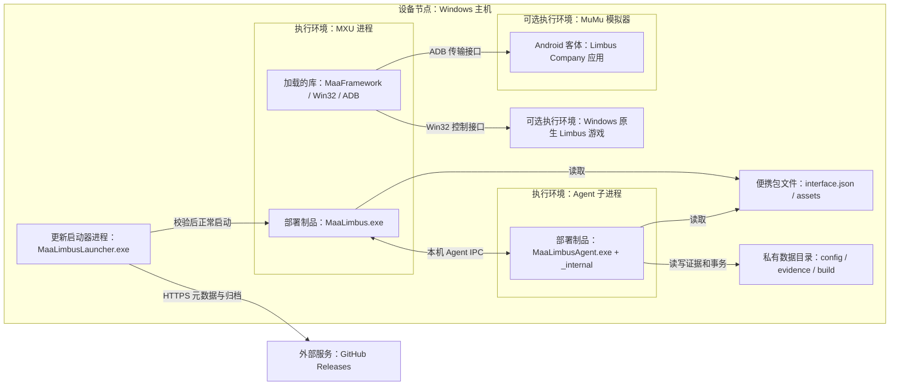
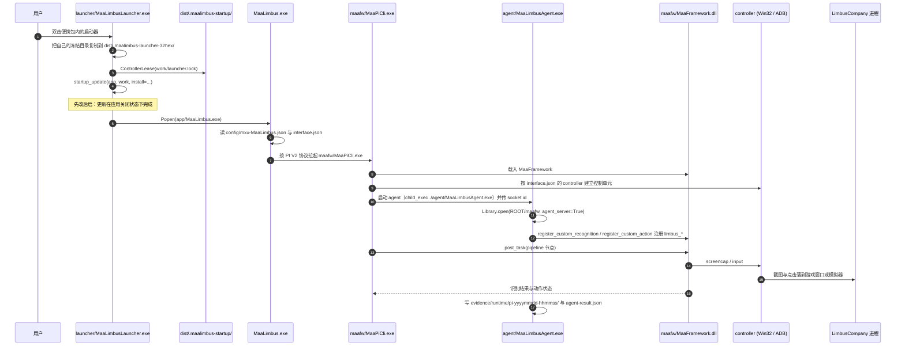
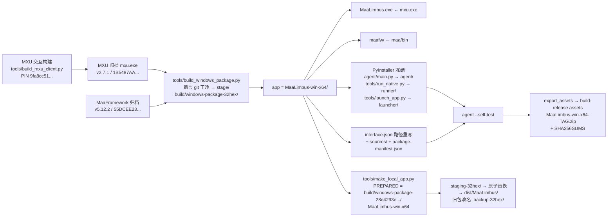
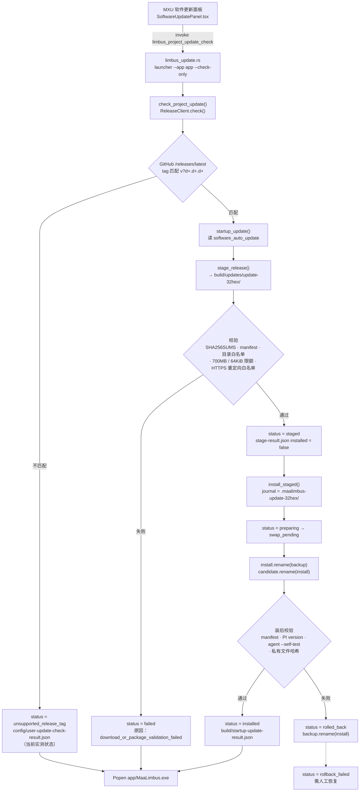

# 6 部署与运维

[English](../en_us/6-deployment.md) · [← 索引](index.md)

> 本章口径：MaaLimbus 是**便携包（portable package）**形态的 Windows 应用——没有安装器、没有注册表写入、没有服务。
> 「部署」在这里等于「把一个目录放到磁盘上」，「运维」等于「启动、检查更新、升级、回滚、读证据」。
>
> 本章的每条技术断言都绑定一个可核验锚点：**源码/脚本行号**、**实测文件清单与字节数**、或**仓库内保留的验证产物路径**。
> 凡是没有被上述三类锚点支撑的说法，一律进入 6.5「未验收 / 待核实清单」，不写成结论。

## 6.1 便携包布局与部署图

### 6.1.1 顶层布局（`dist/MaaLimbus/`，实测）

> 测量时刻：2026-10-13T00:35Z 之后。便携包可被 `tools/make_local_app.py` 随时重建——本会话期间它就被重建过一次，`dist/` 里因此多出一个 `MaaLimbus.backup-*`。所以字节数与计数会随重建变化，**路径与结构不会**。

| 项 | 类型 | 规模 | 说明 |
| --- | --- | --- | --- |
| `MaaLimbus.exe` | 文件 | 31,158,272 B | MXU 客户端（Tauri 打包的 ProjectInterface V2 前端） |
| `interface.json` | 文件 | 3,732,723 B | ProjectInterface V2 项目定义，全局默认入口 |
| `LICENSE` | 文件 | 35,184 B | GPL-3.0 全文 |
| `README.md` / `README_en.md` | 文件 | 8,297 / 7,859 B | 包内欢迎页，被 `interface.json` 的 `welcome` 指向 |
| `build-info.json` | 文件 | 933 B | 本次装配的元数据与自检结果 |
| `agent/` | 目录 | `MaaLimbusAgent.exe` 5,880,171 B + `_internal/` | PyInstaller 冻结的 Python Agent |
| `launcher/` | 目录 | `MaaLimbusLauncher.exe` 2,012,660 B + `_internal/` | 包外更新启动器 |
| `maafw/` | 目录 | 19 个文件 + 2 个子目录 | MaaFramework 原生运行时 |
| `assets/` | 目录 | `resource/`、`i18n/`、`misc/` | 全部识别资源与翻译 |
| `docs/` | 目录 | 31 个扁平文件 + `agents/`、`wiki/` 子目录（递归 45 个文件） | 用户向文档 |
| `config/`、`evidence/`、`build/` | 目录 | 运行期生成 | 私有运行数据，**不由构建写入** |
| `THIRD_PARTY_NOTICES/` | 目录 | 6 份许可证 + README | 第三方许可归属 |

实测中不存在的项（不要在本页或其它页假设它们存在）：

- `runner/MaaLimbusRunner.exe` —— **只存在于发布包**。发布装配会冻结 `tools/run_native.py`（`tools/build_windows_package.py:149`），而本地开发装配不会（grep `MaaLimbusRunner` 只命中 `tools/build_windows_package.py`、`tools/make_local_app.py`、`src/maalimbus/update_install.py:70`）。当前 `dist/MaaLimbus/` 里没有 `runner/`。
- `sources/` —— 发布装配会写入源码归档、本地开发装配只有 `--mxu-proof` 才会写（`tools/make_local_app.py:163-166`）。当前包里 `Test-Path dist/MaaLimbus/sources` 为 `False`。
- `package-manifest.json` —— `Test-Path` 为 `False`。发布装配会生成它（`tools/build_windows_package.py:195-197`），本地开发装配不生成。

### 6.1.2 部署图



### 6.1.3 每个顶层项由谁装配

| 顶层项 | 发布包来源 | 本地开发包来源 |
| --- | --- | --- |
| `MaaLimbus.exe` | `tools/build_windows_package.py:138`（复制 MXU 归档的 `mxu.exe`） | `tools/make_local_app.py:162`（同上） |
| `maafw/` | `tools/build_windows_package.py:139`（从 `stage/maa/bin`） | `tools/make_local_app.py:167`（从构建时的 `--maafw`） |
| `agent/` | `tools/build_windows_package.py:148`（PyInstaller 冻结 `agent/main.py` → 文件基名 `MaaLimbusAgent`） | `tools/make_local_app.py:195`（同一套冻结逻辑） |
| `runner/` | `tools/build_windows_package.py:149`（冻结 `tools/run_native.py` → `MaaLimbusRunner`） | 不生成 |
| `launcher/` | `tools/build_windows_package.py:151`（冻结 `tools/launch_app.py` → `MaaLimbusLauncher`） | `tools/make_local_app.py:197`（同上） |
| `interface.json` | `tools/build_windows_package.py:152-160` 重写；重写规则见 `tools/make_local_app.py:71-82` 的 `packaged_interface()` | `tools/make_local_app.py:188-189` |
| `assets/`、`docs/`、`THIRD_PARTY_NOTICES/` | 从仓库根 copytree | `tools/make_local_app.py:184-185` |
| `README.md`、`README_en.md`、`LICENSE` | `tools/make_local_app.py:186-187` 同源复制 | 同左 |
| `config/`、`evidence/`、`build/` | **不由构建写入**，运行期生成 | 同左 |

`packaged_interface()` 做的路径重写是部署正确性的关键（`tools/make_local_app.py:71-82`）：

- `agent.child_exec` → `./agent/MaaLimbusAgent.exe`
- `license` → `./LICENSE`
- `icon` → `assets/` 下的图标
- `welcome` → `./README.md`
- `languages` → `assets/` 下的语言文件
- `resource` 的每一项路径：`./resource/xxx` → `./assets/resource/xxx`

发布装配还会写入 `sources/`（`tools/build_windows_package.py:161-167`，内含 `MXU-v2.7.1-source.zip`、`MaaFramework-v5.12.2-source.zip`、`MaaLimbus-source.zip`）以及 `package-manifest.json`（`tools/build_windows_package.py:195-197`）。

### 6.1.4 便携包之外的 `dist/` 目录族

`dist/` 不只是「一个应用目录」，它同时是**运行期工作区**。实测计数：

| 目录族 | 实测数量 | 由谁创建 |
| --- | --- | --- |
| `MaaLimbus.backup-<32hex>` | 37 | `tools/make_local_app.py:102`（`backup=out.parent/(out.name+'.backup-'+uuid.uuid4().hex)`，替换式装配时把旧包改名保留） |
| `MaaLimbus.staging-<32hex>` | 1 | `tools/make_local_app.py:159` |
| `.maalimbus-launcher-<32hex>` | 5 | `tools/launch_app.py:37`（启动器把自己的冻结目录复制到应用旁再运行） |
| `.maalimbus-startup/` | 1，内含 `launcher.lock` | `tools/launch_app.py:60-61`（`work = app.parent/'.maalimbus-startup'`；`ControllerLease(work/'launcher.lock')`） |
| `private-state-before-binding-<hex>` | 1 | `tools/bind_local_state.py:32` |
| `.maalimbus-update-<32hex>` | **0** | `src/maalimbus/update_install.py` 的安装日志目录；正常完成后被清理 |

运维含义：`dist/` 会随每次装配与每次启动单调增长。这些目录都是可重建的缓存，但 `MaaLimbus.backup-*` 是回滚的唯一凭据——不要在升级后立刻清理它们（见 6.4）。

## 6.2 MXU / MaaFramework / Agent 三方关系

MaaLimbus 不是单体程序，而是**三个进程 + 一个原生库**的拼装：

### 6.2.1 三个进程

| 进程 | 可执行文件 | 角色 |
| --- | --- | --- |
| MXU 客户端 | `MaaLimbus.exe` | 用户界面。读 `interface.json`，渲染任务面板与选项，向 PI V2 运行时下发任务 |
| PI V2 运行时 | `maafw/MaaPiCli.exe` | 由 MXU 拉起。按 `interface.json` 里的 `controller` / `resource` / `task` 定义建立控制器、加载资源、执行 pipeline |
| Python Agent | `agent/MaaLimbusAgent.exe` | 自定义识别与自定义动作的执行端。注册全部 `limbus_*` 节点，处理游戏特有的场景识别与业务动作 |
| （原生库） | `maafw/MaaFramework.dll` 等 | 上面三者共同依赖的原生实现 |

### 6.2.2 契约：`interface.json` 是三者之间唯一的接口

`assets/interface.json` 的关键锚点：

| 锚点 | 内容 |
| --- | --- |
| `assets/interface.json:2-5` | `interface_version: 2`、`name: MaaLimbus`、`version: v0.1.2` |
| `assets/interface.json:9-13` | `languages`: `zh_cn` / `en_us` / `ja_jp` |
| `assets/interface.json:14` | `controller` 数组，见下表 |
| `assets/interface.json:69-86` | `resource`：`en` → `./resource/base` + `./resource/en`；`jp` → `./resource/base` |
| `assets/interface.json:87-92` | `agent`：`child_exec: python`、`child_args: [../agent/main.py]`（源码形态） |
| `assets/interface.json:93-102` | `group`：`mirror`、`daily` |
| `assets/interface.json:103-170` | `task`：`open_game` / `mirror_loop` / `experience` / `thread` / `rewards` / `stamina` |
| `dist/MaaLimbus/interface.json:87-92` | 打包形态：`child_exec: ./agent/MaaLimbusAgent.exe` |
| `dist/MaaLimbus/interface.json:146785` | `icon: assets/misc/Don-Quixote.png` |
| `dist/MaaLimbus/interface.json:146786` | `welcome: ./README.md` |

四种控制器与它们的落点：

| `controller` 名 | `interface.json` 锚点 | 控制方式 | 代码路径 |
| --- | --- | --- | --- |
| `windows-window` | `:16` | Win32；窗口类正则 `^UnityWndClass$`、窗口标题正则 `^LimbusCompany$`；截图 `Background`、鼠标 `SendMessageWithCursorPos`、键盘 `PostMessage` | `src/maalimbus/windows_controller.py:9-22`（`controller_profile()` 过滤 `type == 'Win32'`，`native_methods()` 映射 `MaaWin32ScreencapMethodEnum` / `MaaWin32InputMethodEnum`） |
| `windows-background` | `:31` | Win32；鼠标 `SendMessageWithWindowPos` | 同上 |
| `windows` | `:46` | Win32；截图 `ScreenDC`、鼠标/键盘 `Seize`（独占前台） | 同上 |
| `mumu-adb` | `:61` | `type: Adb` | `src/maalimbus/adb_device.py`：`discover()` 走 `Toolkit.find_adb_devices`（`:28`）、`build()` 构造 `AdbController`（`:97-103`） |

`mumu-adb` 的输入方式有一个**已在实机验证过的陷阱**：`src/maalimbus/adb_device.py:21` 定义 `INPUT_NAMES`（`1 AdbShell` / `2 MinitouchAndAdbKey` / `4 Maatouch` / `8 EmulatorExtras`），`:22-23` 定义 `SCREENCAP_NAMES`（`64 EmulatorExtras` 等），`:5-6` 记录输入优先级 `EmulatorExtras > Maatouch > MinitouchAndAdbKey > AdbShell`。当不需要截图加速时，`input_policy()`（`:46-63`）会退回到 `adb shell input tap`，而**这条路游戏不认**——2026-10-12 的 `maafw.log` 里 `AdbShellInput::click x=125 y=527` 与 `Controller.Action.Succeeded` 同时出现，但 `DUNGEON_TEAM` 槽位纹丝不动。因此 `tools/make_local_app.py:44-68` 的 `agent_binaries()` 会**强制校验** `maatouch/universal/maatouch` 存在，缺了就报错而不是静默降级（`:183` 把它复制到包的 `maafw/MaaAgentBinary`）。

### 6.2.3 `maafw/` 里有什么（实测字节数）

| 文件 | 字节 | 用途 |
| --- | --- | --- |
| `MaaFramework.dll` | 2,536,448 | 核心库 |
| `MaaPiCli.exe` | 958,464 | ProjectInterface V2 命令行运行时 |
| `MaaWin32ControlUnit.dll` | 670,720 | Win32 控制单元实现 |
| `MaaAdbControlUnit.dll` | 787,456 | ADB 控制单元实现 |
| `MaaToolkit.dll` | 540,160 | 设备发现等工具能力（`Toolkit.find_adb_devices` 落点） |
| `MaaUtils.dll` | 632,832 | 公共工具 |
| `MaaAgentClient.dll` / `MaaAgentServer.dll` | 1,227,264 / 1,388,032 | Agent 客户端/服务端 |
| `MaaNode.node` / `MaaNodeServer.node` | 1,018,880 / 987,648 | Node 绑定 |
| `MaaCustomControlUnit.dll` | 315,392 | 自定义控制单元基座 |
| `MaaGamepadControlUnit.dll` | 350,208 | 手柄控制单元 |
| `MaaRecordControlUnit.dll` / `MaaReplayControlUnit.dll` | 341,504 / 402,432 | 录制/回放控制单元 |
| `onnxruntime_maa.dll` | 19,182,080 | 推理运行时 |
| `opencv_world4_maa.dll` | 13,774,336 | 图像处理 |
| `DirectML.dll` | 18,527,776 | GPU 推理后端 |
| `fastdeploy_ppocr_maa.dll` | 1,138,688 | OCR |
| `ViGEmClient.dll` | 130,048 | 虚拟手柄驱动客户端 |
| `plugins/MaaPluginDemo.dll` | 9,728 | 插件示例 |
| `MaaAgentBinary/` | 92 个文件 | 安卓端 agent 二进制：`maatouch/universal/maatouch`、`minicap/<abi>/`（arm64-v8a、armeabi-v7a、x86、x86_64，覆盖 android-9..31）、`minitouch/<abi>/minitouch`、`LICENSE`、`README.md` |

部署含义：`maafw/` 是**单个 60 MB 级的整体**，它的完整性靠包级校验而不是单文件校验。发布包在 `update_stage.py` 里通过 `package-manifest.json` 校验（见 6.4.2）。

### 6.2.4 启动顺序



## 6.3 构建与打包

### 6.3.1 两条流水线

仓库里有**两条互不相通**的装配流水线，产物同名但内容不同：

| 流水线 | 脚本 | 产物落点 | 定位 |
| --- | --- | --- | --- |
| 发布包 | `tools/build_windows_package.py` | `build/windows-package-<32hex>/MaaLimbus-win-x64/` | 对外分发。带 `runner/`、`sources/`、`package-manifest.json`，并导出 release assets |
| 本地开发包 | `tools/make_local_app.py` | `dist/MaaLimbus/`（经 `.staging-*` + `.backup-*` 原子替换） | 本机开发与实机验证。不带 `runner/` 与 `sources/` |

判据锚点：`tools/make_local_app.py:35-36` 硬编码 `MXU_SHA256 = '1B5487AA2442062A489E20134A82F946f76F57E733A8D8D284C3C76AAF8053E5'` 与 `PREPARED = ROOT/'build/windows-package-28e4293e95e847dcb6f335d2b824cc7a/MaaLimbus-win-x64'`——说明本地开发装配**消费**发布装配的中间态，因此两者不是独立实现，而是同一条链的两段。

### 6.3.2 发布包：`tools/build_windows_package.py`

固定版本与哈希（`:21-30` 的 `ARCHIVES`）：MXU v2.7.1、MaaFramework v5.12.2。`:118` 会先断言 git 工作树干净，`:128` 建 `build/windows-package-<uuid4().hex>` 作为 stage。

装配步骤：

1. `:136` `app = stage/'MaaLimbus-win-x64'`
2. `:138` `MaaLimbus.exe` ← MXU 归档的 `mxu.exe`
3. `:139` `maafw/` ← `stage/maa/bin`
4. `:148-151` 冻结三个 Python 入口：`agent/main.py` → `MaaLimbusAgent`、`tools/run_native.py` → `MaaLimbusRunner`、`tools/launch_app.py` → `MaaLimbusLauncher`
5. `:152-160` 重写 `interface.json`
6. `:161-167` 写入 `sources/`（三个源码归档）
7. `:168-174` 跑 `agent --self-test`
8. `:178-194` 写 `build-info.json`
9. `:195-197` 写 `package-manifest.json`
10. `:199-201` `export_assets` → `build/windows-package-latest.json`（实测存在）

`build-info.json` 的实际字段（以当前 `dist/MaaLimbus/build-info.json` 为样本）：

```json
{
  "project": "MaaLimbus",
  "development_only": true,
  "packaged_app": false,
  "source_commit": "5e9dfc5528494550eca7ff01c9eea26f706aaf02",
  "source_dirty": true,
  "built_at": "2026-10-13T00:35:23.259095+00:00",
  "mxu_sha256": "1b5487aa2442062a489e20134a82f946f76f57e733a8d8d284c3c76aaf8053e5",
  "mxu_modified": false,
  "mxu_source_sha256": null,
  "pending": ["MXU UI validation", "live input postcondition", "full five-floor loop"],
  "self_test": {
    "passed": true,
    "application_root": "D:\\fgoa\\MaaLimbus\\dist\\MaaLimbus.staging-87ecfbf73a0c41b78282157772835029",
    "runner_root": "D:\\fgoa\\MaaLimbus\\dist\\MaaLimbus.staging-87ecfbf73a0c41b78282157772835029",
    "private_state_directory": "D:\\fgoa\\MaaLimbus\\dist\\MaaLimbus.staging-87ecfbf73a0c41b78282157772835029\\config",
    "device_controller": false,
    "locales": ["en", "jp"]
  }
}
```

两个必须注意的字段：

- `development_only: true` 与 `packaged_app: false` —— 当前包是**开发用包**，不是对外发布产物。
- `self_test.application_root` 指向 `MaaLimbus.staging-87ecfbf73a0c41b78282157772835029`，而这个 staging 目录**在 `dist/` 里已经不存在**（现存的是 `MaaLimbus.staging-1619589fdb01498a8ad5905319306fb0`，来自另一次装配）。也就是说 `build-info.json` 记录的是装配时刻的路径，包在原子替换后必然陈旧，而且它记下的那个 staging 目录与磁盘上现存的那个**永远不是同一个**。任何依赖 `application_root` 做判断的逻辑都必须容忍这一点。

### 6.3.3 本地开发包：`tools/make_local_app.py`

关键行为：

- `:159` 先建 `MaaLimbus.staging-<uuid4hex>`，全部装配在 staging 里做完
- `:102` 替换时把旧包改名为 `MaaLimbus.backup-<uuid4hex>`（这就是 `dist/` 里 36 个 backup 的来源）
- `:216` `replace_local_app(staged, out)` 原子替换
- `:199-215` 写 `build-info.json`（schema 与发布包一致）
- `:44-68` `agent_binaries()` 强制校验 `maatouch/universal/maatouch`；`:183` 复制到包的 `maafw/MaaAgentBinary`

### 6.3.4 MXU 客户端构建

`tools/build_mxu_client.py`（77 行）：

- `PIN = '9fa8cc51e8ff8cd89d99f3ea55fe3a7a82e6ede3'`
- `pnpm install --frozen-lockfile` → `pnpm tauri build --no-bundle`
- 产物：`build/mxu-interactive-artifact/mxu.exe`、`MXU-MaaLimbus-source.zip`、`build-proof.json`

其中 `build-proof.json` 的 `ui_verified` 为 `false` —— **构建脚本不验证 UI**。这与 `dist/MaaLimbus/build-info.json` 的 `pending` 里 `MXU UI validation` 一致，是同一件未完成事项在两处的记录。

配套：`tools/patch_mxu_client.py` 对 MXU 源码打补丁；`docs/windows-package.md`（83 行）记录固定哈希与构建命令：

```
python tools/build_windows_package.py --mxu <MXU归档.zip> --maa <Maa归档.zip> \
    --mxu-source <...> --maa-source <...>
```

固定值：MXU `825A62AF...`（v2.7.1）、Maa `55DCEE23...`（v5.12.2）、MXU source `B350877C...`（commit `9fa8cc51e8ff8cd89d99f3ea55fe3a7a82e6ede3`）、Maa source `0013BAAA...`（commit `f625a60edec...`）。

### 6.3.5 流水线图



## 6.4 更新与回滚

### 6.4.1 参与的代码与文件

| 环节 | 落点 |
| --- | --- |
| UI 入口 | `desktop/mxu/SoftwareUpdatePanel.tsx`：`invoke('limbus_project_update_check')`；选项 `optionKey="software_auto_update"`（`globalScope`）；界面提示「启用自动更新后…检查不会立即替换软件」 |
| Tauri 命令 | `desktop/mxu/limbus_update.rs`：`#[tauri::command] pub async fn limbus_project_update_check() -> Result<serde_json::Value, String>`，解析 `current_exe` 的父目录为 app，调 `app/launcher/MaaLimbusLauncher.exe --app <app> --check-only`，`creation_flags 0x08000000`（CREATE_NO_WINDOW），读回 `config/user-update-check-result.json` |
| 启动器 | `tools/launch_app.py`：`:37` 自我复制到 `.maalimbus-launcher-<hex>`；`:60-61` `work = app.parent/'.maalimbus-startup'` + `ControllerLease(work/'launcher.lock')`；`:67` `startup_update(app, work, install=installer)`；`:72` `Popen(app/'MaaLimbus.exe')` |
| 更新判定 | `src/maalimbus/startup_update.py`：`:28` `check_project_update()` 写 `config/user-update-check-result.json`；`:32-44` `update_enabled()` 读 `config/mxu-MaaLimbus.json` 的 `globalOptionValues.software_auto_update`（默认 `True`）；`:47-82` `startup_update()`，`:60` 版本正则 `v?\d+\.\d+\.\d+`，`:81` 写 `build/startup-update-result.json` |
| 远端查询 | `src/maalimbus/releases.py`：GitHub `releases/latest`，2 MiB 上限，ETag `If-None-Match`，`User-Agent: MaaLimbus/0.1.0` |
| 暂存 | `src/maalimbus/update_stage.py`（204 行） |
| 安装 | `src/maalimbus/update_install.py`（176 行） |
| 路径解析 | `src/maalimbus/runtime_paths.py`：`:8-16` `application_root()`（冻结态取 `exe.parents[1]`）；`:23-40` `data_directory()` 读 `config/user-data-root.json`（拒绝符号链接/junction/链式）；`:43-51` `ledger_path()` |
| 单实例锁 | `src/maalimbus/controller_lease.py`：`:12-14` `controller.lock` → `%LOCALAPPDATA%/MaaLimbus/controller.lock`；`msvcrt.locking` `LK_NBLCK` |
| 命令行入口 | `tools/check_update.py`（`:18` `--check`；`:26` `--stage` → `stage_release(...)` 到 `build/updates`）、`tools/install_update.py`（`:17` `install_staged(args.stage, args.install, ROOT/'build/controller.lock')`） |

### 6.4.2 状态流转



`update_stage.py` 的校验规则（`select_assets`，`:27-41`）：

- 只接受**已发布的稳定版本**，tag 必须匹配 `v?\d+\.\d+\.\d+`（`:27`）
- app 压缩包必须**恰好一个**：`MaaLimbus-win-x64.zip` 或 `MaaLimbus-win-x64-<tag>.zip`（`:32-35`）
- 校验文件必须**恰好一个**：`SHA256SUMS` 或 `<zip>.sha256`（`:37-40`）
- 限额：压缩包 ≤ 700,000,000 B、校验文件 ≤ 65,536 B（`:41`）
- HTTPS 重定向白名单：`github.com`、`release-assets.githubusercontent.com`、`objects.githubusercontent.com`（`:58-60`）

`verify_package`（`:125-134`）要求 manifest 至少含这六个键：`MaaLimbus.exe`、`interface.json`、`LICENSE`、`build-info.json`、`agent/MaaLimbusAgent.exe`、`runner/MaaLimbusRunner.exe`；并且**拒绝**首段路径为 `config` / `evidence` / `build` / `logs` 的条目（`:134`）——即包不许夹带私有运行数据。

`update_install.py` 的关键约束：

- `PRIVATE = ('config', 'evidence', 'logs', 'build')`（`:14`）——这四个目录在换包时按私有数据处理，不参与替换
- `metadata()`（`:32-42`）校验 `interface.json` 的 `name == MaaLimbus`、`interface_version == 2`、版本号正则、GitHub URL
- `closed_app()`（`:49-73`）用 PowerShell `Get-CimInstance Win32_Process` 检查 `maalimbus.exe` / `maalimbusagent.exe` / `maalimbusrunner.exe` 是否仍在运行，并排除 `external_launcher_pid`（`:64`）
- `self_test()`（`:76-85`）跑 `agent --self-test`
- `install_staged()`（`:94-176`）：journal = `install.parent/('.maalimbus-update-'+uuid4hex)`（`:124`），`candidate/` 与 `backup/`（`:126`）；拒绝降级（`:115-116`）；存在未了结的历史 journal 时拒绝启动（`:117-122`）
- 状态机：`preparing` / `swap_pending` / `installed` / `failed` / `rolled_back` / `rollback_failed`

### 6.4.3 实测证据

仓库内保留了两份**离线验证产物**，它们是本章「更新链路可用」这一断言的全部依据：

**暂存验证**（`build/update-stage-verification.json`，由 `tools/verify_update_stage.py` 产出，1005 B）：

- `scope: "retained development ZIP and derived stable release metadata; offline transport"`、`network_requested: false` —— 这是一次**离线重放**，全程没有访问网络。
- 结果块：`status: staged`、`version: v0.1.2`、`installed: false`、`executed: false`、`created_at: 2026-10-10T03:34:38.127635+00:00`
- 暂存目录：`build/update-replay/update-519b040d520d422e9497633b834d878b/`
- 包指纹：`files: 827`、`sha256: 9b968cb94eaf119a5903571f99dfd49ad7c17679a66aa72f621a3a597aaf1c11`
- 来源包提交：`source_package_commit: c12960bfb6e52d0b22903e905a8541949396cea7`
- 该次**未覆盖**的三项：`pending: ["installed process exit", "backup and rollback installation", "installed version/configuration verification"]`
- `public_release_verified: false`、`verified_clear: false`

**安装验证**（`build/update-install-verification.json`，由 `tools/verify_update_install.py` 产出，1646 B）：

- `scope: "isolated retained development package; real filesystem swap and Agent self-test"`、`network_requested: false`
- 基线：`baseline_application: D:\fgoa\MaaLimbus\dist\MaaLimbus`，`version_before: v0.1.1` → `version_after: v0.1.2`
- 正常路径：`install.status: installed`、`rolled_back: false`、`verification.agent_self_test: true`、`private_files: 1`；备份落在 `build/update-install-verification-87058ed37d204bb1b10e4091972201c9/.maalimbus-update-099b3a0b49584997b4ce0c0d13b583ae/backup`
- 故障注入路径：把故障注入到「安装后校验」，得到 `rollback.status: rolled_back`、`rolled_back: true`、`reason: installation_or_verification_failed` —— 回滚路径不是纸面设计，而是被实际执行过一次
- 两份产物共同声明：`desktop_install_changed: false`、`public_release_verified: false`、`game_input_sent: false`、`ui_verified: false`；安装侧 `pending: ["MXU UI restart/version verification"]`

**运行期现状**（实测）：`dist/MaaLimbus/config/user-update-check-result.json` 与 `dist/MaaLimbus/build/startup-update-result.json` 都是
`status = unsupported_release_tag`、`current_version = v0.1.2`、`available_version = maalimbus`、`newer_available = false`、`requested = false`、`installed = false`。

原因很清楚：`update_stage.py:27` 要求 tag 匹配 `v?\d+\.\d+\.\d+`，而当前 release 的 `tag_name` 就是字面量 `maalimbus`。所以**检查更新这条链现在走到「识别出可用版本但拒绝安装」为止**，这是设计内的安全行为，不是 bug。

`dist/MaaLimbus/config/user-update-state.json` 里还留着这次查询的痕迹：`etag`、`failures: 0`、`retry_at`、`payload` = GitHub release id `404282926`、`tag_name: "maalimbus"`、`published_at: 2026-10-06T03:30:13Z`、`assets: []`（空 assets 也与「无法暂存」一致）。

一个部署陷阱：`dist/MaaLimbus/config/user-data-root.json` 是
`{"version": 1, "directory": "D:\\fgoa\\MaaLimbus\\config"}` —— 这个便携包的私有状态被**绑定到了源码树的 `config/`**，而不是包内的 `dist/MaaLimbus/config/`。所以包内那份 `config/` 与仓库根那份会分叉；`dist/MaaLimbus/config/` 下有 14 个 `user-*.json` 事务文件，其中包含 `user-launch.json`（实测内容：`{"graces":"2,4,5,7","grace_budget":100,"gift_keyword":"charge","gift_search":"refuse","update":true,"update_stage":true}`）。

### 6.4.4 诚实边界

以下事实必须写清楚，否则读者会高估更新链路的成熟度：

1. **没有一次针对真实 Release 的安装被验证过**（`public_release_verified: false`）。
2. **没有一次真实桌面 UI 的更新流程被验证过**（`ui_verified: false`，`desktop_install_changed: false`，`pending: ["MXU UI restart/version verification"]`）。
3. **当前 release 根本无法被暂存**（tag 不匹配版本正则）。
4. `docs/deployment.md`（75 行）**不是**部署文档。它讲的是游戏内「出战顺序」Prepare deployment 任务；真正的打包文档是 `docs/windows-package.md`（83 行）。命名容易误导，跨页引用时请以文件名而非直觉为准。
5. `build-info.json` 的 `application_root` 是装配时刻的 staging 路径，包被替换后会陈旧。

## 6.5 未验收 / 待核实清单

| 事项 | 现状 | 需要的动作 |
| --- | --- | --- |
| 真实 Release 的暂存 | 仅有离线开发 ZIP 的 `staged` | 发一个 tag 匹配 `v\d+\.\d+\.\d+` 的 release，跑 `tools/check_update.py --stage`，核对 `public_release_verified: true` |
| MXU UI 内的更新流程 | `ui_verified: false` | 在真实桌面上点一次「检查更新」并观察重启后的版本号 |
| 便携包私有状态位置 | 绑定到源码树 `config/` | 决定这是有意（开发态）还是需要重新绑定 |
| `dist/` 工作目录膨胀 | 36 个 backup + 5 个 launcher 目录 | 明确保留策略（备份是回滚凭据，不可盲删） |
| 发布包与开发包的差异 | 已由源码锚点确认 | 若对外分发，需在发布包上重跑 6.4.3 的两份验证 |
| `docs/deployment.md` 的命名 | 与本章主题不符 | 考虑改名为 `docs/battle-deployment.md` 以减少跨页误引用 |


## 6.6 公开输出隐私边界

公开源码导出在写 ZIP 前检查本机用户路径和字面玩家 ID，错误只报告文件名、行号、类别，不回显匹配值；本地学习策略 .local.json、日志和 jsonl 不进入源码归档。已脱敏当前文档中的本机用户路径。

此门禁只检查当前文本；不宣称截图、模型训练集、已有 Git 历史或旧发布包已经全部清理。私有 config/evidence/build 仍必须排除，公开包还需检查实际文件清单和截图是否包含账号信息。
