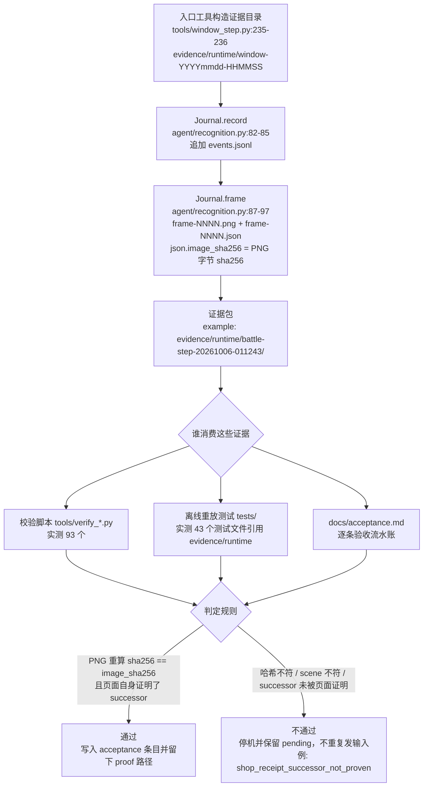
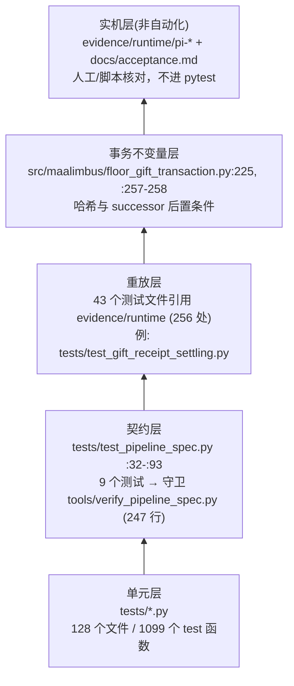

# 7 质量与验收

[English](../en_us/7-quality.md) · [← 索引](index.md)

本章回答三个问题：这个仓库怎么定义「做完」（7.1）；它把这种定义落在哪些测试与校验脚本上（7.2）；以及哪些东西**明确还没有被验收**（7.3）。

阅读约定：本章每条技术断言都绑定一个可核验锚点（`相对路径:行号`、测试名，或 `evidence/runtime/...` 路径）。凡引用文档中的数字而代码/现场与之不符的，以代码为准并在正文中标注（见 7.3 末节）。

---

## 7.1 证据与验收口径

### 7.1.1 「做完」的定义：有帧、有重放、有测试、有 not claimed

仓库没有一份单独的「验收标准清单」，验收口径存在于 `docs/acceptance.md` 的写法里。这个文件是**倒序追加的验收流水账**：每个条目记一次运行、一个缺陷、或一次修复，并且固定包含四类信息：

1. **运行事实**——运行标识、停机原因、步数、点击次数、通过与否。例：`docs/acceptance.md:3-10` 记录 `pi-20261012-112240` 以 `reason=unexpected_successor steps=17 clicks_sent=17 passed=false` 自行结束，17 次点击全是 MAP 节点尝试，454 次观测全部保持 `route.reason=current_position_not_proven verified_clear=false`，并给出 journal 路径 `dist/MaaLimbus/evidence/runtime/pi-20261012-112240/events.jsonl`。
2. **原因读自保留帧，而非猜测**——`docs/acceptance.md:1514-1521` 明确写出「为什么离线套件漏掉了它」：旧的保留奖励帧 `evidence/runtime/window-20261008-111130/frame-0002.json` 把 OCR token 拆成 `Selectable` 与 `0/1`，所以精确 membership 只在那一帧成立。
3. **修复点绑到 `文件:行号`**——例如 `docs/acceptance.md:1534-1540` 指名 `runner.py:1784` 的守卫条件过窄，以及 `runner.py:2131` 的 receipt intent 误判。
4. **证明与 not claimed**——先给可复现的离线证明，再显式声明**这次没有证明什么**。例：`docs/acceptance.md:1573-1581` 结论是「Actual retained frame 0239 of `pi-20261012-170045` replays through the native Agent as SHOP_PURCHASE … This does not yet prove the live Purchase, GET acknowledgement, shelf receipt, GUI continuation, or whole five-floor run.」

第 4 点是这个仓库验收口径的核心：**一条「已验收」必须同时具备运行证据、可重放的离线证明、钉住它的测试，以及一段明写的 not claimed**。因此流水账里大量条目以 `Still required:` 结尾（`docs/acceptance.md:1450-1452`、`:1491-1493`、`:1523-1525`、`:1569-1571`）。

口径的另一半是**测试结果本身的定性**。`docs/acceptance.md:1618-1620` 在给出 `1528 passed, 1 skipped ... 98.33 s` 之后紧接着写：「This is a source test result, not complete game or production-value acceptance.」——套件全绿不等于验收通过，这是写进文件里的规则，不是读者的推断。

### 7.1.2 证据目录里到底存了什么

证据目录形态是 `evidence/runtime/<任务名>-<yyyymmdd-hhmmss>/`。`evidence/runtime` 下实测有 **932 个目录**（2026-10-12 快照；本次核对过程中它从 929 一路涨到 932，因此这个数只会往上走）。目录名前缀由产生它的工具决定，实测存在的形态包括 `adb-probe-*`、`battle-step-*`、`window-*`、`pi-*`、`native-deployment-ui-*`；其中 `window-*` 的构造点已核实为 `tools/window_step.py:235-236`：

```python
directory = ROOT / ('evidence/runtime/window-' + datetime.now().strftime('%Y%m%d-%H%M%S'))
directory.mkdir(parents=True)
```

实测三个不同类型目录的文件构成（`Get-ChildItem` 输出）：

| 目录 | 文件构成 |
|---|---|
| `evidence/runtime/adb-probe-20261005-214515/` | `frame.png`、`result.json`（2 个文件） |
| `evidence/runtime/battle-step-20261006-011243/` | `events.jsonl`、`frame-0001..frame-0007` 各一份 `.json` + `.png`、`result.json`（17 个文件） |
| `evidence/runtime/pi-20261012-135557/` | 仅 `frame-0084.json/.png`、`frame-0085.json/.png`（4 个文件） |

第三行值得单独说明：`pi-20261012-135557` 是 7.1.1 中「改名礼包」那次争议的保留证据，`docs/acceptance.md:1483-1484` 正是引用 `frame-0084.*` 与 `frame-0085.*`。**证据目录是按需保留的，不是全程录像**——保留哪几帧本身就是判定的一部分。

`result.json` 承载一次运行的结论。实测字段：

- `adb-probe` 的 `result.json` 键为 `pid, address, input_sent, verified_clear, input_method, controller, foreground_before, size, foreground_after, reason`（文件 527 字节）。
- `battle-step` 的 `result.json` 键含 `clicks_sent, turn_submitted, victory_verified, verified_clear, before_observation, action, intent, rounds, settled, reason, passed`。

也就是说，`verified_clear` / `passed` 这类「有没有真的落地」的布尔量是**证据目录自带的**，而不是事后由人补记的。

### 7.1.3 journal 与 frame hash 在哪实现

只有一处实现：`agent/recognition.py:76` 的 `class Journal`。

- `agent/recognition.py:82-85` —— `record(event, **details)` 以 JSON Lines 追加写 `events.jsonl`，每条含 `event`、`utc` 与调用方给的 details。
- `agent/recognition.py:87-97` —— `frame(frame, records, scene, **extra)` 递增序号写 `frame-%04d.png`，再写同名 `.json`，其中关键一行是 `:94`：
  ```python
  'image_sha256': hashlib.sha256((self.directory/(name+'.png')).read_bytes()).hexdigest(),
  ```
  即 JSON 里的 `image_sha256` 就是**同目录 PNG 字节的 sha256**。JSON 同时带 `scene`、`size`、`utc` 与 `ocr`（`{text, score, box}` 列表）。
- `agent/recognition.py:108` —— 默认目录取环境变量 `MAALIMBUS_EVIDENCE`，否则 `evidence/runtime/agent`。
- `tools/window_step.py:285` 用 `Journal(directory)` 把上面那个时间戳目录交给 journal。

实测帧文件示例：`evidence/runtime/pi-20261012-135557/frame-0084.json` 的键为 `scene, size, utc, image_sha256, ocr, local_ocr, reward_cost, reward_cost_provenance, neural_sinners, overlay_dismissal`，其 `scene` 为 `GIFT_GET`、`image_sha256` 为 `3af49f7b92e497d98db92fe6c8be2a45936a5030043be43f0d68702b4251c95f`。不同链路会往 `extra` 里加自己的字段，哈希与 `scene` 是公共底座。

哈希不是装饰，下游会**重新计算并比对**：

- `src/maalimbus/floor_gift_transaction.py:225` 与 `:257-258` 在读回保留证据时重算 PNG 的 sha256，与存档的 `image_sha256` 不符即拒绝。
- `src/maalimbus/anchors.py:83-84` 要求几何锚点必须带 `frame` 或 `sha256` 之一，`:93` 的填充逻辑从帧的 `image_sha256` 取哈希。
- `src/maalimbus/gift_vision.py:44`、`:52` 校验 64 位十六进制摘要，并在读取图标文件时比对文件哈希。

`evidence/runtime` 下实测有 **931 个 `events.jsonl`**（递归统计）。

### 7.1.4 一次运行 → 证据 → 消费者 → 判定



图中「不重复发输入」这一点有对应实现与文档：`docs/acceptance.md:1534-1540` 描述了「已落地的确认从证据恢复而不是重放」，`:1540-1547` 则把恢复路径与结算路径合并成同一条 successor 规则。

---

## 7.2 测试布局

### 7.2.1 规模

| 对象 | 数量 | 统计命令 |
|---|---|---|
| `tests/` 下的 `.py` 文件 | 128 | `(Get-ChildItem tests -Recurse -File -Filter *.py).Count` |
| `tests/` 下的子目录 | 0（仅 `__pycache__`） | `Get-ChildItem tests -Directory` |
| `tests/` 里的 `def test_*` 函数 | 1099 | `(Select-String -Path tests\*.py -Pattern 'def test_' -AllMatches).Count` |
| 引用 `evidence/runtime` 的测试文件 | 43（共 256 处匹配） | `Select-String -Path tests\*.py -Pattern 'evidence/runtime'` |
| `tools/` 下的文件 | 158（其中 `.py` 153、`.ps1` 4、`.cmd` 1） | `(Get-ChildItem tools -Recurse -File \| Where-Object { $_.FullName -notmatch '__pycache__' }).Count` |
| `tools/verify_*.py` | 93 | `(Get-ChildItem tools -Filter 'verify_*.py' -File).Count` |
| `tools/probe_*.py` / `tools/measure_*.py` | 5 / 3 | 同名命令 |

上表是 **2026-10-12 的当日快照**，数字随工作树漂移（`evidence/runtime` 在本次复核期间就涨了；`tests/` 也在持续加用例）。所以这张表只保证「快照 + 可复现命令」：要判断某个数在今天是否还成立，**直接跑下面四条命令**，不要信任本页写死的数字。

```powershell
(Get-ChildItem tests -Recurse -File -Filter *.py).Count
(Select-String -Path tests\*.py -Pattern 'def test_' -AllMatches).Count
(Get-ChildItem tools -Recurse -File | Where-Object { $_.FullName -notmatch '__pycache__' }).Count
(Get-ChildItem evidence/runtime -Directory).Count
```

注意上表刻意用 `-Recurse` 且排除 `__pycache__`：不递归或不排除缓存目录都会得到另一个数（`tools/` 含 `__pycache__` 时是 220），那不是说仓库变了，而是统计口径不同。

`tools/` 下 5 个脚本是操作入口，不是测试：`install_desktop_shortcut.ps1`、`native_session.ps1`、`start_native.ps1`、`start-mirror.ps1`、`start-mirror.cmd`。

**测试目录是扁平的**：128 个测试文件全部平铺在 `tests/` 根下，没有按层分子目录。分层只体现在命名与内容上，不体现在目录结构上。

### 7.2.2 三个层次

**单元层**：纯模块级断言，覆盖交易对象、账本、OCR 解析、几何计算等。数量占绝大多数（1099 个 test 函数分布在 128 个文件里）。

**契约 / 协议层**：把「上游协议怎么写」变成可执行检查。核心是 `tools/verify_pipeline_spec.py`（247 行），模块 docstring 明确写出它对照的三份协议：`docs/zh_cn/3.3-ProjectInterfaceV2协议.md`（controller `type` 取值域、`display_*` 互斥、Adb controller 的输入/截图自动探测、`task.entry`、`option.cases[].pipeline_override` 必须指向真实节点）、`docs/zh_cn/3.1-任务流水线协议.md`（节点字段集、`next`/`on_error`/`interrupt` 必须指向存在的节点或带 `[JumpBack]`/`[Error]`/`[Stop]`/`[DetectionMissed]` 标记、`target: true` 的含义）、`docs/zh_cn/1.3-Custom&Agent.md`（节点的 `custom_recognition`/`custom_action` 必须被 `agent/main.py` 注册过）。脚本自述为 read-only，违规时 `exit 1`，参数为 `--interface/--pipeline/--agent-main/--report`。

它被 `tests/test_pipeline_spec.py` 用 **9 个测试**钉住（`:32`、`:39`、`:46`、`:55`、`:62`、`:68`、`:77`、`:85`、`:93`），其中 `:46`、`:77`、`:85`、`:93` 是负例（未注册的 action、协议外的 controller type、同一 controller 两种缩放模式、override 指向不存在的节点）。`docs/maaframework-conformance.md:125-132` 记录了这条守卫的来源与当前结果：`python tools/verify_pipeline_spec.py` → `ok — 0 problem(s)`。

**重放 / 端到端层**：43 个测试文件引用 `evidence/runtime`，用真实保留帧驱动生产代码路径。端到端的实机部分**不是自动化测试**，而是由 `evidence/runtime/pi-*` 目录加 `docs/acceptance.md` 条目承载。

### 7.2.3 测试分层



### 7.2.4 一个已知的套件噪声

`docs/acceptance.md:1484-1490` 记录了一次 `1441 passed, 2 failed, 1 skipped`：两个失败是 `tests/test_controller_lease.py` 与 `tests/test_update_install.py` 与**真实运行中的 app 实例**抢锁（`controller_lease.lease_path` 把名为 `controller.lock` 的路径重定向到 `%LOCALAPPDATA%/MaaLimbus/controller.lock`），直接读该文件复现同样的 `PermissionError [Errno 13]`，因此判定为环境冲突而非代码缺陷。这类失败说明：**在本机跑套件时，套件结果与真实实例状态耦合**，读结果时不能只看红绿。

---

## 7.3 已知边界与未验收项

本节是本章最重要的产出。下表每条都给出「现状」与可核查的锚点，不做「部分功能有待完善」式的概括。

| 条目 | 现状 | 影响 | 证据锚点 |
|---|---|---|---|
| 五层镜牢循环（full five-floor loop） | pipeline 里没有实现镜牢本体五层循环，`dist/MaaLimbus` 只有入口链（`MirrorHard` 链）能跑；打包信息把它列为 pending 第一条 | MXU 里点 `mirror_loop` 任务无法走完整局，GUI 端到端不可验收 | `docs/handover-2026-10-08.md:130-132`；`dist/MaaLimbus/build-info.json:11-15`（`pending` = `MXU UI validation`、`live input postcondition`、`full five-floor loop`） |
| 地图节点身份（map-identity blocker） | `pi-20261012-112240` 自行结束于 `reason=unexpected_successor steps=17 clicks_sent=17 passed=false`，454 次观测全部 `route.reason=current_position_not_proven verified_clear=false`，floor2 从未推进 | 运行停在 MAP 阶段，未触及战斗/商店/floor3/通关 | `docs/acceptance.md:3-10` |
| GET 浮层确认**已**接进 runner | `src/maalimbus/runner.py:1744` 在商店页调 `ShopTransaction.reserve_overlay_acknowledgement`（`src/maalimbus/shop_transaction.py:347`）；`docs/acceptance.md:12-29` 的 `wired_in_runner=false` 是当时的记录，已被代码推翻 | 原先担心的「真实购买以 `shop_receipt_successor_not_proven` 安全停机」不再是必然，实机 2026-10-12 的购买链条（4.3.1）走的正是这条 | `src/maalimbus/runner.py:1744`；`src/maalimbus/shop_transaction.py:347` |
| 实机购买 + 货架 receipt | 「live Purchase」与「货架 receipt」已于 2026-10-12 实机走通（见 4.3.1；`docs/shop-revive.md` 记录复活那一笔 3093→2993）；保留帧 0239 的离线重放仍是另一条独立证据；「GET 确认、GUI 续跑、五层整局」**仍未**证明 | 花钱与回执已有一条实机链路，「一局跑完」仍缺 | `docs/acceptance.md:1573-1581`（原文）；本页 4.3.1 |
| 战斗 HUD 的第二种版式没有可证的开始控件 | 实测同一场战斗存在两种 HUD：START 可见的那种由 `battle_vision.start_button` 取到转盘；另一种（Win Rate 标题左移到 x≈1484、整簇左移约 290px）既没有 START、转盘也是暗的，`start_box=None`，窗口于是在 8 轮无进展后按设计以 `battle_progress_stalled` 停窗（`src/maalimbus/runner.py:1675`） | 碰上这种版式的战斗无法自动推进，只能停窗等人 | `src/maalimbus/battle_vision.py:1`；实测 `tools/window_step.py --observe-page` 在同一画面复现 `turn=7 start_box=null` |
| 十二槽身份教师 | 源码与当前安装包含身份教师及按帧去重日志；完整账户和独立质量仍未验收 | 网格槽位与印刷部署徽章分开，影子预测不是教师真值 | `src/maalimbus/pre_battle_identity.py:1`；`src/maalimbus/runner.py:1` |
| 神经识别（sinner detector） | 已有真实训练 ONNX 和 Maa 原生影子推理；独立生产质量未通过，quality/production/input flags 为 false | 影子预测不控制输入；独立教师、人工复核和跨局验证仍需完善，参见 3.8 | `src/maalimbus/neural_shadow.py:98`；`docs/acceptance.md:1601-1604` |
| 日本语识别 | 日语原生标签与更新/设备区块有保留证据，但「不证明日语游戏识别或 GUI 任务执行」 | 日服部署不可验收 | `docs/acceptance.md:104-106` |
| 账号对账 | 129 exact owned matches / 78 unresolved observations，「still partial」；缺失的 JP 别名与 system row、空布尔量是显式 unknown | 库存状态可能不完整 | `docs/acceptance.md:36-37` |
| 队伍选择与回滑 | 独立标题和当前 sidebar 行定位已接 Runner；Team1/Team2 固定与轮换保留帧测试通过 | 真实产品入口跨屏滑回 Team1/Team2 尚未验收，不用单测代替 | `src/maalimbus/team_navigation.py:1`；`tests/test_team_navigation.py:1` |
| 自更新 | `tools/check_update.py` 已能条件请求并暂存到 `build/updates`，缺的是**带资产的 GitHub release** | 用户收不到更新 | `docs/handover-2026-10-08.md:133-136` |
| Windows 打包 | v0.1.2 候选实际构建及隔离新版安装已有证据；旧候选不含全部后续修复 | 最新源码重建、公开分发和重启仍需分别验收，构建成功不是发布验收 | `tools/build_windows_package.py:1`；`docs/wiki/zh_cn/6-deployment.md:1` |
| 完整镜牢与桌面分发 | 早期 Hard5 通关、领奖历史及实际候选构建保留；当前最新 pipeline 仍需完整连续产品实测 | 不抹掉历史通关，不以旧成功替代新代码验收 | `docs/wiki/zh_cn/4-business-flows.md:1`；`tools/build_windows_package.py:1` |
| 每日 / Lux / 体力任务执行策略 | 「Four daily/lux/stamina task execution policies are still unfinished」；`CurrentTeam7 paid5/weekly0` 的 receipt 仍未见到 | 日常任务链路不可自动执行 | `docs/acceptance.md:152-154` |
| Lux stage / farm / receipt 与 GUI dispatch | 源码改动未安装，「Lux stage/farm/receipt and GUI dispatch remain unverified」 | Lux 流程未验收 | `docs/acceptance.md:96-97` |
| GUI 派发与公开更新 | 实际 GUI Start 已执行入场与初始阶段；公开新版下载/安装/重启仍开放 | 派发入口可运行不等于整局自动完成 | `docs/wiki/zh_cn/4-business-flows.md:1`；`src/maalimbus/startup_update.py:1` |
| MaaFramework 一致性覆盖范围 | 未做 PI/MXU 实跑（只读接口未驱动）；工具包自动探测耗时未测；33 个从任务入口不可达的节点是「报告而非删除」；未使用的协议特性不做任何断言 | 协议符合性只在「本项目已用到的字段」上成立 | `docs/maaframework-conformance.md:136-144` |
| 文档与代码的数值漂移 | `docs/maaframework-conformance.md:110` 记 `mirror.json` 有 `89 nodes`，实测顶层节点数为 **792**；`docs/handover-2026-10-08.md:129` 写 `tests/test_pipeline_spec.py` 有 17 条，实测 **9** 条 | 旧文档的绝对数字不可直接引用 | `docs/maaframework-conformance.md:110-111`；`docs/handover-2026-10-08.md:129`；实测 `python -c "import json;print(len(json.load(open('assets/resource/base/pipeline/mirror.json',encoding='utf-8'))))"` → `792`；`Select-String -Path tests/test_pipeline_spec.py -Pattern '^def test_'` → 9 行 |
| 套件与真实实例的资源竞争 | 真实 app 运行时，`tests/test_controller_lease.py` 与 `tests/test_update_install.py` 会因 `%LOCALAPPDATA%/MaaLimbus/controller.lock` 报 `PermissionError [Errno 13]` | 本机套件结果需要人工区分环境失败与代码缺陷 | `docs/acceptance.md:1484-1490` |
| 其他里程碑 | 楼层策略、预算体力兑换（`config/user-mirror-settings.json` 的 `max_starlight 100` / `refill_lunacy 0` / `convert_modules 0` / `module_budget_pending true`）、邮件每日奖励 | 未实现或未验收 | `docs/handover-2026-10-08.md:137-139` |

### 7.3.1 本节的诚实性约束

上表刻意区分了三种状态，写作时不要混为一谈：

1. **已实现但未接线**（例：GET 浮层确认，`docs/acceptance.md:26-28` 的 `wired_in_runner=false`）。
2. **离线可重放但未在实机跑通**（例：十二位身份报告只有离线证据，`docs/acceptance.md:1491-1493`；保留帧 0239 的 SHOP_PURCHASE 原本也属这一类，2026-10-12 已被实机补上，见 4.3.1）。
3. **源码已改但未安装**（例：Lux 准备排除的改动，`docs/acceptance.md:96-97` 与 `:113`）。

`docs/acceptance.md:139` 与 `:158` 还显示另一类状态：**安装态验收通过但分发链未通过**（「Main interaction, desktop new-version restart and public Release download are not accepted by that observation」）。

---

## 本章自检

- 所有 `路径:行号` 锚点在写作时逐条打开核对；行号均不超过文件总行数。
- 所有数量均附带实际执行过的只读统计命令（见 7.2.1 表格与 7.3 末两行）。
- 与文档冲突的数值已在 7.3 表格倒数第三行显式列出，并以代码实测为准。
