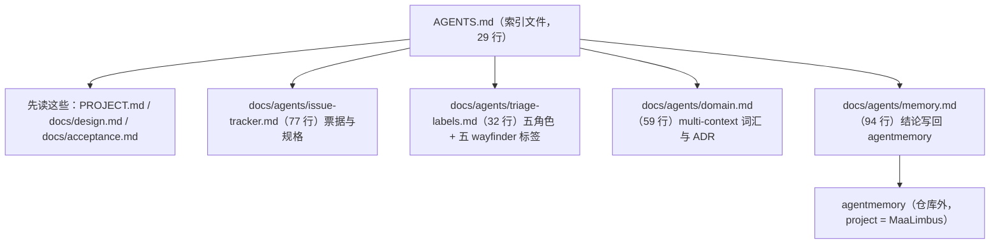
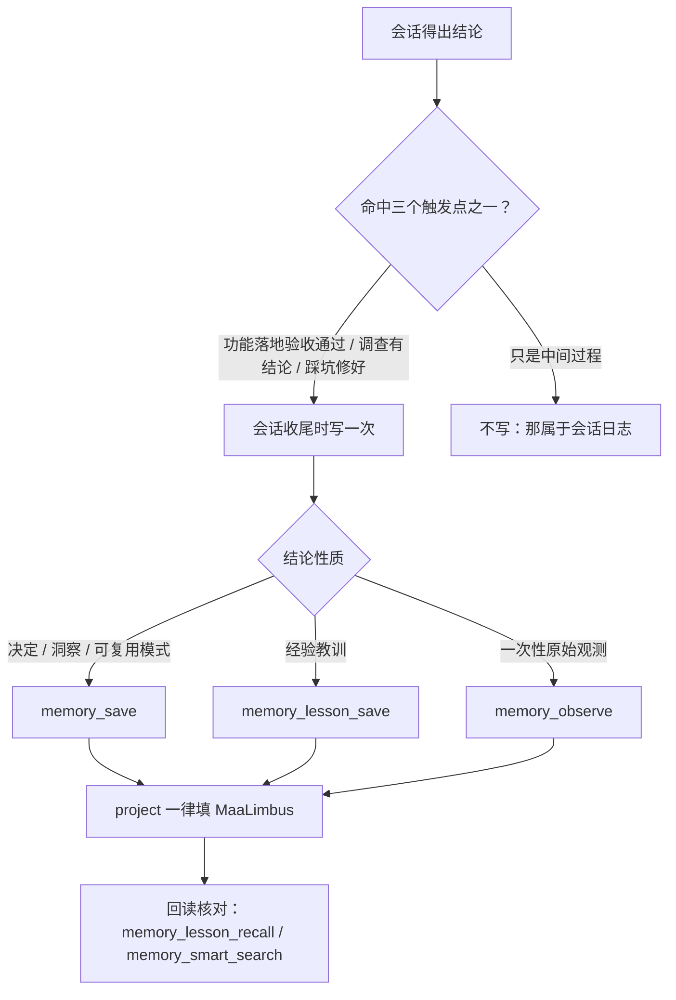

# 8 Agent 规则层

[English](../en_us/8-agent-rules.md) · [← 索引](index.md)

本章讲的是**「在这个仓库里干活时要遵守什么」**，不是产品行为。它的原始文件是 `AGENTS.md` 与 `docs/agents/` 下的四份规则文档；本章把它们讲成一条可读的线，但**不替代它们**——`AGENTS.md` 仍然是入口，四份规则文件仍然是操作源（`AGENTS.md:4` 写着 `This file is the entry point for agents working in this repo.`）。

## 8.1 规则层在文档体系里的位置

这个仓库有四种文字，各有各的职责，互相不替代：**事实源**（`PROJECT.md` 的进度与 development contract、`docs/design.md` 的设计约束、`docs/acceptance.md` 的验收口径；`AGENTS.md:8-10` 把这三份列为改代码前的必读）、**叙述层**（本 wiki；`AGENTS.md:11` 明确写它不替代上面三个事实源）、**协作规则层**（`AGENTS.md` 与 `docs/agents/` 下四份，讲怎么建票、怎么打标签、怎么用词、怎么沉淀结论）、**仓库外结论库**（agentmemory，跨会话可检索，见 8.5）。

`AGENTS.md` 只有 29 行，`## Agent skills` 下每节只有一行指针；真正的规则正文全在那四份文件里。这是刻意的：入口文件承担的是**分发**，不是内容。

## 8.2 票据与规格：GitHub Issues + deck 工具

本仓库的 issue 与规格都是 GitHub issue，远端是 `sairaisaika/MaaLimbus`（`origin`，主分支 `main`）（`docs/agents/issue-tracker.md:71-75`）。读写**一律走插件自带的 deck 工具，不手敲跟踪器命令**——工具自己按当前后端把事情做完并读回核对，所以同一份说明在后端不是 GitHub 时照样成立（`docs/agents/issue-tracker.md:7-13`）。

| 要做的事 | 工具 |
| --- | --- |
| 建一张票 | `deck_issue_create` |
| 读一张票（含评论与标签） | `deck_issue_get` |
| 看有哪些地图与开放票 | `deck_context` |
| 看一张地图的子票与进度 | `deck_map_snapshot` |
| 一次建出整张地图（地图 + 子票 + 边） | `deck_map_plan_create` |
| 补一条边（父子或阻塞） | `deck_map_link` |
| 改一张票（评论 / 标签 / 认领 / 关闭 / 正文） | `deck_issue_patch` |

工具管不到的只有两件事，都发生在跟踪器之外：**登录**（`gh auth login`，再用 `gh auth status` 确认）与**建仓库**（`gh repo create`；面板的「创建并发布」向导通常替你做）（`docs/agents/issue-tracker.md:17-22`）。

写正文有一条通用规则：**先把正文写成文件**（真实换行，每个 `## 章节` 独占一行，段落之间留一个空行），再交给工具写回；不要把正文拼进命令行，不要把换行写成字面的 `\n` 两个字符，不要让正文以 BOM 开头；写完读回来核对（`docs/agents/issue-tracker.md:26-30`）。

阻塞关系优先落成后端自己的**原生依赖边**；真拿不到时才退回在子票正文首行写 `Blocked by: #n`（多个票号用逗号隔开）——这是三后端共用的**降级**写法，不许拿它当默认做法（`docs/agents/issue-tracker.md:34-36`）。

## 8.3 Triage 标签

技能说的是五个**规范角色**，落到跟踪器上就是五枚标签字符串；本仓库的右列与左列同名（`docs/agents/triage-labels.md:5-11`）：

| 角色 | 含义 |
| --- | --- |
| `needs-triage` | 维护者需要评估这张票 |
| `needs-info` | 等报告人补充信息 |
| `ready-for-agent` | 规格完整，可以交给 AFK agent |
| `ready-for-human` | 需要人来实现 |
| `wontfix` | 不会处理 |

`/wayfinder` 另用一族标签，**不做角色映射**，标签字符串就是类型（`docs/agents/triage-labels.md:17-23`）：

| 标签 | 含义 |
| --- | --- |
| `wayfinder:map` | 地图票；持有 Notes / Decisions so far / Fog |
| `wayfinder:research` | 调研票 |
| `wayfinder:prototype` | 原型票 |
| `wayfinder:grilling` | 待定决策 / 讨论票 |
| `wayfinder:task` | 任务票 |

这 10 枚（五角色 + 五 wayfinder）已在远端初始化时建齐；`bug` 用 GitHub 自带那一枚。**除技能明确要求外不额外强制任何标签**（`docs/agents/triage-labels.md:29-31`）。

## 8.4 领域词汇：multi-context

本仓库的域文档布局是 **multi-context**：每个子项目各一份 `CONTEXT.md`，仓库根目录一份 `CONTEXT-MAP.md` 指向它们；系统级决定放 `docs/adr/`，与单个上下文有关的决定放 `<子项目>/docs/adr/`（`docs/agents/domain.md:5-11`）。这份布局是初始化时与用户确认的结论。

探索代码之前先读：根目录的 `CONTEXT-MAP.md`（若存在），再读你即将触碰的那个上下文的 `CONTEXT.md`，再读 `docs/adr/` 里相关区域的 ADR。**这些文件不存在就静默继续**——不要标记缺失，也不要主动提议创建；它们由 `/domain-modeling` 在真正写下词条（术语或决定）时惰性建出（`docs/agents/domain.md:19-25`）。

用词有纪律：输出里命名领域概念（票标题、重构提案、假设、测试名）时，用 `CONTEXT.md` 里的定义，不要漂到术语表明确回避的同义词；需要的概念还不在表里，本身就是一个信号——要么你在发明项目不用的语言，要么真的缺一个词条（`docs/agents/domain.md:51-55`）。**与既有 ADR 冲突时要显式提出**，而不是静默推翻（`docs/agents/domain.md:57-59`）。

## 8.5 结论沉淀：写回 agentmemory

这条纪律只管一件事：**一次会话得出结论之后，把它写进仓库外的 agentmemory**（`docs/agents/memory.md:3`）。它存在的理由是一个可观测的缺口：agentmemory 里不缺原始会话记录，缺的是**结论**——检索 `MaaLimbus` 常常只能捞到 tool_use 壳子（读了哪个文件、跑了哪条命令），捞不到「这件事最后是怎么定的」「哪个做法被证明不行」，于是同一个坑下个会话再踩一次（`docs/agents/memory.md:7-11`）。

写**结论与判据**，不写流水账、不复制 diff：做了什么（一句话）、为什么这么做（含被否掉的方案与原因）、什么做法被证明不行（带最特征的报错原文或症状）、判据 / 数值 / 路径（验收口径、阈值、版本号、关键文件路径）。反例是「读了 A、改了 B、跑了测试」，正例是「X 走不通，因为 Y（报错原文 `...`）；改走 Z，判据是 W 命令输出 P」（`docs/agents/memory.md:33-50`）。

`project` 一律填 `MaaLimbus`——检索靠这个字段分流，留空或填默认工作区、仓库绝对路径，会让本仓库的结论散进别的项目，等于没写；`concepts` / `files` / `tags` 都是逗号分隔的字符串，不是数组；写完用 `memory_lesson_recall` 或 `memory_smart_search` 回读一次，确认能被检索到、`project` 没填错（`docs/agents/memory.md:62-69`）。

与 `PROJECT.md` 有明确分工：**`PROJECT.md` 是仓库内的时序台账**（这一轮做到哪、下一步接什么、还有哪些没关的洞），**agentmemory 是仓库外跨会话的结论库**（这件事上次是怎么定的、什么做法不行）。**不要互抄同一段**——PROJECT.md 里写过的进度不要在 agentmemory 里再抄一遍正文；agentmemory 里落下的结论，PROJECT.md 只在需要 continuation 时用一行指针带过；结论已经属于 `docs/design.md`、`docs/acceptance.md` 或 `docs/agents/*.md` 时，写一行指针即可（`docs/agents/memory.md:84-91`）。

不适用的情形也写明了：没产生结论的会话（纯浏览、纯问答），以及结论只是别人已写下的重复——后者改去加强既有那条记忆，或者干脆不写（`docs/agents/memory.md:92-94`）。

## 8.6 规则层怎么被执行

三条都在跑：**`AGENTS.md` 是索引**，`## Agent skills` 下每节只做一行指针（见 8.1 那张图）；**技能直接读这四份文件**，所以它们的路径是接口，改名会打断调用方；**本 wiki 只做叙述**——本章把规则讲成人话，规则本身仍留在原处（`docs/wiki/README.md:72` 已把这四份文件登记进 docs 专题地图，让它们从 wiki 可达）。

这套分层也解释了 `.gitignore:28-29` 为什么只放行两份：规则层默认是**本机配置**，只有需要跨会话、跨人传递的那部分才随仓库走——`!docs/agents/memory.md` 与 `!AGENTS.md` 正是那两条例外。

## 未验收 / 待核实

本节如实列出这一章核实到哪里、还有什么**没有**核实。

1. **本章没有执行过任何票据操作。** 8.2 的工具清单与降级写法都取自 `docs/agents/issue-tracker.md` 的原文，本章既没有真的建过一张票，也没有验证过 `deck_*` 工具在当前后端上的回报。工具契约的权威在插件本身，不在本章。

2. **标签清单是快照。** 8.3 的 10 枚标签取自 `docs/agents/triage-labels.md:29-31` 的「本仓库现状」一段；本章没有查询远端仓库，去复核它们今天是否仍然存在。

3. **multi-context 是既定布局，不是实测状态。** 8.4 陈述的是初始化时与用户确认的结论：本仓库**尚未**创建 `CONTEXT-MAP.md`、任何 `CONTEXT.md` 与 `docs/adr/`；按 `docs/agents/domain.md:19-25` 的规矩，它们缺失时应静默继续，所以本章也没有去核实它们此刻是否存在。

4. **行数是写作时的实测值。** 8.1 图里的 29 / 77 / 32 / 59 / 94（`AGENTS.md` 与四份规则文件的行数）与 `docs/wiki/README.md:72` 均测于 2026-10-12（America/Indianapolis），引用前请重测。

5. **`.gitignore` 的例外只陈述设计意图。** `.gitignore:28-29` 那两行决定规则层里哪些文件随仓库走；本章只解释这一设计，不代表 git 索引此刻的实际内容——`AGENTS.md` 是否已被 `git add` 与本章的叙述无关。

6. **中英两页没有逐句比对。** 只保证标题、编号、表格与段落顺序一一对应；`../en_us/8-agent-rules.md` 是中文页的忠实镜像而非独立撰写，因此中文页若有一处事实错误，英文页会同步继承。

本会话的新增规则：AGENTS.md 的 Memory 指向 `docs/agents/memory.md`。会话收尾仅沉淀有判据的结论到 agentmemory 项目 MaaLimbus，并读回核实；调用前须确认 memory_save / memory_lesson_save 工具可用；不可用时在 PROJECT.md 保留结论并说明外部写回尚未完成，不能把仓库文档或本地日志冒称成外部记忆写入。
