# 9 端到端修复与学习系统实施计划

[English](../en_us/9-execution-plan.md) · [← 索引](index.md)

这是 **2026-10-14 的执行规格**，不是功能完成报告。执行者 DSH；Codex 负责架构、接口、完成判据与复核。事实源仍是 `PROJECT.md`、`docs/design.md`、`docs/acceptance.md`。每张看板卡必须带本文阶段编号、依赖、变更文件、验证命令和实际证据；“开始做”“单测绿”“截图变了”不能关闭阶段。

这是可裁剪的技术计划，不增加代码锁、审批或强制全站阅读。按当前问题从[短索引](../agent-index.md)进入相关阶段，独立工作可以并行；执行者报告读过的路由与实际差异即可。

## 9.1 当前基线与工作分工

| 事项 | 已核对事实 | 尚不能声称 |
| --- | --- | --- |
| 星光余额 | 原失败帧75在 only_rec 模式低于.85；两框检测后识别与隔离恢复已有证据，见 `src/maalimbus/grace_balance_native.py:1`、`src/maalimbus/grace_transaction.py:120` | 每种界面变体都可靠，或历史购买都已到账 |
| 原生导航 | `agent/recognition.py:1410` 的 AgentTasker 通过 Context 执行子节点；源码252c0d2修复了 Device 未携带适配器的问题 | 源码修复即等于所有安装实例已经更新 |
| DSH新进展 | `build/grace-stop-page-star-graces.json` 记录成品入口3输入到星光页；运行报告明确 dungeon_complete=false。随后私有事务已有四卡选中记录，必须与该局原生帧逐笔对账 | 三次输入等于镜牢跑完；只读事务记录等于完整实机验收 |
| 设置与评分 | 定制MXU已构建安装；GitHub按钮已实际显示；评分输出在 `src/maalimbus/decision_log.py:1` | 头像/星光配置保存重开均已验收，或影子分数决定了购买 |
| 模型与占用 | `src/maalimbus/neural_shadow.py:1`、`src/maalimbus/shop_value_shadow.py:1` 区分识别、影子预测和控制策略；`src/maalimbus/resource_diagnostics.py:1` 已有采样器原型及只读CLI，GUI仍待实现验收 | 有模型文件就已经用于策略；整卡占用就是脚本占用；后端采样等于面板完成 |

同一时刻只有一个设备控制器。DSH可以并行做纯离线数据/文档/监控实现；实机输入必须串行。Codex更新本章与接口，DSH更新实际验收记录；不覆盖对方未提交修改。每次开始先重读 git、安装清单、当前运行状态与最新截图，不把上述快照当当前游戏画面。

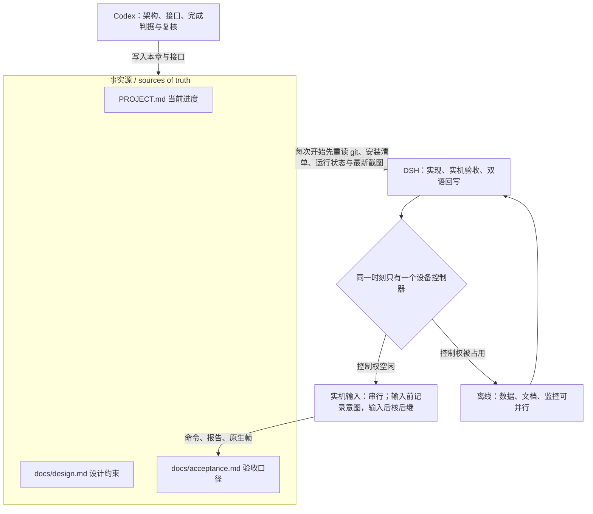

## 9.2 依赖、看板与阶段出口

| 卡号 | 依赖 | 具体实施与产物 | 关闭该卡需要的证据 |
| --- | --- | --- | --- |
| P0 现场对账 | 无 | 核对活动局、历史星光意图、实际页面和安装版本；为未结意图选择“核账成功 / 已取消并保留历史 / 仍待证明”分支 | 同scope的前后PNG/JSON/hash、可见余额与成本、无重复购买；现场结论写回验收 |
| P1 实际启动管线 | P0 | 安装正确适配器；从GUI Start经过MainTask、MirrorLoop和原生子节点；把GUI模式/目标队伍/ledger/游戏选中标题关联 | GUI启动日志、正确Agent和资源版本、真实页面推进；不能用另一个CLI入口替代GUI点击 |
| P2 镜牢核心循环 | P1 | 地图→事件/战斗→奖励→商店→换层；部署顺序正确则复用；逐个修复后继失败并恢复 | 至少一局Hard五层实际clear；每层、每笔购买/刷新/GET与后继可追溯；脚本自己操作，人工点过不算 |
| P3 设置与可解释日志 | P1；发布依赖P2 | 四十队槽、头像点序、星光基础卡、单队/轮换、独立运行次数与步数/时间上限；候选权重和最终分 | 保存→正常关闭→重开→原生参数→真实队伍标题一致；反复启动不重复应用；实际日志含分项、决胜规则、拒绝理由 |
| P4 本地资源占用 | P1后可与P2并行 | 按9.6契约实现CPU/RAM/GPU/VRAM采样与GUI；采样独立于控制器 | 与独立只读工具同时间窗对照；缺供应商/超时/进程退出/开关关闭测试；关闭采样后无后台忙等 |
| P5 学习闭环 | P2的真实轨迹；可先离线收集 | 按9.4/9.5形成证据包、标签、复核、分集、训练、Maa原生评估、影子对照和可回滚晋级 | 独立episode隔离；模型、数据集、教师、评估hash；真正使用模型的节点日志；未晋级只能明确标为shadow |
| P6 整体验收与交付 | P2、P3、P4、P5 | 合并后的最新代码完整测试、成品自检、GUI启动及连续运行验收；核wiki/图/实现差异 | 9.7逐项勾选的证据目录、最新安装版本、无遗留未解释失败；公开发布另过许可/隐私/更新门禁 |

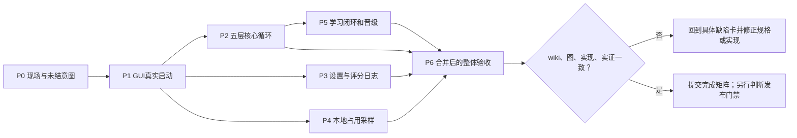

P0/P1已有局部证据，仍需本轮最终核验；P2–P6不能批量标完成。遇到新缺陷就在对应卡追加“触发→原始证据→假设→修改→正反例→重新运行”，不要另开无关联测试然后宣称旧失败已解决。

## 9.3 失败后的自动恢复与运行次数

未知不等于立即结束整条任务。先辨别：等待动画、识别缺失、可逆遮罩、已发送的交易、未知游戏效果、需要新资源预算。允许的已知动作通过Maa执行；未知效果可以在既有有界探索和玩家预算内选择，并把不确定性记入评分。**读不清购买结果时重读核账，而不是重复购买。**

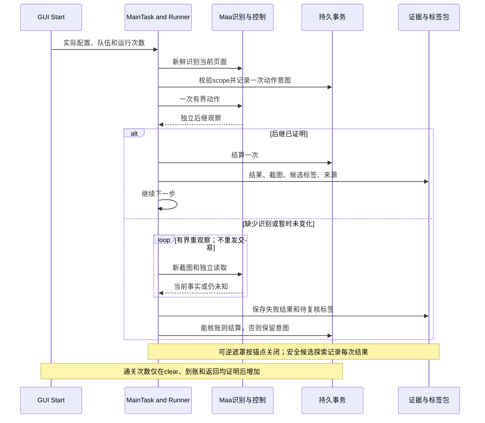

每种动作明确次数/时间/无进展预算；星光购买已有最多3次只读重观察，其他动作不能照搬该数值当无限重试。候选尝试必须记录动作区域、前后画面、是否改变目标页面。达到该动作的上限才暂停该分支；能独立进行的采样、离线训练或缺陷修复继续。弹窗关闭不能变成未经确认的付款。

运行次数是玩家设定的完整局数，必须与“单次运行步数上限”和时间上限分离。“沿用保存值”只读取保存配置，不能从部署人数、队伍数量或循环步数推导局数。重复N局需要逐scope消费预算；预算不够时保留已clear待领奖状态，不能冒用历史6模块授权。

**已落地（2026-10-14）**：玩家可保存的完整局数是 `Settings.run_count`（`src/maalimbus/runner.py:158`）与 PI 选项 `mirror_run_count`（`assets/interface.json:68144`），由管线节点 `MirrorRunCount`（`assets/resource/base/pipeline/mirror.json:5579`）承载并在 `src/maalimbus/mirror_task_options.py:9` 读取。达标判定只认账本增量：`MirrorRunner._run_count_reached`（`src/maalimbus/runner.py:1393`）用 `RunLedger.completed_runs` 减去本次启动基线，而该计数只在 `entry_returned` 后 +1（`src/maalimbus/storage.py:287`），账本对缺少五层、胜利或已领奖的返回一律拒绝。达到玩家N局时窗口以 `run_count_reached` 停止（`src/maalimbus/runner.py:2807`），步骤记录与 `summary()` 带上 `verified_runs={target,completed}`（`src/maalimbus/runner.py:3196`），日志打印 `verified runs: x of y this launch (z in the ledger)`（`src/maalimbus/event_log.py:149`）。**尚未实测**：本窗口还没打完一局（实测时仍在楼层1），该停止路径目前只有单测覆盖。

```mermaid
stateDiagram-v2
  [*] --> Preparing
  Preparing --> Running: 队伍和入场后继证明
  Running --> Recovering: 未知或缺后继
  Recovering --> Running: 新观察证明进展或安全探索成功
  Recovering --> Held: 有界尝试无进展
  Held --> Recovering: 已诊断修复后恢复，不重放未结交易
  Running --> Cleared: 五层与最终胜利证明
  Cleared --> AwaitBudget: 本scope消费预算缺失
  AwaitBudget --> Claiming: 明确预算及新鲜成本
  Cleared --> Claiming: 明确预算及新鲜成本
  Claiming --> Returned: 实际到账回执和独立返回
  Returned --> Counted: 完整局数加一，仅一次轮换
  Counted --> Preparing: 尚未达到玩家N局
  Counted --> [*]: 已达N局
```

### 9.3.1 GUI Start到原生子节点的实际适配链

源码已有的链路是 `MainTaskAction.run → MirrorLoopAction.run → MaaDevice → MirrorRunner → run_node → AgentTasker.post_task → Context.run_task`。用 `python tools/wiki_route.py startup --limit 1` 获取这些符号的当前行号，不依赖图内静态行号。`MirrorLoopAction.run` 必须把 `AgentTasker(context)` 交给Device；Runner从Device取得tasker，NODE计划才能执行原生Pipeline。缺少适配器正是历史报错 `a node plan needs a Maa tasker` 的原因。

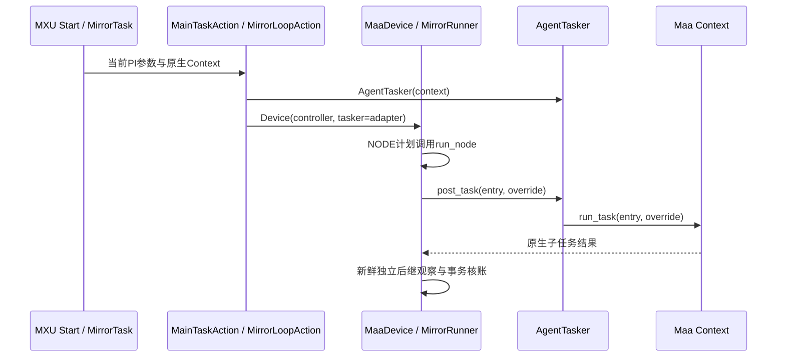

CustomAction已经占用框架worker，不能在里面改回 `context.tasker.post_task` 并等待自身队列；`AgentTasker` 的源码说明了这一点。此图解释已有实现，**本身不等于GUI实机启动或Hard五层通过**；验证仍要绑定实际安装版本、GUI选择和后继帧。观察重置仅针对只读节点hit count，不得清空输入节点或交易记录。

**已落地（2026-10-14）**：用 `8ca1ac1` 重装的版本（其父提交 `d574a26` 是节点面板身份修复）以真实GUI启动（`dist/MaaLimbus/MaaLimbus.exe`，进程34940），并在本地07:22用真实指针输入按下它自己的开始按钮。该局 `dist/MaaLimbus/evidence/runtime/pi-20261014-072228` 的首帧场景是 `NODE_PANEL`——正是打包CLI局在 `d574a26` 之前无法识别而停窗的状态——随后走通 `CUTSCENE -> EVENT_CHOICE -> EVENT_RESULT -> GIFT_GET -> PRE_BATTLE_TEAM -> BATTLE_HUD -> MAP -> NODE_PANEL -> GIFT_GET`，因此上面这条链路现在是实机观察到的，而不再只是接线。仍未由此证明：完整五层一周目，以及保存局数的停止路径。

**实机走到并被修（2026-10-14）**：同一局继续跑到254帧/71次输入——`BATTLE_HUD` 20（胜率分配与开始）、`MAP` 8次节点点击、`SHOP` 7含4次 `SHOP_PURCHASE`、`GIFT_GET` 6、`NODE_PANEL` 5（全部走 `panel_enter_is_the_only_forward_input`，即身份修复在实机被使用）、`GIFT_PICK` 4、`REWARD_CARD` 2——随后停在 `floor_gift_commit_receipt_not_proven`：它按下的 `Select 2/2` 得到的是印着 `Dark Vestige` 的提示窗，这个名字既不在选礼页的四个候选里，也不在本局点击勾选的两张卡里（`frame-0252`），而原来的收据规则要求提示窗必须报出被选名字。现在规则把两件事分开：提示窗页面加上它自己的名牌即可证明这次按键，收据同时保留两个名字——它回应的那张卡与设备实际印出的名字（`src/maalimbus/floor_gift_transaction.py` 的 `FloorGiftTransaction.notice_matches_a_pick` 与 `receipt_intent(..., on_notice_page=True)`，`src/maalimbus/runner.py` 的门控与带标记的说明，`tests/test_gift_receipt_settling.py` 用保留帧 `evidence/runtime/gui-20261014-072228/frame-0254.json` 固定）。选不出处的名字在非提示窗页面仍然拒收，因为中段读数是宽松读取。随后重跑的实机局（`pi-20261014-080122`，本地08:01）又遇到同一页面形态，但这次印出的名字与勾选一致：该局自己的 `floor_gift_ranking` 选中 `Today's Expression`（`selection_source: single_free_select_button`），`Select` 后提示窗出现，交易记下了收据的标题与后继帧（`config/user-floor-gift-transaction.json` 的 `receipts[0]`：`frame-0059.json` -> `frame-0060.json`），链路越过了上次停车的位置。只有“提示窗名字与任何勾选都对不上”的那条分支仍仅有单元测试。

**货架与状态（2026-10-14）**：装好折叠后的下一次启动只走了3次输入，就停在同一条拒绝上，差别只有一个空格——这一局自己的预定帧 `frame-0002` 把144币货位读成 `Crownof Roses`，回来的 `frame-0008` 印的是 `Crown of Roses`，于是 `_fold` 现在在易混字形与 `rn` 连字之外再折掉空格（仍不能缩短标题：字母与数字仍须逐个对上）。它下面还压着一个会让本阶段彻底结束的状态缺陷：再下一次启动在第一次输入之前就抛 `Configuration/state exceeds 2 MiB`，因为决策上下文把 `owned_bought` 记成了整条购买记录，而每条记录又带着自己的上下文，`config/user-shop-<scope>.json` 因此涨到2,464,332字节。现在 runner 只记名字，`shop_transaction._context` 在存储边界强制这一形状，`tools/prune_shop_state.py` 把线上文件改写回46,950字节且不动其他字段。两者都有单测（含修剪工具），被修正的货架也已用真实帧回放（不再列出任何“未持有”的报价）；真正要在实机证明的，是重装后的下一次运行。

**同一处读取差距，落在货架上（2026-10-14）**：同一局复测继续走到第3层，在结算刚买下的 `Rusted Cutting Knife`（244枚，1530 → 1286）时以 `Shop successor shows an offer the shelf never held` 停下（68步 / 67次输入，`passed: false`）。存档保留了 `pending.stage: overlay_intent`，返回后的货架仍是同样的六个槽位、被买下的卡带自己的 `Purchased` 徽标——但本次造访自己的预订帧把160枚那个槽位读成 `Thomy Path`，返回货架读成 `Thorny Path`（图鉴名，`assets/resource/base/gift-catalog.json` 的 `gifts[280]`），于是严格的标题比较把货架一直持有的卡当成“从未持有”的报盘。商店的折叠现在把印刷体连字 `rn` 一并折成 `m`（`src/maalimbus/shop_transaction.py`），由 `tests/test_shop_transaction.py::test_a_condensed_ligature_reads_as_the_same_slot` 及其反例钉住；用返回帧重放停止的存档即可结算（`reconcile_purchase: True`、`bought[-1] = Rusted Cutting Knife`、`pending` 清空）。要再次尝试五层通关，安装版必须带上这处折叠。

**等货架重画完再判（2026-10-14）**：重装后的应用再次由自己的按钮启动（`pi-20261014-193945`，本地19:39），只走了1次输入就停下——货架上没有计划想要的藏品，于是它付了15币刷新（`[1478,168,86,28]`，金币1127），而后继帧 `frame-0004` 只读到六个槽位中的两个、计数仍是刷新前的数，既证不出差额也证不出完整的变更货架。交易规则拒收这样一帧是对的（`ShopTransaction.reconcile_refresh`，`src/maalimbus/shop_transaction.py`），所以 runner 改为等待而不是停车：同一次造访里最多三帧未证成的后继帧会记为 `shop_refresh_settling` 并重新观察，意图在等待期间始终未被认领，第四帧仍然停车（`src/maalimbus/runner.py`，由 `tests/test_runner.py::test_a_refresh_successor_read_mid_change_waits_before_it_stops` 钉住）。实机证明要等下一次在同一商店启动。

### 9.3.2 新版镜牢界面的适配计划（2026-10-15）

游戏在 2026-10 整体换掉了镜牢界面：入口改名 `Mirror of Sisyphus`（`DUNGEON 08`），右侧改为 `Exploring / Weekly Bonuses / Parallel Superposition Mode / INFINITY MIRROR`，星光页与买星确认框全部重绘。识别层不比对美术，只读 OCR 文本与归一化框（`src/maalimbus/vision.py:19` 的 `find`、`src/maalimbus/vision.py:63` 的 `classify`），所以这次改版只在**文本形态**和**绘制细节**上打穿它；适配按“先只读、后真输入、只修实机证明坏了的那一处”推进。

只读证法：`python tools/verify_packaged_mirror_loop.py --app dist/MaaLimbus --address 127.0.0.1:16416 --adb "<MuMu>/adb.exe" --observe-only --stop-page MIRROR_ENTRY` 以 `input_enabled=False` 构造控制器（`tools/verify_packaged_mirror_loop.py:117`），不点任何东西；要放真输入则加 `--authorize <nonce>`，门控在 `src/maalimbus/runner.py` 的 `AUTHORIZATION` 与 `authorized(nonce)`。

| 页面 | 改版打穿的方式 | 实机证据 | 状态 |
| --- | --- | --- | --- |
| MIRROR_ENTRY / ENTRY_CONFIRM / DUNGEON_TEAM / LEVEL_WARNING | 未受影响 | `evidence/runtime/packaged-mirror-20261015-071912/frame-0001..0009` | 已实机连续走通 |
| STAR_GRACES | 页面整体重画：OCR 把 `Select All Graces` 读成 `Select Al Graoes`，卡框几何与角标偏移也变了 | 同上 `frame-0010`，判定脚本 `build/probe_star_page.py`、`build/probe_grace_grid.py` | 已修 `45adac7` |
| STAR_CONFIRM | 勾选框重绘：旧图 1.00 → 勾选 0.83 / 空白 0.15，0.92 的严格门判成未知 | 同上 `frame-0011`，两态对照 `evidence/runtime/star-confirm-20261015/{checked,unchecked}.png` | 已修 `c6df293` |
| INITIAL_GIFTS / GIFT_GET / GIFT_SEARCH / GIFT_SEARCH_FORGO / THEME_PACKS / MAP / NODE_PANEL / CUTSCENE / EVENT_CHOICE / EVENT_RESULT_READY / EVENT_CHECK / EVENT_CHECK_RESULT | 未受影响 | 同上 `frame-0012..0036` 的 `map_observed.scene` 序列 | 已实机连续走通 |
| 过渡帧 `UNKNOWN` | 页面切换中的中间帧无身份 | 同上，出现 2 帧后自行重读继续 | 允许等待，不输入 |

`45adac7` 的修法是把“逐字对齐”放宽为**有界容错**（`src/maalimbus/vision.py` 的 `close_to` / `find_read`，编辑距离上限 2，且仍要求一段文本只命中一个候选），同时让星光页先按已证几何判、失败再按实测边界（±24px、密度下限 0.04）定位卡框，读不到十张带框卡片就返回失败而不是猜。`c6df293` 的修法是把勾选状态改成**两道独立证据**：保留模板与框内亮笔画（勾选 0.17、空白 0.00），两者不一致时仍返回未知并拒绝（`src/maalimbus/grace_vision.py:206` 的 `conversion_state`）。

仍待实机证明的部分（本计划未完成项）：完整五层一周目与到账页；按保存局数停止的路径（本次钉的是 `mirror_run_count=3`、`mirror_run_bounds=2000`、单队第 2 队）尚无实机证据；GUI Start 自己按下后走满五层。另外，本机没有 Rust 工具链，`desktop/mxu` 的叠加层改动让 `tools/make_local_app.py` 以 `Modified MXU artifact is stale` 拒绝重装（`src/maalimbus/mxu_distribution.py:10`），因此这一阶段的验证走 `build/refreeze_agent.py` 重冻 agent（保留 agent 备份与自检），MXU 面板本身仍属未验收。

本节的回写纪律：改版适配只按实机帧重标锚点，不按猜测定坐标；每一处修改都必须再用真实脚本启动一次验证，才可写入“已实机走通”。

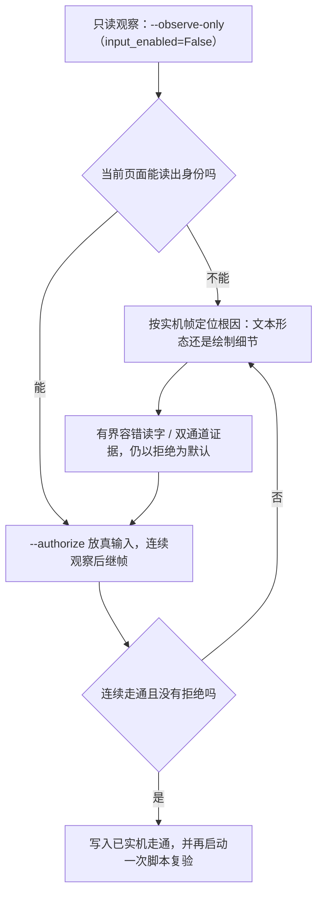

### 9.3.3 GUI Start 遇到旧局仍在跑的入口判定（2026-10-15）

实机根因（本节写作时的现场）：GUI Start 在 09:55 真的按下了开始，但镜牢入口停在“启动前核对旧局与队伍设置”后以 `mirror_settings_rejected` 结束，`dist/MaaLimbus/evidence/runtime/pi-20261015-095517` 里 0 帧 0 点击。日志两条错误分别是观察节点没读出页面（`the observation node recorded no page for this frame`，`src/maalimbus/runner.py:648`、`:659`）和本机参与者 OCR 无证据（`Maa local participant OCR returned no evidence`，`agent/recognition.py:284`）。

为什么现场是这个状态：只读与放行两类验证脚本（`evidence/runtime/packaged-mirror-20261015-070250`、`-071416`、`-071912`）已经进入一个真实的 Hard 周目，并把游戏留在 `PRE_BATTLE_TEAM`；账本里那条 `active`（id `616264a2…`，team 1，phase `entered`）仍在 app 自己的数据根 `D:\fgoa\MaaLimbus\config`（`dist/MaaLimbus/config/user-data-root.json` 指过去）。**进行中的周目不是空闲入口**：`reconcile_idle_entry`（`src/maalimbus/run_wiring.py:255`）只允许在刚拍到的帧明确证明是空闲 `MIRROR_ENTRY` 或 `DUNGEON_TEAM` 选人页时退休旧局；当时观察连一帧都没产出，于是整条入口被拒。

本节计划：入口预检必须把两种情况分开——「账本有局，且这帧证明游戏已不持有它」照旧退休；「账本有局，但这帧读不出任何页面身份」保留该局，并把读页交给循环自己去做，绝不在读不出的帧上输入。容忍分支只记 `mirror_entry_preparation`（`retired=False` 与观察错误原文），随后与没有旧局时一样继续走 `GlobalSettingsAction.apply` 与 `MirrorLoopAction`；读不出页的帧仍然按未知页面处理，不点、只等。

| 现场 | 期望行为 | 证据要求 |
| --- | --- | --- |
| 账本 `active` 为 null | 直接按设置进镜牢 | app 日志出现 `mirror_loop_start` |
| 账本 `active` 非空，帧证明空闲入口/选人页 | 退休旧局后按设置进镜牢 | `mirror_entry_preparation` 的 `retired=True` 与 disposition |
| 账本 `active` 非空，帧读不出身份（本节的实机现场） | **保留该局**，继续进循环，由循环重读页面 | `mirror_entry_preparation` 的 `retired=False` 与观察错误原文，且不再出现 `mirror_settings_rejected` |

同样必须记住的第二个事实：app 的真实数据根是 `D:\fgoa\MaaLimbus\config`，不是 `dist/MaaLimbus/config`。写进 `dist` 的设置只会被 GUI 显示，agent 读的是前者；要钉“单队第 2 队 / 本次 3 次 / 步数 2000”这类运行设置，必须写 app 自己的数据根。

验收口径：在游戏停在进行中的镜牢页面时按下 GUI Start，必须真的进到循环（app 自己的日志可读），且不得再因为“没有证据”停在 `mirror_settings_rejected`；首帧读不出时循环仍按未知页面诚实停止。

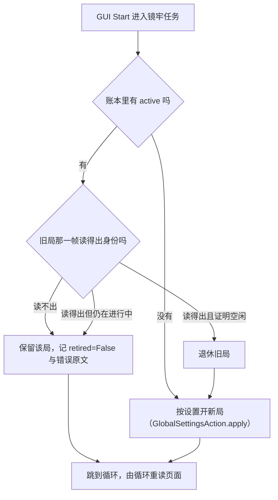

### 9.3.4 参与者计数读不出时的入口与部署（2026-10-15）

实机根因（13:01–13:08 现场）：入口观察在 `PRE_BATTLE_TEAM` 页上以 `Maa local participant OCR returned no evidence` 抛出，异常发生在**观察节点内部**（`agent/recognition.py` 的 `PRE_BATTLE_TEAM` 分支），所以 9.3.3 那层“入口容忍”根本没有机会生效：Maa 任务先一步失败，app 显示「任务失败: 自动镜牢」（`dist/MaaLimbus/evidence/runtime/pi-20261015-130827`，0 帧）。

测量：新版选人页把计数器画成 `2/12`，在实机帧里被整帧 OCR 读成 `2/12`、框 `[1610,745,250,80]`、分数 `0.997`（`evidence/runtime/packaged-mirror-20261015-131001/frame-0001.json`）。`team_vision.participants`（`src/maalimbus/team_vision.py:46-62`，模式 `:9`，ROI `:10` = `(0.86,0.66,0.97,0.78)`）在该帧上离线复算得到 `(2,12)`；曾经失效的是旧裁切 `(1680,738,180,92)` 切掉了分子，新裁切 `(1610,745,250,80)` 两侧留了余量。

本节计划：计数器读到与否都不是“页面是否成立”的条件——计数未落定的那一帧仍然是帧，不是页面。节点只记录缺读并放行，由循环自己的有界重读（`src/maalimbus/runner.py:1696-1702`）决定是继续还是诚实停止；节点不再因为缺读而让整个启动失败。

| 现场 | 期望行为 | 证据要求 |
| --- | --- | --- |
| 计数器读得到 | 照常进入选人与部署判定 | 帧里出现 `2/12` 一类计数，`deployment_participants` 有结果 |
| 计数器读不到（滚动/未落定帧） | 节点记录缺读并继续，循环做有界重读 | 帧里无计数但页面身份成立，且不再出现节点级异常 |
| 重读用尽仍读不到 | 诚实停在部署一步，不发输入 | 停止原因为 `deployment_transaction_or_counter_missing`，`clicks_sent` 不增加 |

验收口径：在停顿的 `PRE_BATTLE_TEAM` 页上再按一次 GUI Start，必须走到 `mirror_loop_start` 并进入部署判定，而不是让观察节点把整个任务判失败。

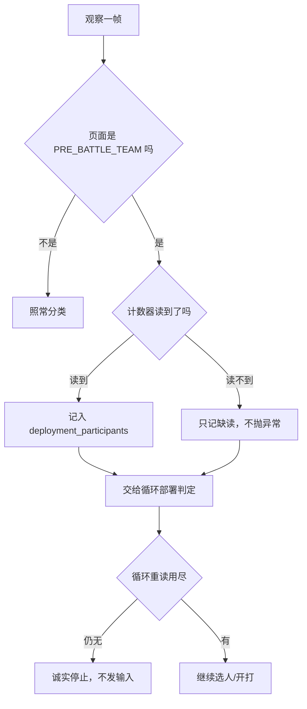

### 9.3.5 新版购买确认框：粘在一起的货币徽章（2026-10-15）

现场：17:31 那次 GUI 启动一路打到第三个商店，在购买确认框上停住，理由是 `the_shop_asked_about_a_purchase_and_its_confirm_was_not_read`（`src/maalimbus/window.py:614`），停在 `SHOP_PURCHASE` 两帧（`dist/MaaLimbus/evidence/runtime/pi-20261015-173132/frame-0250/0251.png`）。

根因（已离线复现）：新版确认框标题是 `Purchase E.G.O Gifts`、按钮是 `Purchase`，`native_purchase_dialog` 三个锚点都读到了；但货币转变徽章 `1102 ▶ 895` 被识别成一个粘连 token `'1102895'`，于是 `purchase_balances` 找不到「前一个数字」而返回 None，`matching_purchase_question`（它是花钱的授权入口）随之返回 None，页面只能拒绝。

修法：`src/maalimbus/shop_vision.py` 的 `purchase_balances` 先按老版式读分开的两个数字；读不到时，用旁边的 after 数字去**切开粘连 token**（`^\d{1,4}` + 那个 after 数字 + `$`），切不出来就返回 None。真正的授权仍然要求 `before - after == price` 且 `before == 意向里记的 coins`，所以切错也买不成。

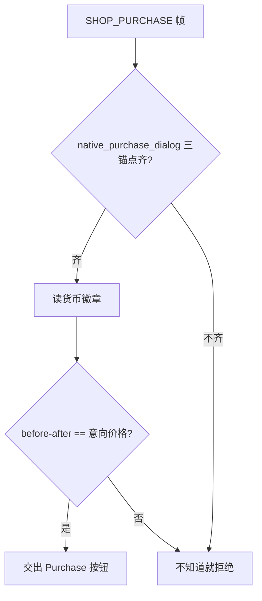

| 锚点 | 新版读数 | 判据 |
| --- | --- | --- |
| 标题 | `Purchase E.G.O Gifts` [674,236,292,34] .999 | `^Purchase E\.G\.O Gifts$` 在 (.32,.20,.55,.27) |
| 确认 | `Purchase` [1092,706,128,34] 1.000 | `^Purchase$` 在 (.50,.58,.70,.80) |
| 取消 | `X Cancel` [710,702,156,42] .912 | `^[X×]?\s*Cancel$` 在 (.31,.58,.50,.80) |
| 徽章 | `1102895` + `895` | after 数字切出 before，且 before-after=207=价格 |

验收：同一帧上 `purchase_balances` 返回 (1102,895)、`matching_purchase_question(records,'Awe',207,coins=1102)` 返回 `Purchase` 的框；价格改成 208 必须返回 None。测试在 `tests/test_shop_vision.py`（含无留帧时 skip 的实机帧用例）。

### 9.3.6 按完成镜牢计数，以及把藏品搜索开放出来（2026-10-15）

用户口径（m01434）：别再用步数上限当目标，**按完成镜牢算**；步数当安全网就行。藏品搜索要**开放**，让它自己学购买策略；但金币不能攒太多、也不能一点不留。

已经有效的部分：停止条件是循环自己的完成局计数（`src/maalimbus/runner.py:2846` `_run_count_reached`，目标写在 `runner.py:3237` 的 `verified_runs`），不是步数；步数窗口来自 `MirrorRunBounds`（`src/maalimbus/mirror_task_options.py:27-30`，1..2000）。因此入口在**点名了次数**时把窗口抬成至少 4000（`agent/recognition.py` 的 `loop.run(steps=...)` 调用处），让五层镜牢不会被一个“你想跑三次”的数字中途截断。金币平衡规则本来就在：`CARRY_CAP_COINS = 1500`（`src/maalimbus/shop_settings.py`）与保留默认 500（同文件 `:74`）——留一部分、把溢出的花掉，正是“不能攒太多、不能一点不留”。

尚未实现的部分（不得写成已实现）：藏品搜索页现在只有两条路——`refuse` 或“用 Select 离场、不花星光”（`src/maalimbus/window.py:763-785`），而任务设置只接受 `saved`/`refuse`（`src/maalimbus/mirror_task_options.py:22-26`）。要真正“开放”，必须新增：按评分从池子里挑不超过三件、付出星光、支出用带回执的持久事务证明，并且没有回执就不算买过。

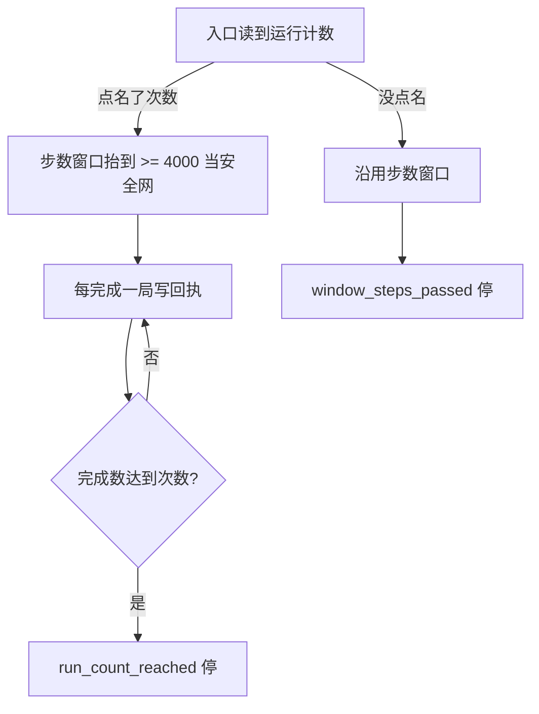

| 现场 | 期望行为 | 证据要求 |
| --- | --- | --- |
| 点名了完成次数 | 计数到次数才停；步数只做安全网 | `run_count_reached` 事件与 `verified_runs` |
| 没有点名次数 | 保持原来的步数窗口行为 | 停止原因为 `window_steps_passed` |
| 藏品搜索（开放后） | 按评分挑件并付星光 | 星光支出回执 + 页面后继帧 |
| 藏品搜索（当前） | 只拒绝或离场，不花钱 | 事件里 `gift_search` 走的是 refuse/select 分支 |

验收口径：把次数点成 3 后，一次启动能连跑到第三次完成回执；藏品搜索开放前不得在任何日志或文档里声称它已经在买。

### 9.3.7 奖励页的两处误停：目录名错字与“价”的判据（2026-10-15）

两次实机停止都发生在奖励页，都不是“游戏变了”而是我们自己的判据错了。

**一、`floor_gift_identity_unknown`。** `dist/MaaLimbus/evidence/runtime/pi-20261015-180214` 跑了 345 帧后停在奖励页。页面确实印着标题，但镜像目录 `assets/resource/base/gift-catalog.json` 把这条藏品的名字写成了 `Arrested Hymm`，客户端印的是 `Arrested Hymn`（`build/learning-review` 的留存语料里 20 次全是 Hymn）。两者归一化后只差一个字母，而 12 字符时 `difflib` 比率只有 0.9167，低于 `src/maalimbus/gift_vision.py` `text_identity` 的 0.93 门槛，于是返回 None、整局停止。处置有两层：目录条目名改成 `Arrested Hymn`（**不改** `icons[].path` 与 `sha256`，图标哈希校验因此不受影响），并在 `text_identity` 加一条兜底——只有“唯一一个、长度 ≥ 8、编辑距离 ≤ 1”的目录名才算命中，短名或两名并列仍然拒绝，所以模糊歧义的原有防线没有放松。

**二、`three_free_gift_trial_or_cost_present`。** `pi-20261015-172214` 在三选一奖励页停了，因为否决条件把 `Defense Level`、`Max HP`、`Cost` 等词当成“这是试炼/付费页”。新版把**每张卡片自己的效果文本**印在卡片里，`Defense Level Down until` `[844,534,244,25]` 就是第一张卡的效果句，页面上按钮却明明是 `Refuse Gift` 与 `Select`。否决改为判“带价的说法”：出现 `Modules`/`Purchase`/`Shop`/`Lunacy`/`Mounting`/`Trials` 这类名词，或 `Enemy Level`/`Defense Level`/`Damage Taken`/`Max HP`/`Cost` 后紧跟数字时才否决；纯效果措辞不再误伤。

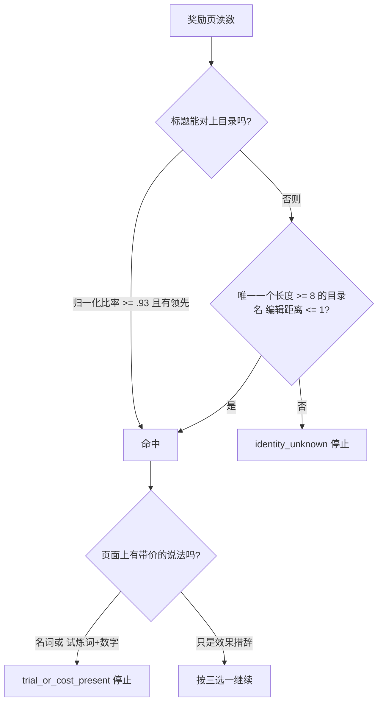

| 现场 | 期望行为 | 证据要求 |
| --- | --- | --- |
| 目录名有一个字母错字，客户端印刷正确 | 仍解析成该藏品 | `tests/test_gift_vision.py` 用 `Arrested Hymm` 断言得到 `Arrested Hymn` |
| 卡片里的纯效果句 | 不否决三选一布局 | `tests/test_three_free_gifts.py` 用 `Defense Level Down until` 断言仍返回三个候选 |
| 真试炼/真付费措辞 | 仍否决 | 同文件用 `Enemy Level +2` 与 `Mounting Trials` 断言抛出 |
| 图标路径与哈希 | 改名不触碰它们 | `gift-catalog.json` 的 `icons[].path`/`sha256` 未变，目录加载校验通过 |

验收口径：同一次启动能走过三选一奖励页与购买确认框继续往下跑；`three_free_gift_trial_or_cost_present` 只在真的是付费/试炼页时出现，而目录外的藏品现在退回页面自己印的标题（见 9.3.9），不再结束整局。

### 9.3.8 页面读不动与识别卡死：视角恢复阶梯与停滞看门狗（2026-10-15）

用户口径：一天之内连着四次停在不同页面，用户要求先停下来总结规律，而不是再逐个打补丁——「不要遇到问题改一个遇到问题改一个」，并明确「只要在这种界面失败了一律尝试缩小地图」（m02370、m02456–m02457）。四次停止（购买确认框的货币徽章、被拉近到只剩一格的地图、还没淡入的技能检定条、迟迟没等到计划里那件商品的商店）确实共享同一个形状：**都是"这个视图现在读不出东西"，而视图是可以被手势移动的**。所以处置不是再加四条特判，而是两条通解。

**通解一：任何一步没落地，先花一档视角手势，而不是直接结束整局。** `RECOVERY_LADDER`（`src/maalimbus/runner.py:301-306`）四档依次是 `pinch_out`（缩小地图）、`drag_down`、`drag_up`、`wait`。缩小地图这一档直接复用实机标定过的双指手势：`pinch_out`（`runner.py:315`）配 `MAP_ZOOM_OUT = {'centre': (960, 540), 'radius': 320, 'factor': 0.55, 'seconds': 0.9}`（`runner.py:290`，与 `tools/map_zoom.py` 标定值一致），两指从 ±320 走拢到 ±176，共 12 步；控制器不支持双指时抛 `NotImplementedError`，**不会退化成在地图上乱点**。`_recover`（`runner.py:3321`）以 `页面|停止原因` 作为签名，同一个停止一次只花一档（`state['recovery_rung']`），花完整个梯子才允许整局结束，事件分别是 `window_recovery` 与 `window_recovery_exhausted`，另计 `artifacts['recoveries']`。关键安全性质写在注释里也写在测试里：**四档全部只移动视角、不按任何游戏控件**，所以在布局还没学过的页面上也可以放心试。想关掉这套行为就把 `recovery_tries` 设为 0。

**地图上先花掉第一档，再去试下一个候选节点。** 地图上一次点击之后页面完全没动，说明计划瞄的那个节点根本不在屏幕上：实机 `pi-20261015-200848` 在 90 秒里点了五个候选节点，`Exploring Floor 3` 一直没变，看起来就像卡死，用户于是手动停掉了它。所以 `_map_zoom_once`（`runner.py:3304`）在第一次"点了没动"时就直接花掉缩小地图这一档，并按第 0 档记账（写 `state['recovery_for']` 且 `recovery_rung = 1`），使梯子不会把同一档花两遍；只有**再下一次**仍然没动才退回换候选节点（`window_map_retry`）。事件是带 `gesture=pinch_out`、`before_another_candidate=true` 的 `window_recovery`；一旦真的落地成功，`map_zoom_for` 与其它恢复状态一起清零。

**通解二：识别调用卡死时，任何手势都救不回来，于是从循环外把进程结束掉。** `dist/MaaLimbus/evidence/runtime` 里 `pi-20261015-191205` 在 19:16:07 卡在一次 OCR 调用上，此后 12 分钟没有新帧、没有事件、没有结果，GUI 侧表现为「停了，甚至没法打开」（用户 m02283）——进程还在，线程全在等，是挂死不是循环。`stall_watchdog`（`runner.py:342`）用帧心跳判定：`_observe` 每次拿到帧就刷新 `artifacts['heartbeat']`（`runner.py:1582`），守护线程在超过 `stall_seconds`（默认 300 秒，`STALL_SECONDS` 见 `runner.py:3358`）没有心跳时先 `_record_stall`（`runner.py:3382`）把停止记录写进本次运行目录，再 `os._exit(4)`，让 GUI 如实报「任务失败」而不是静默挂着。

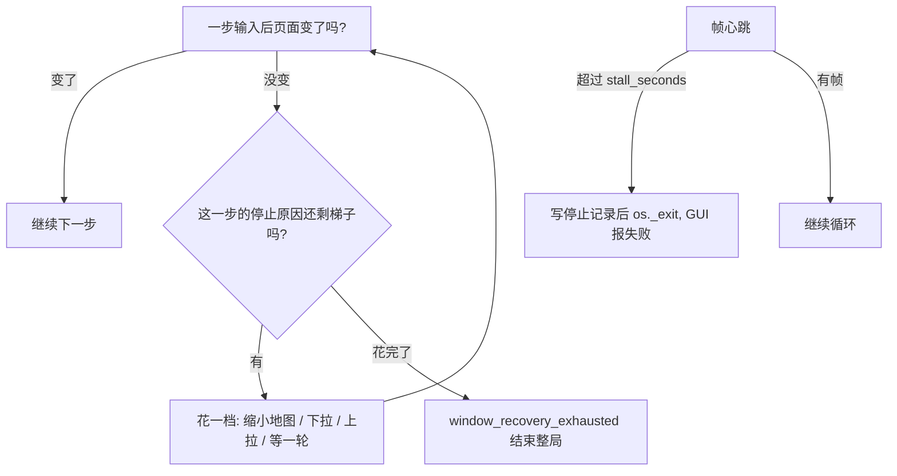

| 现场 | 期望行为 | 证据要求 |
| --- | --- | --- |
| 地图被拉近、节点在屏幕外 | 先双指缩小地图再重读该页 | `window_recovery` 事件 `gesture=pinch_out`，`artifacts['recoveries']` 递增 |
| 地图点击后画面完全没动 | **先**缩小地图，再考虑换下一个节点；同一次停滞只缩一次 | `window_recovery` 带 `before_another_candidate=true`；`tests/test_recovery_ladder.py::test_the_map_view_moves_before_another_candidate_is_tried` |
| 同一页同一原因连续失败 | 一次只花一档，四档花完才结束 | `tests/test_recovery_ladder.py::test_the_ladder_is_spent_once_per_stop_and_then_the_run_ends` |
| 识别调用永不返回 | 超时后写记录并结束进程，GUI 报失败 | `stall_watchdog` 用例传入 `rounds` 后有界返回；实机帧心跳见 `artifacts['heartbeat']` |
| 控制器不支持双指 | 抛错而不是退化成点击 | `test_a_controller_that_cannot_simulate_two_fingers_refuses_instead_of_clicking` |
| 想恢复旧行为 | `recovery_tries = 0` 时一步不落地就立即结束 | 老用例显式传该设置后仍断言原停止原因 |

验收口径：实机在拉近的地图上失败时，停止原因应先是 `the_view_is_pinched_out_so_the_page_shows_all_of_itself` 并伴随 `window_recovery` 事件，而不是直接结束；识别卡死时应在 `stall_seconds` 内以失败结束而非静默挂着。这套阶梯只解决「视图读不动」，不解决「判据本身错」（那属于 9.3.5 与 9.3.7）。

### 9.3.9 读不出来的模态不结束整局：对话框自己的 Cancel 与目录外的藏品（2026-10-15）

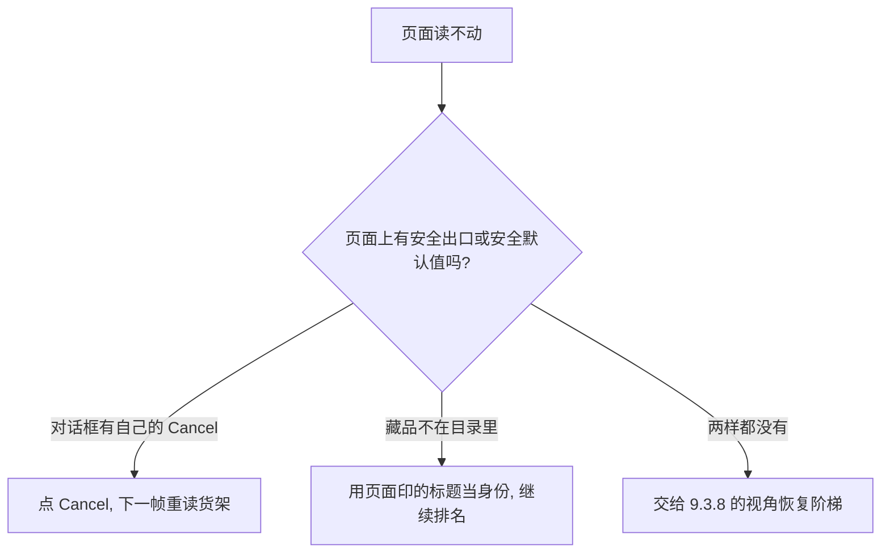

用户口径（m08238）：「你能不能做事情结构化一点，框架化一点，这种东西明明有容错更高的上游实现方法」，并直接问「不会所有没有录入的藏品都会给我停了吧」。两处停止共享同一个上游事实：**页面上本来就有安全出口或安全默认值，是判据把它们当成了不可继续。**

**买确认框：它自己的 Cancel 就是答案。** 实机 `dist/MaaLimbus/evidence/runtime/pi-20261015-202635` 停在新版购买框（`Purchase E.G.O Gifts` + `Purchase` / `✗ Cancel`），原因是 `the_shop_asked_about_a_purchase_and_its_confirm_was_not_read`。判据链 `matching_purchase_question`（`src/maalimbus/shop_vision.py:354`）要求礼物名、`before - after == price`、`balances[0] == coins` 三者严格相等；同一局商店刚读到 `1808`，对话框徽章读成 `1809`，一个 token 的漂移就否掉了这次购买。新的 `purchase_dialog_answer`（`shop_vision.py:408`）把这个模态当成有安全出口的问答：只有名字相邻（`close_to(..., 1)`）**且**正好花掉预留价格才回 `('purchase', box)`，其余一律回 `('cancel', box)`，货币容差 `COIN_DRIFT = 2`。`window.py:610` 在 `shop['cancel']` 存在时点它自己的 Cancel、下一帧重读货架，不再结束整局；只有 Cancel 也读不到时才保留原来的拒绝。

**目录外的藏品：用页面自己印的名字当身份。** `floor_gifts.observe`（`src/maalimbus/floor_gifts.py`）以前在 `catalog.text_identity` 返回 `None` 时抛 `floor_gift_identity_unknown`，于是任何没进 `assets/resource/base/gift-catalog.json` 的藏品都会结束整局。现在 `identity_of` 在查不到目录条目时退回**页面自己印的标题**当身份：不发明字符串，藏品照样进排名与回执，只是关键字为空（`keywords_of`），而 `rank` 本来就把"没有关键字"当作没有队伍收益，学习也按它看到的这个名字记样本。

| 现场 | 期望行为 | 证据要求 |
| --- | --- | --- |
| 购买框读不出预留的那件商品 | 点它自己的 Cancel，下一帧重读货架 | `tests/test_shop_vision.py::test_the_dialogs_own_cancel_answers_a_question_it_cannot_authorize` |
| 商店货币与对话框徽章差一两个 token | 仍按预留购买确认 | `COIN_DRIFT = 2`；`test_a_drifted_coin_counter_is_the_reader_not_another_purchase` |
| 奖励页出现目录外的藏品 | 用页面印的标题当身份，继续参与排名 | `identity_of` / `keywords_of`；`tests/test_floor_gifts.py` 全绿 |

验收口径：读不动的模态与目录外的藏品都不得单独结束整局；能结束整局的仍然只有「整条恢复阶梯花完」（9.3.8）。

### 9.3.10 场景读数不是授权：购买页上的按钮，与退役的预留（2026-10-15）

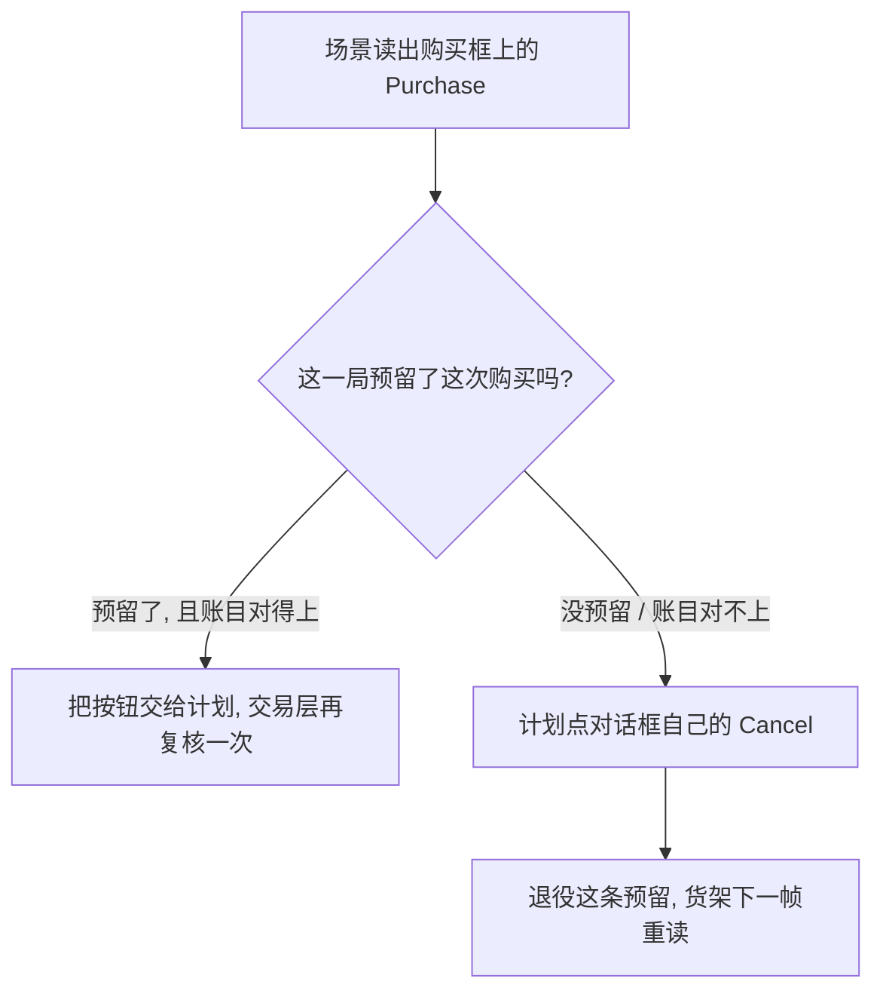

用户口径（m08238）：「这怎么也会失败的？？？」，要的是**更上游的容错**。9.3.9 修的是"读不出来"，这一条修的是另一半：**读数被当成了授权**。实机 `dist/MaaLimbus/evidence/runtime/pi-20261015-212438` 在 21:24:38 启动、2 秒后停，理由是 `mirror_loop_failed; Full matching purchase title/price/question not proven`（`src/maalimbus/shop_transaction.py:384`）：上一局留下的 159 币预留，遇上一个自己徽章写着 390 的对话框，场景读到的按钮照样进了计划，交易层拒绝授权，整局就结束了。

三处结构性改动：

- **场景读数不再冒充授权。** `shop_state`（`src/maalimbus/runner.py:1111`）在 `SHOP_PURCHASE` 页面上不再交出 `confirm`：对话框的 `Purchase` 只当场景锚点，读到的结果（`readable`）只用来写 trace 理由。购买页唯一的授权来自 `_observe` 的 `SHOP_PURCHASE` 分支（`runner.py:2074`），它按预留意向的名字、价格与金币算出 `purchase_dialog_answer`；账目对不上就退成 `shop['cancel']`。
- **没有预留的问答也有出口。** 页面上压根没有本局预留时（操作者自己点的购买框，或上一局死在框上），`native_purchase_dialog` 读到的 `Cancel` 就是唯一输入（理由 `a_purchase_question_this_run_never_reserved`）。
- **预留必须跟着 Cancel 一起退役。** `ShopTransaction.retire_pending`（`shop_transaction.py:390`）在点 Cancel 前清掉 `pending`，并把原因记进本次访问（`visits[...]['retired']`）。不清掉的话，货架下一帧会因为"已有预留"拒绝任何新购买，整局就卡在同一个对话框上。
- **换行的礼物名按词读，不按行的先后读。** 购买框把自己的礼物名折成两三行叠着印，识别器按框落点排序，读出来的顺序不是印刷顺序：实机 `pi-20261015-213416/frame-0001.json` 把 `Clear Mirror, Calm Water` 读成了 `Mirror, Calm`、`Clear`、`Water` 三个框，于是名字核对永远不成立，每一帧都拿对话框自己的 Cancel 作答，货架下一帧又挑同一个礼物 —— 21:34 那一局就这样在同一张卡上打了 5 次，最后停在 `the observation node recorded no page for this frame`。`names_match`（`src/maalimbus/shop_vision.py`）改成**词的多重集合**比较：行的先后不参与证明，客户端的单字滑落仍然宽容。同一条实机的 390 币预留，第一帧就被确认。

| 现场 | 期望行为 | 证据要求 |
| --- | --- | --- |
| 场景读到购买框上的 `Purchase` | 不交给计划，只有账目证明才交 | `tests/test_shop_vision.py::test_the_purchase_pages_own_button_is_never_an_authorization` |
| 页面上有本局没预留的购买框 | 点它自己的 Cancel，不买也不结束整局 | `runner.py:2074` 的 `SHOP_PURCHASE` 分支 |
| Cancel 之后 | 预留退役、货架可再次购买 | `tests/test_shop_transaction.py::test_a_reservation_the_modal_never_asked_about_is_retired` |
| 礼物名折成多行、识别框顺序被打乱 | 仍按词认定为同一个礼物并确认购买 | `tests/test_shop_vision.py::test_a_wrapped_gift_name_is_read_in_whatever_order_its_lines_came` |

验收口径：一次启动里，购买框无论是"读不出来"还是"没预留过"，都只走 Cancel 并继续跑；交易层拒绝不可授权的按钮时不再结束整局。**授权这一步也要认得新版对话框**：它不再要求那句 `Would you like to purchase …?`（新版根本不印），而是用与计划完全相同的证据 —— 礼物名按词、徽章正好花掉预留下价格、金币落在预留意向里（`ShopTransaction.reserve_confirm` 先问 `purchase_dialog_answer`，读不出来时才回落到旧版问句）。实机 `pi-20261015-214921`（21:49:21 启动，11 秒后停，inputs=1）就是死在旧问句上：计划已经授权了这一个购买框，交易层却找不到那句问句，于是整局结束。

### 9.3.11 购买标签来自这一局自己后来的观测：价值模型的门控式参与（2026-10-15）

**症状**：商店样本一直在记录（`dist/MaaLimbus/evidence/runtime/pi-*/agent-result.json` 里 `shop_purchase_learning_samples.neural_policy_applied=false`，日志写"购买学习样本已记录：7；价值神经模型尚未应用"），但运行目录 `assets/resource/base/model/shop-value` 根本不存在，因此 `shop_value_shadow.rank_preview` 每次都走 `purchase_value_model_missing_rule_fallback`。样本被记下，却没有任何东西给它们打标签；"人的复核"是一个没人执行的门。

**规则**：一次购买的收益**不由人写**，就是这一局在它之后自己观测到的东西 —— `shop_value_training.label_from_outcomes()` 重新推导：过层按层数（一层 0.2）、通关 1.0、只拿到奖励或原路退出 0.1；标签摘要只覆盖被哈希绑定的那些位（`outcomes_digest`），所以证据到达的顺序不会改变标签。`review_sample()` 只在存在**被运行账本绑定过的后续观测**时才写 `review.json`/`outcome.json`（`approved_by=observed_run_return_in_scope`，`training_eligible=true`，`human_approved` 仍为 false）；没有后续观测的目录保持 pending 并计数（`delayed_outcome_evidence_missing`），不编造收益。加载侧（`load_reviewed_episodes`）不信任盘上的标签：它会重新推导，标称收益与证据不一致的样本以 `objective_label_mismatch` 排除，再次检查 `action_executed`、`training_eligible`、内容地址与账本绑定。

**参与是门控的**：训练器用 `split_by_scope` 按整局留出，只有在留出对比里自己证明了排序能力（对数 ≥ 4 且准确率 ≥ 0.6）才把 `participation` 写成 `ranked`；否则写 `shadow`。`rank_preview` 每次加载都重验哈希链（`weights_sha256`、`dataset_sha256` 三处一致、`evidence_verified`、`reviewed_episodes` 与 `verified_episodes` 相等、权重有限且界内），再按参与方式返回：`ranked` 在**计划已经批准的候选内部**按分数排序，`shadow` 只报分数、顺序不动。两者都不会覆盖"计划指定的那个礼物"（`the_gift_plan_asked_for_this_offer`）——模型只在计划自己划出的集合里决定先买哪个。

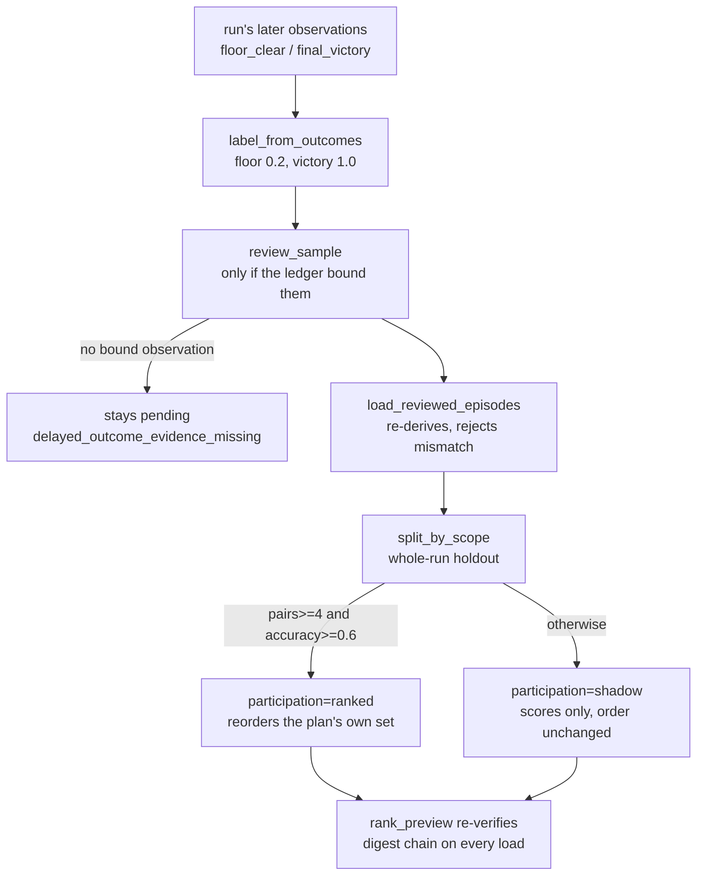

| 现场 | 期望行为 | 证据要求 |
| --- | --- | --- |
| 购买后这一局过了一层 | 标签按层数推导，写入复核文件 | `tests/test_shop_value_review.py::test_the_label_is_the_runs_own_later_observation` |
| 证据缺哈希绑定 | 不算标签 | `tests/test_shop_value_review.py::test_a_later_observation_without_a_bound_digest_is_not_a_label` |
| 购买后没有被绑定的观测 | 保持 pending，不编造 | `tests/test_shop_value_review.py::test_a_purchase_the_run_never_followed_up_stays_pending` |
| 候选证明不了留出排序 | 只做影子，顺序不变 | `tests/test_shop_value_review.py::test_a_promoted_candidate_reorders_the_offers_and_a_shadow_one_does_not` |
| 盘上标签与证据不一致 | 加载时重新推导并排除 | `tests/test_shop_value_review.py::test_a_candidate_with_a_dataset_digest_that_does_not_re_derive_is_ignored` |

验收口径：`python tools/shop_value_review.py --install` 会复核目录、训练、并把 `weights.json` 与 `modelcard.json` 装进 `assets/resource/base/model/shop-value`。2026-10-15 的实测状态：10 个目录中 7 个已按观测标注、3 个仍待核（缺后续观测）；已核样本 1 局 / 6 行，留出 0 对、准确率未知，因此参与方式为 **shadow**（分数已可见，顺序不变）。**这不是"神经网络已上线"**：要开始参与，需要第二个被核验的局形成留出对比；缺的就是能跑完的实机局数，而不是人的复核。

**续（2026-10-16）：账本的 `abandoned` 也是账本；而标签只有一个值时，门控拒绝得对。** 上一段把缺口记成"缺的是能跑完的实机局数"。核对之后它分成两件不同的事。

1. **当时被核样本不可能有两局，这是结构问题。** `_scope_evidence`（`src/maalimbus/shop_value_training.py:389`）只在 `active` 与 `receipts` 里找这一局的证据绑定，而 `run_wiring.expire()` 把到期或重开的旧局归入 `abandoned`——`f855ac82c2b1429aae9c747a122213b8` 就在那里（备注：画出选人页时镜牢里没有进行中的局）。它自己的 4 条 `floor_clear` 正是给那次商店购买打标签的后续观测，却因为不在前两个列表里被判 `delayed_outcome_scope_not_in_run_ledger` 排除。只读前两个列表意味着一次购买只在**自己那一局还是 active 的时候**才能被标注：语料永远只有一局，留出比较永远没有对可比，`ranked` 于是不是"还没到"，而是结构上到不了。`_ledger_runs()`（`:374`）现在把 `active`/`receipts`/`abandoned` 一起读，重复登记仍按 `run_ledger_scope_ambiguous` 拒绝；实机语料从 1 局 6 行变成 2 局 7 行、留出 6 行。

2. **两局之后标签仍然只有一个值，而这一次门控拒绝得对。** `label_from_outcomes` 取的是**这一局**在购买之后观测到的最大收益，所以一次运行里每一行拿到的基本是同一个数：这局后来到过哪一层，就是这局所有购买的标签。实机 7 行的 `label_values` 是 `[0.6]`，`len(targets) > 1` 这道门因此照旧把它写成 shadow。这不是缺陷：只有单一取值的语料没有任何"谁更好"的对比可学，强行晋级只会得到一个把常数写在脸上的排序器。训练报告与 modelcard 现在直接写出 `label_values` 与原因（`candidate_shadow_blocked_because_every_row_in_the_corpus_carries_the_same_outcome_value_0.6`），不再只留一个 `shadow` 结论。

   要让它真的开始参与，缺的不是更多次同样的购买，而是**结果有差别**的局：同一种礼物有时买、有时不买，且两局的后续不同。这里还有一个必须承认的混淆：因为标签是"这局后来到得多远"，跨局样本教出来的可能是"**哪些礼物出现在强队里**"，而不是"哪些礼物值得买"。在把 `ranked` 交给它之前，这条混淆要有对照（例如同一队伍下的购买对比），否则 `ranked` 只是把一条相关性写进顺序。

## 9.4 学习与策略的架构边界

下图中“晋级后的推理/策略”是**设计目标**，不能读成当前生产已启用。已有基础分别在 `src/maalimbus/unknown_exploration.py:1`、`src/maalimbus/semantic_labels.py:1`、`src/maalimbus/learning_dataset.py:1`、`src/maalimbus/neural_shadow.py:1`、`src/maalimbus/shop_learning.py:1`、`src/maalimbus/shop_value_shadow.py:1`。MaaFramework提供识别/控制/Pipeline；训练、标签复核和策略晋级是本项目扩展，不称作Maa自带训练器。

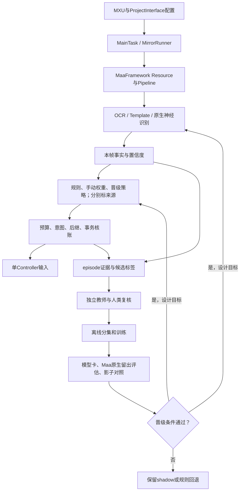

首先列清当前哪些节点真正调用模型、哪些只写proposal、哪些为shadow/off，附模型hash和实际日志。识别和购买价值分别验收：买成功只证明交易，不证明藏品强度；重绘或赢一场不证明选择最优。商店手动优先级、保留金币、刷新上限、允许/禁止名单始终有效；模型不能扩大预算。

感知模型至少按episode隔离训练/验证/测试；同一局连续帧不能同时充当训练与独立验收。模型晋级前固定类别、阈值、误识别指标和回退条件，并在新episode跑原生Maa评估。购买策略先做历史回放和影子排序，按实际效果指标与规则基线比较；证据不足就保持影子，不得把“模型加载了”写成“学习控制已应用”。

## 9.5 标签、评分与证据的数据模型

这是**逻辑模型**，不是声称所有实体已是一张数据库表。已有JSON/JSONL产物要做字段映射；缺字段先在规格写明，再实现。原图、OCR事实、动作结果、推断标签、人工裁决分开保存；标签更正保留版本。运行日志只展示真实参与决策的权重、各项加扣分、最终分、决胜规则、候选被排除的原因以及模型是否参与。

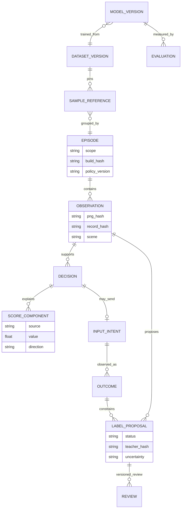

复核包至少含manifest、前后截图/OCR、动作意图与结果、评分轨迹、标签proposal与review状态；引用采用hash而非只靠可被覆盖的文件名。失败样本也收集，但“未知”不是负例，“无进展”不一定是按钮错误。模型训练资格由证据和复核状态决定；不能让自己的模型预测循环充当独立教师。

## 9.6 资源监控部署与接口

监控不创建控制器，不抢截图，不阻塞输入。采样关闭时停止后台任务；建议低频起步，具体间隔写入设置并测开销。读取总GPU、VRAM、脚本进程CPU/RAM；若提供进程GPU，必须写明供应商与归属算法。缺值用null和reason，不能显示为0。

当前源码边界：`resource_diagnostics.sample` 已提供进程CPU/RAM和整卡GPU/VRAM采样，`NvidiaSmiProvider` 有固定参数和超时；`tools/resource_diagnostics.py` 是只读CLI。CPU以单核忙碌为100%，多核可超过100%。进程GPU只有可注入接口，默认 `unsupported / no_per_process_gpu_provider`，不是已实现归属。GUI异步调用、开关与实机同窗对照仍待验收。查询 `gpu` 路由查看当前符号和窄测试；结构检查通过不能证明这些行为已交付。

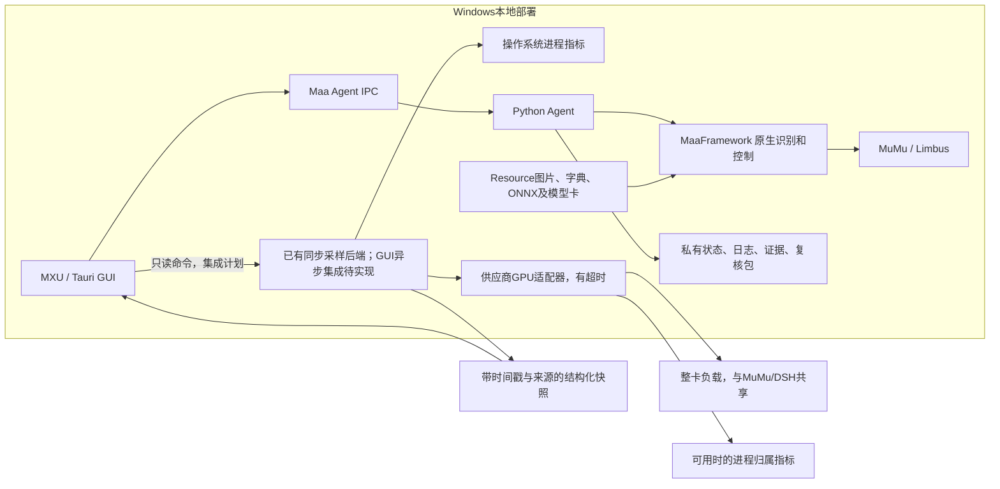

接口沿用[诊断契约](../../plan-20261014-recovery-diagnostics.md)：version、sampled_at、interval_ms，进程role/pid/cpu_percent/rss_bytes/status，GPU provider/device_name/util_percent/vram_used_bytes/vram_total_bytes/status；整体和进程指标分开。明确CPU百分比是否按逻辑核归一化。不得采集或公开GPU UUID、用户名、机器ID或原始命令输出；不改系统权限。

P4验收包括同窗对照、非NVIDIA/无工具、超时、Agent退出、多GPU、开关开闭和游戏运行时采样。若运行中推理有GPU负载而面板无法归属，应显示“整卡可见、进程不可用”，不能伪造脚本占用。工具适配器具体实现由DSH选定并记入本节，架构边界不得改变。

## 9.7 验收矩阵与回写纪律

- [ ] P0：原卡4意图有原生证据支持的明确归宿，成功/取消分别记录，没有重买或凭空到账。
- [ ] P1：当前成品GUI点一次开始能进入正确管线，原生导航节点通过；证据绑定安装版本。
- [ ] P2：脚本实际完成Hard五层；部署核对正确时不清空重编；每层奖励、商店购买/刷新均结算可追溯。
- [ ] P3：Team1、Team2和Team22的指定体系/顺序/EGO配置逐项核对；离屏队伍滚动按新鲜行与选中标题验证；单队与轮换模式不串用。未实现的EGO装备不得勾选通过。
- [ ] P3：头像/星光卡保存重开和参数应用一致；运行N局与步数/时间上限分开；日志展示候选、权重/分项、最终分、来源和理由。
- [ ] P4：资源采样真实可对照、缺失正确显示、开关有效，运行不抢控制器。
- [ ] P5：未知尝试、成功/失败标签包、人类复核、episode分集、原生模型评估、实际推理和策略晋级各有独立证据。
- [ ] P6：最新合并代码完整测试无未解释失败；真实GUI→五层→到账→返回→一次轮换/再次入场，并核明确预算。
- [ ] P6：双语wiki和局部图与实现/证据一致；新增计划组件已重新标注真实状态；隐私与发布门禁分别核验。

每卡结束按“计划要求→实际代码/配置→验证命令→实际产物→差异→处置”回写，不只增加一段进度描述。未达到条件则保持部分完成，带下一步。打断/超时/用户操作造成的运行结束与程序异常分别归因；禁止把旧局截图当新局实证。最新状态放验收与PROJECT，本文保留稳定完成标准。

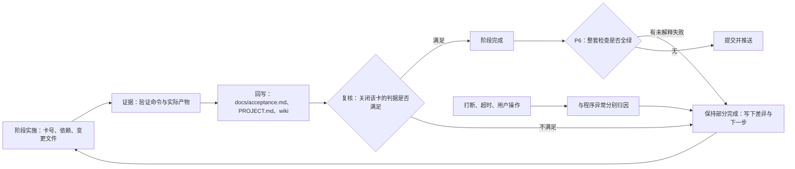

## 未验收 / 待核实

本章新增的是可执行计划及设计视图，**不代表P0–P6已交付**。GPU面板、模型晋级、显式连续局数、Team22体系EGO和整轮闭环仍按各卡实际产物判断。DSH正在运行的任务只观察其结果；不得为补计划重启控制器或替换活跃应用。

## 9.3.12 点击判定必须说明它看的是哪一帧，队伍位置必须能被读出

`map_click_result` 的 `frame` 曾经恒为 `None`：代码写的是 `getattr(self,'frames',None)`，
而 `frames` 只在 journal 上存在，`Runner` 上没有这个属性。现在点击派发时把帧名存进
`state['map_click_frame']`，三条判定（拒绝 / 接受 / 页面未变）统一读取；并且补了"页面既没变也
没移动时仍记一条"，避免意图被静默丢弃。真机验收：`packaged-mirror-20261022-075450` 388 事件、
13 条判定、13/13 带帧名、0 条 `None`、0 条静默丢弃。

`player_marker` 在直播帧上返回 `None`，循环无法只点相邻节点。新增 `map_vision.party_point()`
用队伍自己的火把（两枚上下相邻的暖色高亮斑）定位，该局 14 个地图帧全部读出，相邻帧位移
`(829,440)→(826,561)` 与一格步幅一致。

被数据否掉的假设同样记在这里：徽章点并不在节点上方空白（`(1020,327)` 落在 `?` 六边格内，
"下移 106"落在格子下方空地）；`GOLD_MARK_DROP` 全局改成 106 会让两条既有测试失败，说明偏移随
页面变、全局常量在结构上就是错的；用面积阈值取橙色边取到的是徽章图标而非连线。检测器在
`frame-0034` 上输出的中心与 `gold_marks` 重合，因为标签来自规则——这一项要改的是标注对象。

## 9.3.13 推断格不再直接当节点；连续被拒要说出"探索未恢复"

`lattice_step` 候选原先把格子推算点直接当节点中心。`packaged-mirror-20261022-080630` 的
`frame-0057` 显示同一批点里有的落在节点内、有的落在空地，而循环无从分辨。现在每个格子点先吸附到
120 px 内最近的徽章中心（徽章中心才是游戏提供的节点，见 `badge_mark` 一节），吸附不到就丢弃——
宁可少点一次，不点空地。

地图点击被拒有两种原因，帧上无法区分：候选错了，或探索尚未恢复。对照实验（同一设备、同一批候选）
给出判据：恢复前九次点击只产生 300–2000 px 动画，恢复后第一次点击即弹出节点面板（107 860 px）。
因此 `map_refusal_streak()` 在连续第三次被拒时记一条
`map_clicks_refused_while_the_exploration_may_be_unresumed`，`accepted` 时清零。它只**命名**，
不自动执行恢复——恢复导航仍未实现，这是已知的缺口。

## 9.3.14 连续被拒的地图不再点节点，而是先恢复探索

`map_refused_streak` 到达 3 时，runner 把地图页的进度控件放进 `plan_controls['map.progress_button']`
（`MAP_PROGRESS_CONTROL`，`src/maalimbus/runner.py`），`window.plan_map` 见到它就先返回
`the_exploration_must_be_resumed_before_a_node_click` 的计划，而不再点候选节点。未触发时行为不变。

依据是 9.3.13 记下的对照实验：恢复前九次点击只产生 300–2000 px 动画，恢复后第一次点击即弹出节点面板
（107 860 px）。所以"再点一个候选"在这种状态下是浪费，真正缺的是恢复。

已知限制：`MAP_PROGRESS_CONTROL` 来自单帧目测，只在一个分辨率上验证过；`plan_map` 目前只发起
"打开进度控件"这一步，`Dungeon Progress` 里的 `Resume` 仍由后续帧的常规计划处理。

## 9.3.15 恢复链的最后一环：进度面板上的 Continue 要有锚点

`window.plan_step` 对 `DUNGEON_PROGRESS` 早有分支，只按 `dungeon_progress.continue_button`
并且"没有锚点就不猜"。但真机 `packaged-mirror-20261022-084358` 显示：恢复计划打开了面板，
随后立刻 `continue_button_not_anchored`——分支在，**没人绑定**。

现在 runner 在该页从本帧 OCR 里绑定文本为 `continue` 的那一行，`Forfeit` 一律不绑。
面板上五个按钮里只有它继续当前探索，`Forfeit` 会结束这一局，`Config` 会中途改设置。

这次修复本身也留下一条教训：新增页面前先检索是否已有分支。本轮为此多写了一个重复分支并回滚。

## 9.3.16 只有一步之内的节点才能移动队伍

`map_clicks` 的候选此前只排序、不做可达约束，于是循环反复点隔两格以上的节点，判定全为
`rejected` 而队伍原地不动（`packaged-mirror-20261022-085428`：队伍在 `(1052,562)`，目标从
`(576,361)` 起）。手测证明相距 219–395 px 的邻居可点、会开面板。

现在 `map_vision.adjacent_to(party, boxes)` 只保留中心距队伍 150–430 px 的候选，并在
`runner.candidates_of` 里接上。读不到队伍时不过滤，避免"读不到就不试"。

先试格点精确匹配（`(384,0)/(192,110)/(0,220)`）会把真实邻居滤掉——实测偏移与任何单一格点
向量都不吻合，所以改用距离带。
