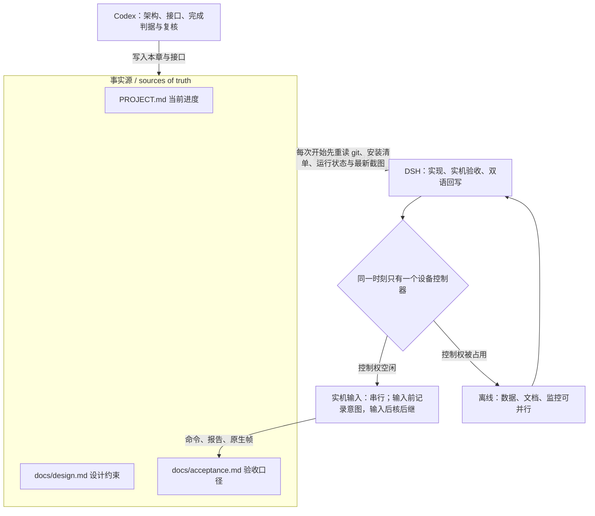
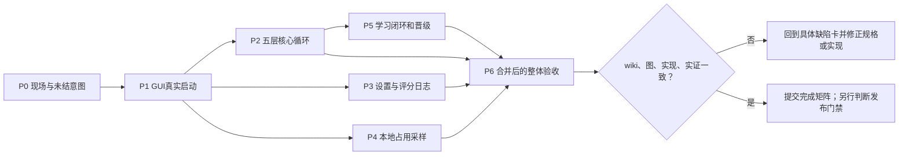
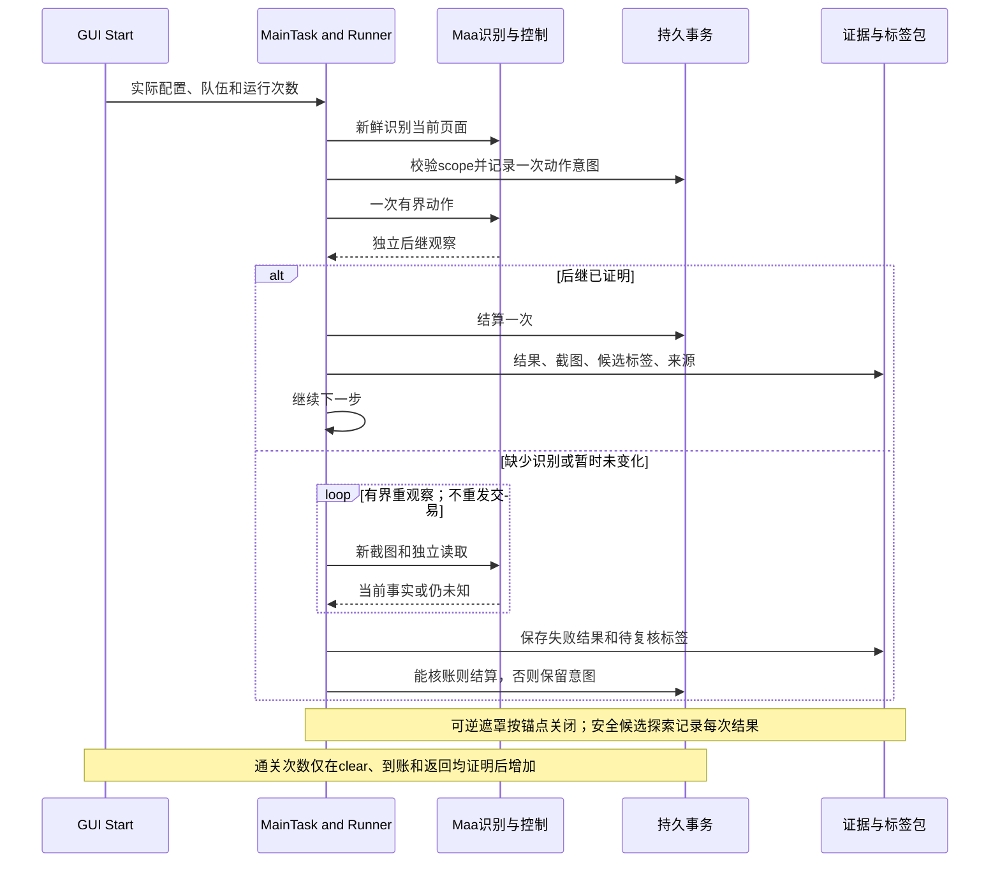
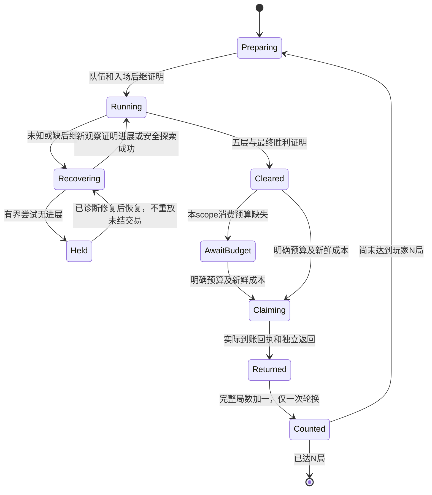
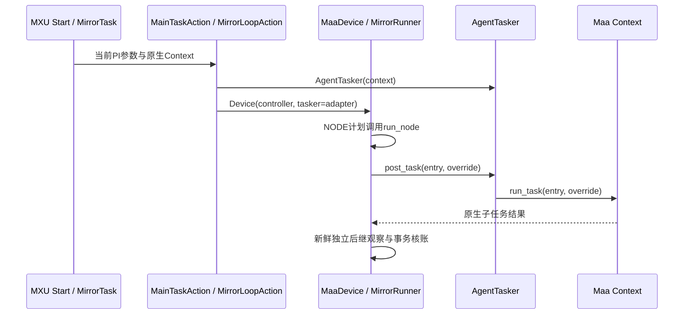
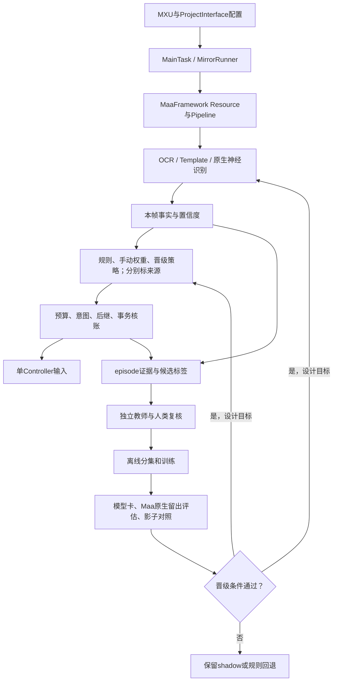
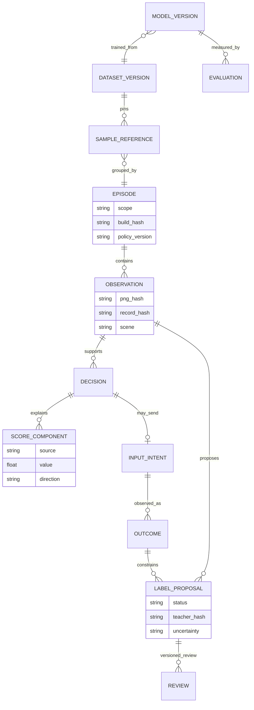
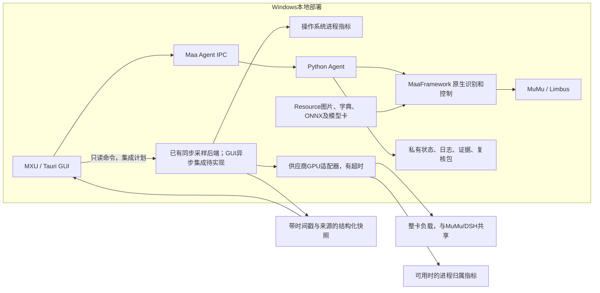
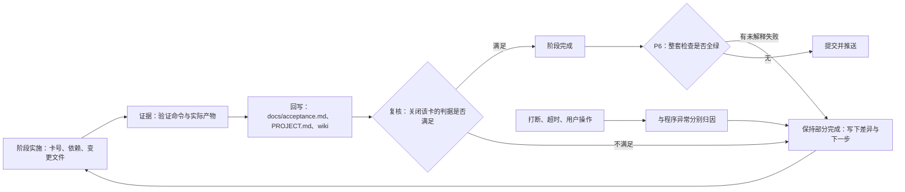

# 9 端到端修复与学习系统实施计划

[English](../en_us/9-execution-plan.md) · [← 索引](index.md)

这是 **2026-10-14 的执行规格**，不是功能完成报告。执行者 DSH；Codex 负责架构、接口、完成判据与复核。事实源仍是 `PROJECT.md`、`docs/design.md`、`docs/acceptance.md`。每张看板卡必须带本文阶段编号、依赖、变更文件、验证命令和实际证据；“开始做”“单测绿”“截图变了”不能关闭阶段。

这是可裁剪的技术计划，不增加代码锁、审批或强制全站阅读。按当前问题从[短索引](../agent-index.md)进入相关阶段，独立工作可以并行；执行者报告读过的路由与实际差异即可。

## 9.1 当前基线与工作分工

| 事项 | 已核对事实 | 尚不能声称 |
| --- | --- | --- |
| 星光余额 | 原失败帧75在 only_rec 模式低于.85；两框检测后识别与隔离恢复已有证据，见 `src/maalimbus/grace_balance_native.py:1`、`src/maalimbus/grace_transaction.py:120` | 每种界面变体都可靠，或历史购买都已到账 |
| 原生导航 | `agent/recognition.py:1410` 的 AgentTasker 通过 Context 执行子节点；源码252c0d2修复了 Device 未携带适配器的问题 | 源码修复即等于所有安装实例已经更新 |
| DSH新进展 | `build/grace-stop-page-star-graces.json` 记录成品入口3输入到星光页；运行报告明确 dungeon_complete=false。随后私有事务已有四卡选中记录，必须与该局原生帧逐笔对账 | 三次输入等于镜牢跑完；只读事务记录等于完整实机验收 |
| 设置与评分 | 定制MXU已构建安装；GitHub按钮已实际显示；评分输出在 `src/maalimbus/decision_log.py:1` | 头像/星光配置保存重开均已验收，或影子分数决定了购买 |
| 模型与占用 | `src/maalimbus/neural_shadow.py:1`、`src/maalimbus/shop_value_shadow.py:1` 区分识别、影子预测和控制策略；`src/maalimbus/resource_diagnostics.py:1` 已有采样器原型及只读CLI，GUI仍待实现验收 | 有模型文件就已经用于策略；整卡占用就是脚本占用；后端采样等于面板完成 |

同一时刻只有一个设备控制器。DSH可以并行做纯离线数据/文档/监控实现；实机输入必须串行。Codex更新本章与接口，DSH更新实际验收记录；不覆盖对方未提交修改。每次开始先重读 git、安装清单、当前运行状态与最新截图，不把上述快照当当前游戏画面。

## 9.2 依赖、看板与阶段出口

| 卡号 | 依赖 | 具体实施与产物 | 关闭该卡需要的证据 |
| --- | --- | --- | --- |
| P0 现场对账 | 无 | 核对活动局、历史星光意图、实际页面和安装版本；为未结意图选择“核账成功 / 已取消并保留历史 / 仍待证明”分支 | 同scope的前后PNG/JSON/hash、可见余额与成本、无重复购买；现场结论写回验收 |
| P1 实际启动管线 | P0 | 安装正确适配器；从GUI Start经过MainTask、MirrorLoop和原生子节点；把GUI模式/目标队伍/ledger/游戏选中标题关联 | GUI启动日志、正确Agent和资源版本、真实页面推进；不能用另一个CLI入口替代GUI点击 |
| P2 镜牢核心循环 | P1 | 地图→事件/战斗→奖励→商店→换层；部署顺序正确则复用；逐个修复后继失败并恢复 | 至少一局Hard五层实际clear；每层、每笔购买/刷新/GET与后继可追溯；脚本自己操作，人工点过不算 |
| P3 设置与可解释日志 | P1；发布依赖P2 | 四十队槽、头像点序、星光基础卡、单队/轮换、独立运行次数与步数/时间上限；候选权重和最终分 | 保存→正常关闭→重开→原生参数→真实队伍标题一致；反复启动不重复应用；实际日志含分项、决胜规则、拒绝理由 |
| P4 本地资源占用 | P1后可与P2并行 | 按9.6契约实现CPU/RAM/GPU/VRAM采样与GUI；采样独立于控制器 | 与独立只读工具同时间窗对照；缺供应商/超时/进程退出/开关关闭测试；关闭采样后无后台忙等 |
| P5 学习闭环 | P2的真实轨迹；可先离线收集 | 按9.4/9.5形成证据包、标签、复核、分集、训练、Maa原生评估、影子对照和可回滚晋级 | 独立episode隔离；模型、数据集、教师、评估hash；真正使用模型的节点日志；未晋级只能明确标为shadow |
| P6 整体验收与交付 | P2、P3、P4、P5 | 合并后的最新代码完整测试、成品自检、GUI启动及连续运行验收；核wiki/图/实现差异 | 9.7逐项勾选的证据目录、最新安装版本、无遗留未解释失败；公开发布另过许可/隐私/更新门禁 |

P0/P1已有局部证据，仍需本轮最终核验；P2–P6不能批量标完成。遇到新缺陷就在对应卡追加“触发→原始证据→假设→修改→正反例→重新运行”，不要另开无关联测试然后宣称旧失败已解决。

## 9.3 失败后的自动恢复与运行次数

未知不等于立即结束整条任务。先辨别：等待动画、识别缺失、可逆遮罩、已发送的交易、未知游戏效果、需要新资源预算。允许的已知动作通过Maa执行；未知效果可以在既有有界探索和玩家预算内选择，并把不确定性记入评分。**读不清购买结果时重读核账，而不是重复购买。**

每种动作明确次数/时间/无进展预算；星光购买已有最多3次只读重观察，其他动作不能照搬该数值当无限重试。候选尝试必须记录动作区域、前后画面、是否改变目标页面。达到该动作的上限才暂停该分支；能独立进行的采样、离线训练或缺陷修复继续。弹窗关闭不能变成未经确认的付款。

运行次数是玩家设定的完整局数，必须与“单次运行步数上限”和时间上限分离。“沿用保存值”只读取保存配置，不能从部署人数、队伍数量或循环步数推导局数。重复N局需要逐scope消费预算；预算不够时保留已clear待领奖状态，不能冒用历史6模块授权。

**已落地（2026-10-14）**：玩家可保存的完整局数是 `Settings.run_count`（`src/maalimbus/runner.py:158`）与 PI 选项 `mirror_run_count`（`assets/interface.json:68144`），由管线节点 `MirrorRunCount`（`assets/resource/base/pipeline/mirror.json:5579`）承载并在 `src/maalimbus/mirror_task_options.py:9` 读取。达标判定只认账本增量：`MirrorRunner._run_count_reached`（`src/maalimbus/runner.py:1393`）用 `RunLedger.completed_runs` 减去本次启动基线，而该计数只在 `entry_returned` 后 +1（`src/maalimbus/storage.py:287`），账本对缺少五层、胜利或已领奖的返回一律拒绝。达到玩家N局时窗口以 `run_count_reached` 停止（`src/maalimbus/runner.py:2807`），步骤记录与 `summary()` 带上 `verified_runs={target,completed}`（`src/maalimbus/runner.py:3196`），日志打印 `verified runs: x of y this launch (z in the ledger)`（`src/maalimbus/event_log.py:149`）。**尚未实测**：本窗口还没打完一局（实测时仍在楼层1），该停止路径目前只有单测覆盖。

### 9.3.1 GUI Start到原生子节点的实际适配链

源码已有的链路是 `MainTaskAction.run → MirrorLoopAction.run → MaaDevice → MirrorRunner → run_node → AgentTasker.post_task → Context.run_task`。用 `python tools/wiki_route.py startup --limit 1` 获取这些符号的当前行号，不依赖图内静态行号。`MirrorLoopAction.run` 必须把 `AgentTasker(context)` 交给Device；Runner从Device取得tasker，NODE计划才能执行原生Pipeline。缺少适配器正是历史报错 `a node plan needs a Maa tasker` 的原因。

CustomAction已经占用框架worker，不能在里面改回 `context.tasker.post_task` 并等待自身队列；`AgentTasker` 的源码说明了这一点。此图解释已有实现，**本身不等于GUI实机启动或Hard五层通过**；验证仍要绑定实际安装版本、GUI选择和后继帧。观察重置仅针对只读节点hit count，不得清空输入节点或交易记录。

**已落地（2026-10-14）**：用 `8ca1ac1` 重装的版本（其父提交 `d574a26` 是节点面板身份修复）以真实GUI启动（`dist/MaaLimbus/MaaLimbus.exe`，进程34940），并在本地07:22用真实指针输入按下它自己的开始按钮。该局 `dist/MaaLimbus/evidence/runtime/pi-20261014-072228` 的首帧场景是 `NODE_PANEL`——正是打包CLI局在 `d574a26` 之前无法识别而停窗的状态——随后走通 `CUTSCENE -> EVENT_CHOICE -> EVENT_RESULT -> GIFT_GET -> PRE_BATTLE_TEAM -> BATTLE_HUD -> MAP -> NODE_PANEL -> GIFT_GET`，因此上面这条链路现在是实机观察到的，而不再只是接线。仍未由此证明：完整五层一周目，以及保存局数的停止路径。

**实机走到并被修（2026-10-14）**：同一局继续跑到254帧/71次输入——`BATTLE_HUD` 20（胜率分配与开始）、`MAP` 8次节点点击、`SHOP` 7含4次 `SHOP_PURCHASE`、`GIFT_GET` 6、`NODE_PANEL` 5（全部走 `panel_enter_is_the_only_forward_input`，即身份修复在实机被使用）、`GIFT_PICK` 4、`REWARD_CARD` 2——随后停在 `floor_gift_commit_receipt_not_proven`：它按下的 `Select 2/2` 得到的是印着 `Dark Vestige` 的提示窗，这个名字既不在选礼页的四个候选里，也不在本局点击勾选的两张卡里（`frame-0252`），而原来的收据规则要求提示窗必须报出被选名字。现在规则把两件事分开：提示窗页面加上它自己的名牌即可证明这次按键，收据同时保留两个名字——它回应的那张卡与设备实际印出的名字（`src/maalimbus/floor_gift_transaction.py` 的 `FloorGiftTransaction.notice_matches_a_pick` 与 `receipt_intent(..., on_notice_page=True)`，`src/maalimbus/runner.py` 的门控与带标记的说明，`tests/test_gift_receipt_settling.py` 用保留帧 `evidence/runtime/gui-20261014-072228/frame-0254.json` 固定）。选不出处的名字在非提示窗页面仍然拒收，因为中段读数是宽松读取。该修复目前只有单元测试，尚未再次实机跑通整条链路。

## 9.4 学习与策略的架构边界

下图中“晋级后的推理/策略”是**设计目标**，不能读成当前生产已启用。已有基础分别在 `src/maalimbus/unknown_exploration.py:1`、`src/maalimbus/semantic_labels.py:1`、`src/maalimbus/learning_dataset.py:1`、`src/maalimbus/neural_shadow.py:1`、`src/maalimbus/shop_learning.py:1`、`src/maalimbus/shop_value_shadow.py:1`。MaaFramework提供识别/控制/Pipeline；训练、标签复核和策略晋级是本项目扩展，不称作Maa自带训练器。

首先列清当前哪些节点真正调用模型、哪些只写proposal、哪些为shadow/off，附模型hash和实际日志。识别和购买价值分别验收：买成功只证明交易，不证明藏品强度；重绘或赢一场不证明选择最优。商店手动优先级、保留金币、刷新上限、允许/禁止名单始终有效；模型不能扩大预算。

感知模型至少按episode隔离训练/验证/测试；同一局连续帧不能同时充当训练与独立验收。模型晋级前固定类别、阈值、误识别指标和回退条件，并在新episode跑原生Maa评估。购买策略先做历史回放和影子排序，按实际效果指标与规则基线比较；证据不足就保持影子，不得把“模型加载了”写成“学习控制已应用”。

## 9.5 标签、评分与证据的数据模型

这是**逻辑模型**，不是声称所有实体已是一张数据库表。已有JSON/JSONL产物要做字段映射；缺字段先在规格写明，再实现。原图、OCR事实、动作结果、推断标签、人工裁决分开保存；标签更正保留版本。运行日志只展示真实参与决策的权重、各项加扣分、最终分、决胜规则、候选被排除的原因以及模型是否参与。

复核包至少含manifest、前后截图/OCR、动作意图与结果、评分轨迹、标签proposal与review状态；引用采用hash而非只靠可被覆盖的文件名。失败样本也收集，但“未知”不是负例，“无进展”不一定是按钮错误。模型训练资格由证据和复核状态决定；不能让自己的模型预测循环充当独立教师。

## 9.6 资源监控部署与接口

监控不创建控制器，不抢截图，不阻塞输入。采样关闭时停止后台任务；建议低频起步，具体间隔写入设置并测开销。读取总GPU、VRAM、脚本进程CPU/RAM；若提供进程GPU，必须写明供应商与归属算法。缺值用null和reason，不能显示为0。

当前源码边界：`resource_diagnostics.sample` 已提供进程CPU/RAM和整卡GPU/VRAM采样，`NvidiaSmiProvider` 有固定参数和超时；`tools/resource_diagnostics.py` 是只读CLI。CPU以单核忙碌为100%，多核可超过100%。进程GPU只有可注入接口，默认 `unsupported / no_per_process_gpu_provider`，不是已实现归属。GUI异步调用、开关与实机同窗对照仍待验收。查询 `gpu` 路由查看当前符号和窄测试；结构检查通过不能证明这些行为已交付。

接口沿用[诊断契约](../../plan-20261014-recovery-diagnostics.md)：version、sampled_at、interval_ms，进程role/pid/cpu_percent/rss_bytes/status，GPU provider/device_name/util_percent/vram_used_bytes/vram_total_bytes/status；整体和进程指标分开。明确CPU百分比是否按逻辑核归一化。不得采集或公开GPU UUID、用户名、机器ID或原始命令输出；不改系统权限。

P4验收包括同窗对照、非NVIDIA/无工具、超时、Agent退出、多GPU、开关开闭和游戏运行时采样。若运行中推理有GPU负载而面板无法归属，应显示“整卡可见、进程不可用”，不能伪造脚本占用。工具适配器具体实现由DSH选定并记入本节，架构边界不得改变。

## 9.7 验收矩阵与回写纪律

- [ ] P0：原卡4意图有原生证据支持的明确归宿，成功/取消分别记录，没有重买或凭空到账。
- [ ] P1：当前成品GUI点一次开始能进入正确管线，原生导航节点通过；证据绑定安装版本。
- [ ] P2：脚本实际完成Hard五层；部署核对正确时不清空重编；每层奖励、商店购买/刷新均结算可追溯。
- [ ] P3：Team1、Team2和Team22的指定体系/顺序/EGO配置逐项核对；离屏队伍滚动按新鲜行与选中标题验证；单队与轮换模式不串用。未实现的EGO装备不得勾选通过。
- [ ] P3：头像/星光卡保存重开和参数应用一致；运行N局与步数/时间上限分开；日志展示候选、权重/分项、最终分、来源和理由。
- [ ] P4：资源采样真实可对照、缺失正确显示、开关有效，运行不抢控制器。
- [ ] P5：未知尝试、成功/失败标签包、人类复核、episode分集、原生模型评估、实际推理和策略晋级各有独立证据。
- [ ] P6：最新合并代码完整测试无未解释失败；真实GUI→五层→到账→返回→一次轮换/再次入场，并核明确预算。
- [ ] P6：双语wiki和局部图与实现/证据一致；新增计划组件已重新标注真实状态；隐私与发布门禁分别核验。

每卡结束按“计划要求→实际代码/配置→验证命令→实际产物→差异→处置”回写，不只增加一段进度描述。未达到条件则保持部分完成，带下一步。打断/超时/用户操作造成的运行结束与程序异常分别归因；禁止把旧局截图当新局实证。最新状态放验收与PROJECT，本文保留稳定完成标准。

## 未验收 / 待核实

本章新增的是可执行计划及设计视图，**不代表P0–P6已交付**。GPU面板、模型晋级、显式连续局数、Team22体系EGO和整轮闭环仍按各卡实际产物判断。DSH正在运行的任务只观察其结果；不得为补计划重启控制器或替换活跃应用。
